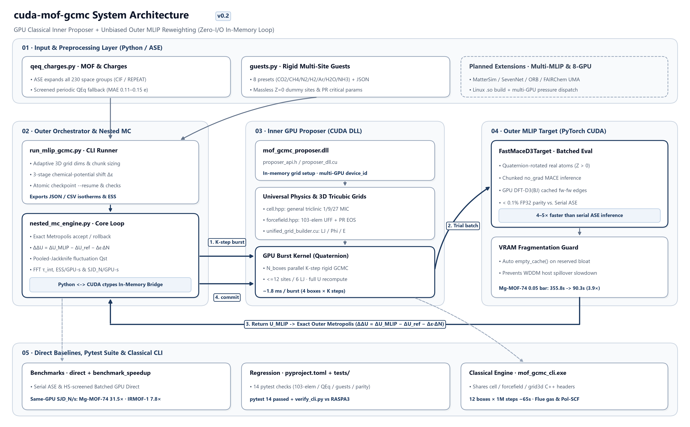

**English** | [简体中文](README.zh-CN.md)

# `cuda-mof-gcmc`


A GPU-native simulation engine for gas adsorption in **arbitrary rigid Metal–Organic Frameworks (MOFs)** on **NVIDIA RTX 5070** (`sm_120`). It combines **(1) a verified CUDA classical and many-body self-consistent polarizable (`Pol-SCF`) GCMC solver** with **(2) a zero-I/O CUDA-to-PyTorch Nested Monte Carlo (Nested MC) engine** that uses a general 3D quaternion GPU proposer (`103`-element UFF + periodic QEq, or `Mercado 2016` DFT-FF) as an inner Markov chain for Machine-Learning Interatomic Potentials (`MACE + TorchDFTD3`).

---

## System Architecture



1. **Universal MOF & Multi-Site Guest Preprocessing** ([`scripts/qeq_charges.py`](scripts/qeq_charges.py), [`scripts/guests.py`](scripts/guests.py)): ASE expands any of the `230` space groups while preserving asymmetric-unit charges/labels (`spacegroup_kinds`), with a screened periodic Ewald QEq fallback (`eps_eff = 1.50`) for uncharged frameworks; rigid guests up to `12` sites (including massless `Z = 0` dummy charge sites) use unit-quaternion 3D rotations and generic Peng–Robinson EOS fugacities.
2. **Inner GPU Classical Burst (`K`-step proposer)** ([`src/proposer_dll.cu`](src/proposer_dll.cu), [`include/cell.hpp`](include/cell.hpp), [`include/forcefield.hpp`](include/forcefield.hpp)): Runs $K$ reversible rigid-body GCMC steps across `N_boxes` replicas in `~1.8 ms/burst`, screening hard-core overlaps before touching PyTorch.
3. **In-Memory MLIP Scoring & Exact Unbiased Reweighting** ([`scripts/nested_mc_engine.py`](scripts/nested_mc_engine.py)): Only the $K$-step endpoint coordinates pass via `ctypes` pointers to batched `FastMaceD3Target` (chunked `no_grad` MACE + cached framework-edge GPU DFT-D3(BJ) + VRAM fragmentation guard). Pre-calibrated 3-stage bias $\Delta\varepsilon$ balances insertions and deletions, while the outer Metropolis criterion cancels $\Delta\varepsilon\,\Delta N$ and rolls back rejected bursts—preserving the **exact target MLIP grand-canonical ensemble**.

---

## Head-to-Head Sampling Speedup vs. Direct MLIP-GCMC


Evaluated on the **same NVIDIA RTX 5070** starting from identical equilibrated MLIP configurations against two unbiased `Direct MLIP-GCMC` baselines ([`scripts/direct_mlip_gcmc.py`](scripts/direct_mlip_gcmc.py))—a standard **Serial ASE** baseline and a stronger **hard-sphere-screened (`r_hs = 1.20 Å`) Batched GPU** baseline sharing `FastMaceD3Target` ([`scripts/benchmark_speedup.py`](scripts/benchmark_speedup.py)):

| System (298 K) | Method | `Uptake (mmol/g)` | `Outer / Move Acc` | `ESS_N / GPU-s` | `SJD_N / GPU-s` | Speedup vs. Serial ASE (`SJD_N` / `ESS_N`) | Speedup vs. Batched GPU (`SJD_N` / `ESS_N`) |
| :--- | :--- | :---: | :---: | :---: | :---: | :---: | :---: |
| **`Mg-MOF-74 + CO₂`** (`0.05 bar`, `r2SCAN+D3`) | `Direct Serial ASE` (`r_hs=1.20 Å`) | `10.14` | `20.0%` | `0.197` | `0.080` | `1.0×` / `1.0×` | — |
| | `Direct Batched GPU` (`4 boxes, r_hs=1.20 Å`) | `9.79 ± 0.27` | `17.5%` | `0.337` | `0.314` | `3.9×` / `1.7×` | `1.0×` / `1.0×` |
| | `Nested GPU (Mercado K=25)` | `9.94 ± 0.40` | `51.6%` | **`0.725`** | `1.735` | `21.6×` / **`3.7×`** | `5.5×` / **`2.1×`** |
| | `Nested GPU (Mercado K=50)` | `9.98 ± 0.32` | `33.3%` | `0.681` | **`2.534`** | **`31.5×`** / `3.5×` | **`8.1×`** / `2.0×` |
| **`IRMOF-1 + CH₄`** (`5.0 bar`, `MACE-MP0+D3`) | `Direct Serial ASE` (`r_hs=1.20 Å`) | `9.04` | `47.0%` | `0.077` | `0.903` | `1.0×` / `1.0×` | — |
| | `Direct Batched GPU` (`4 boxes, r_hs=1.20 Å`) | `8.19 ± 0.15` | `45.6%` | `0.301` | `3.176` | `3.5×` / `3.9×` | `1.0×` / `1.0×` |
| | `Nested GPU (Generic UFF+QEq K=25)` | `8.43 ± 0.32` | `28.1%` | `0.300` | **`7.063`** | **`7.8×`** / `3.9×` | **`2.2×`** / `1.0×` |
| | `Nested GPU (Generic UFF+QEq K=50)` | `8.70 ± 0.08` | `17.0%` | **`0.322`** | `6.833` | `7.6×` / **`4.2×`** | **`2.2×`** / `1.1×` |

> **Physical Diagnostics**: (1) On `Mg-MOF-74`, uncharged UFF starves outer acceptance (`6.2%`), while screened periodic QEq lifts general `UFF` outer acceptance to `38.8%` (`5.45 ± 0.30 mmol/g`); accessing the `~2.25 Å` open-`Mg²⁺` chemisorption well (`9.2–10.0 mmol/g`) still favors softer core potentials such as `Mercado 2016`. (2) PyTorch CUDA caching-allocator cleanup (`empty_cache()` on `memory_reserved` bloat) reduced full `Mg-MOF-74` `0.05 bar` production wall time from `355.8 s` to **`90.3 s` (`3.9×`)** on 12 GB VRAM.

---

## How This Differs from `RASPA3` and `gRASPA`

| Aspect | CPU `RASPA3` / GPU `gRASPA` | `cuda-mof-gcmc` |
| :--- | :--- | :--- |
| **Primary Role** | Full-featured classical GCMC ecosystem (broad force fields, flexible CBMC molecules, high-throughput screening) | **GPU-native many-body polarization (`Pol-SCF`)** + **zero-I/O Nested MLIP-GCMC proposer architecture** |
| **Polarization** | Standard fixed point charges (LJ + Ewald) | 3D tricubic framework E-fields (`Pol-3Site`) + block-collective FP64 Applequist–Thole **many-body `Pol-SCF`** |
| **MLIP Sampling** | No built-in zero-I/O CUDA proposer DLL for PyTorch MLIP reweighting | Native C ABI ([`proposer_api.h`](include/proposer_api.h)) coupled in memory with `FastMaceD3Target`, 3-stage $\Delta\mu_{\text{ref}}$, Pooled-Jackknife $Q_{\text{st}}$, and `ESS` diagnostics |
| **Benchmark Scope** | Benchmarked directly against CPU **`RASPA3 3.0.29`** (not same-GPU vs. `gRASPA`); for standard classical screening, use `gRASPA` | Tuned on single RTX 5070 for arbitrary rigid MOFs + rigid small guests (`CO₂`, `CH₄`, `N₂`, `H₂`, `Ar`, `H₂O`, `NH₃`) |

---

## Modules & Maturity

| Module | What It Does | Status |
| :--- | :--- | :---: |
| **Tricubic Classical CUDA GCMC** ([`src/main_cli.cu`](src/main_cli.cu)) | `0.10 Å` $O(h^4)$ 3D tricubic grids, `UFF` (`103` elements) / `Mercado 2016`, arbitrary triclinic MIC, `Identity Swap`, PR EOS | **Verified** (vs. `RASPA3 3.0.29` `≤ 0.54σ`) |
| **Polarizable & `Pol-SCF` Solvers** | Framework `Pol-COM` / `Pol-3Site` + block-collective FP64 many-body Thole `Pol-SCF` | **Verified** (`1.83e-08 K` vs. `36×36` exact inversion) |
| **Universal Nested MLIP-GCMC Engine** ([`src/proposer_dll.cu`](src/proposer_dll.cu), [`scripts/nested_mc_engine.py`](scripts/nested_mc_engine.py)) | 3D quaternion GPU proposer + `qeq_charges.py` + `guests.py` + batched `FastMaceD3Target` + VRAM guard | **Verified** (`pytest` `14 passed`; `Pol3->Merc` `z = 1.15`, `0.000 K` quat parity) |
| **Direct Baselines & Multi-MLIP Roadmap** ([`scripts/benchmark_speedup.py`](scripts/benchmark_speedup.py)) | Same-GPU `ESS / GPU-s` & `SJD_N / GPU-s` benchmarks vs. Direct MLIP-GCMC (`Mg-MOF-74`, `IRMOF-1`) | **Active** (multi-MLIP plugins & Linux 8-GPU queued next) |

---

## Verified Classical & Parity Benchmarks


- **`RASPA3 3.0.29` Parity (`Mg-MOF-74`, `298 K`, UFF+REPEAT)**: Matches single-core RASPA3 Tricubic Grid within **`+2.32% / +1.39% / -0.41%`** at `0.15 / 1.0 / 5.0 bar` ($\Delta Q_{\text{st}} \le 0.54\ \text{kJ/mol}$), with full FP64 recompute keeping max drift at **`≤ 1.02e-08 K`** over `64M` steps.
- **Classical GPU Throughput**: **`598,669 MC-steps/s`** (`153.2×` vs. single-core CPU `RASPA3` Tricubic Grid `3,908/s`; `492.6×` vs. Exact Ewald `1,215/s`); builds `256×256×72` 3D grids in `3.03 s` (`38.9×`).
- **`Pol-SCF` Exact Parity**: Matches Python exact `36×36` matrix inversion in `--test-scf` to **`1.83e-08 K`** and **`1.13e-11 e·Å`**.
- **Universal Proposer & QEq Parity**: `Pol-3Site -> Mercado` reproduces direct GPU GCMC within **`z = 1.15`** (`|ΔQst| = 0.43 kJ/mol`, `0.000e+00 K` energy error); `SPC/E H₂O` quaternion `eval_energy_quat` matches to `0.000e+00 K`; periodic QEq matches `REPEAT` / `Cu-BTC` DFT charges with `MAE = 0.153 e` / `0.110 e`.

> **Scope & Limitations**: Supports **rigid MOF frameworks and rigid multi-site guests** (`≤ 12` sites, `≤ 6` LJ types; no flexible CBMC chains or framework breathing). Physical MLIP accuracy depends on the underlying foundation model and dispersion treatment—for instance, `mace-matpes-r2scan-0` severely overbinds `CH₄` in `IRMOF-1` (`-30.6` to `-36.4 kJ/mol`), whereas `MACE-MP-0 medium + D3(pbe)` yields `-12.03 kJ/mol`. See [MLIP Nested MC Notes](docs/MLIP_NESTED_MC_NOTES.md).

---

## Quickstart

### Prerequisites
- Windows 10/11 + NVIDIA CUDA Toolkit (`sm_120`, RTX 5070) + MSVC (`Visual Studio 2022` Build Tools)
- Optional (for MLIP Nested MC & pytest): Python 3.11+ (`pip install -r requirements.txt` after CUDA PyTorch; see [requirements.txt](requirements.txt) and [pyproject.toml](pyproject.toml))

### Build & Run

```powershell
# Default core targets (mof_gcmc_cli.exe + mof_gcmc_proposer.dll); use `build.bat all` for archived legacy binaries
cmd /c build.bat

# Classical / Polarizable unified CLI presets & regression
.\build\mof_gcmc_cli.exe --test-scf
.\build\mof_gcmc_cli.exe --config configs\mg_mof74_co2_298K_uff.json
.\build\mof_gcmc_cli.exe --config configs\mg_mof74_fluegas_298K_pol3site.json
.\.venv-mlip\Scripts\python.exe -u scripts\verify_cli.py

# Pytest regression suite (13 classical + 1 MLIP parity check)
.\.venv-mlip\Scripts\python.exe -m pytest -v

# Universal MLIP Nested MC examples (CO2 in Mg-MOF-74 / CH4 in IRMOF-1 with auto QEq)
.\.venv-mlip\Scripts\python.exe -u scripts\run_mlip_gcmc.py `
  --cif data\MgMOF-74.cif --pressures 0.01 0.05 0.15 `
  --guest co2 --proposer mercado --model mace-matpes-r2scan-0 --dispersion on --xc r2scan `
  --out-json build\mg_r2scan.json --out-csv build\mg_r2scan.csv

.\.venv-mlip\Scripts\python.exe -u scripts\run_mlip_gcmc.py `
  --cif data\IRMOF-1.cif --supercell 1 1 1 --pressures 5.0 `
  --guest ch4 --proposer uff --charge-mode auto --model medium --dispersion on --xc pbe `
  --out-json build\irmof1_ch4.json

# Head-to-head ESS / GPU-s & SJD_N / GPU-s speedup benchmark vs. Direct MLIP-GCMC
.\.venv-mlip\Scripts\python.exe -u scripts\benchmark_speedup.py
```

---

## Documentation & Repository Layout

- [**Technical Report (Preprint Draft)**](docs/TECHNICAL_REPORT.md) — Unified methods, `RASPA3` / `Pol-SCF` / Nested MC verification, foundation-model diagnostics & 4-MOF NIST ISODB benchmarks.
- [**Classical & Polarizable Validation (Steps 1–5)**](docs/CLASSICAL_VALIDATION.md) — Crystal geometry, tricubic MAE, RASPA3 parity tables, co-adsorption selectivity & `Pol-SCF` checks.
- [**MLIP Nested MC: Verified Mechanics & WIP Notes**](docs/MLIP_NESTED_MC_NOTES.md) — Reweighting null-bias proofs, $\Delta\mu_{\text{ref}}$ calibration, batched MACE speedup, foundation-model diagnostics & open scientific issues.

```text
cuda-mof-gcmc/
├── pyproject.toml  # Package metadata & pytest markers (mlip, slow)
├── configs/        # JSON presets for mof_gcmc_cli.exe (UFF, Mercado 2016, 313K PSA, Flue Gas, Pol-SCF)
├── data/           # Crystal CIFs (Mg-MOF-74, Ni-MOF-74, Cu-BTC, IRMOF-1), Mercado FF & NIST ISODB tables
├── docs/           # Detailed validation benchmarks, equations & WIP research notes (EN / ZH)
├── include/        # C++17 / CUDA headers: triclinic MIC geometry, 103-elem UFF + PR, 3D grids & proposer C ABI
├── src/            # Active CUDA kernels & drivers (mof_gcmc_cli, mof_gcmc_proposer.dll) + src/legacy/ (v1–v3)
├── scripts/        # MLIP Nested MC engine, QEq, rigid guests, Direct MLIP baselines & benchmark/plot scripts
├── tests/          # Automated pytest suite (103-elem, QEq, quaternion guests, Jackknife/ESS, Direct parity)
└── assets/         # Architecture diagrams & benchmark/verification plots (300 DPI)
```
