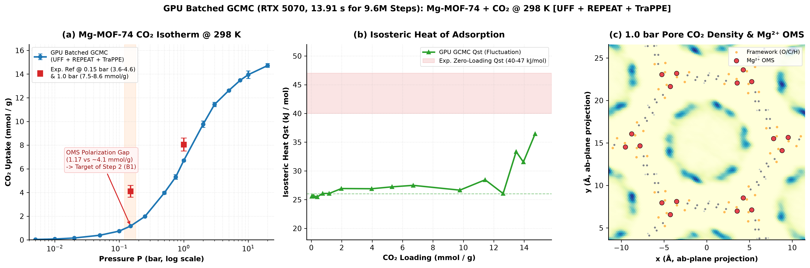

**English** | [简体中文](README.zh-CN.md)

# `cuda-mof-gcmc`: GPU-Accelerated Batched GCMC for Open-Metal-Site MOFs

A CUDA simulation engine for gas adsorption in Metal–Organic Frameworks (MOFs) on **NVIDIA GeForce RTX 5070** (`sm_120`), built specifically around open-metal-site (OMS) adsorption physics such as **$\text{CO}_2$ capture in Mg-MOF-74 ($\text{Mg}_2(\text{dobdc})$)**.



---

## Roadmap (Three-Step Plan)

- **[Done] Step 1 — GPU Rigid 3D Framework Grid + Batched GCMC Baseline (UFF + REPEAT + TraPPE)**
  - Precomputes 6 periodic 3D unit-cell grids (`U_lj_C`, `U_lj_O`, `Phi_elec`, `Ex`, `Ey`, `Ez`) via exact 12-6 LJ + 3D Ewald summation on GPU, runs 32 independent pressure/replica boxes concurrently (`128` threads/box, shared-memory molecules, exact hexagonal MIC, Marsaglia/Rodrigues rotation, DSF electrostatics, Peng–Robinson fugacity), and verifies detailed balance + replica convergence.
- **[Next] Step 2 (Branch B1) — Explicit $\text{Mg}^{2+}$ Electric-Field Polarization**
  - Plugs directly into the precomputed `(Ex, Ey, Ez)` grids using anisotropic $\text{CO}_2$ polarizability ($\alpha_\parallel, \alpha_\perp$) and self-consistent guest-induced dipole / OMS short-range parameters to capture the steep low-pressure uptake at $\text{Mg}^{2+}$ open metal sites.
- **[Planned] Step 3 — Competitive Multi-Component Co-Adsorption**
  - Extends the batched GPU engine with identity-swap moves for $\text{CO}_2/\text{N}_2$, $\text{CO}_2/\text{CH}_4$, and $\text{CO}_2/\text{H}_2\text{O}$ mixtures.

---

## Step 1 Physical & Numerical Verification (RTX 5070)

### 1. Crystal Structure & Symmetry ([`data/MgMOF-74.cif`](data/MgMOF-74.cif))
- **Unit Cell (`R -3`, hexagonal setting)**: $a = b = 26.136\ \text{\AA},\ c = 6.942\ \text{\AA},\ \alpha = \beta = 90^\circ,\ \gamma = 120^\circ$
- **Expanded Unit Cell (`1x1x1`)**: `162` atoms (`18 Mg`, `54 O`, `72 C`, `18 H`), REPEAT charge sum = `0.000000 e`, molar mass = `2184.372 g/mol`
- **Minimum Bond Lengths**: `Mg–O = 1.948 Å`, `C–O = 1.337 Å`, `C–C = 1.420 Å`, `C–H = 1.123 Å`
- **GCMC Supercell (`1x1x4`)**: $V = 16,426.82\ \text{\AA}^3$, mass = `8737.488 g/mol`, minimum perpendicular width = `22.634 Å > 2 * 11.0 Å`
- **Exact Hexagonal MIC**: `0 / 10,000` mismatches against `3x3x3` brute-force search (verified in both C++ and Python)

### 2. GPU 3D Grid Precomputation (`128 x 128 x 36`)
- **Build Time**: **`356.79 ms`** for all 6 grids (`U_lj_C`, `U_lj_O`, `Phi_elec`, `Ex`, `Ey`, `Ez`, Ewald $\alpha = 0.30\ \text{\AA}^{-1}, r_{\text{cut}} = 11.0\ \text{\AA}$)
- **Independent Verification** (vs. direct Ewald $\alpha_{\text{ref}} = 0.25\ \text{\AA}^{-1}$ across `1,000` pore points):
  - `MAE(U_lj_C) = 3.491 K`, `MAE(U_lj_O) = 10.482 K`, `MAE(Phi) = 4.4038 K/e`

### 3. Batched GCMC Performance & 298 K $\text{CO}_2$ Isotherm
- **Configuration**: `32` boxes (`16` pressures `0.005–20.0 bar` × `2` independent replicas), `100k` equilibration + `200k` production steps/box (**`9.6M` total MC steps**)
- **Runtime**: **`13.906 s`** (`0.69 M MC-steps/sec`)
- **Key Isotherm Results (UFF + REPEAT + TraPPE baseline)**:
  - `0.150 bar` ($\phi = 0.9992$): **`1.1724 ± 0.0301 mmol/g`**, $Q_{\text{st}} = \mathbf{26.07\ \text{kJ/mol}}$ (`acc_ins = acc_del = 0.09`)
  - `1.000 bar` ($\phi = 0.9945$): **`6.7019 ± 0.0769 mmol/g`**, $Q_{\text{st}} = \mathbf{27.49\ \text{kJ/mol}}$ (`acc_ins = acc_del = 0.05`)
  - `20.000 bar` ($\phi = 0.8934$): **`14.7214 ± 0.1619 mmol/g`**, $Q_{\text{st}} = \mathbf{36.46\ \text{kJ/mol}}$
- **Physical Diagnostic**: Just as established in the MOF literature, generic non-polarizable UFF+REPEAT underpredicts the 298 K, `0.15 bar` uptake (`1.17` vs experimental `~3.6–4.6 mmol/g`) and zero-loading heat (`~25.6` vs `~40–47 kJ/mol`), directly motivating **Step 2 (Branch B1)** polarization.

---

## Build & Run

```powershell
# Compile for RTX 5070 (sm_120)
cmd /c build.bat

# Run Step 1 batched GCMC (~14 s) -> exports CSVs to build/
.\build\mof_gcmc.exe

# Run independent Python checks (Hex MIC, Peng-Robinson EOS) & plot 300 DPI figure
uv run --with matplotlib --with numpy python scripts\verify_physics.py
```

---

## Repository Layout

```text
cuda-mof-gcmc/
├── data/
│   └── MgMOF-74.cif              # Official RASPA2 R-3 Mg-MOF-74 crystal structure
├── include/
│   ├── cell.hpp                  # Hexagonal/triclinic cell transform & exact 5-candidate MIC
│   ├── forcefield.hpp            # UFF, REPEAT, TraPPE CO2 & Peng-Robinson EOS fugacity
│   ├── grid3d.hpp                # Periodic 3D grid view (U_lj, Phi, Ex, Ey, Ez) & trilinear lookup
│   ├── cif_loader.hpp            # CIF symmetry expander & geometry checker interface
│   └── gcmc_gpu.hpp              # Grid builder & batched GCMC host API
├── src/
│   ├── cif_loader.cpp            # Symmetry expansion -> 162 atoms & bond/charge validation
│   ├── grid_builder.cu           # GPU 3D LJ + Ewald potential & E-field precomputation
│   ├── gcmc_kernel.cu            # Multi-box GPU GCMC (128 threads/box, DSF + detailed balance)
│   └── main.cu                   # Driver, unit checks, 32-box isotherm & CSV export
├── scripts/
│   └── verify_physics.py         # Independent MIC/PR checks & 300 DPI visualization
├── assets/
│   └── step1_mof74_co2_298K.png  # 298 K isotherm, Qst, and 1 bar hexagonal pore density
├── build.bat                     # VS2019 + nvcc (sm_120) build script
├── README.md                     # English documentation
└── README.zh-CN.md               # Chinese documentation
```
