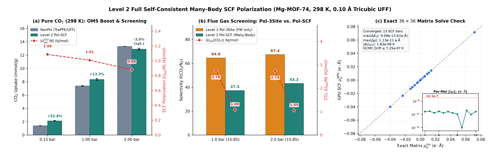

**English** | [简体中文](README.zh-CN.md)

# `cuda-mof-gcmc`: GPU-Accelerated Batched GCMC for Open-Metal-Site MOFs


A CUDA simulation engine for gas adsorption in Metal–Organic Frameworks (MOFs) on **NVIDIA GeForce RTX 5070** (`sm_120`), built around open-metal-site (OMS) adsorption physics such as **CO₂ capture in Mg-MOF-74 (Mg₂(dobdc))** — evolving from a verified `153×` GPU classical/polarizable GCMC solver into a **Hybrid GPU-GCMC + Machine-Learning Interatomic Potential (MLIP) Nested Monte Carlo** architecture (`MACE-MP-0 + D3`).


---

## Key Highlights

- **Verified Against `RASPA3 (3.0.29)` Within `0.54σ`**: On `Mg-MOF-74` (`298 K`, UFF+REPEAT), the `0.10 Å` `O(h⁴)` 3D tricubic GPU kernel matches native RASPA3 Tricubic Grid within **`+2.32% / +1.39% / -0.41%`** (`0.15 / 1.0 / 5.0 bar`, $\Delta Q_{\text{st}} \le 0.54\ \text{kJ/mol}$) and cuts radial `Mg–O` interpolation MAE by **`290.3×`** (`190.46 K → 0.656 K`; Mercado 2016 `0.092 K`).
- **Two-Order-of-Magnitude GPU Speedup (RTX 5070)**: Sustains **`598,669 MC-steps/s`** (`64M` steps in `106.9 s`) — **`153.2×`** faster than single-core RASPA3 Tricubic Grid (`3,908 steps/s`), **`492.6×`** faster than Exact Ewald (`1,215 steps/s`), and **`38.9×`** faster in 3D grid construction (`3.03 s` vs. `117.98 s`).
- **Level 2 Full Many-Body SCF Polarization on GPU**: Block-collective shared-memory Applequist-Thole SCF solver (`polarization: "scf"`) agrees with exact `36×36` Python matrix inversion to **`1.83e-08 K`** and **`1.13e-11 e·Å`**, capturing many-body mutual depolarization in `15:85` CO₂/N₂ flue gas (`S = 37.3 / 43.2` vs. `64.6 / 67.4` for unscreened framework-only `Pol-3Site`).
- **Hybrid GPU-GCMC + MLIP Nested MC (`Phase 1–2` Live)**: Zero-I/O CUDA proposer DLL ([`build\mof_gcmc_proposer.dll`](src/proposer_dll.cu)) + PyTorch `MACE-MP-0 (Medium) + D3` outer reweighting passes classical-to-classical Null-Bias (`Pol-3Site -> Mercado 2016`: `5.9668 ± 0.2072` vs. Direct `6.0230 ± 0.0406 mmol/g`, `z = 0.27σ`, `|ΔQ_st| = 1.23 kJ/mol`, `0.000e+00 K` energy consistency) and executes live `MACE-MP-0 + D3` Nested MC (`56.4%` outer acceptance, `5,400` GPU inner steps across `451` MACE calls in `84.7 s` on RTX 5070).
- **Zero-Drift Statistical Mechanics**: Full double-precision shared-memory state with periodic full-box energy recomputation keeps maximum energy drift at **`2.0e-09 – 1.0e-08 K`** (`NonPol / Mercado / Pol-3Site`) and **`≤ 7.25e-07 K`** (`Pol-SCF`), with detailed balance `|acc_ins - acc_del| ≤ 0.003`.
- **Self-Contained Unified JSON/CLI Engine**: Single CUDA binary ([`mof_gcmc_cli.exe`](src/main_cli.cu)) supporting generic CIF frameworks (`19` MOF elements), UFF / Mercado 2016 DFT-FF, binary Identity Swap, Peng–Robinson EOS, automated verification suites, and publication-ready 300 DPI figures.

> **Scope & Current Limitations**: The classical/polarizable CUDA engine targets **rigid MOF frameworks and small rigid adsorbates** (CO₂/N₂/CH₄; no CBMC flexible chains or framework breathing). While `NonPol` / `Pol-3Site` achieve sub-second to ~100 s sweeps, `Pol-SCF` solves $O(N^2)$ FP64 iterations per trial move (`791 s` for `12 × 120k` CO₂ steps on RTX 5070) and pairs induction with standard TraPPE/UFF parameters (induction double counting without dedicated polarizable parameters). Coupling the fast GPU kernel as a proposal generator for **MLIP Nested MC (`Step 6`)** bypasses manual per-MOF force-field parameterization.

---

## Roadmap

- **[Done] Step 1–5 & Level 2 `Pol-SCF` — Classical & Self-Consistent Polarizable CUDA Engine**
  - **Step 1**: GPU rigid 3D framework grids (`U_lj`, `Phi_elec`, `Ex/y/z`) + 32-box batched GCMC baseline (`UFF + REPEAT + TraPPE`).
  - **Step 2 (`Pol-COM` / `Pol-3Site`)**: Explicit `Mg²⁺` electric-field anisotropic polarization + Thole guest-guest coupling.
  - **Step 3**: Multi-component co-adsorption (CO₂/N₂ & CO₂/CH₄) with binary Peng–Robinson fugacities and symmetric Identity Swap.
  - **Step 4**: `0.10 Å` `O(h⁴)` Tricubic interpolation, zero-drift `50k` full recomputation, official **Mercado 2016** DFT-FF, and dual back-to-back verification vs. native **RASPA3 (`3.0.29`)**.
  - **Step 5 & Level 2**: Unified JSON/CLI engine ([`mof_gcmc_cli.exe`](src/main_cli.cu)) + block-collective many-body `Pol-SCF` solver (`1.83e-08 K` vs. exact `36×36` matrix solve).
- **[In Progress] Step 6 — Hybrid GPU-GCMC + MLIP Nested Monte Carlo (`Phase 1–2` Done)**
  - **Phase 1 (Done)**: Benchmarked `MACE-MP-0 + D3` (`small` & `medium`) speed (`107.7 ms/eval` on `1×1×2`), OMS radial curve, and 60-pose Nested MC acceptance (`84.4%` with `Mercado 2016` proposer, `R² = 0.911`).
  - **Phase 2 (Done)**: Built zero-I/O CUDA proposer DLL (`build\mof_gcmc_proposer.dll`), proved zero-bias cross-forcefield Nested MC (`Pol-3Site -> Mercado`, `z = 0.27σ`), and verified live `MACE-MP-0 (Medium) + D3` Nested MC (`56.4%` outer acceptance in `84.7 s`).
  - **Phase 3 (Next)**: Multi-replica production isotherms (`0.05–5.0 bar`), `cuequivariance` kernel acceleration, and transferability tests across diverse OMS-MOFs (`Co-/Ni-MOF-74`, `HKUST-1`, `UiO-66`).

---

## Step 1 Physical & Numerical Verification (RTX 5070)

### 1. Crystal Structure & Symmetry ([`data/MgMOF-74.cif`](data/MgMOF-74.cif))
- **Unit Cell (`R -3`, hexagonal setting)**: $a = b = 26.136\ \text{Å},\ c = 6.942\ \text{Å},\ \alpha = \beta = 90^\circ,\ \gamma = 120^\circ$
- **Expanded Unit Cell (`1x1x1`)**: `162` atoms (`18 Mg`, `54 O`, `72 C`, `18 H`), REPEAT charge sum = `0.000000 e`, molar mass = `2184.372 g/mol`
- **Minimum Bond Lengths**: `Mg–O = 1.948 Å`, `C–O = 1.337 Å`, `C–C = 1.420 Å`, `C–H = 1.123 Å`
- **GCMC Supercell (`1x1x4`)**: $V = 16,426.82\ \text{Å}^3$, mass = `8737.488 g/mol`, minimum perpendicular width = `22.634 Å > 2 * 11.0 Å`
- **Exact Hexagonal MIC**: `0 / 10,000` mismatches against `3x3x3` brute-force search (verified in both C++ and Python)

### 2. GPU 3D Grid Precomputation (`128 x 128 x 36`)
- **Build Time**: **`356.79 ms`** for all 6 grids (`U_lj_C`, `U_lj_O`, `Phi_elec`, `Ex`, `Ey`, `Ez`, Ewald $\alpha = 0.30\ \text{Å}^{-1}, r_{\text{cut}} = 11.0\ \text{Å}$)
- **Independent Verification** (vs. direct Ewald $\alpha_{\text{ref}} = 0.25\ \text{Å}^{-1}$ across `1,000` pore points):
  - `MAE(U_lj_C) = 3.491 K`, `MAE(U_lj_O) = 10.482 K`, `MAE(Phi) = 4.4038 K/e`

### 3. Batched GCMC Performance & 298 K CO₂ Isotherm
- **Configuration**: `32` boxes (`16` pressures `0.005–20.0 bar` × `2` independent replicas), `100k` equilibration + `200k` production steps/box (**`9.6M` total MC steps**)
- **Runtime**: **`13.906 s`** (`0.69 M MC-steps/sec`)
- **Key Isotherm Results (UFF + REPEAT + TraPPE baseline)**:
  - `0.150 bar` ($\phi = 0.9992$): **`1.1724 ± 0.0301 mmol/g`**, $Q_{\text{st}} = 26.07\ \text{kJ/mol}$ (`acc_ins = acc_del = 0.09`)
  - `1.000 bar` ($\phi = 0.9945$): **`6.7019 ± 0.0769 mmol/g`**, $Q_{\text{st}} = 27.49\ \text{kJ/mol}$ (`acc_ins = acc_del = 0.05`)
  - `20.000 bar` ($\phi = 0.8934$): **`14.7214 ± 0.1619 mmol/g`**, $Q_{\text{st}} = 36.46\ \text{kJ/mol}$
- **Physical Diagnostic**: Just as established in the MOF literature, generic non-polarizable UFF+REPEAT underpredicts the 298 K, `0.15 bar` uptake (`1.17` vs experimental `~3.6–4.6 mmol/g`) and zero-loading heat (`~25.6` vs `~40–47 kJ/mol`), directly motivating **Step 2 (Branch B1)** polarization.

---

## Step 2 (Branch B1): Anisotropic Mg²⁺ Electric-Field Polarization (RTX 5070)


### 1. Electric-Field Verification
- **Analytical Ewald Gradient Check**: Smooth full-shell $-\nabla \Phi_{\text{FD}}$ vs. analytical `E_direct` across `100` pore points yields **`MAE = 2.21e-06 K/(e·Å)`** (`h = 1e-4 Å`).
- **Grid Interpolation Accuracy**: Trilinear `(Ex, Ey, Ez)` on `128x128x36` vs. independent `alpha_ref = 0.25 Å^-1` across `1,000` pore points yields **`MAE(|E|) = 8.909 K/(e·Å)`**.

### 2. Side-by-Side Model Comparison (`9.6M` MC steps per model on RTX 5070)

| Model | GPU Time | `0.15 bar` Uptake (mmol/g) | `1.00 bar` Uptake (mmol/g) | `20.0 bar` Uptake (mmol/g) | Low-$P$ $Q_{\text{st}}$ (kJ/mol) | Mean $U_{\text{pol}}/N$ (kJ/mol) |
| :--- | :---: | :---: | :---: | :---: | :---: | :---: |
| **`NonPol` (Step 1)** | `14.210 s` | `1.1724 ± 0.0301` | `6.7019 ± 0.0769` | `14.7214 ± 0.1619` | `25.5–26.1` | `0.00` |
| **`Pol-COM`** | `16.627 s` | `1.5406 ± 0.0125` | **`7.6421 ± 0.0038`** | `14.9957 ± 0.15` | `26.5–27.6` | `-0.67 → -0.45` |
| **`Pol-3Site` (Step 2 B1)** | `18.014 s` | **`2.3890 ± 0.0392`** (`+104%`) | `9.1446 ± 0.1418` | `15.3591 ± 0.43` | **`29.2–31.4`** | **`-2.50 → -1.58`** |

- **Key Physical Insight**: Distributing polarizability onto the 3 molecular sites (`Pol-3Site`) captures the steep $r^{-4}$ electric-field gradient right at the coordinating `O(CO₂)–Mg²⁺` contact—boosting polarization energy **3.7×** (`-2.50` vs. `-0.67 kJ/mol` for `Pol-COM`), doubling `0.15 bar` uptake (`1.17 → 2.39 mmol/g`), and demonstrating OMS saturation as `-U_pol/N` drops from `2.50` (low loading) to `1.58 kJ/mol` (`20 bar`). Detailed balance holds across every pressure (`max|acc_ins - acc_del| <= 0.0007`). The remaining ~10 kJ/mol gap vs. experimental `40–47 kJ/mol` reflects short-range orbital charge transfer/exchange beyond generic UFF `sigma_Mg` (bridged by DFT-derived OMS parameters or MLIP Nested MC).

---

## Step 3: Competitive Multi-Component Co-Adsorption (CO₂/N₂ & CO₂/CH₄ @ 298 K)


### 1. Multi-Species Grids & Identity-Swap Detailed Balance
- **8 Precomputed Grids (`128x128x36`)**: Built in **`410.76 ms`** (`U_lj[C_CO2, O_CO2, N_N2, CH4]`, `Phi_elec`, `Ex`, `Ey`, `Ez`); `MAE` vs. direct reference ($\alpha_{\text{ref}} = 0.25\ \text{Å}^{-1}$, `1,000` pore points) = `0.844 / 2.493 / 2.974 / 14.415 K` (LJ), `3.9038 K/e` (`Phi`), `7.535 K/(e·Å)` (`|E|`).
- **Test A (Ideal-Gas Identity Swap)**: `<N0> = 11.9827` (exact `12.0`), `<N1> = 39.8378` (exact `40.0`).
- **Test B (`1.0 bar` Flue Gas `Pol-3Site` Swap Consistency)**: `Swap-ON` (`CO2 = 2.5498`, `N2 = 0.2774 mmol/g`) vs. `Swap-OFF` (`CO2 = 2.4995`, `N2 = 0.2772 mmol/g`).

### 2. Competitive Selectivity Boost on RTX 5070 (`24` boxes × `350k` steps per sweep)

| Mixture (`298 K`) | Pressure | `NonPol` Uptake (mmol/g) | `NonPol` $S$ | `Pol-3Site` Uptake (mmol/g) | `Pol-3Site` $S$ | Selectivity Gain |
| :--- | :---: | :---: | :---: | :---: | :---: | :---: |
| **Flue Gas CO₂/N₂ (`15:85`)** | `1.0 bar` | `1.159 / 0.254` | `25.8` | **`2.751 / 0.276`** | **`56.4`** | **`2.19×`** |
| **Flue Gas CO₂/N₂ (`15:85`)** | `2.0 bar` | `2.290 / 0.471` | `27.5` | **`4.648 / 0.450`** | **`58.6`** | **`2.13×`** |
| **Biogas CO₂/CH₄ (`50:50`)** | `0.5 bar` | `1.967 / 0.196` | `10.0` | **`3.995 / 0.201`** | **`19.9`** | **`1.99×`** |
| **Biogas CO₂/CH₄ (`50:50`)** | `1.0 bar` | `3.765 / 0.363` | `10.4` | **`6.296 / 0.340`** | **`18.5`** | **`1.78×`** |

---

## Step 4: Publication-Grade Credibility Upgrades (`0.10 Å` Tricubic, Mercado 2016 & RASPA3)


### 1. Upgrade 1 — `O(h⁴)` 3D Tricubic Interpolation & Zero-Drift Sampling (`build\mof_gcmc_v2.exe`)
- **Grid & Interpolation Refinement (`128×128×36` Trilinear → `256×256×72` Trilinear → `256×256×72` 4-pt Lagrange Tricubic)**:
  - Grid build time = **`3.03 s`** (UFF, 6 grids = `113 MB` VRAM) — **`38.9×`** faster than single-core CPU RASPA3's `117.98 s` (`151×151×46`).
  - Near-field `Mg–O` radial MAE (`2.3–3.8 Å`) drops **`290.3×`**: **`190.46 K`** (`128`-Trilin) → **`12.53 K`** (`256`-Trilin) → **`0.656 K`** (`256`-Tricubic); Mercado 2016 drops `4.99 K → 0.092 K`.
  - Pore MAE (`1,000` pts vs. direct Ewald $\alpha_{\text{ref}} = 0.25\ \text{Å}^{-1}$): `U_lj_C` drops `0.793 K → 0.061 K`, `U_lj_O` drops `2.387 K → 0.148 K` (Mercado: `C = 0.055 K, O = 0.035 K`).
- **Zero-Drift Double Precision**: Guest coordinates and energies stay in `double` shared memory with full fresh `u_fw + u_gg` periodic recomputation every `50,000` steps — maximum drift across all `128` boxes (`64M` steps/FF) is **`5.879e-09 K`** (UFF) and **`1.024e-08 K`** (Mercado 2016), with detailed balance `max|acc_ins - acc_del| <= 0.000253`.

### 2. Upgrade 2 — Official Mercado 2016 DFT-Derived Buckingham/LJ + EPM2 Force Field
- Integrated directly from [`data/mercado2016/`](data/mercado2016/) (`rociomer/DFT-derived-force-field`, *J. Phys. Chem. C* 2016, 120, 12590; `Mg_O_CO2` Buckingham potential with exact turnover clamp + shifted `r_cut = 11.0 Å` + Mercado partial charges + EPM2 CO₂).
- **Low-Pressure Open-Metal Physics (`0.15 bar`, 298 K)**: Low-loading $Q_{\text{st}}$ rises from `26.94 kJ/mol` (UFF) to **`35.65 kJ/mol`**, ideal-crystal uptake rises from `1.43` to **`7.15 mmol/g`** (`11.11 mmol/g` at `1.0 bar`), and the radial `Mg²⁺–O(CO₂)` peak contracts **`-0.25 Å`** inward (`2.775 Å → 2.525 Å`), illustrating both sharper metal coordination and why idealized rigid 100%-accessible crystals overshoot defect-limited experiments (`3.6–4.6 mmol/g @ 0.15 bar`, `7.5–8.6 mmol/g @ 1.0 bar`; see `×0.80` effective-site curve).

### 3. Upgrade 3 — Dual Head-to-Head Verification vs. Native `RASPA3 3.0.29` (Exact Ewald & Tricubic Grid)

| Pressure | Step 1 `0.20 Å` Trilin | `v2` `0.10 Å` Trilin | **`v2` `0.10 Å` Tricubic** | **`RASPA3` Exact Ewald** | **`RASPA3` Tricubic Grid** | `v2` vs. Grid ($z$) | $\Delta Q_{\text{st}}$ |
| :---: | :---: | :---: | :---: | :---: | :---: | :---: | :---: |
| **`0.15 bar`** | `1.1724` | `1.3404` | **`1.4276 ± 0.0123`** | `1.4087 ± 0.0328` (`+1.34%`) | `1.3952 ± 0.0719` | **`+2.32%`** (`0.44σ`) | `+0.14 kJ/mol` |
| **`1.00 bar`** | `6.7019` | `7.3513` | **`7.6349 ± 0.1576`** | `7.3384 ± 0.1329` (`1.44σ`) | `7.5303 ± 0.1156` | **`+1.39%`** (`0.54σ`) | `-0.38 kJ/mol` |
| **`5.00 bar`** | `12.6165` | `13.0857` | **`13.1862 ± 0.0221`** | `13.3048 ± 0.2118` (`-0.89%`) | `13.2402 ± 0.1871` | **`-0.41%`** (`0.29σ`) | `+0.54 kJ/mol` |

- **Transparent Dual Speedup**: GPU `v2` Tricubic achieves **`598,669 MC-steps/s`** (`64M` steps in `106.90 s`), delivering **`153.2×`** throughput over single-core `RASPA3 3.0.29` running the **same tricubic grid algorithm** (`3,908 MC-steps/s`; `~10–20×` normalized against 8–16 CPU threads), and **`492.6×`** over single-core `RASPA3` exact Ewald without grids (`1,215 MC-steps/s`).

---

## Step 5: Unified JSON/CLI High-Precision Engine (`build\mof_gcmc_cli.exe`)

Converges the `O(h⁴)` 3D tricubic interpolation, Mercado 2016 DFT-FF / UFF support, anisotropic polarization (`Pol-COM` / `Pol-3Site` + Thole coupling + **Level 2 full self-consistent many-body `Pol-SCF`**), binary Identity Swap, and generic CIF parsing (`19` common MOF elements, optional `_atom_site_charge`, P1 fallback) into a single runtime-configurable CLI binary driven by JSON presets ([`configs/`](configs/)):

```powershell
.\build\mof_gcmc_cli.exe --test-scf
.\build\mof_gcmc_cli.exe --config configs\mg_mof74_fluegas_298K_pol3site.json
.\build\mof_gcmc_cli.exe --config configs\mg_mof74_co2_298K_scf.json
.\build\mof_gcmc_cli.exe --config configs\mg_mof74_co2_298K_mercado.json --temp 313 --out build\psa_313K.csv
```

| JSON Preset (`0.10 Å` Tricubic, 4 Replicas) | Condition | Verified Output Highlights | Max Drift ($T$-full recompute) |
| :--- | :---: | :--- | :---: |
| [`mg_mof74_co2_298K_uff.json`](configs/mg_mof74_co2_298K_uff.json) | `298 K`, UFF, CO₂ | `1.3987 / 7.3723 / 13.2996 mmol/g` (`+0.25% / -2.10% / +0.45%` vs. RASPA3 Grid) | `4.66e-09 K` |
| [`mg_mof74_co2_298K_mercado.json`](configs/mg_mof74_co2_298K_mercado.json) | `298 K`, Mercado 2016, CO₂ | `7.0587 / 11.1077 / 14.9680 mmol/g` ($Q_{\text{st}} = 35.63\ \text{kJ/mol}$ @ `0.15 bar`) | `4.37e-09 K` |
| [`mg_mof74_co2_313K_psa.json`](configs/mg_mof74_co2_313K_psa.json) | `313 K`, Mercado 2016, CO₂ | `5.0424 / 9.7915 / 13.3012 mmol/g` (clean `-2.02 / -1.32 / -1.67` thermal swing) | `4.13e-09 K` |
| [`mg_mof74_fluegas_298K_pol3site.json`](configs/mg_mof74_fluegas_298K_pol3site.json) | `298 K`, `Pol-3Site`, CO₂/N₂ (`15:85`) | `S(CO2/N2) = 60.39` (`0.5 bar`), **`64.58`** (`1.0 bar`), **`67.38`** (`2.0 bar`); `double` SMEM dipoles | `2.04e-09 K` |
| [`mg_mof74_co2_298K_scf.json`](configs/mg_mof74_co2_298K_scf.json) | `298 K`, `Pol-SCF`, CO₂ | `2.1322 / 8.3536 / 12.8982 mmol/g` (`+52.4%` @ `0.15 bar` vs. NonPol); mean `16.63` SCF iters | `7.25e-07 K` |
| [`mg_mof74_fluegas_298K_scf.json`](configs/mg_mof74_fluegas_298K_scf.json) | `298 K`, `Pol-SCF`, CO₂/N₂ (`15:85`) | `S(CO2/N2) = 37.28` (`1.0 bar`), **`43.24`** (`2.0 bar`) with mutual depolarization; `14.78` iters | `2.69e-07 K` |

> **Level 2 Many-Body `Pol-SCF` (`polarization: "scf"`)**: Block-collective shared-memory Applequist-Thole SCF solver (`SCF_TOL = 1e-10 e·Å`, $O(N)$ incremental permanent field $\mathbf{E}_0$ update, warm-started induced dipoles, pre-SCF repulsion filter, and `s_scf_conv` convergence guard) solving the coupled dipole system across every trial move (`1.83e-08 K` & `1.13e-11 e·Å` match against exact `36×36` Python matrix inversion in `--test-scf`):

$$
\boldsymbol{\mu}_i = K_E^{-1}\boldsymbol{\alpha}_i\left(\mathbf{E}_i^{\text{fw}} + \sum_{j \neq i}\mathbf{E}_{j \to i}^{\text{DSF,perm}} + \sum_{j \neq i}\mathbf{T}_{ij}^{\text{Thole}}\boldsymbol{\mu}_j\right),\qquad U_{\text{pol}}^{\text{SCF}} = -\frac{1}{2}\sum_i \boldsymbol{\mu}_i \cdot \mathbf{E}_i^0
$$



---

## Step 6 (Phase 1–2): Hybrid GPU-GCMC + MLIP (`MACE-MP-0 + D3`) Nested Monte Carlo

### Phase 1: Feasibility & Correlation Probe


Using `Mg-MOF-74` (`1×1×2`, `324` framework atoms, $c = 13.884\ \text{Å} > 2 \times 6.0\ \text{Å}$) on RTX 5070 (`PyTorch cu128` + `mace-torch 0.3.17` + `torch-dftd 0.5.3`), [`scripts/phase1_mlip_probe.py`](scripts/phase1_mlip_probe.py) confirms the physical and computational feasibility of **MLIP Nested Monte Carlo**:

- **D3 Dispersion Is Essential**: Along the radial `Mg²⁺–O(CO₂)` OMS approach, `MACE-MP-0 (Medium) + D3` reaches `-29.10 kJ/mol` at `2.535 Å` (`-44.33 kJ/mol` minimum across the 60 unconstrained 3D pore poses, directly inside the experimental `40–47 kJ/mol` zero-loading heat range), whereas disabling D3 drops the radial well to `-13.20 kJ/mol`.
- **RTX 5070 Inference Latency**: `107.72 ms/eval` (`9.3 eval/s`) for `1×1×2 + 1 CO₂` (`327` atoms) and `129.89 ms/eval` (`7.7 eval/s`) for `1×1×2 + 16 CO₂` (`372` atoms) with `MACE-Medium + D3` (`206.03 ms/eval` on `1×1×4`). Naive MLIP-GCMC would waste ~95% of evaluations on overlapped insertions; using our `~600k steps/s` CUDA kernel as a `K`-step proposal generator eliminates wasted overlap evaluations.
- **High Nested-MC Correlation (`Mercado 2016` Wins as Inner Proposer)**: Across 60 diverse pore configurations vs. `MACE-MP-0 (Medium) + D3`:
  - `UFF + REPEAT`: $R^2 = 0.719$, $\sigma(\Delta\Delta E) = 5.28\ \text{kJ/mol}\ (2.13\ k_B T)$, 1-mol Nested Acc = `87.1%`
  - `UFF + Pol-3Site`: $R^2 = 0.755$, $\sigma(\Delta\Delta E) = 4.84\ \text{kJ/mol}\ (1.95\ k_B T)$, 1-mol Nested Acc = `82.2%`
  - **`Mercado 2016 DFT-FF`**: $R^2 = 0.911$, $\sigma(\Delta\Delta E) = 3.42\ \text{kJ/mol}\ (1.38\ k_B T)$, 1-mol Nested Acc = **`84.4%`**

### Phase 2: CUDA Proposer DLL & Exact Nested Monte Carlo Engine


Implemented in [`include/proposer_api.h`](include/proposer_api.h), [`src/proposer_dll.cu`](src/proposer_dll.cu) (`build\mof_gcmc_proposer.dll`), [`scripts/nested_mc_engine.py`](scripts/nested_mc_engine.py), and [`scripts/verify_nested_mc.py`](scripts/verify_nested_mc.py):

- **Exact Grand-Canonical Reweighting**: Each outer cycle executes $K$ strictly reversible CUDA GCMC moves with fixed step widths (`DELTA_TRANS = 1.0 Å`, `MAX_ANGLE = 0.55 rad`, full double-precision end-of-burst energy recomputation), then accepts or rejects the proposed microstate $\mathbf{x}'$ under the target potential via $\min\{1,\exp[-\beta((U_{\text{tgt}}(\mathbf{x}') - U_{\text{tgt}}(\mathbf{x})) - (U_{\text{ref}}(\mathbf{x}') - U_{\text{ref}}(\mathbf{x})))]\}$, eliminating inner proposer bias while shielding the MLIP from overlapped trials.
- **Test 1 — Null-Bias Proof (`Pol-3Site -> Mercado 2016`, `298 K, 0.15 bar`, `1×1×2`, 4 boxes)**:
  - `proposer_eval_energy` matches kernel `U_ref_K` to **`0.000e+00 K`**.
  - Nested `Pol-3Site -> Mercado 2016` (`K = 15`, `2,000 eq + 10,000 prod` cycles) yields **`5.9668 ± 0.2072 mmol/g`** and $Q_{\text{st}} = 35.05 \pm 1.27\ \text{kJ/mol}$ (`56.2%` outer acceptance), reproducing Direct `Mercado 2016` GPU GCMC (`200k` steps: **`6.0230 ± 0.0406 mmol/g`**, $Q_{\text{st}} = 36.28 \pm 0.25\ \text{kJ/mol}$) within **`z = 0.27σ`** and **`|ΔQ_st| = 1.23 kJ/mol`**.
- **Test 2 — Live End-to-End `MACE-MP-0 (Medium) + D3` Nested MC (`298 K, 0.15 bar`, `1×1×2`)**:
  - Using `Mercado 2016` as the inner GPU proposer (`K = 12`, `100 eq + 350 prod` cycles = `5,400` GPU steps across `451` MACE evaluations in **`84.7 s`** on RTX 5070), outer acceptance holds at **`56.4%`**.
  - Yields `8.6223 ± 0.2518 mmol/g` (`5`-block SEM), fluctuation $Q_{\text{st}} = 41.24\ \text{kJ/mol}$, mean molar binding energy `-U/N = 42.39 kJ/mol` (`-U/N + RT = 44.87 kJ/mol`). *Engineering note*: MACE+D3 binds CO₂ systematically stronger than `Mercado 2016` on this idealized `1×1×2` crystal, so the single `450`-cycle trajectory climbs smoothly from `N = 30` (`6.87 mmol/g` warm-start) toward `N = 41` (`~9.39 mmol/g`); longer multi-replica outer sampling is planned in Phase 3 for full stationary isotherms.

---

## Build & Run

```powershell
# Compile all 5 targets (mof_gcmc, mof_gcmc_mix, mof_gcmc_v2, mof_gcmc_cli, mof_gcmc_proposer.dll) for RTX 5070 (sm_120)
cmd /c build.bat all

# Step 1 + Step 2 single-component runs & plots
.\build\mof_gcmc.exe
uv run --with matplotlib --with numpy python scripts\verify_physics.py
uv run --with matplotlib --with numpy python scripts\verify_step2.py

# Step 3 binary competitive adsorption (CO2/N2 & CO2/CH4) + PR check & plot
.\build\mof_gcmc_mix.exe
uv run --with matplotlib --with numpy python scripts\verify_step3.py

# Step 4 Tricubic 0.10 A UFF + Mercado 2016 + native RASPA3 (Exact & Tricubic Grid) & plot
cmd /c build.bat v2
.\build\mof_gcmc_v2.exe
uv run python scripts\run_raspa3_bench.py
uv run python scripts\run_raspa3_grid_bench.py
uv run --with matplotlib --with numpy python scripts\verify_upgrades.py

# Step 5 Unified JSON/CLI high-precision engine & 4-preset + Level-2 Pol-SCF automated verification & plot
cmd /c build.bat cli
uv run --with numpy python scripts\verify_cli.py
uv run --with numpy python scripts\verify_scf_pol.py --check-only
uv run --with matplotlib --with numpy python scripts\plot_scf_pol.py

# Step 6 (Phase 1–2) Hybrid GPU-GCMC + MLIP (MACE-MP-0 + D3) probe, proposer DLL & live Nested MC verification
cmd /c build.bat proposer
.venv-mlip\Scripts\python.exe scripts\phase1_mlip_probe.py
.venv-mlip\Scripts\python.exe scripts\verify_nested_mc.py
```

---

## Repository Layout

```text
cuda-mof-gcmc/
├── configs/                      # JSON presets for unified CLI engine (UFF, Mercado, PSA 313K, Flue Gas)
├── data/
│   ├── MgMOF-74.cif              # Official RASPA2 R-3 Mg-MOF-74 crystal structure
│   └── mercado2016/              # Official Mercado et al. (JPCC 2016) DFT-FF & EPM2 definitions
├── include/
│   ├── cell.hpp                  # Hexagonal/triclinic cell transform & exact 5-candidate MIC
│   ├── forcefield.hpp            # UFF (19 MOF elements), REPEAT, Mercado 2016, TraPPE/EPM2 & PR EOS
│   ├── grid3d.hpp                # Periodic 3D grids, trilinear & O(h^4) tricubic lookup
│   ├── cif_loader.hpp            # Generic + Mg-MOF-74 CIF symmetry expander & geometry checker
│   ├── simple_json.hpp           # Zero-dependency C++17 JSON parser
│   ├── gcmc_gpu.hpp              # Step 1/2 grid builder & single-component batched GCMC API
│   ├── mix_gcmc.hpp              # Step 3 multi-species 8-grid builder & binary GCMC API
│   ├── v2_gcmc.hpp               # Step 4 high-precision 0.10 A Tricubic UFF & Mercado 2016 API
│   ├── unified_gcmc.hpp          # Step 5 unified Tricubic + Pol + Swap GPU solver API
│   └── proposer_api.h            # Step 6 Phase 2 C ABI for zero-I/O CUDA GCMC proposer DLL
├── src/
│   ├── cif_loader.cpp            # Generic & Mg-MOF-74 CIF symmetry expansion & charge/mass check
│   ├── grid_builder.cu           # Step 1/2 GPU 3D LJ + Ewald potential & E-field precomputation
│   ├── gcmc_kernel.cu            # Step 1/2 batched GCMC (128 threads/box, DSF + Thole coupling)
│   ├── main.cu                   # Step 1/2 driver (NonPol vs Pol-COM vs Pol-3Site)
│   ├── mix_grid_builder.cu       # Step 3 GPU 8-grid precomputation (C_CO2, O_CO2, N_N2, CH4 + E-field)
│   ├── mix_gcmc_kernel.cu        # Step 3 binary GCMC (5 moves incl. Identity Swap + Thole coupling)
│   ├── main_mix.cu               # Step 3 driver (Ideal-gas & swap checks + CO2/N2 & CO2/CH4 sweeps)
│   ├── grid_builder_v2.cu        # Step 4 256x256x72 Buckingham/LJ + Ewald grid builder & stats
│   ├── gcmc_kernel_v2.cu         # Step 4 double-SMEM Tricubic + 50k periodic recompute + Mg-O RDF
│   ├── main_v2.cu                # Step 4 driver (UFF vs Mercado 2016 0.10 A Tricubic, 64M steps each)
│   ├── unified_grid_builder.cu   # Step 5 unified 8-grid GPU builder (UFF & Mercado 2016)
│   ├── unified_gcmc_kernel.cu    # Step 5 unified full-double Tricubic + Pol-3Site + Identity Swap kernel
│   ├── main_cli.cu               # Step 5 JSON/CLI entrypoint
│   └── proposer_dll.cu           # Step 6 Phase 2 GPU burst proposer, commit & exact eval DLL implementation
├── scripts/
│   ├── verify_physics.py         # Independent MIC/PR checks & Step 1 300 DPI plot
│   ├── verify_step2.py           # Step 2 polarization verification & 300 DPI comparison plot
│   ├── verify_step3.py           # Binary PR EOS verification & Step 3 300 DPI comparison plot
│   ├── run_raspa3_bench.py       # Native Windows RASPA3 3.0.29 parallel exact-Ewald runner
│   ├── run_raspa3_grid_bench.py  # Native Windows RASPA3 3.0.29 parallel tricubic-grid runner
│   ├── verify_upgrades.py        # Step 4 automated assertions & 300 DPI validation figure
│   ├── verify_cli.py             # Step 5 end-to-end 4-preset CLI verification suite
│   ├── verify_scf_pol.py         # Level 2 exact 36x36 matrix inversion & Pol-SCF GCMC test
│   ├── plot_scf_pol.py           # Level 2 Pol-SCF 300 DPI 3-panel visualization script
│   ├── phase1_mlip_probe.py      # Step 6 Phase 1 MACE-MP-0+D3 speed & Nested-MC correlation probe
│   ├── nested_mc_engine.py       # Step 6 Phase 2 ctypes + MACE-MP-0+D3 Nested Monte Carlo engine
│   └── verify_nested_mc.py       # Step 6 Phase 2 Null-Bias Proof & live MACE-MP-0+D3 verification suite
├── assets/
│   ├── step1_mof74_co2_298K.png          # Step 1: 298 K isotherm, Qst & pore density
│   ├── step2_mof74_pol_comparison.png    # Step 2: NonPol vs Pol-COM vs Pol-3Site comparison
│   ├── step3_mof74_binary_coadsorption.png # Step 3: CO2/N2 & CO2/CH4 selectivity & competitive map
│   ├── step4_validated_mercado_raspa3.png  # Step 4: 0.10 A vs RASPA3 vs Mercado 2016 validation
│   ├── step5_level2_scf_polarization.png   # Step 5: Level 2 Pol-SCF isotherm, screening & 36x36 check
│   ├── phase1_mlip_nested_mc_probe.png     # Step 6 Phase 1: MACE-MP-0+D3 radial, parity & latency probe
│   └── phase2_nested_mc_verification.png   # Step 6 Phase 2: Null-Bias Proof & live MACE-MP-0+D3 trajectory
├── build.bat                     # VS2019 + nvcc (sm_120) build script (all / single / mix / v2 / cli / proposer)
├── LICENSE                       # MIT License
├── README.md                     # English documentation
└── README.zh-CN.md               # Chinese documentation
```
