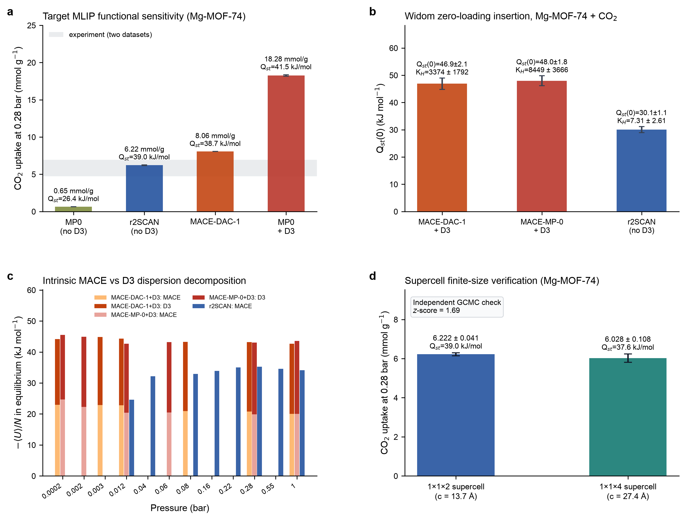
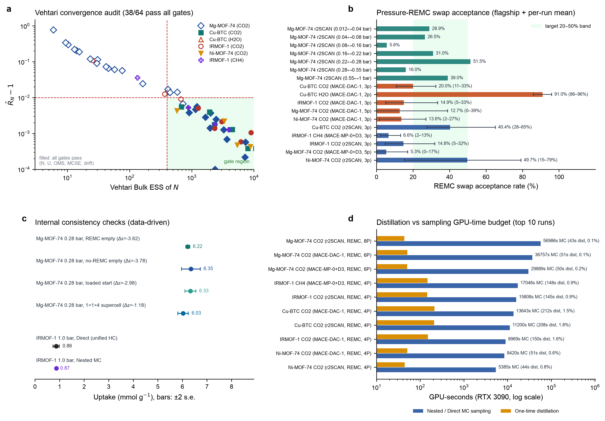

**English** | [简体中文](README.zh-CN.md)

# `cuda-mof-gcmc`


A GPU-accelerated CUDA/C++17 grand-canonical Monte Carlo (GCMC) engine for gas adsorption in rigid MOFs, running on Windows (RTX 5070, `sm_120`) and multi-GPU Linux nodes (8×RTX 3090, `sm_86`). It combines two verified components:

1. A classical and self-consistent polarizable (`Pol-SCF`) GCMC solver validated against `RASPA3 3.0.29`; see [classical validation](docs/CLASSICAL_VALIDATION.md).
2. An automated **Nested Monte Carlo + independent-ladder $\mu$-REMC** engine targeting full-system machine-learned interatomic potentials (`mace-matpes-r2scan-0`, `MACE-MP-0`, `MACE-DAC-1`, with or without D3(BJ)). For each `(framework, guest, MLIP)` tuple, a 1B radial-plus-electroneutral-Ewald grid and 2B in-pore residual LUT are distilled on demand directly from the target MLIP—without manual framework atom typing—and drive 128-trial Rosenbluth CBMC GPU bursts with equilibration-frozen marginal-drift $(\Delta\varepsilon, k)$ calibration and FP64 node-energy-accumulated batched MLIP outer corrections. Full per-point convergence audits and precision checks reside in [`docs/results/jctc_audit_report.md`](docs/results/jctc_audit_report.md) and [`docs/results/jctc_summary.json`](docs/results/jctc_summary.json).


## Main JCTC v2 results

All numbers below come directly from [`docs/results/jctc_audit_report.md`](docs/results/jctc_audit_report.md), [`docs/results/jctc_summary.json`](docs/results/jctc_summary.json), [`docs/results/precision_hc_audit.json`](docs/results/precision_hc_audit.json), and [`docs/results/phase2_phase3_summary.json`](docs/results/phase2_phase3_summary.json).

- **On-demand 1B+2B surrogate distillation:** Across all 14 content-addressed caches (4 MOFs: Mg-MOF-74, Ni-MOF-74, Cu-BTC, IRMOF-1; 3 guests: $\text{CO}_2$, $\text{CH}_4$, $\text{H}_2\text{O}$; 4 MLIP setups) built in `40.3–212.7 s` on one RTX 3090 (`0.08%–1.82%` of multi-pressure REMC campaign GPU time), 85/15 analytical 1B hold-out $R^2$ spans `0.9236–0.9942` (`0.9522–0.9942` for $\text{CO}_2/\text{CH}_4$, MAE `0.89–2.85 kJ/mol`) and 80/20 (`154/38`) **deployed-LUT** 2B hold-out MAE spans `0.04–1.54 kJ/mol`.
- **Exact parity & $51.2\times$ sampling speedup (`IRMOF-1 + CO2` at 1.0 bar, `r2SCAN`):** Nested MC (`0.874 ± 0.011 mmol/g`, `Qst = 16.3 ± 0.2 kJ/mol`, **`PASS`**) matches Direct MLIP-GCMC (`0.863 ± 0.080 mmol/g` MCSE, `16.2 ± 0.5 kJ/mol`, `FAIL`) within $z = 0.18$, while boosting `ESS_bulk(N)/GPU-s` by **$51.2\times$** (`0.480` vs. `0.009`) and cutting cold-start time-to-`MCSE=0.10` by **$9.7\times$** (`179 s` vs. `1,737 s`).
- **Open-metal-site efficiency & many-body outer reweighting (`Mg-MOF-74 + CO2` at 0.28 bar, `r2SCAN`):** Single-pressure Direct MLIP-GCMC (`1.165 ± 0.290`, `ESS = 6`), UFF NMC (`3.157 ± 0.251`, `ins/del = 0.39`), and bespoke Mercado-2016 DFT-FF NMC (`6.044 ± 0.295`, `ESS = 10`) all fail multi-chain gates; adding 1B+2B distillation + isolated-ladder $\mu$-REMC raises bulk loading ESS to **`446`** (`6.222 ± 0.041 mmol/g`, `Qst = 39.0 ± 0.2 kJ/mol`) and independently matches a doubled `1×1×4` supercell (`6.028 ± 0.108 mmol/g`, $z = 1.69$). Dropping the outer full-system MLIP (`grid_only`) underestimates `0.28 bar` uptake by **`-56.6%`** (`2.703` vs. `6.222 mmol/g`).
- **Zero-shot foundation MLIPs vs. fine-tuned `MACE-DAC-1+PBE-D3` & global audit:** Across all 23 runs (76 pressure points), **`41/76`** pass all 5 strict Vehtari gates ($\hat{R}_{\max} < 1.01$, $\text{ESS}_{\text{bulk,tail}} \ge 400$ across $N$, $U$, $N_{\text{OMS}}$, MCSE, drift)—including `38/64` estimable non-grid MLIP points and **18/18 (100%)** `MACE-DAC-1+PBE-D3` $\text{CO}_2$ points across all four frameworks. Widom and equilibrium partitioning show D3(BJ) supplies `47.9%–53.0%` (`MACE-DAC-1`) and `45.8%–54.1%` (`MP0+D3`) of Mg-MOF-74 interaction energy. All `34 FAIL` and `1 INSUFFICIENT` points are audited explicitly (`Direct/UFF/Mercado/grid_only` failure baselines, overbound dense `MP0+D3` Mg-MOF-74 at `15.4–18.9 mmol/g`, ultra-dilute `<N> < 0.22` empty-box tail-ESS edge cases, and strict near-miss secondary gates on dense `r2SCAN` rungs).
- **Numerical precision, hard-core support, multi-GPU & classical baseline:** `FP32` forward with `FP64` `node_energy` summation matches full `FP64` to RMS `0.00044–0.00130 kJ/mol` with **`0%` accept/reject flips** across 64 outer test pairs and `5.93×–9.49×` speedup; 4×RTX 3090 replica sharding accelerates MC by **`3.26×`** (`2.19×` pressure queue end-to-end); classical Tricubic GCMC matches single-core `RASPA3 3.0.29` within `≤ 0.54σ` at `598,669 MC-steps/s`, and `Pol-SCF` matches `36×36` matrix inversion to `1.83×10⁻⁸ K`.

````carousel

<!-- slide -->

<!-- slide -->

<!-- slide -->

````

## Code layout

1. **Framework and guest preprocessing** ([`scripts/qeq_charges.py`](scripts/qeq_charges.py), [`scripts/guests.py`](scripts/guests.py)): ASE expands any space group and preserves CIF charges; uncharged frameworks fall back to screened periodic Ewald QEq; rigid guests support up to 12 sites with Peng–Robinson fugacities.
2. **Surrogate distillation and GPU proposer** ([`scripts/mlip_distill.py`](scripts/mlip_distill.py), [`src/proposer_dll.cu`](src/proposer_dll.cu), [`include/proposer_api.h`](include/proposer_api.h)): 1B tricubic grids and clipped 2B residual LUTs reside in device memory, one CUDA thread block per replica, with zero-I/O state exchange via C ABI and full FP64 energy recomputation.
3. **Nested MC, $\mu$-REMC, diagnostics and archiving** ([`scripts/nested_mc_engine.py`](scripts/nested_mc_engine.py), [`scripts/mcmc_diagnostics.py`](scripts/mcmc_diagnostics.py), [`scripts/multi_gpu.py`](scripts/multi_gpu.py), [`scripts/archive_jctc_results.py`](scripts/archive_jctc_results.py)): batched MACE/D3 evaluation (`FP32` + `FP64` node sum), equilibration-frozen marginal-drift $(\Delta\varepsilon, k)$ calibration, isolated-ladder $\mu$-REMC, rank-normalized $\hat{R}$ / bulk-tail ESS gates, and SHA-256-verified full-trace archiving.

## Quickstart

### Environment check and build

```powershell
# Windows: check prerequisites only
cmd /c fast_start.bat -CheckOnly
# Windows: install what is missing, build and run fast self-tests (-FullTest runs long parity checks)
cmd /c fast_start.bat
```

```bash
# Linux
./fast_start.sh --check-only
./fast_start.sh --gpu 0
```

### Nested MC & isolated-ladder $\mu$-REMC ([`scripts/run_mlip_gcmc.py`](scripts/run_mlip_gcmc.py))

```bash
CUDA_VISIBLE_DEVICES=0,1,2,3 .venv-mlip/bin/python -u scripts/run_mlip_gcmc.py \
  --cif data/IRMOF-1.cif --supercell 1 1 1 --guest co2 --temp 298 \
  --pressures 0.5 1.0 2.5 5.0 --proposer auto_mlip --cbmc-k 128 \
  --model build/models/mace-dac-1.model --dispersion on --dispersion-xc pbe \
  --boxes 4 --k-steps 24 --eq-cycles 800 --prod-cycles 16000 \
  --distill-cache-dir build/distill_cache --gpus 0 1 2 3 --parallel-mode remc --swap-every 2 \
  --out-json build/irmof1_co2_macedac_remc.json
```

Widom insertion and energy decomposition:

```bash
.venv-mlip/bin/python -u scripts/widom_mlip.py \
  --cif data/MgMOF-74.cif --supercell 1 1 2 --guest co2 --temp 298 \
  --model mace-matpes-r2scan-0 --dispersion off --n-samples 6000 \
  --out-json build/widom_mgmof74_r2scan.json
```

Verify a downloaded full-trace archive (when `jctc_traces.npz` is present from an offline/release bundle) and regenerate all 5 JCTC publication figures directly from [`docs/results/jctc_summary.json`](docs/results/jctc_summary.json):

```bash
.venv-mlip/bin/python scripts/archive_jctc_results.py \
  --verify-summary docs/results/jctc_summary.json --traces-npz docs/results/jctc_traces.npz
.venv-mlip/bin/python scripts/plot_phase4_figures.py --mode jctc
```

### Classical and `Pol-SCF` regression tests

```powershell
.\build\mof_gcmc_cli.exe --test-scf
.\build\mof_gcmc_cli.exe --config configs\mg_mof74_co2_298K_uff.json
.\.venv-mlip\Scripts\python.exe -m pytest -v -m "not mlip and not slow"
```

## Documentation

- **JCTC Audit & Precision Data:** [`docs/results/jctc_audit_report.md`](docs/results/jctc_audit_report.md) · [`docs/results/jctc_summary.json`](docs/results/jctc_summary.json) · [`docs/results/precision_hc_audit.json`](docs/results/precision_hc_audit.json) · [`docs/results/phase2_phase3_summary.json`](docs/results/phase2_phase3_summary.json)
- **Classical & Polarizable Validation (`RASPA3 3.0.29`):** [Classical & polarizable validation](docs/CLASSICAL_VALIDATION.md) · [中文](docs/CLASSICAL_VALIDATION.zh-CN.md)

```text
cuda-mof-gcmc/
├── fast_start.bat / .sh  # environment check, dependency install, build and self-test
├── build.bat / .sh       # MSVC+CUDA / nvcc+g++ build scripts
├── configs/              # mof_gcmc_cli presets (UFF, Mercado, flue gas, Pol-SCF)
├── data/                 # CIFs, Mercado force-field files, experimental isotherms
├── docs/                 # classical validation docs and results/ audit data
├── include/              # CUDA/C++17 headers and the proposer C ABI
├── src/                  # CUDA kernels and drivers; src/legacy/ holds older versions
├── scripts/              # run_mlip_gcmc, mlip_distill, widom_mlip, nested_mc_engine, multi_gpu, archive_jctc_results, plot_phase4_figures
├── tests/                # pytest suite
└── assets/               # Fig. 1-5 publication figures (300 DPI)
```
