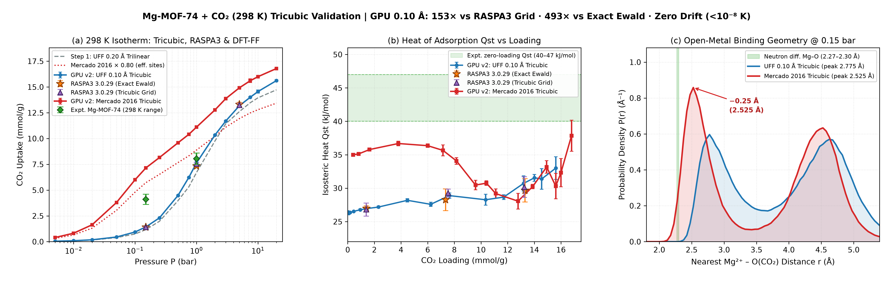

**English** | [简体中文](README.zh-CN.md)

# `cuda-mof-gcmc`


A GPU-native simulation engine for gas adsorption in rigid Metal–Organic Frameworks (MOFs) on **NVIDIA RTX 5070** (`sm_120`). It combines **(1) a verified CUDA classical and many-body self-consistent polarizable (`Pol-SCF`) GCMC solver** with **(2) a zero-I/O CUDA-to-PyTorch Nested Monte Carlo (Nested MC) engine** that uses the fast GPU classical kernel as an inner configuration proposer for universal Machine-Learning Interatomic Potentials (`MACE + TorchDFTD3`).

---

## How It Works: Shifted Nested MLIP-GCMC

Evaluating an MLIP on every trial MC insertion wastes ~95% of neural-network calls on steric framework overlaps, while running MLIP reweighting without chemical-potential calibration causes insertion/deletion deadlock when MLIP and classical binding energies differ. This repository resolves both bottlenecks in memory:

```text
  [1. Inner CUDA Proposer DLL (build\mof_gcmc_proposer.dll)]
     Runs K reversible classical GCMC steps (trans/rot/ins/del)
     at shifted inner fugacity f_ref = f_tgt * exp(-beta * delta_eps)
     -> Filters steric overlaps & proposes a full non-overlapping box x'
                                 |
                    (zero-I/O ctypes memory pointer)
                                 v
  [2. Batched PyTorch Target (FastMaceD3Target)]
     Evaluates 4-replica MACE + TorchDFTD3 binding energy U_tgt(x') in 37.5 ms/box
                                 |
                                 v
  [3. Outer Exact Reweighting & Rollback]
     Accept x -> x' with min{1, exp[-beta * (dU_tgt - dU_ref - delta_eps * dN)]}
     Reject? -> CUDA DLL rolls the entire box state cleanly back to x
```

1. **Inner Classical Proposer (`K`-step burst)**: The C++/CUDA DLL executes $K$ full reversible GCMC steps (not just insertions) in microseconds, screening out hard-sphere framework collisions before invoking the neural network.
2. **In-Memory MLIP Scoring**: Only the $K$-step endpoint coordinates $\mathbf{x}'$ pass directly from GPU/host buffers to batched `MACE + TorchDFTD3` via `ctypes`—no CIF/XYZ file I/O per step.
3. **Chemical-Potential-Shifted Acceptance / Rollback**: Pre-calibrated constant bias $\Delta\varepsilon$ shifts the inner classical loading to match the MLIP's pore occupancy so insertions and deletions remain balanced, while the outer Metropolis criterion cancels $\Delta\varepsilon\,\Delta N$ and rolls back rejected bursts—preserving the **exact target MLIP grand-canonical ensemble**.

---

## How This Differs from `RASPA3` and `gRASPA`

| Aspect | CPU `RASPA3` / GPU `gRASPA` | `cuda-mof-gcmc` |
| :--- | :--- | :--- |
| **Primary Role** | Full-featured classical GCMC ecosystem (broad force fields, flexible CBMC molecules, high-throughput screening) | **GPU-native many-body polarization (`Pol-SCF`)** + **zero-I/O Nested MLIP-GCMC proposer architecture** |
| **Polarization** | Standard fixed point charges (LJ + Ewald) | 3D tricubic framework E-fields (`Pol-3Site`) + block-collective FP64 Applequist-Thole **many-body `Pol-SCF`** |
| **MLIP Sampling** | No built-in zero-I/O CUDA proposer DLL for PyTorch MLIP reweighting | Native C ABI ([`proposer_api.h`](include/proposer_api.h)) coupled in memory with `FastMaceD3Target` + 3-stage $\Delta\mu_{\text{ref}}$ shift |
| **Benchmark Scope** | Here we benchmarked directly against CPU **`RASPA3 3.0.29`** (not same-GPU vs. `gRASPA`); for standard flexible/fixed-charge screening, use `gRASPA` | Tuned on single RTX 5070 for rigid MOFs + rigid `CO₂ / N₂ / CH₄` to make open-metal-site MLIP-GCMC and `Pol-SCF` practical |

---

## Modules & Maturity

| Module | What It Does | Status |
| :--- | :--- | :--- |
| **Tricubic Classical CUDA GCMC** ([`src/main_cli.cu`](src/main_cli.cu)) | `0.10 Å` $O(h^4)$ 3D tricubic grids, `UFF` / `Mercado 2016` DFT-FF, binary `Identity Swap`, Peng–Robinson EOS | **Verified** (vs. `RASPA3 3.0.29` `≤ 0.54σ`) |
| **Polarizable & `Pol-SCF` Solvers** | Framework `Pol-COM` / `Pol-3Site` + block-collective FP64 many-body Thole `Pol-SCF` | **Verified** (`1.83e-08 K` vs. `36×36` exact inversion) |
| **Nested MC Proposer DLL & `FastMaceD3Target`** | Zero-I/O CUDA proposer ([`src/proposer_dll.cu`](src/proposer_dll.cu)) + batched MACE/D3 engine ([`scripts/nested_mc_engine.py`](scripts/nested_mc_engine.py)) | **Verified** (`0.27σ` null bias, `4.21×` vs. ASE) |
| **MLIP Adsorption Isotherms & Heat Studies** ([`scripts/run_mlip_gcmc.py`](scripts/run_mlip_gcmc.py)) | Grand-canonical isotherms & model audits across `Mg/Ni-MOF-74`, `HKUST-1`, `IRMOF-1` | **WIP** (DFT ground-truth & equilibration ongoing; see [Notes](docs/MLIP_NESTED_MC_NOTES.md)) |

---

## Verified Benchmarks & Scope



- **`RASPA3 3.0.29` Parity (`Mg-MOF-74`, `298 K`, UFF+REPEAT)**: Matches single-core RASPA3 Tricubic Grid within **`+2.32% / +1.39% / -0.41%`** at `0.15 / 1.0 / 5.0 bar` ($\Delta Q_{\text{st}} \le 0.54\ \text{kJ/mol}$), with full FP64 recompute keeping max drift at **`≤ 1.02e-08 K`** over `64M` steps.
- **Classical GPU Throughput**: **`598,669 MC-steps/s`** (`153.2×` vs. single-core CPU `RASPA3` Tricubic Grid `3,908/s`; `492.6×` vs. Exact Ewald `1,215/s`); builds `256×256×72` 3D grids in `3.03 s` (`38.9×`).
- **`Pol-SCF` Exact Parity**: Matches Python exact `36×36` matrix inversion in `--test-scf` to **`1.83e-08 K`** and **`1.13e-11 e·Å`**.
- **Nested MC Statistics & Speed**: `proposer_eval_energy` matches kernel energy to **`0.000e+00 K`**; `Pol-3Site -> Mercado` reproduces direct GPU GCMC within **`z = 0.27σ`**; `FastMaceD3Target` accelerates 4-box inference **`4.21×`** over ASE (`157.7 → 37.5 ms/box`); `1×1×2` vs. `1×1×4` supercells agree within `z = 0.04σ` (classical) and `z = 0.63σ` (live MLIP).

> **Scope & Limitations**: Supports **rigid MOF frameworks and small rigid adsorbates** (`CO₂`, `N₂`, `CH₄`; no flexible CBMC chains or breathing). `Pol-SCF` solves $O(N^2)$ FP64 iterations per trial move on top of standard TraPPE/UFF parameters (induction double-counting relative to unpolarized fits). For MLIP simulations, physical accuracy depends on the underlying foundation model, dispersion parameters, and MCMC sampling cycles—see [Known Issues & Open Work](docs/MLIP_NESTED_MC_NOTES.md#4-known-issues--open-work).

---

## Quickstart

### Prerequisites
- Windows 10/11 + NVIDIA CUDA Toolkit (`sm_120`, RTX 5070) + MSVC (`Visual Studio 2022` Build Tools)
- Optional (for MLIP Nested MC): Python 3.11+ with PyTorch CUDA, `mace-torch`, `torch-dftd`, `ase`, `numpy`, `matplotlib`

### Build & Run

```powershell
# Compile all 5 targets (mof_gcmc, mof_gcmc_mix, mof_gcmc_v2, mof_gcmc_cli, mof_gcmc_proposer.dll)
cmd /c build.bat all

# Classical / Polarizable unified CLI presets
.\build\mof_gcmc_cli.exe --test-scf
.\build\mof_gcmc_cli.exe --config configs\mg_mof74_co2_298K_uff.json
.\build\mof_gcmc_cli.exe --config configs\mg_mof74_fluegas_298K_pol3site.json
.\build\mof_gcmc_cli.exe --config configs\mg_mof74_co2_298K_scf.json
uv run --with numpy python scripts\verify_cli.py

# Zero-I/O MLIP Nested MC tests & unified runner (WIP)
.venv-mlip\Scripts\python.exe scripts\verify_nested_mc.py
.venv-mlip\Scripts\python.exe -u scripts\run_mlip_gcmc.py `
  --cif data\MgMOF-74.cif --pressures 0.01 0.05 0.15 `
  --proposer mercado --model mace-matpes-r2scan-0 --dispersion on --xc r2scan `
  --out-json build\mg_r2scan.json
```

---

## Documentation & Repository Layout

- [**Classical & Polarizable Validation (Steps 1–5)**](docs/CLASSICAL_VALIDATION.md) — Crystal geometry, tricubic MAE, RASPA3 parity tables, co-adsorption selectivity & `Pol-SCF` checks.
- [**MLIP Nested MC: Verified Mechanics & WIP Notes**](docs/MLIP_NESTED_MC_NOTES.md) — Reweighting null-bias proofs, $\Delta\mu_{\text{ref}}$ calibration, batched MACE speedup, foundation-model diagnostics & open scientific issues.

```text
cuda-mof-gcmc/
├── configs/   # JSON presets for mof_gcmc_cli.exe (UFF, Mercado 2016, 313K PSA, Flue Gas, Pol-SCF)
├── data/      # Crystal CIFs (Mg-MOF-74, Ni-MOF-74, Cu-BTC, IRMOF-1), Mercado FF & NIST ISODB tables
├── docs/      # Detailed validation benchmarks, equations & WIP research notes (EN / ZH)
├── include/   # C++17 / CUDA headers: MIC geometry, force fields, 3D grids, CIF loader & proposer C ABI
├── src/       # CUDA kernels & C++ drivers (mof_gcmc, mix, v2, cli, mof_gcmc_proposer.dll)
├── scripts/   # Python verification suites, RASPA3 wrappers & MLIP Nested MC engine
└── assets/    # Benchmark & verification plots (300 DPI)
```
