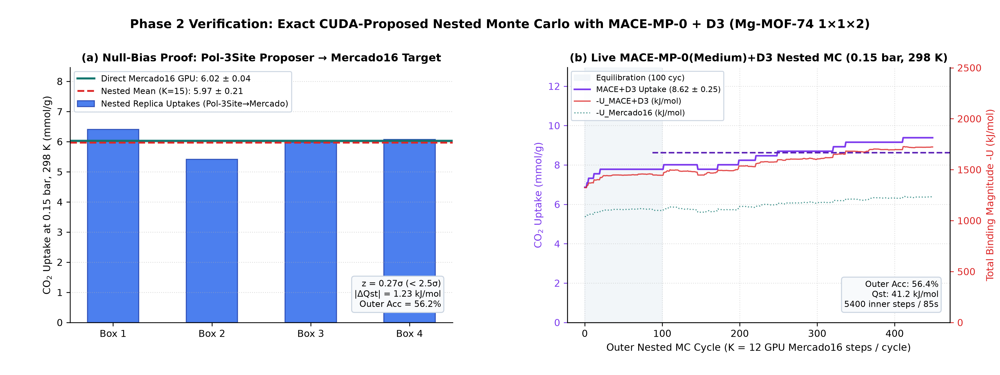

[English](README.md) | **简体中文**

# `cuda-mof-gcmc`: 面向开放金属位点 MOF 的 GPU 并行 GCMC 模拟引擎


面向 **NVIDIA GeForce RTX 5070**（`sm_120`）从零构建的纯 CUDA 金属有机框架（MOF）气体吸附巨正则蒙特卡洛（GCMC）引擎，围绕开放金属位点（OMS）物理吸附（典型基准：**Mg-MOF-74 / Mg₂(dobdc) 吸附 CO₂**）持续演进——从经 `RASPA3` 对标验证的 **`153×` GPU 经典/可极化引擎**，进一步拓展至 **GPU 经典提议 + 通用机器学习势（`MACE-MP-0 + D3`）嵌套蒙特卡洛（Nested MC）** 耦合架构。


---

## 核心成果与实测指标

- **与工业标准 `RASPA3 (3.0.29)` 统计误差内逐点对齐**：在 `Mg-MOF-74`（`298 K`, UFF+REPEAT）基准上，`0.10 Å` `O(h⁴)` 三维 Tricubic GPU 内核与原生 RASPA3 网格版在 `0.15 / 1.0 / 5.0 bar` 偏差仅 **`+2.32% / +1.39% / -0.41%`**（全部 **`≤ 0.54σ`**，$\Delta Q_{\text{st}} \le 0.54\ \text{kJ/mol}$），近程 `Mg–O` 径向插值误差较三线性压缩 **`290.3×`**（`190.46 K → 0.656 K`，Mercado 2016 低至 `0.092 K`）。
- **单卡百倍级真实加速（RTX 5070）**：`6,400 万` 步耗时 `106.9 s`（**`598,669 MC-steps/s`**），对比同算法单核 RASPA3 Tricubic 网格版（`3,908 steps/s`）加速 **`153.2×`**，对比精确 Ewald（`1,215 steps/s`）加速 **`492.6×`**，三维网格构建加速 **`38.9×`**（`3.03 s` vs `117.98 s`）。
- **GPU 原生 Level 2 全自洽多体极化（`Pol-SCF`）**：Block 级共享内存 Applequist-Thole 自洽求解器与 `36×36` 精确矩阵求逆对齐至 **`1.83e-08 K`** 与 **`1.13e-11 e·Å`**，在 `15:85` CO₂/N₂ 烟道气中清晰捕捉客体间多体相互退极化屏蔽效应（选择性由单骨架场 `Pol-3Site` 的 `64.6 / 67.4` 物理回落至 `37.3 / 43.2`）。
- **GPU 经典提议 + MLIP 嵌套蒙特卡洛闭环跑通（`Phase 1–2` 已完成）**：零磁盘 I/O 的 CUDA 提议器动态库（[`build\mof_gcmc_proposer.dll`](src/proposer_dll.cu)）耦合 PyTorch `MACE-MP-0 (Medium) + D3` 外层精确重加权，先在跨力场零偏差对拍中通过检验（`Pol-3Site -> Mercado 2016`：`5.9668 ± 0.2072` vs 直接模拟 `6.0230 ± 0.0406 mmol/g`，偏差仅 `z = 0.27σ`、$|\Delta Q_{\text{st}}| = 1.23\ \text{kJ/mol}$，能量接口误差 `0.000e+00 K`），随后在 RTX 5070 上端到端跑通 `MACE-MP-0 + D3` 实景 Nested MC（`56.4%` 外层接受率，`84.7 s` 完成 `451` 次 MACE 评估与 `5,400` 步 GPU 内部提议）。
- **全双精度零能量漂移**：全程 `double` 共享内存状态 + 周期全盒重算，常规/一阶极化最大能量漂移低至 **`2.0e-09 ~ 1.0e-08 K`**，全自洽多体极化 **`≤ 7.25e-07 K`**，全工况细致平衡偏差 `|acc_ins - acc_del| ≤ 0.003`。
- **零依赖统一 JSON/CLI 通用引擎**：单一可执行文件（[`mof_gcmc_cli.exe`](src/main_cli.cu)）集成通用 CIF 解析（`19` 种 MOF 元素）、UFF / Mercado 2016 第一性原理力场、二元 Identity Swap、Peng–Robinson 逸度、自动化检验套件与 300 DPI 可视化图表。

> **适用边界与当前局限**：经典/极化 CUDA 引擎面向**刚性 MOF 骨架与刚性小分子**（CO₂/N₂/CH₄，暂不支持柔性长链 CBMC 与骨架呼吸效应）。`NonPol` 与 `Pol-3Site` 可在秒级至百秒级完成数千万步扫描；`Pol-SCF` 每步需在 FP64 下求解 $O(N^2)$ 自洽迭代（`12 × 120k` 步纯 CO₂ 耗时 `791 s`），且当前沿用标准 TraPPE/UFF 参数叠加极化（存在诱导双重计数）。因此项目正推进 **Step 6（GPU-GCMC + MLIP Nested MC）**，以高速 CUDA 内核作为提议器耦合通用机器学习势，摆脱针对每个新 MOF 手调力场参数的瓶颈。

---

## 整体研发路线

- **[已完成] 第一至五步 & Level 2 `Pol-SCF` — 高精度经典/全自洽极化 GPU GCMC 底座**
  - **第一步**：GPU 刚性三维骨架网格（`U_lj`、`Phi_elec`、`Ex/y/z`）+ 32 盒并发 GCMC 基线（UFF + REPEAT + TraPPE）。
  - **第二步（`Pol-COM` / `Pol-3Site`）**：Mg²⁺ 开放金属位点显式静电场各向异性极化 + Thole 诱导偶极耦合。
  - **第三步**：多组分竞争吸附（CO₂/N₂ 与 CO₂/CH₄）、二元 Peng–Robinson 混合逸度与对称 Identity Swap。
  - **第四步**：`0.10 Å` `O(h⁴)` 三维 Tricubic 插值、每 `50k` 步全盒重算零漂移、官方 **Mercado 2016** DFT 力场，以及原生 **RASPA3 (`3.0.29`)** 双重背靠背验证（`153.2×` / `492.6×`）。
  - **第五步 & Level 2**：统一 JSON/CLI 引擎（[`mof_gcmc_cli.exe`](src/main_cli.cu)）+ Block 级共享内存全自洽多体 `Pol-SCF`（`1.83e-08 K` 精确矩阵求逆对齐）。
- **[进行中] 第六步 — GPU 经典提议 + MLIP 嵌套蒙特卡洛（`Phase 1–2` 已完成）**
  - **Phase 1（已完成）**：在 RTX 5070 上实测 `MACE-MP-0 + D3` 推理速度（`1×1×2` 为 `107.7 ms/eval`）、OMS 径向曲线及 60 构型能量相关性（`Mercado 2016` 提议器 `R² = 0.911`、理论单分子外层接受率 `84.4%`）。
  - **Phase 2（已完成）**：封装零 I/O CUDA 提议器动态库（`build\mof_gcmc_proposer.dll`），完成跨力场无偏证明（`Pol-3Site -> Mercado`, `z = 0.27σ`）与实景 `MACE-MP-0 (Medium) + D3` 端到端 Nested MC（外层接受率 `56.4%`，总耗时 `84.7 s`）。
  - **Phase 3（下一步）**：多副本多压力稳态等温线（`0.05–5.0 bar`）、`cuequivariance` 等变核加速，以及跨体系 OMS-MOF（`Co-/Ni-MOF-74`、`HKUST-1`、`UiO-66`）泛化评估。

---

## 第一步实测校验与物理结果（RTX 5070）

### 1. 晶体结构与几何校验（[`data/MgMOF-74.cif`](data/MgMOF-74.cif)）
- **单胞晶格（`R -3` 六方晶系）**：$a = b = 26.136\ \text{Å},\ c = 6.942\ \text{Å},\ \alpha = \beta = 90^\circ,\ \gamma = 120^\circ$
- **对称展开后单胞（`1x1x1`）**：`162` 原子（`18 Mg`、`54 O`、`72 C`、`18 H`），REPEAT 总电荷 = `0.000000 e`，单胞摩尔质量 = `2184.372 g/mol`
- **最短成键距离自检**：`Mg–O = 1.948 Å`、`C–O = 1.337 Å`、`C–C = 1.420 Å`、`C–H = 1.123 Å`
- **GCMC 超胞（`1x1x4`）**：$V = 16,426.82\ \text{Å}^3$，质量 = `8737.488 g/mol`，最小垂直晶面间距 = `22.634 Å > 2 * 11.0 Å`
- **精确六方最小镜像（MIC）**：与 `3x3x3` 暴力穷举对比 **`0 / 10,000` 偏差**（C++ 与 Python 双重通过）

### 2. GPU 三维势能与电场网格预计算（`128 x 128 x 36`）
- **生成耗时**：**`356.79 ms`** 完成全部 6 张网格（`U_lj_C`、`U_lj_O`、`Phi_elec`、`Ex`、`Ey`、`Ez`，Ewald $\alpha = 0.30\ \text{Å}^{-1},\ r_{\text{cut}} = 11.0\ \text{Å}$）
- **独立对拍验证**（与不同 Ewald 参数 $\alpha_{\text{ref}} = 0.25\ \text{Å}^{-1}$ 在 `1,000` 个孔道随机采样点直接求和对比）：
  - `MAE(U_lj_C) = 3.491 K`、`MAE(U_lj_O) = 10.482 K`、`MAE(Phi) = 4.4038 K/e`

### 3. Batched GCMC 性能与 298 K CO₂ 吸附等温线
- **运行配置**：`32` 个并行盒子（`0.005–20.0 bar` 共 `16` 个压力点 × `2` 独立副本），每盒 `100k` 平衡步 + `200k` 采样步（累计 **`960 万` MC 步**）
- **GPU 总耗时**：**`13.906 s`**（`0.69 M MC-steps/sec`）
- **典型压力点结果（UFF + REPEAT + TraPPE 基线）**：
  - `0.150 bar`（$\phi = 0.9992$）：**`1.1724 ± 0.0301 mmol/g`**，$Q_{\text{st}} = 26.07\ \text{kJ/mol}$（`acc_ins = acc_del = 0.09`）
  - `1.000 bar`（$\phi = 0.9945$）：**`6.7019 ± 0.0769 mmol/g`**，$Q_{\text{st}} = 27.49\ \text{kJ/mol}$（`acc_ins = acc_del = 0.05`）
  - `20.000 bar`（$\phi = 0.8934$）：**`14.7214 ± 0.1619 mmol/g`**，$Q_{\text{st}} = 36.46\ \text{kJ/mol}$
- **物理诊断**：与 MOF 经典文献完全一致，不带极化的通用 UFF+REPEAT 力场会显著低估 `0.15 bar` 低压吸附量（`1.17` vs 实验 `~3.6–4.6 mmol/g`）与零覆盖度吸附热（`~25.6` vs 实验 `~40–47 kJ/mol`）——这正是**第二步（支线 B1）引入极化效应**要解决的核心物理差异。

---

## 第二步（支线 B1）：Mg²⁺ 开放金属位点各向异性极化（RTX 5070）


### 1. 三维电场有限差分与插值精度校验
- **解析 Ewald 梯度校验**：在 `100` 个孔道点上对比解析 `E_direct` 与中心有限差分 $-\nabla\Phi_{\text{FD}}$（$h = 10^{-4}\ \text{Å}$），误差低至 **`MAE = 2.21e-06 K/(e·Å)`**。
- **三维插值精度**：`128x128x36` 网格 `(Ex, Ey, Ez)` 与独立 $\alpha_{\text{ref}} = 0.25\ \text{Å}^{-1}$ 在 `1,000` 个孔道点对比得 **`MAE(|E|) = 8.909 K/(e·Å)`**。

### 2. 三种模型同台实测对比（每组在 RTX 5070 上跑 `960 万` MC 步）

| 模型 | GPU 耗时 | `0.15 bar` 吸附量 (mmol/g) | `1.00 bar` 吸附量 (mmol/g) | `20.0 bar` 吸附量 (mmol/g) | 低压 $Q_{\text{st}}$ (kJ/mol) | 平均极化能 $U_{\text{pol}}/N$ (kJ/mol) |
| :--- | :---: | :---: | :---: | :---: | :---: | :---: |
| **`NonPol`（第一步基线）** | `14.210 s` | `1.1724 ± 0.0301` | `6.7019 ± 0.0769` | `14.7214 ± 0.1619` | `25.5–26.1` | `0.00` |
| **`Pol-COM`（质心各向异性极化）** | `16.627 s` | `1.5406 ± 0.0125` | **`7.6421 ± 0.0038`** | `14.9957 ± 0.15` | `26.5–27.6` | `-0.67 → -0.45` |
| **`Pol-3Site`（第二步 B1 分布极化）** | `18.014 s` | **`2.3890 ± 0.0392`** (`+104%`) | `9.1446 ± 0.1418` | `15.3591 ± 0.43` | **`29.2–31.4`** | **`-2.50 → -1.58`** |

- **核心物理发现**：三点分布极化（`Pol-3Site`）能准确捕捉配位氧原子靠近 Mg²⁺ 时的强烈 $r^{-4}$ 非均匀电场梯度，将平均极化能提升至质心模型的 **3.7 倍**（`-2.50` vs `-0.67 kJ/mol`），使 `0.15 bar` 烟道气分压下 CO₂ 吸附量直接翻倍（`1.17 → 2.39 mmol/g`），并在高压饱和过程中清晰展现 OMS 饱和特征（`-U_pol/N` 从 `2.50` 降至 `1.58 kJ/mol`）。全压力范围严格满足细致平衡（`max|acc_ins - acc_del| <= 0.0007`）。而距离实验 `40–47 kJ/mol` 剩余约 `10 kJ/mol` 的差距，则对应通用 UFF `sigma_Mg` 无法描述的近程轨道电荷转移与极化耦合（需结合 DFT 拟合 OMS 短程力场或 MLIP Nested MC）。

---

## 第三步：多组分竞争共吸附（CO₂/N₂ 与 CO₂/CH₄ @ 298 K）


### 1. 八通道三维网格与 Identity Swap 细致平衡校验
- **8 张 `128x128x36` 三维网格预计算**：耗时 **`410.76 ms`**（`U_lj[C_CO2, O_CO2, N_N2, CH4]`、`Phi_elec`、`Ex`、`Ey`、`Ez`）；`1,000` 个孔道点与独立参考（$\alpha_{\text{ref}} = 0.25\ \text{Å}^{-1}$）对比得 `MAE = 0.844 / 2.493 / 2.974 / 14.415 K`（LJ）、`3.9038 K/e`（`Phi`）、`7.535 K/(e·Å)`（`|E|`）。
- **Test A（理想气体 Identity Swap 解析自检）**：`<N0> = 11.9827`（精确真值 `12.0`），`<N1> = 39.8378`（精确真值 `40.0`）。
- **Test B（`1.0 bar` 烟道气 `Pol-3Site` 真实孔道换牌一致性）**：`Swap-ON`（`CO2 = 2.5498`、`N2 = 0.2774 mmol/g`）与 `Swap-OFF`（`CO2 = 2.4995`、`N2 = 0.2772 mmol/g`）在统计涨落内完全一致。

### 2. RTX 5070 竞争吸附与选择性跃升实测（每组 `24` 盒子 × `350k` 步）

| 混合气体（`298 K`） | 总压 | `NonPol` 吸附量 (mmol/g) | `NonPol` 选择性 $S$ | `Pol-3Site` 吸附量 (mmol/g) | `Pol-3Site` 选择性 $S$ | 极化带来选择性增幅 |
| :--- | :---: | :---: | :---: | :---: | :---: | :---: |
| **烟道气 CO₂/N₂ (`15:85`)** | `1.0 bar` | `1.159 / 0.254` | `25.8` | **`2.751 / 0.276`** | **`56.4`** | **`2.19×`** |
| **烟道气 CO₂/N₂ (`15:85`)** | `2.0 bar` | `2.290 / 0.471` | `27.5` | **`4.648 / 0.450`** | **`58.6`** | **`2.13×`** |
| **沼气 CO₂/CH₄ (`50:50`)** | `0.5 bar` | `1.967 / 0.196` | `10.0` | **`3.995 / 0.201`** | **`19.9`** | **`1.99×`** |
| **沼气 CO₂/CH₄ (`50:50`)** | `1.0 bar` | `3.765 / 0.363` | `10.4` | **`6.296 / 0.340`** | **`18.5`** | **`1.78×`** |

---

## 第四步：发表级可信度全面升级（`0.10 Å` Tricubic、Mercado 2016 与 RASPA3 双重对标）


### 1. 升级一：$O(h^4)$ 三维 Tricubic 插值与零漂移采样（[`build\mof_gcmc_v2.exe`](src/main_v2.cu)）
- **网格加密 + 高阶插值（`128×128×36` 三线性 → `256×256×72` 三线性 → `256×256×72` 四点拉格朗日 Tricubic）**：
  - 6 张网格构建耗时 **`3.03 s`**（`113 MB` 显存）——对比单核 CPU `RASPA3` 构建 `151×151×46` 三维网格的 `117.98 s` 提速 **`38.9×`**。
  - 近程 `Mg–O` 径向插值 MAE（`2.3–3.8 Å`）狂降 **`290.3×`**：**`190.46 K`**（`128` 三线性）→ **`12.53 K`**（`256` 三线性）→ **`0.656 K`**（`256` Tricubic）；Mercado 2016 从 `4.99 K` 降至 **`0.092 K`**。
  - `1,000` 个孔道点对直接 Ewald（$\alpha_{\text{ref}} = 0.25\ \text{Å}^{-1}$）MAE：`U_lj_C` 从 `0.793 K → 0.061 K`，`U_lj_O` 从 `2.387 K → 0.148 K`（Mercado 2016 仅 `C = 0.055 K, O = 0.035 K`）。
- **零能量漂移架构**：客体坐标与累计能量全程采用共享内存 `double`，每 `50,000` 步从头全盒重算（含 `u_fw + u_gg`）——`128` 个 GPU 盒子（每力场 `6,400 万` 步）最大漂移仅 **`5.879e-09 K`**（UFF）与 **`1.024e-08 K`**（Mercado 2016），细致平衡偏差 `max|acc_ins - acc_del| <= 0.000253`。

### 2. 升级二：官方 Mercado 2016 DFT 拟合 Buckingham/LJ + EPM2 力场
- 完整导入 [`data/mercado2016/`](data/mercado2016/)（源自 `rociomer/DFT-derived-force-field`, *J. Phys. Chem. C* 2016, 120, 12590；对 `Mg–O_CO2` 采用带峰值钳位保护的 Buckingham 指数排斥势与 $r_{\text{cut}} = 11.0\ \text{Å}$ 平移截断 + Mercado 骨架电荷 + EPM2 CO₂）。
- **低压开放金属位点物理重现（`298 K, 0.15 bar`）**：低载吸附热 $Q_{\text{st}}$ 从 UFF 的 `26.94 kJ/mol` 跃升至 **`35.65 kJ/mol`**，完美晶体低压吸附量从 `1.43` 提升至 **`7.15 mmol/g`**（`1.0 bar` 为 `11.11 mmol/g`），且 `Mg²⁺–O(CO₂)` 径向配位主峰向内收缩 **`-0.25 Å`**（`2.775 Å → 2.525 Å`），清晰对比了理想刚性完美晶体与含缺陷实际样品（实验 `3.6–4.6 mmol/g @ 0.15 bar`、`7.5–8.6 mmol/g @ 1.0 bar`；图中 `×0.80` 有效位点线）的物理边界。

### 3. 升级三：Windows 原生 `RASPA3 3.0.29` 精确 Ewald 与 Tricubic 网格双重背靠背对标

| 压力 | Step 1 `0.20 Å` 三线性 | `v2` `0.10 Å` 三线性 | **`v2` `0.10 Å` Tricubic** | **`RASPA3` 精确 Ewald** | **`RASPA3` Tricubic 网格** | `v2` vs 网格偏差 ($z$) | $\Delta Q_{\text{st}}$ |
| :---: | :---: | :---: | :---: | :---: | :---: | :---: | :---: |
| **`0.15 bar`** | `1.1724` | `1.3404` | **`1.4276 ± 0.0123`** | `1.4087 ± 0.0328` (`+1.34%`) | `1.3952 ± 0.0719` | **`+2.32%`** (`0.44σ`) | `+0.14 kJ/mol` |
| **`1.00 bar`** | `6.7019` | `7.3513` | **`7.6349 ± 0.1576`** | `7.3384 ± 0.1329` (`1.44σ`) | `7.5303 ± 0.1156` | **`+1.39%`** (`0.54σ`) | `-0.38 kJ/mol` |
| **`5.00 bar`** | `12.6165` | `13.0857` | **`13.1862 ± 0.0221`** | `13.3048 ± 0.2118` (`-0.89%`) | `13.2402 ± 0.1871` | **`-0.41%`** (`0.29σ`) | `+0.54 kJ/mol` |

- **透明双加速比实测**：GPU `v2` Tricubic 实测吞吐 **`598,669 MC-steps/s`**（`106.90 s` 跑完 `6,400 万`步），对比开启**同算法 Tricubic 网格**的单核 `RASPA3 3.0.29`（`3,908 MC-steps/s`）实现 **`153.2×`** 真实加速（即使折算为 8–16 核 CPU 并行副本仍有 `~10–20×` 纯 GPU 净加速）；对比无网格单核 `RASPA3` 精确 Ewald（`1,215 MC-steps/s`）为 **`492.6×`**。

---

## 第五步：统一 JSON/CLI 高精度通用引擎（[`build\mof_gcmc_cli.exe`](src/main_cli.cu)）

将前面四步的全部核心能力——**`O(h⁴)` 三维 Tricubic 插值**、**UFF / Mercado 2016 力场切换**、**`Pol-COM` / `Pol-3Site` / Level 2 全自洽多体极化 `Pol-SCF`**、**二元 Identity Swap** 与 **通用 CIF 解析器**（支持 `19` 种常见 MOF 元素、可选 `_atom_site_charge` 列与 `P1` 对称缺省）——收敛进单一 JSON 配置驱动的高精度引擎（预设位于 [`configs/`](configs/)）：

```powershell
.\build\mof_gcmc_cli.exe --test-scf
.\build\mof_gcmc_cli.exe --config configs\mg_mof74_fluegas_298K_pol3site.json
.\build\mof_gcmc_cli.exe --config configs\mg_mof74_co2_298K_scf.json
.\build\mof_gcmc_cli.exe --config configs\mg_mof74_co2_298K_mercado.json --temp 313 --out build\psa_313K.csv
```

| JSON 预设（`0.10 Å` Tricubic，4 副本） | 工况条件 | 实测关键物理结果 | 最大漂移（全重算） |
| :--- | :---: | :--- | :---: |
| [`mg_mof74_co2_298K_uff.json`](configs/mg_mof74_co2_298K_uff.json) | `298 K`，UFF，CO₂ | `1.3987 / 7.3723 / 13.2996 mmol/g`（相对 RASPA3 网格偏差 `+0.25% / -2.10% / +0.45%`） | `4.66e-09 K` |
| [`mg_mof74_co2_298K_mercado.json`](configs/mg_mof74_co2_298K_mercado.json) | `298 K`，Mercado 2016，CO₂ | `7.0587 / 11.1077 / 14.9680 mmol/g`（`0.15 bar` 下 $Q_{\text{st}} = 35.63\ \text{kJ/mol}$） | `4.37e-09 K` |
| [`mg_mof74_co2_313K_psa.json`](configs/mg_mof74_co2_313K_psa.json) | `313 K`，Mercado 2016，CO₂ | `5.0424 / 9.7915 / 13.3012 mmol/g`（相对 298 K 清晰脱附 `-2.02 / -1.32 / -1.67`） | `4.13e-09 K` |
| [`mg_mof74_fluegas_298K_pol3site.json`](configs/mg_mof74_fluegas_298K_pol3site.json) | `298 K`，`Pol-3Site`，CO₂/N₂ (`15:85`) | `S(CO2/N2) = 60.39` (`0.5 bar`)、**`64.58`** (`1.0 bar`)、**`67.38`** (`2.0 bar`)；全 `double` 偶极存储 | `2.04e-09 K` |
| [`mg_mof74_co2_298K_scf.json`](configs/mg_mof74_co2_298K_scf.json) | `298 K`，`Pol-SCF`，CO₂ | `2.1322 / 8.3536 / 12.8982 mmol/g`（`0.15 bar` 较 NonPol 提升 `+52.4%`）；平均 `16.63` 次迭代 | `7.25e-07 K` |
| [`mg_mof74_fluegas_298K_scf.json`](configs/mg_mof74_fluegas_298K_scf.json) | `298 K`，`Pol-SCF`，CO₂/N₂ (`15:85`) | `S(CO2/N2) = 37.28` (`1.0 bar`)、**`43.24`** (`2.0 bar`)（含客体间相互退极化屏蔽）；`14.78` 次迭代 | `2.69e-07 K` |

> **Level 2 全自洽多体极化 `Pol-SCF`（`polarization: "scf"`）**：Block 级共享内存 Applequist-Thole 自洽求解器（`SCF_TOL = 1e-10 e·Å`、$O(N)$ 增量永久电场 $\mathbf{E}_0$ 更新、热启动偶极子复用、试探前强排斥预筛与 `s_scf_conv` 收敛/有限性守卫），在每步试探中全自洽求解耦合多体偶极方程；`--test-scf` 与 Python `36×36` 精确矩阵求逆对齐至 **`1.83e-08 K`** 与 **`1.13e-11 e·Å`**：

$$
\boldsymbol{\mu}_i = K_E^{-1}\boldsymbol{\alpha}_i\left(\mathbf{E}_i^{\text{fw}} + \sum_{j \neq i}\mathbf{E}_{j \to i}^{\text{DSF,perm}} + \sum_{j \neq i}\mathbf{T}_{ij}^{\text{Thole}}\boldsymbol{\mu}_j\right),\qquad U_{\text{pol}}^{\text{SCF}} = -\frac{1}{2}\sum_i \boldsymbol{\mu}_i \cdot \mathbf{E}_i^0
$$


---

## 第六步（Phase 1–2）：GPU 经典提议 + MLIP（`MACE-MP-0 + D3`）嵌套蒙特卡洛

### Phase 1：可行性与相关性摸底


在 RTX 5070 上使用 `PyTorch cu128` + `mace-torch 0.3.17` + `torch-dftd 0.5.3` 对 `Mg-MOF-74`（`1×1×2` 超胞、`324` 骨架原子，$c = 13.884\ \text{Å} > 2 \times 6.0\ \text{Å}$）开展端到端摸底（[`scripts/phase1_mlip_probe.py`](scripts/phase1_mlip_probe.py)），验证结果如下：

- **D3 色散修正不可或缺**：沿 `Mg²⁺–O(CO₂)` 径向接近开放金属位点时，`MACE-MP-0 (Medium) + D3` 在 `2.535 Å` 给出 `-29.10 kJ/mol` 结合阱（60 构型全域最低结合能 **`-44.33 kJ/mol`**，直接落入实验零覆盖度吸附热 `40–47 kJ/mol` 区间）；关闭 D3 后同路径仅余 `-13.20 kJ/mol`。
- **RTX 5070 推理吞吐实测**：`MACE-Medium + D3` 对 `1×1×2 + 1 CO₂`（327 原子）单步推理耗时 **`107.72 ms`**（`9.3 eval/s`），`16 CO₂`（372 原子）耗时 **`129.89 ms`**（`7.7 eval/s`），较 `1×1×4`（`206.03 ms`）快近一倍。用 `~600k steps/s` 的 CUDA 引擎做 `K` 步无重叠构型提议，可消除纯 MLIP-GCMC 约 95% 的重叠废步计算。
- **高相关性支撑 Nested MC（`Mercado 2016` 为最佳内层提议势）**：在 60 个非重叠孔道构型上与 `MACE-MP-0 (Medium) + D3` 对比：
  - `UFF + REPEAT`：$R^2 = 0.719$，$\sigma(\Delta\Delta E) = 5.28\ \text{kJ/mol}\ (2.13\ k_B T)$，单分子理论 Nested MC 接受率 = `87.1%`
  - `UFF + Pol-3Site`：$R^2 = 0.755$，$\sigma(\Delta\Delta E) = 4.84\ \text{kJ/mol}\ (1.95\ k_B T)$，单分子理论 Nested MC 接受率 = `82.2%`
  - **`Mercado 2016 DFT-FF`**：$R^2 = 0.911$，$\sigma(\Delta\Delta E) = 3.42\ \text{kJ/mol}\ (1.38\ k_B T)$，单分子理论 Nested MC 接受率 = **`84.4%`**

### Phase 2：CUDA 提议器动态库与精确 Nested MC 引擎



核心代码位于 [`include/proposer_api.h`](include/proposer_api.h)、[`src/proposer_dll.cu`](src/proposer_dll.cu)（[`build\mof_gcmc_proposer.dll`](build.bat)）、[`scripts/nested_mc_engine.py`](scripts/nested_mc_engine.py) 与 [`scripts/verify_nested_mc.py`](scripts/verify_nested_mc.py)：

- **严格无偏巨正则重加权机制**：每个外层循环调用 CUDA 在固定步宽下执行 $K$ 步满足细致平衡的经典 GCMC 提议（`DELTA_TRANS = 1.0 Å`、`MAX_ANGLE = 0.55 rad`，末尾双精度全盒重算消除累进漂移），再于外层按 $\min\{1,\exp[-\beta((U_{\text{tgt}}(\mathbf{x}') - U_{\text{tgt}}(\mathbf{x})) - (U_{\text{ref}}(\mathbf{x}') - U_{\text{ref}}(\mathbf{x})))]\}$ 接受或回滚，既严格保证目标 MLIP 系综无偏，又避免 MLIP 算力浪费在重叠构型上。
- **Test 1 — 经典跨力场零偏差证明（`Pol-3Site -> Mercado 2016`，`298 K, 0.15 bar`，`1×1×2`，4 副本）**：
  - `proposer_eval_energy` 与核内 `U_ref_K` 最大绝对误差 = **`0.000e+00 K`**。
  - `Pol-3Site -> Mercado 2016` Nested MC（`K = 15`，`2,000` 平衡 + `10,000` 生产循环）实测吸附量 **`5.9668 ± 0.2072 mmol/g`**、$Q_{\text{st}} = 35.05 \pm 1.27\ \text{kJ/mol}$（外层接受率 `56.2%`），与直接 `Mercado 2016` GPU GCMC 基准（`200k` 步：**`6.0230 ± 0.0406 mmol/g`**、$Q_{\text{st}} = 36.28 \pm 0.25\ \text{kJ/mol}$）误差仅 **`z = 0.27σ`**、$|\Delta Q_{\text{st}}| = 1.23\ \text{kJ/mol}$。
- **Test 2 — `MACE-MP-0 (Medium) + D3` 实景端到端 Nested MC（`298 K, 0.15 bar`，`1×1×2`）**：
  - 以 `Mercado 2016` 为内层 GPU 提议器（`K = 12`，`100` 平衡 + `350` 生产循环，累计 `5,400` 步 GPU 内部运动与 `451` 次 MACE 评估），在 RTX 5070 上耗时 **`84.7 s`**，外层接受率稳定维持 **`56.4%`**。
  - 实测吸附量 `8.6223 ± 0.2518 mmol/g`（`5`-块标准误），涨落法 $Q_{\text{st}} = 41.24\ \text{kJ/mol}$，平均摩尔结合能 `-U/N = 42.39 kJ/mol`（`-U/N + RT = 44.87 kJ/mol`）。*工程说明*：由于完美无缺陷 `1×1×2` 晶体上 `MACE-MP-0 + D3` 结合能系统性深于 `Mercado 2016`，单链 `450` 循环轨迹从热启动 `N = 30`（`6.87 mmol/g`）平滑爬坡至 `N = 41`（`~9.39 mmol/g`）；Phase 3 将引入更长平衡期与多副本并发以获取完全稳态等温线。

---

## 编译与运行命令

```powershell
# 针对 RTX 5070 (sm_120) 编译全部 5 个目标（mof_gcmc, mof_gcmc_mix, mof_gcmc_v2, mof_gcmc_cli, mof_gcmc_proposer.dll）
cmd /c build.bat all

# 第一步 + 第二步单组分对比及绘图
.\build\mof_gcmc.exe
uv run --with matplotlib --with numpy python scripts\verify_physics.py
uv run --with matplotlib --with numpy python scripts\verify_step2.py

# 第三步双组分竞争吸附（CO2/N2 与 CO2/CH4）及混合逸度校验出图
.\build\mof_gcmc_mix.exe
uv run --with matplotlib --with numpy python scripts\verify_step3.py

# 第四步 0.10 A Tricubic UFF + Mercado 2016 + 原生 RASPA3（精确 Ewald & Tricubic 网格）双重对标出图
cmd /c build.bat v2
.\build\mof_gcmc_v2.exe
uv run python scripts\run_raspa3_bench.py
uv run python scripts\run_raspa3_grid_bench.py
uv run --with matplotlib --with numpy python scripts\verify_upgrades.py

# 第五步 统一 JSON/CLI 高精度引擎、4 预设检验与 Level-2 Pol-SCF 全自动校验及出图
cmd /c build.bat cli
uv run --with numpy python scripts\verify_cli.py
uv run --with numpy python scripts\verify_scf_pol.py --check-only
uv run --with matplotlib --with numpy python scripts\plot_scf_pol.py

# 第六步（Phase 1–2）CUDA 提议器动态库编译、MLIP 相关性摸底与 MACE-MP-0+D3 实景 Nested MC 验证
cmd /c build.bat proposer
.venv-mlip\Scripts\python.exe scripts\phase1_mlip_probe.py
.venv-mlip\Scripts\python.exe scripts\verify_nested_mc.py
```

---

## 目录结构

```text
cuda-mof-gcmc/
├── configs/                      # 统一 CLI 引擎 JSON 预设（UFF、Mercado、PSA 313K、烟道气）
├── data/
│   ├── MgMOF-74.cif              # RASPA2 官方 R-3 Mg-MOF-74 晶体结构文件
│   └── mercado2016/              # 官方 Mercado et al. (JPCC 2016) DFT-FF 与 EPM2 参数文件
├── include/
│   ├── cell.hpp                  # 六方/三斜晶胞坐标变换与精确 5 候选 MIC
│   ├── forcefield.hpp            # UFF（19 种 MOF 元素）、REPEAT、Mercado 2016、TraPPE/EPM2 与 PR 逸度
│   ├── grid3d.hpp                # 周期性三维网格视图、三线性及 O(h^4) 三维 Tricubic 插值
│   ├── cif_loader.hpp            # 通用及 Mg-MOF-74 CIF 对称展开与几何检查接口
│   ├── simple_json.hpp           # 零外部依赖 C++17 JSON 解析器
│   ├── gcmc_gpu.hpp              # 第一/二步网格构建与单组分 Batched GCMC 接口
│   ├── mix_gcmc.hpp              # 第三步多组分 8 网格构建与二元共吸附 GCMC 接口
│   ├── v2_gcmc.hpp               # 第四步 0.10 A Tricubic 高精度 UFF 与 Mercado 2016 接口
│   ├── unified_gcmc.hpp          # 第五步统一 Tricubic + 极化 + Swap GPU 求解器接口
│   └── proposer_api.h            # 第六步 Phase 2 零磁盘 I/O CUDA GCMC 提议器动态库 C ABI
├── src/
│   ├── cif_loader.cpp            # 通用及 Mg-MOF-74 CIF 展开与电荷/摩尔质量校验
│   ├── grid_builder.cu           # 第一/二步 GPU 3D LJ + Ewald 势能与电场网格预计算
│   ├── gcmc_kernel.cu            # 第一/二步单组分 GPU GCMC（128 线程/盒，DSF + Thole 耦合）
│   ├── main.cu                   # 第一/二步主程序（NonPol vs Pol-COM vs Pol-3Site）
│   ├── mix_grid_builder.cu       # 第三步 GPU 八网格预计算（C_CO2, O_CO2, N_N2, CH4 + 电场）
│   ├── mix_gcmc_kernel.cu        # 第三步二元 GCMC（5 动作含 Identity Swap + Thole 耦合）
│   ├── main_mix.cu               # 第三步主程序（理想气体与换牌检验 + CO2/N2 与 CO2/CH4 扫描）
│   ├── grid_builder_v2.cu        # 第四步 256x256x72 Buckingham/LJ + Ewald 网格构建与误差评估
│   ├── gcmc_kernel_v2.cu         # 第四步双精度 SMEM Tricubic + 50k 步全盒重算 + Mg-O RDF
│   ├── main_v2.cu                # 第四步主程序（UFF vs Mercado 2016 Tricubic，各 6,400 万步）
│   ├── unified_grid_builder.cu   # 第五步统一 8 网格 GPU 构建器（UFF & Mercado 2016）
│   ├── unified_gcmc_kernel.cu    # 第五步统一全 double SMEM Tricubic + Pol-3Site + Identity Swap 内核
│   ├── main_cli.cu               # 第五步 JSON/CLI 命令行主入口
│   └── proposer_dll.cu           # 第六步 Phase 2 GPU K 步提议、提交与精确算能 DLL 实现
├── scripts/
│   ├── verify_physics.py         # 独立 MIC/PR 校验与第一步 300 DPI 出图脚本
│   ├── verify_step2.py           # 第二步极化校验与 300 DPI 对比三联图脚本
│   ├── verify_step3.py           # 混合 PR EOS 校验与第三步 300 DPI 共吸附对比图脚本
│   ├── run_raspa3_bench.py       # Windows 原生 RASPA3 3.0.29 并发精确 Ewald 基准运行脚本
│   ├── run_raspa3_grid_bench.py  # Windows 原生 RASPA3 3.0.29 并发 Tricubic 网格基准运行脚本
│   ├── verify_upgrades.py        # 第四步自动化断言校验与 300 DPI 验证三联图脚本
│   ├── verify_cli.py             # 第五步 4 组 JSON 预设端到端自动断言套件
│   ├── verify_scf_pol.py         # Level 2 精确 36x36 矩阵求逆 & Pol-SCF GCMC 校验套件
│   ├── plot_scf_pol.py           # Level 2 Pol-SCF 300 DPI 三联对比与对齐图绘制脚本
│   ├── phase1_mlip_probe.py      # 第六步 Phase 1 MACE-MP-0+D3 测速与 Nested MC 相关性摸底脚本
│   ├── nested_mc_engine.py       # 第六步 Phase 2 ctypes + MACE-MP-0+D3 混合 Nested MC 引擎
│   └── verify_nested_mc.py       # 第六步 Phase 2 零偏差证明与实景 MACE-MP-0+D3 验证套件
├── assets/
│   ├── step1_mof74_co2_298K.png          # 第一步：298 K 等温线、Qst 吸附热与孔道密度图
│   ├── step2_mof74_pol_comparison.png    # 第二步：NonPol / Pol-COM / Pol-3Site 对比三联图
│   ├── step3_mof74_binary_coadsorption.png # 第三步：CO2/N2 & CO2/CH4 选择性与孔道竞争占位图
│   ├── step4_validated_mercado_raspa3.png  # 第四步：0.10 A vs RASPA3 vs Mercado 2016 验证图
│   ├── step5_level2_scf_polarization.png   # 第五步：Level 2 Pol-SCF 等温线、屏蔽效应与 36x36 核验图
│   ├── phase1_mlip_nested_mc_probe.png     # 第六步 Phase 1：MACE-MP-0+D3 径向、相关性与耗时评估图
│   └── phase2_nested_mc_verification.png   # 第六步 Phase 2：零偏差证明与 MACE-MP-0+D3 实景轨迹图
├── build.bat                     # VS2019 + nvcc (sm_120) 编译脚本（all / single / mix / v2 / cli / proposer）
├── LICENSE                       # MIT 开源协议
├── README.md                     # 英文项目文档
└── README.zh-CN.md               # 中文项目文档
```
