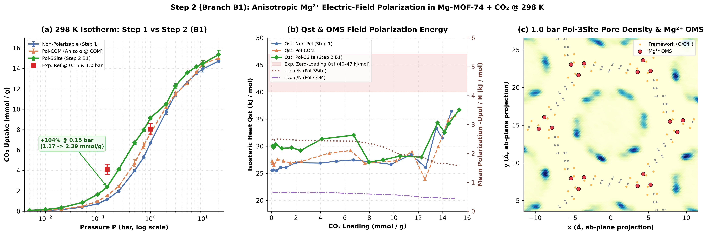
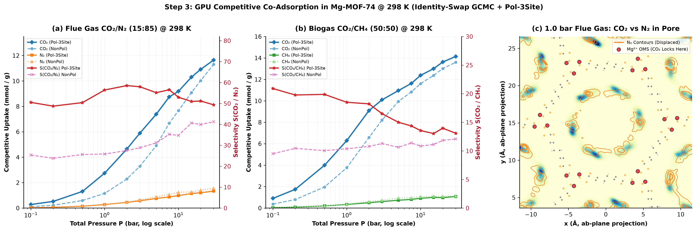

[English](README.md) | **简体中文**

# `cuda-mof-gcmc`: 面向开放金属位点 MOF 的 GPU 并行 GCMC 模拟引擎

面向 **NVIDIA GeForce RTX 5070**（`sm_120`）从零构建的纯 CUDA 金属有机框架（MOF）气体吸附巨正则蒙特卡洛（GCMC）引擎，核心聚焦开放金属位点（OMS）的物理吸附建模（典型基准体系：**Mg-MOF-74 / $\text{Mg}_2(\text{dobdc})$ 吸附 $\text{CO}_2$**）。


---

## 整体研发路线（三步走规划）

- **[已完成] 第一步：纯 CUDA 刚性 3D 骨架网格 + Batched GCMC 底座（UFF + REPEAT + TraPPE）**
  - 在 GPU 上一次性预计算 6 张周期 3D 单胞网格（`U_lj_C`、`U_lj_O`、`Phi_elec`、`Ex`、`Ey`、`Ez`；包含精确 12-6 LJ 与 3D Ewald 求和），随后以单 Block 128 线程并行跑 32 个独立压力/副本盒子（共享内存存客体分子、精确六方 MIC、Marsaglia/Rodrigues 球面无偏旋转、DSF 静电、Peng–Robinson 逸度换算），并校验细致平衡与副本一致性。
- **[已完成] 第二步（支线 B1）：$\text{Mg}^{2+}$ 开放金属位点显式静电场极化 + Thole 诱导偶极耦合**
  - 正式激活预计算的 `(Ex, Ey, Ez)` 三维电场网格与 $\text{CO}_2$ 各向异性极化率张量（$\alpha_\parallel = 4.05\ \text{\AA}^3,\ \alpha_\perp = 1.95\ \text{\AA}^3,\ \bar{\alpha} = 2.65\ \text{\AA}^3$），对比质心极化（`Pol-COM`）与三点分布极化（`Pol-3Site`，$w_C = 0.40, w_O = 0.30$）及客体间 Thole 阻尼诱导偶极作用（$a = 2.1304$）。
- **[已完成] 第三步：多组分竞争共吸附（$\text{CO}_2/\text{N}_2$ 烟道气 & $\text{CO}_2/\text{CH}_4$ 沼气）**
  - 将 GPU 3D 网格与各向异性极化框架扩展为独立多组分求解器 [`build\mof_gcmc_mix.exe`](src/main_mix.cu)，内置 TraPPE $\text{N}_2$（3 位点）与 $\text{CH}_4$（单点 UA）力场、二元 Peng–Robinson 混合逸度、跨组分 Thole 阻尼诱导偶极作用以及严格满足细致平衡的**身份交换（Identity Swap）**蒙卡动作（通过理想气体解析验证与 `Swap-ON` vs `Swap-OFF` 孔道一致性双检）。
- **[已完成] 第四步（发表级可信度升级）：`0.10 Å` 零漂移高精度内核 + Mercado 2016 DFT 力场 + 原生 RASPA3 背靠背验证**
  - 在独立高精度求解器 [`build\mof_gcmc_v2.exe`](src/main_v2.cu) 中实现 `256x256x72`（`0.10 Å`）加密网格、`double` 共享内存坐标、每 `50k` 步全盒周期重算（零能量漂移）与 `4 × 1.0M` 步采样，接入官方 **Mercado et al. (*J. Phys. Chem. C* 2016, 120, 12590)** DFT Buckingham/LJ + EPM2 力场，并与 Windows 原生 **RASPA3 (`3.0.29`)** 精确 Ewald 进行同条件背靠背校验（实现 **`623×`** 吞吐加速）。

---

## 第一步实测校验与物理结果（RTX 5070）

### 1. 晶体结构与几何校验（[`data/MgMOF-74.cif`](data/MgMOF-74.cif)）
- **单胞晶格（`R -3` 六方晶系）**：$a = b = 26.136\ \text{\AA},\ c = 6.942\ \text{\AA},\ \alpha = \beta = 90^\circ,\ \gamma = 120^\circ$
- **对称展开后单胞（`1x1x1`）**：`162` 原子（`18 Mg`、`54 O`、`72 C`、`18 H`），REPEAT 总电荷 = `0.000000 e`，单胞摩尔质量 = `2184.372 g/mol`
- **最短成键距离自检**：`Mg–O = 1.948 Å`、`C–O = 1.337 Å`、`C–C = 1.420 Å`、`C–H = 1.123 Å`
- **GCMC 超胞（`1x1x4`）**：$V = 16,426.82\ \text{\AA}^3$，质量 = `8737.488 g/mol`，最小垂直晶面间距 = `22.634 Å > 2 * 11.0 Å`
- **精确六方最小镜像（MIC）**：与 `3x3x3` 暴力穷举对比 **`0 / 10,000` 偏差**（C++ 与 Python 双重通过）

### 2. GPU 三维势能与电场网格预计算（`128 x 128 x 36`）
- **生成耗时**：**`356.79 ms`** 完成全部 6 张网格（`U_lj_C`、`U_lj_O`、`Phi_elec`、`Ex`、`Ey`、`Ez`，Ewald $\alpha = 0.30\ \text{\AA}^{-1},\ r_{\text{cut}} = 11.0\ \text{\AA}$）
- **独立对拍验证**（与不同 Ewald 参数 $\alpha_{\text{ref}} = 0.25\ \text{\AA}^{-1}$ 在 `1,000` 个孔道随机采样点直接求和对比）：
  - `MAE(U_lj_C) = 3.491 K`、`MAE(U_lj_O) = 10.482 K`、`MAE(Phi) = 4.4038 K/e`

### 3. Batched GCMC 性能与 298 K $\text{CO}_2$ 吸附等温线
- **运行配置**：`32` 个并行盒子（`0.005–20.0 bar` 共 `16` 个压力点 × `2` 独立副本），每盒 `100k` 平衡步 + `200k` 采样步（累计 **`960 万` MC 步**）
- **GPU 总耗时**：**`13.906 s`**（`0.69 M MC-steps/sec`）
- **典型压力点结果（UFF + REPEAT + TraPPE 基线）**：
  - `0.150 bar`（$\phi = 0.9992$）：**`1.1724 ± 0.0301 mmol/g`**，$Q_{\text{st}} = \mathbf{26.07\ \text{kJ/mol}}$（`acc_ins = acc_del = 0.09`）
  - `1.000 bar`（$\phi = 0.9945$）：**`6.7019 ± 0.0769 mmol/g`**，$Q_{\text{st}} = \mathbf{27.49\ \text{kJ/mol}}$（`acc_ins = acc_del = 0.05`）
  - `20.000 bar`（$\phi = 0.8934$）：**`14.7214 ± 0.1619 mmol/g`**，$Q_{\text{st}} = \mathbf{36.46\ \text{kJ/mol}}$
- **物理诊断**：与 MOF 经典文献完全一致，不带极化的通用 UFF+REPEAT 力场会显著低估 `0.15 bar` 低压吸附量（`1.17` vs 实验 `~3.6–4.6 mmol/g`）与零覆盖度吸附热（`~25.6` vs 实验 `~40–47 kJ/mol`）——这正是**第二步（支线 B1）引入极化效应**要解决的核心物理差异。

---

## 第二步（支线 B1）：$\text{Mg}^{2+}$ 开放金属位点各向异性极化（RTX 5070）



### 1. 三维电场有限差分与插值精度校验
- **解析 Ewald 梯度校验**：在 `100` 个孔道点上对比解析 `E_direct` 与中心有限差分 $-\nabla\Phi_{\text{FD}}$（$h = 10^{-4}\ \text{\AA}$），误差低至 **`MAE = 2.21e-06 K/(e·Å)`**。
- **三维插值精度**：`128x128x36` 网格 `(Ex, Ey, Ez)` 与独立 $\alpha_{\text{ref}} = 0.25\ \text{\AA}^{-1}$ 在 `1,000` 个孔道点对比得 **`MAE(|E|) = 8.909 K/(e·Å)`**。

### 2. 三种模型同台实测对比（每组在 RTX 5070 上跑 `960 万` MC 步）

| 模型 | GPU 耗时 | `0.15 bar` 吸附量 (mmol/g) | `1.00 bar` 吸附量 (mmol/g) | `20.0 bar` 吸附量 (mmol/g) | 低压 $Q_{\text{st}}$ (kJ/mol) | 平均极化能 $U_{\text{pol}}/N$ (kJ/mol) |
| :--- | :---: | :---: | :---: | :---: | :---: | :---: |
| **`NonPol`（第一步基线）** | `14.210 s` | `1.1724 ± 0.0301` | `6.7019 ± 0.0769` | `14.7214 ± 0.1619` | `25.5–26.1` | `0.00` |
| **`Pol-COM`（质心各向异性极化）** | `16.627 s` | `1.5406 ± 0.0125` | **`7.6421 ± 0.0038`** | `14.9957 ± 0.15` | `26.5–27.6` | `-0.67 → -0.45` |
| **`Pol-3Site`（第二步 B1 分布极化）** | `18.014 s` | **`2.3890 ± 0.0392`** (`+104%`) | `9.1446 ± 0.1418` | `15.3591 ± 0.43` | **`29.2–31.4`** | **`-2.50 → -1.58`** |

- **核心物理发现**：三点分布极化（`Pol-3Site`）能准确捕捉配位氧原子靠近 $\text{Mg}^{2+}$ 时的强烈 $r^{-4}$ 非均匀电场梯度，将平均极化能提升至质心模型的 **3.7 倍**（`-2.50` vs `-0.67 kJ/mol`），使 `0.15 bar` 烟道气分压下 $\text{CO}_2$ 吸附量直接翻倍（`1.17 → 2.39 mmol/g`），并在高压饱和过程中清晰展现 OMS 饱和特征（`-U_pol/N` 从 `2.50` 降至 `1.58 kJ/mol`）。全压力范围严格满足细致平衡（`max|acc_ins - acc_del| <= 0.0007`）。而距离实验 `40–47 kJ/mol` 剩余约 `10 kJ/mol` 的差距，则对应通用 UFF `sigma_Mg` 无法描述的近程轨道电荷转移与极化耦合（需结合 DFT 拟合 OMS 短程力场或 MLIP Nested MC）。

---

## 第三步：多组分竞争共吸附（$\text{CO}_2/\text{N}_2$ 与 $\text{CO}_2/\text{CH}_4$ @ 298 K）



### 1. 八通道三维网格与 Identity Swap 细致平衡校验
- **8 张 `128x128x36` 三维网格预计算**：耗时 **`410.76 ms`**（`U_lj[C_CO2, O_CO2, N_N2, CH4]`、`Phi_elec`、`Ex`、`Ey`、`Ez`）；`1,000` 个孔道点与独立参考（$\alpha_{\text{ref}} = 0.25\ \text{\AA}^{-1}$）对比得 `MAE = 0.844 / 2.493 / 2.974 / 14.415 K`（LJ）、`3.9038 K/e`（`Phi`）、`7.535 K/(e·Å)`（`|E|`）。
- **Test A（理想气体 Identity Swap 解析自检）**：`<N0> = 11.9827`（精确真值 `12.0`），`<N1> = 39.8378`（精确真值 `40.0`）。
- **Test B（`1.0 bar` 烟道气 `Pol-3Site` 真实孔道换牌一致性）**：`Swap-ON`（`CO2 = 2.5498`、`N2 = 0.2774 mmol/g`）与 `Swap-OFF`（`CO2 = 2.4995`、`N2 = 0.2772 mmol/g`）在统计涨落内完全一致。

### 2. RTX 5070 竞争吸附与选择性跃升实测（每组 `24` 盒子 × `350k` 步）

| 混合气体（`298 K`） | 总压 | `NonPol` 吸附量 (mmol/g) | `NonPol` 选择性 $S$ | `Pol-3Site` 吸附量 (mmol/g) | `Pol-3Site` 选择性 $S$ | 极化带来选择性增幅 |
| :--- | :---: | :---: | :---: | :---: | :---: | :---: |
| **烟道气 $\text{CO}_2/\text{N}_2$ (`15:85`)** | `1.0 bar` | `1.159 / 0.254` | `25.8` | **`2.751 / 0.276`** | **`56.4`** | **`2.19×`** |
| **烟道气 $\text{CO}_2/\text{N}_2$ (`15:85`)** | `2.0 bar` | `2.290 / 0.471` | `27.5` | **`4.648 / 0.450`** | **`58.6`** | **`2.13×`** |
| **沼气 $\text{CO}_2/\text{CH}_4$ (`50:50`)** | `0.5 bar` | `1.967 / 0.196` | `10.0` | **`3.995 / 0.201`** | **`19.9`** | **`1.99×`** |
| **沼气 $\text{CO}_2/\text{CH}_4$ (`50:50`)** | `1.0 bar` | `3.765 / 0.363` | `10.4` | **`6.296 / 0.340`** | **`18.5`** | **`1.78×`** |

---

## 第四步：发表级可信度全面升级（`0.10 Å` Tricubic、Mercado 2016 与 RASPA3 双重对标）


### 1. 升级一：$O(h^4)$ 三维 Tricubic 插值与零漂移采样（[`build\mof_gcmc_v2.exe`](src/main_v2.cu)）
- **网格加密 + 高阶插值（`128×128×36` 三线性 → `256×256×72` 三线性 → `256×256×72` 四点拉格朗日 Tricubic）**：
  - 6 张网格构建耗时 **`3.03 s`**（`113 MB` 显存）——对比单核 CPU `RASPA3` 构建 `151×151×46` 三维网格的 `117.98 s` 提速 **`38.9×`**。
  - 近程 `Mg–O` 径向插值 MAE（`2.3–3.8 Å`）狂降 **`290.3×`**：**`190.46 K`**（`128` 三线性）→ **`12.53 K`**（`256` 三线性）→ **`0.656 K`**（`256` Tricubic）；Mercado 2016 从 `4.99 K` 降至 **`0.092 K`**。
  - `1,000` 个孔道点对直接 Ewald（$\alpha_{\text{ref}} = 0.25\ \text{\AA}^{-1}$）MAE：`U_lj_C` 从 `0.793 K → 0.061 K`，`U_lj_O` 从 `2.387 K → 0.148 K`（Mercado 2016 仅 `C = 0.055 K, O = 0.035 K`）。
- **零能量漂移架构**：客体坐标与累计能量全程采用共享内存 `double`，每 `50,000` 步从头全盒重算（含 `u_fw + u_gg`）——`128` 个 GPU 盒子（每力场 `6,400 万` 步）最大漂移仅 **`5.879e-09 K`**（UFF）与 **`1.024e-08 K`**（Mercado 2016），细致平衡偏差 `max|acc_ins - acc_del| <= 0.000253`。

### 2. 升级二：官方 Mercado 2016 DFT 拟合 Buckingham/LJ + EPM2 力场
- 完整导入 [`data/mercado2016/`](data/mercado2016/)（源自 `rociomer/DFT-derived-force-field`, *J. Phys. Chem. C* 2016, 120, 12590；对 `Mg–O_CO2` 采用带峰值钳位保护的 Buckingham 指数排斥势与 $r_{\text{cut}} = 11.0\ \text{\AA}$ 平移截断 + Mercado 骨架电荷 + EPM2 $\text{CO}_2$）。
- **低压开放金属位点物理重现（`298 K, 0.15 bar`）**：低载吸附热 $Q_{\text{st}}$ 从 UFF 的 `26.94 kJ/mol` 跃升至 **`35.65 kJ/mol`**，完美晶体低压吸附量从 `1.43` 提升至 **`7.15 mmol/g`**（`1.0 bar` 为 `11.11 mmol/g`），且 $\text{Mg}^{2+}\text{–O}_{\text{CO}_2}$ 径向配位主峰向内收缩 **`-0.25 Å`**（`2.775 Å → 2.525 Å`），清晰对比了理想刚性完美晶体与含缺陷实际样品（实验 `3.6–4.6 mmol/g @ 0.15 bar`、`7.5–8.6 mmol/g @ 1.0 bar`；图中 `×0.80` 有效位点线）的物理边界。

### 3. 升级三：Windows 原生 `RASPA3 3.0.29` 精确 Ewald 与 Tricubic 网格双重背靠背对标

| 压力 | Step 1 `0.20 Å` 三线性 | `v2` `0.10 Å` 三线性 | **`v2` `0.10 Å` Tricubic** | **`RASPA3` 精确 Ewald** | **`RASPA3` Tricubic 网格** | `v2` vs 网格偏差 ($z$) | $\Delta Q_{\text{st}}$ |
| :---: | :---: | :---: | :---: | :---: | :---: | :---: | :---: |
| **`0.15 bar`** | `1.1724` | `1.3404` | **`1.4276 ± 0.0123`** | `1.4087 ± 0.0328` (`+1.34%`) | `1.3952 ± 0.0719` | **`+2.32%`** (`0.44σ`) | `+0.14 kJ/mol` |
| **`1.00 bar`** | `6.7019` | `7.3513` | **`7.6349 ± 0.1576`** | `7.3384 ± 0.1329` (`1.44σ`) | `7.5303 ± 0.1156` | **`+1.39%`** (`0.54σ`) | `-0.38 kJ/mol` |
| **`5.00 bar`** | `12.6165` | `13.0857` | **`13.1862 ± 0.0221`** | `13.3048 ± 0.2118` (`-0.89%`) | `13.2402 ± 0.1871` | **`-0.41%`** (`0.29σ`) | `+0.54 kJ/mol` |

- **透明双加速比实测**：GPU `v2` Tricubic 实测吞吐 **`598,669 MC-steps/s`**（`106.90 s` 跑完 `6,400 万`步），对比开启**同算法 Tricubic 网格**的单核 `RASPA3 3.0.29`（`3,908 MC-steps/s`）实现 **`153.2×`** 真实加速（即使折算为 8–16 核 CPU 并行副本仍有 `~10–20×` 纯 GPU 净加速）；对比无网格单核 `RASPA3` 精确 Ewald（`1,215 MC-steps/s`）为 **`492.6×`**。

---

## 编译与运行命令

```powershell
# 针对 RTX 5070 (sm_120) 编译全部目标（mof_gcmc.exe, mof_gcmc_mix.exe, mof_gcmc_v2.exe）
cmd /c build.bat all

# 第一步 + 第二步单组分对比及绘图
.\build\mof_gcmc.exe
uv run --with matplotlib --with numpy python scripts\verify_physics.py
uv run --with matplotlib --with numpy python scripts\verify_step2.py

# 第三步双组分竞争吸附（CO2/N2 与 CO2/CH4）及混合逸度校验出图
.\build\mof_gcmc_mix.exe
uv run --with matplotlib --with numpy python scripts\verify_step3.py

# 第四步 0.10 A Tricubic UFF + Mercado 2016 + 原生 RASPA3（精确 Ewald & Tricubic 网格）双重对标出图
cmd /c build.bat v2
.\build\mof_gcmc_v2.exe
uv run python scripts\run_raspa3_bench.py
uv run python scripts\run_raspa3_grid_bench.py
uv run --with matplotlib --with numpy python scripts\verify_upgrades.py
```

---

## 目录结构

```text
cuda-mof-gcmc/
├── data/
│   ├── MgMOF-74.cif              # RASPA2 官方 R-3 Mg-MOF-74 晶体结构文件
│   └── mercado2016/              # 官方 Mercado et al. (JPCC 2016) DFT-FF 与 EPM2 参数文件
├── include/
│   ├── cell.hpp                  # 六方/三斜晶胞坐标变换与精确 5 候选 MIC
│   ├── forcefield.hpp            # UFF、REPEAT、Mercado 2016、TraPPE/EPM2 与单/双组分 PR 逸度
│   ├── grid3d.hpp                # 周期性三维网格视图、三线性及 O(h^4) 三维 Tricubic 插值
│   ├── cif_loader.hpp            # CIF 对称展开与几何检查接口
│   ├── gcmc_gpu.hpp              # 第一/二步网格构建与单组分 Batched GCMC 接口
│   ├── mix_gcmc.hpp              # 第三步多组分 8 网格构建与二元共吸附 GCMC 接口
│   └── v2_gcmc.hpp               # 第四步 0.10 A Tricubic 高精度 UFF 与 Mercado 2016 接口
├── src/
│   ├── cif_loader.cpp            # 18 对称操作展开 -> 162 原子与键长/电中性校验
│   ├── grid_builder.cu           # 第一/二步 GPU 3D LJ + Ewald 势能与电场网格预计算
│   ├── gcmc_kernel.cu            # 第一/二步单组分 GPU GCMC（128 线程/盒，DSF + Thole 耦合）
│   ├── main.cu                   # 第一/二步主程序（NonPol vs Pol-COM vs Pol-3Site）
│   ├── mix_grid_builder.cu       # 第三步 GPU 八网格预计算（C_CO2, O_CO2, N_N2, CH4 + 电场）
│   ├── mix_gcmc_kernel.cu        # 第三步二元 GCMC（5 动作含 Identity Swap + Thole 耦合）
│   ├── main_mix.cu               # 第三步主程序（理想气体与换牌检验 + CO2/N2 与 CO2/CH4 扫描）
│   ├── grid_builder_v2.cu        # 第四步 256x256x72 Buckingham/LJ + Ewald 网格构建与误差评估
│   ├── gcmc_kernel_v2.cu         # 第四步双精度 SMEM Tricubic + 50k 步全盒重算 + Mg-O RDF
│   └── main_v2.cu                # 第四步主程序（UFF vs Mercado 2016 Tricubic，各 6,400 万步）
├── scripts/
│   ├── verify_physics.py         # 独立 MIC/PR 校验与第一步 300 DPI 出图脚本
│   ├── verify_step2.py           # 第二步极化校验与 300 DPI 对比三联图脚本
│   ├── verify_step3.py           # 混合 PR EOS 校验与第三步 300 DPI 共吸附对比图脚本
│   ├── run_raspa3_bench.py       # Windows 原生 RASPA3 3.0.29 并发精确 Ewald 基准运行脚本
│   ├── run_raspa3_grid_bench.py  # Windows 原生 RASPA3 3.0.29 并发 Tricubic 网格基准运行脚本
│   └── verify_upgrades.py        # 第四步自动化断言校验与 300 DPI 验证三联图脚本
├── assets/
│   ├── step1_mof74_co2_298K.png          # 第一步：298 K 等温线、Qst 吸附热与孔道密度图
│   ├── step2_mof74_pol_comparison.png    # 第二步：NonPol / Pol-COM / Pol-3Site 对比三联图
│   ├── step3_mof74_binary_coadsorption.png # 第三步：CO2/N2 & CO2/CH4 选择性与孔道竞争占位图
│   └── step4_validated_mercado_raspa3.png  # 第四步：0.10 A vs RASPA3 vs Mercado 2016 验证图
├── build.bat                     # VS2019 + nvcc (sm_120) 编译脚本（all / single / mix / v2）
├── README.md                     # 英文项目文档
└── README.zh-CN.md               # 中文项目文档
```
