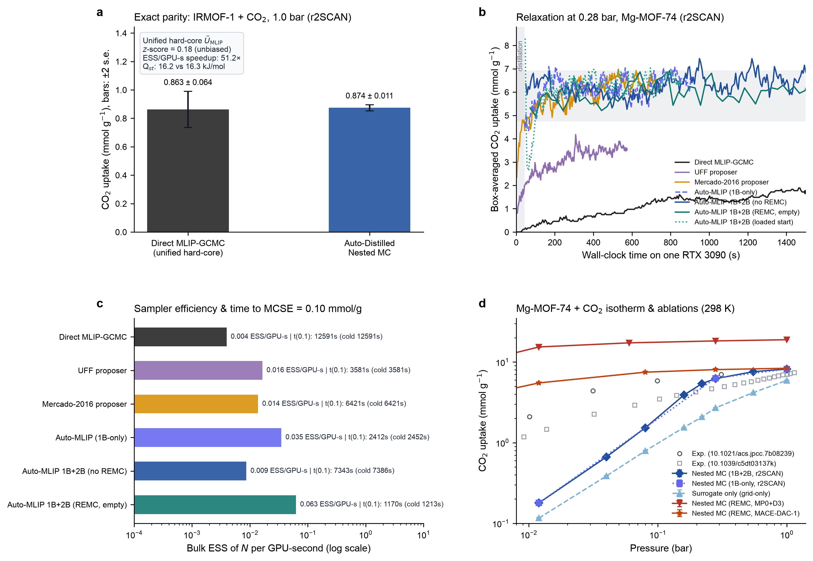
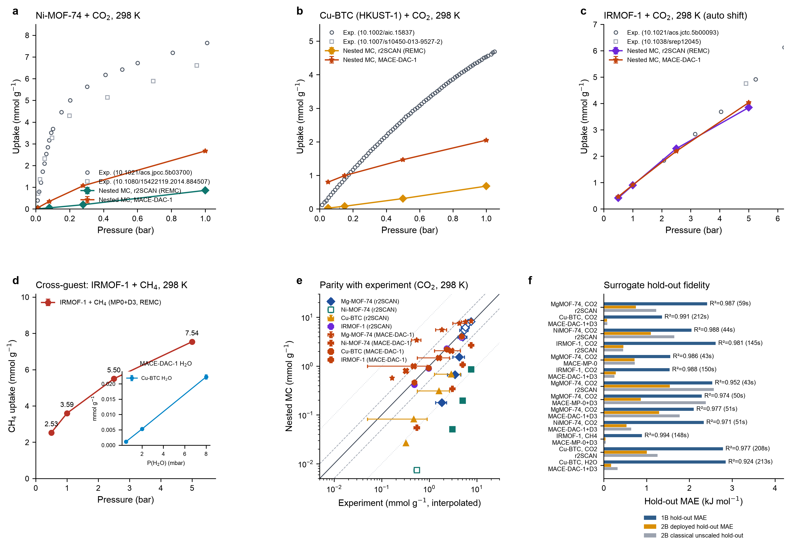

[English](README.md) | **简体中文**

# `cuda-mof-gcmc`


刚性 MOF 气体吸附的 CUDA/C++17 巨正则蒙特卡洛（GCMC）引擎，支持 Windows（RTX 5070，`sm_120`）与多卡 Linux 节点（8×RTX 3090，`sm_86`）。项目包含两部分核心能力：

1. 经 `RASPA3 3.0.29` 严格对标的经典及全自洽极化（`Pol-SCF`）GCMC 求解器，详见[经典验证文档](docs/CLASSICAL_VALIDATION.zh-CN.md)。
2. 面向全系统机器学习原子间势（`mace-matpes-r2scan-0`、`MACE-MP-0`、`MACE-DAC-1`，可选 D3(BJ) 色散）的自动化 **嵌套蒙特卡洛 + 独立副本梯子 $\mu$-REMC** 引擎。系统按 `(框架, 客体, 目标 MLIP)` 按需自动蒸馏一体（1B 径向基+电中性 Ewald 三次插值网格）与二体（2B 孔内二聚体 LUT）参考势，无需手工指定框架原子类型；内层在 GPU 上执行 128 路 Rosenbluth 构型偏倚移动，平衡期冻结边际漂移 $(\Delta\varepsilon, k)$ 校准，外层采用 FP64 节点能量累加的批量 MLIP Metropolis 修正保证严格无偏。完整逐点收敛审计与汇总数据见 [`docs/results/jctc_audit_report.md`](docs/results/jctc_audit_report.md) 与 [`docs/results/jctc_summary.json`](docs/results/jctc_summary.json)。


## 主要研究结果（JCTC v2 归档验证）

以下全部数据均直接来自 [`docs/results/jctc_audit_report.md`](docs/results/jctc_audit_report.md)、[`docs/results/jctc_summary.json`](docs/results/jctc_summary.json)、[`docs/results/precision_hc_audit.json`](docs/results/precision_hc_audit.json) 与 [`docs/results/phase2_phase3_summary.json`](docs/results/phase2_phase3_summary.json)。

- **自动化按需 1B+2B 代理势蒸馏：** 覆盖 4 种 MOF（Mg-MOF-74、Ni-MOF-74、Cu-BTC、IRMOF-1）、3 种客体（$\text{CO}_2$、$\text{CH}_4$、$\text{H}_2\text{O}$）与 4 种 MLIP 设置的 14 个内容寻址缓存单卡构建耗时 `40.3–212.7 s`（仅占多压力 REMC 总 GPU 机时的 `0.08%–1.82%`）。1B 模型 15% 解析留出集 $R^2$ 为 `0.9236–0.9942`（$\text{CO}_2/\text{CH}_4$ 为 `0.9522–0.9942`，MAE `0.89–2.85 kJ/mol`）；2B 模型在独立 20%（`154/38`）二聚体留出集上**严格使用线上截断插值 LUT 内核**验证，MAE 达 `0.04–1.54 kJ/mol`。
- **同目标精确一致性与 $51.2\times$ 采样加速（IRMOF-1 + CO₂，1.0 bar，`r2SCAN`）：** 嵌套 MC（`0.874 ± 0.011 mmol/g`，`Qst = 16.3 ± 0.2 kJ/mol`，**`PASS`**）与直接 MLIP-GCMC（`0.863 ± 0.080 mmol/g` MCSE，`16.2 ± 0.5 kJ/mol`，`FAIL`）偏差仅 $z = 0.18$；同时有效采样率 `ESS_bulk(N)/GPU-s` 提升 **$51.2\times$**（`0.480` vs. `0.009`），达到 `MCSE=0.10 mmol/g` 的冷启动壁钟时间缩短 **$9.7\times$**（`179 s` vs. `1,737 s`）。
- **开放金属位点效率与外层多体修正必要性（Mg-MOF-74 + CO₂，0.28 bar，`r2SCAN`）：** 单压力直接 MLIP-GCMC（`1.165 ± 0.290`，`ESS = 6`）、UFF 嵌套 MC（`3.157 ± 0.251`，`ins/del = 0.39` 严重不对称）与定制 Mercado-2016 力场嵌套 MC（`6.044 ± 0.295`，`ESS = 10`）均未通过多链收敛判据；结合 1B+2B 蒸馏与独立梯子 $\mu$-REMC 将装载量体相 ESS 提升至 **`446`**（`6.222 ± 0.041 mmol/g`，`Qst = 39.0 ± 0.2 kJ/mol`），并与独立加倍的 `1×1×4` 超胞有限尺寸验证（`6.028 ± 0.108 mmol/g`，$z = 1.69$）在误差内一致。若省去外层全系统 MLIP 修正（仅跑代理网格 `grid_only`），0.28 bar 吸附量低估高达 **`-56.6%`**（`2.703` vs. `6.222 mmol/g`）。
- **零样本基础势与领域微调 `MACE-DAC-1+PBE-D3` 及全量收敛审计：** 全套 23 组运行共 76 个压力点中，**`41/76`** 通过全部 5 项严格 Vehtari 判据（非仅网格 MLIP 可估点中 **`38/64`** 通过），其中面向 MOF 碳捕集微调的 **`MACE-DAC-1+PBE-D3` $\text{CO}_2$ 等温线跨全部 4 种 MOF 实现 18/18（100%）全通过**。Widom 插入与平衡态能量分解揭示 D3(BJ) 在 Mg-MOF-74 上贡献了 `47.9%–53.0%`（`MACE-DAC-1`）与 `45.8%–54.1%`（`MP0+D3`）的结合能。所有 `34 FAIL + 1 INSUFFICIENT` 点均在报告中逐一公开归因（包含刻意设置的失败基线、高密度过结合 `MP0+D3`、`Cu-BTC H2O` 等极稀空箱尾分布退化以及陡峭过渡区次级能量的微弱未达标点）。
- **数值精度、硬核边界、多卡扩展与经典基线：** `FP32` 前向配合 `FP64` 节点累加与全 `FP64` 对比在 64 组外层转移对上达成 **`0%` 接受/拒绝判决翻转**（RMS 偏差 `0.00044–0.00130 kJ/mol`，推理提速 `5.93×–9.49×`）；4×RTX 3090 上副本分片纯 MC 加速 **`3.26×`**，压力队列端到端加速 `2.19×`；经典三维插值内核与单核 `RASPA3 3.0.29` 偏差 `≤ 0.54σ`（`598,669 MC-steps/s`），`Pol-SCF` 极化求解与精确矩阵求逆偏差 `1.83×10⁻⁸ K`。

````carousel

<!-- slide -->

<!-- slide -->

<!-- slide -->

````

## 代码结构

1. **结构与客体前处理**（[`scripts/qeq_charges.py`](scripts/qeq_charges.py)、[`scripts/guests.py`](scripts/guests.py)）：ASE 展开任意空间群并保留 CIF 电荷；无电荷框架采用带屏蔽的周期性 Ewald QEq；刚性客体支持最多 12 个位点，逸度由 Peng–Robinson 方程计算。
2. **代理势蒸馏与 GPU 提议器**（[`scripts/mlip_distill.py`](scripts/mlip_distill.py)、[`src/proposer_dll.cu`](src/proposer_dll.cu)、[`include/proposer_api.h`](include/proposer_api.h)）：1B 三维网格与截断 2B LUT 驻留显存，每模拟箱独占 1 个 CUDA 线程块（128 路并行 CBMC），经 C ABI 零开销交互并周期性全 FP64 重算消除累加漂移。
3. **嵌套 MC、$\mu$-REMC、收敛诊断与全轨迹归档**（[`scripts/nested_mc_engine.py`](scripts/nested_mc_engine.py)、[`scripts/mcmc_diagnostics.py`](scripts/mcmc_diagnostics.py)、[`scripts/multi_gpu.py`](scripts/multi_gpu.py)、[`scripts/archive_jctc_results.py`](scripts/archive_jctc_results.py)）：批量 MACE/D3 评估（FP32 + FP64 节点累加）、平衡期冻结边际漂移 $(\Delta\varepsilon, k)$ 校准、独立梯子 $\mu$-REMC、rank-normalized $\hat{R}$ / 体尾 ESS 判据及带 SHA-256 溯源的全轨迹归档校验。

## 快速开始

### 环境检测与编译

```powershell
# Windows：只检查依赖
cmd /c fast_start.bat -CheckOnly
# Windows：补齐依赖、编译并运行快速自检（加 -FullTest 跑完整经典采样分布对比）
cmd /c fast_start.bat
```

```bash
# Linux
./fast_start.sh --check-only
./fast_start.sh --gpu 0
```

### 运行嵌套 MC 与独立梯子 $\mu$-REMC（[`scripts/run_mlip_gcmc.py`](scripts/run_mlip_gcmc.py)）

```bash
CUDA_VISIBLE_DEVICES=0,1,2,3 .venv-mlip/bin/python -u scripts/run_mlip_gcmc.py \
  --cif data/IRMOF-1.cif --supercell 1 1 1 --guest co2 --temp 298 \
  --pressures 0.5 1.0 2.5 5.0 --proposer auto_mlip --cbmc-k 128 \
  --model build/models/mace-dac-1.model --dispersion on --dispersion-xc pbe \
  --boxes 4 --k-steps 24 --eq-cycles 800 --prod-cycles 16000 \
  --distill-cache-dir build/distill_cache --gpus 0 1 2 3 --parallel-mode remc --swap-every 2 \
  --out-json build/irmof1_co2_macedac_remc.json
```

Widom 插入与能量分解：

```bash
.venv-mlip/bin/python -u scripts/widom_mlip.py \
  --cif data/MgMOF-74.cif --supercell 1 1 2 --guest co2 --temp 298 \
  --model mace-matpes-r2scan-0 --dispersion off --n-samples 6000 \
  --out-json build/widom_mgmof74_r2scan.json
```

校验离线/Release 完整轨迹包（存在 `jctc_traces.npz` 时）并从 [`docs/results/jctc_summary.json`](docs/results/jctc_summary.json) 重新生成全部 5 张 JCTC 论文插图：

```bash
.venv-mlip/bin/python scripts/archive_jctc_results.py \
  --verify-summary docs/results/jctc_summary.json --traces-npz docs/results/jctc_traces.npz
.venv-mlip/bin/python scripts/plot_phase4_figures.py --mode jctc
```

### 经典与 `Pol-SCF` 回归测试

```powershell
.\build\mof_gcmc_cli.exe --test-scf
.\build\mof_gcmc_cli.exe --config configs\mg_mof74_co2_298K_uff.json
.\.venv-mlip\Scripts\python.exe -m pytest -v -m "not mlip and not slow"
```

## 文档索引

- **JCTC 审计与精度校验数据：** [`docs/results/jctc_audit_report.md`](docs/results/jctc_audit_report.md) · [`docs/results/jctc_summary.json`](docs/results/jctc_summary.json) · [`docs/results/precision_hc_audit.json`](docs/results/precision_hc_audit.json) · [`docs/results/phase2_phase3_summary.json`](docs/results/phase2_phase3_summary.json)
- **经典与极化基准验证（`RASPA3 3.0.29`）：** [经典与极化基准（中文）](docs/CLASSICAL_VALIDATION.zh-CN.md) · [English](docs/CLASSICAL_VALIDATION.md)

```text
cuda-mof-gcmc/
├── fast_start.bat / .sh  # 环境检测、依赖安装、编译与自检
├── build.bat / .sh       # MSVC+CUDA / nvcc+g++ 编译脚本
├── configs/              # mof_gcmc_cli 预设（UFF、Mercado、烟道气、Pol-SCF）
├── data/                 # CIF、Mercado 力场参数、实验等温线
├── docs/                 # 经典与极化验证文档及 results/ 审计汇总数据
├── include/              # CUDA/C++17 头文件与 proposer C ABI
├── src/                  # CUDA 内核与驱动；src/legacy/ 为旧版
├── scripts/              # run_mlip_gcmc、mlip_distill、widom_mlip、nested_mc_engine、multi_gpu、archive_jctc_results、plot_phase4_figures
├── tests/                # pytest 测试
└── assets/               # Fig. 1-5 论文插图（300 DPI）
```
