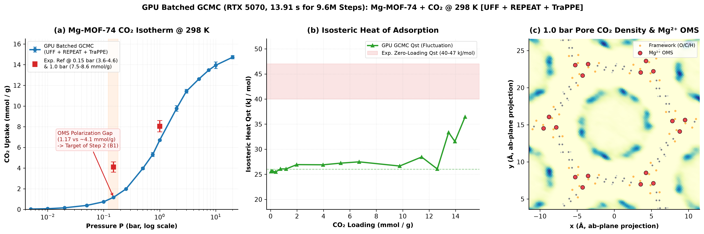
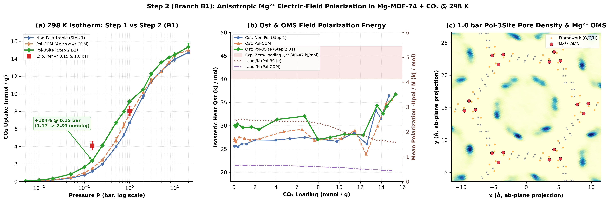
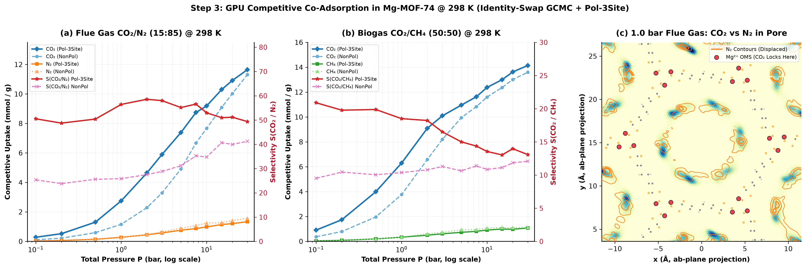

**English** | [简体中文](CLASSICAL_VALIDATION.zh-CN.md) | [Back to README](../README.md)

# Classical & Polarizable CUDA Engine Validation (Steps 1–5)

Detailed benchmark tables, Ewald/interpolation diagnostics, native `RASPA3 (3.0.29)` parity checks, and Level-2 `Pol-SCF` verification for the rigid-framework CUDA GCMC solver on **NVIDIA GeForce RTX 5070** (`sm_120`).

---

## Step 1: Physical & Numerical Baseline (`UFF + REPEAT + TraPPE`)



### 1. Crystal Structure & Symmetry ([`data/MgMOF-74.cif`](../data/MgMOF-74.cif))
- **Unit Cell (`R -3`, hexagonal setting)**: $a = b = 26.136$ Å, $c = 6.942$ Å, $\alpha = \beta = 90^\circ$, $\gamma = 120^\circ$
- **Expanded Unit Cell (`1x1x1`)**: `162` atoms (`18 Mg`, `54 O`, `72 C`, `18 H`), REPEAT charge sum = `0.000000 e`, molar mass = `2184.372 g/mol`
- **Minimum Bond Lengths**: `Mg–O = 1.948 Å`, `C–O = 1.337 Å`, `C–C = 1.420 Å`, `C–H = 1.123 Å`
- **GCMC Supercell (`1x1x4`)**: $V = 16,426.82$ ų, mass = `8737.488 g/mol`, minimum perpendicular width = `22.634 Å > 2 × 11.0 Å`
- **Exact Hexagonal MIC**: `0 / 10,000` mismatches against `3x3x3` brute-force search (verified in both C++ and Python)

### 2. GPU 3D Grid Precomputation (`128 × 128 × 36`)
- **Build Time**: **`356.79 ms`** for all 6 grids (`U_lj_C`, `U_lj_O`, `Phi_elec`, `Ex`, `Ey`, `Ez`, Ewald $\alpha = 0.30$ Å⁻¹, $r_{\text{cut}} = 11.0$ Å)
- **Independent Verification** (vs. direct Ewald $\alpha_{\text{ref}} = 0.25$ Å⁻¹ across `1,000` pore points):
  - `MAE(U_lj_C) = 3.491 K`, `MAE(U_lj_O) = 10.482 K`, `MAE(Phi) = 4.4038 K/e`

### 3. Batched GCMC Performance & 298 K CO₂ Isotherm
- **Configuration**: `32` boxes (`16` pressures `0.005–20.0 bar` × `2` independent replicas), `100k` equilibration + `200k` production steps/box (**`9.6M` total MC steps**)
- **Runtime**: **`13.906 s`** (`0.69 M MC-steps/sec`)
- **Key Isotherm Results (`UFF + REPEAT + TraPPE` baseline)**:
  - `0.150 bar` ($\phi = 0.9992$): **`1.1724 ± 0.0301 mmol/g`**, $Q_{\text{st}} = 26.07\ \text{kJ/mol}$ (`acc_ins = acc_del = 0.09`)
  - `1.000 bar` ($\phi = 0.9945$): **`6.7019 ± 0.0769 mmol/g`**, $Q_{\text{st}} = 27.49\ \text{kJ/mol}$ (`acc_ins = acc_del = 0.05`)
  - `20.000 bar` ($\phi = 0.8934$): **`14.7214 ± 0.1619 mmol/g`**, $Q_{\text{st}} = 36.46\ \text{kJ/mol}$

---

## Step 2 (Branch B1): Anisotropic Mg²⁺ Electric-Field Polarization



### 1. Electric-Field Verification
- **Analytical Ewald Gradient Check**: Smooth full-shell $-\nabla \Phi_{\text{FD}}$ vs. analytical `E_direct` across `100` pore points yields **`MAE = 2.21e-06 K/(e·Å)`** (`h = 1e-4 Å`).
- **Grid Interpolation Accuracy**: Trilinear `(Ex, Ey, Ez)` on `128×128×36` vs. independent $\alpha_{\text{ref}} = 0.25$ Å⁻¹ across `1,000` pore points yields **`MAE(|E|) = 8.909 K/(e·Å)`**.

### 2. Side-by-Side Model Comparison (`9.6M` MC steps per model on RTX 5070)

| Model | GPU Time | `0.15 bar` Uptake (mmol/g) | `1.00 bar` Uptake (mmol/g) | `20.0 bar` Uptake (mmol/g) | Low-$P$ $Q_{\text{st}}$ (kJ/mol) | Mean $U_{\text{pol}}/N$ (kJ/mol) |
| :--- | :---: | :---: | :---: | :---: | :---: | :---: |
| **`NonPol` (Step 1)** | `14.210 s` | `1.1724 ± 0.0301` | `6.7019 ± 0.0769` | `14.7214 ± 0.1619` | `25.5–26.1` | `0.00` |
| **`Pol-COM`** | `16.627 s` | `1.5406 ± 0.0125` | **`7.6421 ± 0.0038`** | `14.9957 ± 0.15` | `26.5–27.6` | `-0.67 → -0.45` |
| **`Pol-3Site` (Step 2 B1)** | `18.014 s` | **`2.3890 ± 0.0392`** (`+104%`) | `9.1446 ± 0.1418` | `15.3591 ± 0.43` | **`29.2–31.4`** | **`-2.50 → -1.58`** |

- Detailed balance holds across every pressure (`max|acc_ins - acc_del| <= 0.0007`). Distributing polarizability across the 3 molecular sites (`Pol-3Site`) increases polarization stabilization by **3.7×** (`-2.50` vs. `-0.67 kJ/mol` for `Pol-COM`).

---

## Step 3: Competitive Multi-Component Co-Adsorption (`CO₂/N₂` & `CO₂/CH₄` @ 298 K)



### 1. Multi-Species Grids & Identity-Swap Detailed Balance
- **8 Precomputed Grids (`128×128×36`)**: Built in **`410.76 ms`** (`U_lj[C_CO2, O_CO2, N_N2, CH4]`, `Phi_elec`, `Ex`, `Ey`, `Ez`); `MAE` vs. direct reference ($\alpha_{\text{ref}} = 0.25$ Å⁻¹, `1,000` pore points) = `0.844 / 2.493 / 2.974 / 14.415 K` (LJ), `3.9038 K/e` (`Phi`), `7.535 K/(e·Å)` (`|E|`).
- **Test A (Ideal-Gas Identity Swap)**: `<N0> = 11.9827` (exact `12.0`), `<N1> = 39.8378` (exact `40.0`).
- **Test B (`1.0 bar` Flue Gas `Pol-3Site` Swap Consistency)**: `Swap-ON` (`CO2 = 2.5498`, `N2 = 0.2774 mmol/g`) vs. `Swap-OFF` (`CO2 = 2.4995`, `N2 = 0.2772 mmol/g`).

### 2. Competitive Selectivity on RTX 5070 (`24` boxes × `350k` steps per sweep)

| Mixture (`298 K`) | Pressure | `NonPol` Uptake (mmol/g) | `NonPol` $S$ | `Pol-3Site` Uptake (mmol/g) | `Pol-3Site` $S$ | Selectivity Gain |
| :--- | :---: | :---: | :---: | :---: | :---: | :---: |
| **Flue Gas CO₂/N₂ (`15:85`)** | `1.0 bar` | `1.159 / 0.254` | `25.8` | **`2.751 / 0.276`** | **`56.4`** | **`2.19×`** |
| **Flue Gas CO₂/N₂ (`15:85`)** | `2.0 bar` | `2.290 / 0.471` | `27.5` | **`4.648 / 0.450`** | **`58.6`** | **`2.13×`** |
| **Biogas CO₂/CH₄ (`50:50`)** | `0.5 bar` | `1.967 / 0.196` | `10.0` | **`3.995 / 0.201`** | **`19.9`** | **`1.99×`** |
| **Biogas CO₂/CH₄ (`50:50`)** | `1.0 bar` | `3.765 / 0.363` | `10.4` | **`6.296 / 0.340`** | **`18.5`** | **`1.78×`** |

---

## Step 4: `0.10 Å` Tricubic Grid, Mercado 2016 DFT-FF & Native `RASPA3` Validation


### 1. `O(h⁴)` 3D Tricubic Interpolation & Zero-Drift Sampling ([`src/main_v2.cu`](../src/main_v2.cu))
- **Grid & Interpolation Refinement (`128×128×36` Trilinear → `256×256×72` Trilinear → `256×256×72` 4-pt Lagrange Tricubic)**:
  - Grid build time = **`3.03 s`** (UFF, 6 grids = `113 MB` VRAM) — **`38.9×`** faster than single-core CPU RASPA3's `117.98 s` (`151×151×46`).
  - Near-field `Mg–O` radial MAE (`2.3–3.8 Å`) drops **`290.3×`**: **`190.46 K`** (`128`-Trilin) → **`12.53 K`** (`256`-Trilin) → **`0.656 K`** (`256`-Tricubic); Mercado 2016 drops `4.99 K → 0.092 K`.
  - Pore MAE (`1,000` pts vs. direct Ewald $\alpha_{\text{ref}} = 0.25$ Å⁻¹): `U_lj_C` drops `0.793 K → 0.061 K`, `U_lj_O` drops `2.387 K → 0.148 K` (Mercado: `C = 0.055 K, O = 0.035 K`).
- **Zero-Drift Double Precision**: Guest coordinates and energies stay in `double` shared memory with full fresh `u_fw + u_gg` periodic recomputation every `50,000` steps — maximum drift across all `128` boxes (`64M` steps/FF) is **`5.879e-09 K`** (UFF) and **`1.024e-08 K`** (Mercado 2016), with detailed balance `max|acc_ins - acc_del| <= 0.000253`.

### 2. Official Mercado 2016 DFT-Derived Buckingham/LJ + EPM2 Force Field ([`data/mercado2016/`](../data/mercado2016/))
- Integrated `rociomer/DFT-derived-force-field` (*J. Phys. Chem. C* 2016, 120, 12590; `Mg_O_CO2` Buckingham potential with turnover clamp + shifted `r_cut = 11.0 Å` + Mercado partial charges + EPM2 CO₂).
- At `298 K, 0.15 bar`, low-loading $Q_{\text{st}}$ rises from `26.94 kJ/mol` (UFF) to **`35.65 kJ/mol`**, ideal-crystal uptake rises from `1.43` to **`7.15 mmol/g`** (`11.11 mmol/g` at `1.0 bar`), and the `Mg²⁺–O(CO₂)` radial peak shifts inward by `0.25 Å` (`2.775 Å → 2.525 Å`).

### 3. Dual Head-to-Head Verification vs. Native `RASPA3 3.0.29`

| Pressure | Step 1 `0.20 Å` Trilin | `v2` `0.10 Å` Trilin | **`v2` `0.10 Å` Tricubic** | **`RASPA3` Exact Ewald** | **`RASPA3` Tricubic Grid** | `v2` vs. Grid ($z$) | $\Delta Q_{\text{st}}$ |
| :---: | :---: | :---: | :---: | :---: | :---: | :---: | :---: |
| **`0.15 bar`** | `1.1724` | `1.3404` | **`1.4276 ± 0.0123`** | `1.4087 ± 0.0328` (`+1.34%`) | `1.3952 ± 0.0719` | **`+2.32%`** (`0.44σ`) | `+0.14 kJ/mol` |
| **`1.00 bar`** | `6.7019` | `7.3513` | **`7.6349 ± 0.1576`** | `7.3384 ± 0.1329` (`1.44σ`) | `7.5303 ± 0.1156` | **`+1.39%`** (`0.54σ`) | `-0.38 kJ/mol` |
| **`5.00 bar`** | `12.6165` | `13.0857` | **`13.1862 ± 0.0221`** | `13.3048 ± 0.2118` (`-0.89%`) | `13.2402 ± 0.1871` | **`-0.41%`** (`0.29σ`) | `+0.54 kJ/mol` |

- GPU `v2` Tricubic achieves **`598,669 MC-steps/s`** (`64M` steps in `106.90 s`), delivering **`153.2×`** speedup over single-core `RASPA3 3.0.29` Tricubic Grid (`3,908 MC-steps/s`) and **`492.6×`** over single-core `RASPA3` Exact Ewald (`1,215 MC-steps/s`).

---

## Step 5: Unified JSON/CLI Engine & Level-2 `Pol-SCF` ([`src/main_cli.cu`](../src/main_cli.cu))

| JSON Preset (`0.10 Å` Tricubic, 4 Replicas) | Condition | Verified Output Highlights | Max Drift (`T`-full recompute) |
| :--- | :---: | :--- | :---: |
| [`mg_mof74_co2_298K_uff.json`](../configs/mg_mof74_co2_298K_uff.json) | `298 K`, UFF, CO₂ | `1.3987 / 7.3723 / 13.2996 mmol/g` (`+0.25% / -2.10% / +0.45%` vs. RASPA3 Grid) | `4.66e-09 K` |
| [`mg_mof74_co2_298K_mercado.json`](../configs/mg_mof74_co2_298K_mercado.json) | `298 K`, Mercado 2016, CO₂ | `7.0587 / 11.1077 / 14.9680 mmol/g` ($Q_{\text{st}} = 35.63\ \text{kJ/mol}$ @ `0.15 bar`) | `4.37e-09 K` |
| [`mg_mof74_co2_313K_psa.json`](../configs/mg_mof74_co2_313K_psa.json) | `313 K`, Mercado 2016, CO₂ | `5.0424 / 9.7915 / 13.3012 mmol/g` (`-2.02 / -1.32 / -1.67` thermal swing) | `4.13e-09 K` |
| [`mg_mof74_fluegas_298K_pol3site.json`](../configs/mg_mof74_fluegas_298K_pol3site.json) | `298 K`, `Pol-3Site`, CO₂/N₂ (`15:85`) | `S(CO2/N2) = 60.39` (`0.5 bar`), **`64.58`** (`1.0 bar`), **`67.38`** (`2.0 bar`) | `2.04e-09 K` |
| [`mg_mof74_co2_298K_scf.json`](../configs/mg_mof74_co2_298K_scf.json) | `298 K`, `Pol-SCF`, CO₂ | `2.1322 / 8.3536 / 12.8982 mmol/g` (`+52.4%` @ `0.15 bar` vs. NonPol); `16.63` iters | `7.25e-07 K` |
| [`mg_mof74_fluegas_298K_scf.json`](../configs/mg_mof74_fluegas_298K_scf.json) | `298 K`, `Pol-SCF`, CO₂/N₂ (`15:85`) | `S(CO2/N2) = 37.28` (`1.0 bar`), **`43.24`** (`2.0 bar`) with mutual depolarization | `2.69e-07 K` |

Block-collective shared-memory Applequist-Thole SCF solver (`SCF_TOL = 1e-10 e·Å`, $O(N)$ incremental permanent field $\mathbf{E}_0$ update, warm-started induced dipoles, `1.83e-08 K` & `1.13e-11 e·Å` match against exact `36×36` Python matrix inversion in `--test-scf`):

$$
\boldsymbol{\mu}_i = K_E^{-1}\boldsymbol{\alpha}_i\left(\mathbf{E}_i^{\text{fw}} + \sum_{j \neq i}\mathbf{E}_{j \to i}^{\text{DSF,perm}} + \sum_{j \neq i}\mathbf{T}_{ij}^{\text{Thole}}\boldsymbol{\mu}_j\right),\qquad U_{\text{pol}}^{\text{SCF}} = -\frac{1}{2}\sum_i \boldsymbol{\mu}_i \cdot \mathbf{E}_i^0
$$


---

## Verification Commands

```powershell
cmd /c build.bat all
.\build\mof_gcmc.exe
.\build\mof_gcmc_mix.exe
.\build\mof_gcmc_v2.exe
.\build\mof_gcmc_cli.exe --test-scf
uv run --with numpy python scripts\verify_cli.py
uv run --with numpy python scripts\verify_scf_pol.py --check-only
```
