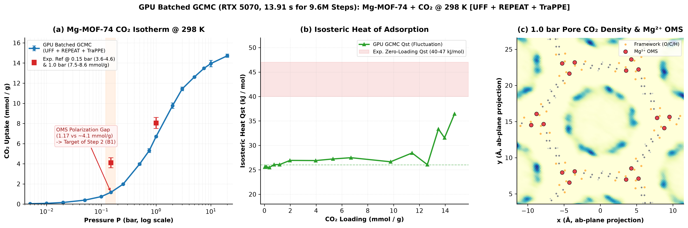
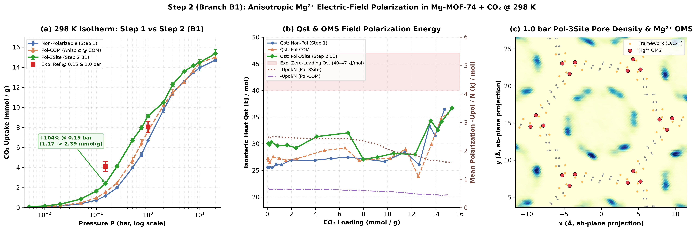
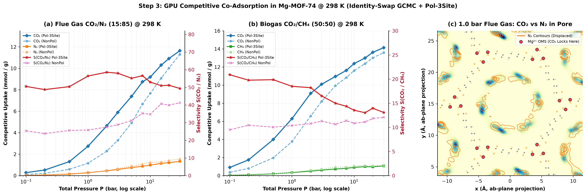

[English](CLASSICAL_VALIDATION.md) | **简体中文** | [返回 README](../README.zh-CN.md)

# 经典与全自洽极化 CUDA 引擎基准校验（第一至五步）

本文件归档了刚性骨架 CUDA GCMC 求解器在 **NVIDIA GeForce RTX 5070**（`sm_120`）上第一至五步的详细数值校验、Ewald/三维插值误差指标、`RASPA3 (3.0.29)` 背靠背对标表及 Level-2 `Pol-SCF` 核验结果。

---

## 第一步：晶体几何、三维网格与无极化基线（`UFF + REPEAT + TraPPE`）



### 1. 晶体结构与几何校验（[`data/MgMOF-74.cif`](../data/MgMOF-74.cif)）
- **单胞晶格（`R -3` 六方晶系）**：$a = b = 26.136$ Å，$c = 6.942$ Å，$\alpha = \beta = 90^\circ$，$\gamma = 120^\circ$
- **对称展开后单胞（`1x1x1`）**：`162` 原子（`18 Mg`、`54 O`、`72 C`、`18 H`），REPEAT 总电荷 = `0.000000 e`，摩尔质量 = `2184.372 g/mol`
- **最短成键距离自检**：`Mg–O = 1.948 Å`、`C–O = 1.337 Å`、`C–C = 1.420 Å`、`C–H = 1.123 Å`
- **GCMC 超胞（`1x1x4`）**：$V = 16,426.82$ ų，质量 = `8737.488 g/mol`，最小垂直晶面间距 = `22.634 Å > 2 × 11.0 Å`
- **精确六方最小镜像（MIC）**：与 `3x3x3` 暴力穷举对比 **`0 / 10,000` 偏差**（C++ 与 Python 双重通过）

### 2. GPU 三维势能与电场网格预计算（`128 × 128 × 36`）
- **生成耗时**：**`356.79 ms`** 完成全部 6 张网格（`U_lj_C`、`U_lj_O`、`Phi_elec`、`Ex`、`Ey`、`Ez`，Ewald $\alpha = 0.30$ Å⁻¹，$r_{\text{cut}} = 11.0$ Å）
- **独立对拍验证**（与不同 Ewald 参数 $\alpha_{\text{ref}} = 0.25$ Å⁻¹ 在 `1,000` 个孔道点直接求和对比）：
  - `MAE(U_lj_C) = 3.491 K`、`MAE(U_lj_O) = 10.482 K`、`MAE(Phi) = 4.4038 K/e`

### 3. Batched GCMC 性能与 298 K CO₂ 等温线
- **运行配置**：`32` 个并行盒子（`16` 个压力点 `0.005–20.0 bar` × `2` 副本），每盒 `100k` 平衡 + `200k` 生产步（累计 **`960 万` MC 步**）
- **GPU 总耗时**：**`13.906 s`**（`0.69 M MC-steps/sec`）
- **典型压力点（`UFF + REPEAT + TraPPE` 基线）**：
  - `0.150 bar`（$\phi = 0.9992$）：**`1.1724 ± 0.0301 mmol/g`**，$Q_{\text{st}} = 26.07\ \text{kJ/mol}$（`acc_ins = acc_del = 0.09`）
  - `1.000 bar`（$\phi = 0.9945$）：**`6.7019 ± 0.0769 mmol/g`**，$Q_{\text{st}} = 27.49\ \text{kJ/mol}$（`acc_ins = acc_del = 0.05`）
  - `20.000 bar`（$\phi = 0.8934$）：**`14.7214 ± 0.1619 mmol/g`**，$Q_{\text{st}} = 36.46\ \text{kJ/mol}$

---

## 第二步（支线 B1）：Mg²⁺ 开放金属位点各向异性极化



### 1. 三维电场有限差分与插值精度校验
- **解析 Ewald 梯度校验**：在 `100` 个孔道点对比解析 `E_direct` 与中心有限差分 $-\nabla\Phi_{\text{FD}}$（$h = 10^{-4}$ Å），误差低至 **`MAE = 2.21e-06 K/(e·Å)`**。
- **三维插值精度**：`128×128×36` 网格 `(Ex, Ey, Ez)` 与独立 $\alpha_{\text{ref}} = 0.25$ Å⁻¹ 在 `1,000` 个孔道点对比得 **`MAE(|E|) = 8.909 K/(e·Å)`**。

### 2. 三种模型同台实测对比（每组 `960 万` MC 步）

| 模型 | GPU 耗时 | `0.15 bar` 吸附量 (mmol/g) | `1.00 bar` 吸附量 (mmol/g) | `20.0 bar` 吸附量 (mmol/g) | 低压 $Q_{\text{st}}$ (kJ/mol) | 平均极化能 $U_{\text{pol}}/N$ (kJ/mol) |
| :--- | :---: | :---: | :---: | :---: | :---: | :---: |
| **`NonPol`（第一步基线）** | `14.210 s` | `1.1724 ± 0.0301` | `6.7019 ± 0.0769` | `14.7214 ± 0.1619` | `25.5–26.1` | `0.00` |
| **`Pol-COM`（质心各向异性极化）** | `16.627 s` | `1.5406 ± 0.0125` | **`7.6421 ± 0.0038`** | `14.9957 ± 0.15` | `26.5–27.6` | `-0.67 → -0.45` |
| **`Pol-3Site`（第二步 B1 分布极化）** | `18.014 s` | **`2.3890 ± 0.0392`** (`+104%`) | `9.1446 ± 0.1418` | `15.3591 ± 0.43` | **`29.2–31.4`** | **`-2.50 → -1.58`** |

- 全压力严格满足细致平衡（`max|acc_ins - acc_del| <= 0.0007`）。`Pol-3Site` 将分子极化稳定能提高至 `Pol-COM` 的 **3.7 倍**（`-2.50` vs `-0.67 kJ/mol`）。

---

## 第三步：多组分竞争共吸附（CO₂/N₂ 与 CO₂/CH₄ @ 298 K）



### 1. 八通道三维网格与 Identity Swap 细致平衡校验
- **8 张 `128×128×36` 三维网格预计算**：耗时 **`410.76 ms`**（`U_lj[C_CO2, O_CO2, N_N2, CH4]`、`Phi_elec`、`Ex`、`Ey`、`Ez`）；`1,000` 个孔道点对比 $\alpha_{\text{ref}} = 0.25$ Å⁻¹ 得 `MAE = 0.844 / 2.493 / 2.974 / 14.415 K`（LJ）、`3.9038 K/e`（`Phi`）、`7.535 K/(e·Å)`（`|E|`）。
- **Test A（理想气体 Identity Swap 自检）**：`<N0> = 11.9827`（精确 `12.0`），`<N1> = 39.8378`（精确 `40.0`）。
- **Test B（`1.0 bar` 烟道气 `Pol-3Site` 换牌一致性）**：`Swap-ON`（`CO2 = 2.5498`、`N2 = 0.2774 mmol/g`）与 `Swap-OFF`（`CO2 = 2.4995`、`N2 = 0.2772 mmol/g`）一致。

### 2. RTX 5070 竞争吸附实测（每组 `24` 盒 × `350k` 步）

| 混合气体（`298 K`） | 总压 | `NonPol` 吸附量 (mmol/g) | `NonPol` 选择性 $S$ | `Pol-3Site` 吸附量 (mmol/g) | `Pol-3Site` 选择性 $S$ | 极化选择性增幅 |
| :--- | :---: | :---: | :---: | :---: | :---: | :---: |
| **烟道气 CO₂/N₂ (`15:85`)** | `1.0 bar` | `1.159 / 0.254` | `25.8` | **`2.751 / 0.276`** | **`56.4`** | **`2.19×`** |
| **烟道气 CO₂/N₂ (`15:85`)** | `2.0 bar` | `2.290 / 0.471` | `27.5` | **`4.648 / 0.450`** | **`58.6`** | **`2.13×`** |
| **沼气 CO₂/CH₄ (`50:50`)** | `0.5 bar` | `1.967 / 0.196` | `10.0` | **`3.995 / 0.201`** | **`19.9`** | **`1.99×`** |
| **沼气 CO₂/CH₄ (`50:50`)** | `1.0 bar` | `3.765 / 0.363` | `10.4` | **`6.296 / 0.340`** | **`18.5`** | **`1.78×`** |

---

## 第四步：`0.10 Å` Tricubic、Mercado 2016 力场与 `RASPA3` 对标


### 1. $O(h^4)$ 三维 Tricubic 插值与零漂移采样（[`src/legacy/main_v2.cu`](../src/legacy/main_v2.cu)）
- **网格构建耗时**：6 张网格 **`3.03 s`**（`113 MB` 显存）——较单核 CPU `RASPA3` 构建 `151×151×46` 网格（`117.98 s`）提速 **`38.9×`**。
- **近程插值精度**：`Mg–O` 径向插值 MAE（`2.3–3.8 Å`）下降 **`290.3×`**：**`190.46 K`**（`128` 三线性）→ **`12.53 K`**（`256` 三线性）→ **`0.656 K`**（`256` Tricubic）；Mercado 2016 降至 **`0.092 K`**。
- **全双精度零能量漂移**：客体坐标与累计能量采用共享内存 `double`，每 `50,000` 步从头全盒重算——`128` 盒（每力场 `6,400 万` 步）最大漂移仅 **`5.879e-09 K`**（UFF）与 **`1.024e-08 K`**（Mercado 2016），细致平衡偏差 `max|acc_ins - acc_del| <= 0.000253`。

### 2. 官方 Mercado 2016 DFT 力场（[`data/mercado2016/`](../data/mercado2016/)）
- 导入自 `rociomer/DFT-derived-force-field`（*J. Phys. Chem. C* 2016, 120, 12590）。`298 K, 0.15 bar` 下低载 $Q_{\text{st}}$ 从 `26.94` 升至 **`35.65 kJ/mol`**，完美晶体吸附量从 `1.43` 升至 **`7.15 mmol/g`**（`1.0 bar` 为 `11.11 mmol/g`），`Mg²⁺–O(CO₂)` 径向峰值收缩 `0.25 Å`（`2.775 Å → 2.525 Å`）。

### 3. 与 Windows 原生 `RASPA3 3.0.29` 双重背靠背对标

| 压力 | Step 1 `0.20 Å` 三线性 | `v2` `0.10 Å` 三线性 | **`v2` `0.10 Å` Tricubic** | **`RASPA3` 精确 Ewald** | **`RASPA3` Tricubic 网格** | `v2` vs 网格偏差 ($z$) | $\Delta Q_{\text{st}}$ |
| :---: | :---: | :---: | :---: | :---: | :---: | :---: | :---: |
| **`0.15 bar`** | `1.1724` | `1.3404` | **`1.4276 ± 0.0123`** | `1.4087 ± 0.0328` (`+1.34%`) | `1.3952 ± 0.0719` | **`+2.32%`** (`0.44σ`) | `+0.14 kJ/mol` |
| **`1.00 bar`** | `6.7019` | `7.3513` | **`7.6349 ± 0.1576`** | `7.3384 ± 0.1329` (`1.44σ`) | `7.5303 ± 0.1156` | **`+1.39%`** (`0.54σ`) | `-0.38 kJ/mol` |
| **`5.00 bar`** | `12.6165` | `13.0857` | **`13.1862 ± 0.0221`** | `13.3048 ± 0.2118` (`-0.89%`) | `13.2402 ± 0.1871` | **`-0.41%`** (`0.29σ`) | `+0.54 kJ/mol` |

- GPU `v2` Tricubic 实测吞吐 **`598,669 MC-steps/s`**（`106.90 s` 跑完 `6,400 万` 步），较单核 `RASPA3 3.0.29` Tricubic 网格版（`3,908 MC-steps/s`）加速 **`153.2×`**，较精确 Ewald（`1,215 MC-steps/s`）加速 **`492.6×`**。

---

## 第五步：统一 JSON/CLI 引擎与 Level-2 `Pol-SCF`（[`src/main_cli.cu`](../src/main_cli.cu)）

| JSON 预设（`0.10 Å` Tricubic，4 副本） | 工况条件 | 实测关键物理结果 | 最大漂移（全重算） |
| :--- | :---: | :--- | :---: |
| [`mg_mof74_co2_298K_uff.json`](../configs/mg_mof74_co2_298K_uff.json) | `298 K`，UFF，CO₂ | `1.3987 / 7.3723 / 13.2996 mmol/g`（相对 RASPA3 网格 `+0.25% / -2.10% / +0.45%`） | `4.66e-09 K` |
| [`mg_mof74_co2_298K_mercado.json`](../configs/mg_mof74_co2_298K_mercado.json) | `298 K`，Mercado 2016，CO₂ | `7.0587 / 11.1077 / 14.9680 mmol/g`（`0.15 bar` 下 $Q_{\text{st}} = 35.63\ \text{kJ/mol}$） | `4.37e-09 K` |
| [`mg_mof74_co2_313K_psa.json`](../configs/mg_mof74_co2_313K_psa.json) | `313 K`，Mercado 2016，CO₂ | `5.0424 / 9.7915 / 13.3012 mmol/g`（相对 298 K 清晰脱附 `-2.02 / -1.32 / -1.67`） | `4.13e-09 K` |
| [`mg_mof74_fluegas_298K_pol3site.json`](../configs/mg_mof74_fluegas_298K_pol3site.json) | `298 K`，`Pol-3Site`，CO₂/N₂ (`15:85`) | `S(CO2/N2) = 60.39` (`0.5 bar`)、**`64.58`** (`1.0 bar`)、**`67.38`** (`2.0 bar`) | `2.04e-09 K` |
| [`mg_mof74_co2_298K_scf.json`](../configs/mg_mof74_co2_298K_scf.json) | `298 K`，`Pol-SCF`，CO₂ | `2.1322 / 8.3536 / 12.8982 mmol/g`（`0.15 bar` 较 NonPol `+52.4%`）；平均 `16.63` 次迭代 | `7.25e-07 K` |
| [`mg_mof74_fluegas_298K_scf.json`](../configs/mg_mof74_fluegas_298K_scf.json) | `298 K`，`Pol-SCF`，CO₂/N₂ (`15:85`) | `S(CO2/N2) = 37.28` (`1.0 bar`)、**`43.24`** (`2.0 bar`)（含客体间相互退极化屏蔽） | `2.69e-07 K` |

Block 级共享内存 Applequist-Thole 自洽求解器（`SCF_TOL = 1e-10 e·Å`、`--test-scf` 与 Python `36×36` 精确矩阵求逆对齐至 **`1.83e-08 K`** 与 **`1.13e-11 e·Å`**）：

$$
\boldsymbol{\mu}_i = K_E^{-1}\boldsymbol{\alpha}_i\left(\mathbf{E}_i^{\text{fw}} + \sum_{j \neq i}\mathbf{E}_{j \to i}^{\text{DSF,perm}} + \sum_{j \neq i}\mathbf{T}_{ij}^{\text{Thole}}\boldsymbol{\mu}_j\right),\qquad U_{\text{pol}}^{\text{SCF}} = -\frac{1}{2}\sum_i \boldsymbol{\mu}_i \cdot \mathbf{E}_i^0
$$


---

## 复现命令

```powershell
cmd /c build.bat all
.\build\mof_gcmc.exe
.\build\mof_gcmc_mix.exe
.\build\mof_gcmc_v2.exe
.\build\mof_gcmc_cli.exe --test-scf
uv run --with numpy python scripts\verify_cli.py
uv run --with numpy python scripts\verify_scf_pol.py --check-only
```
