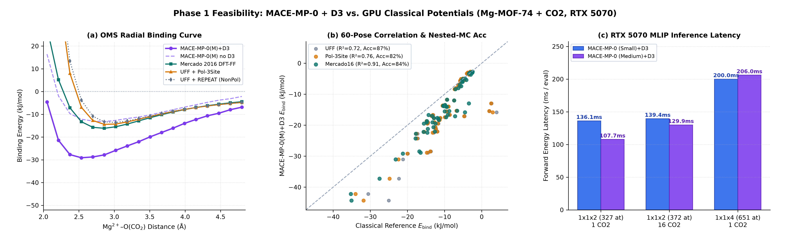
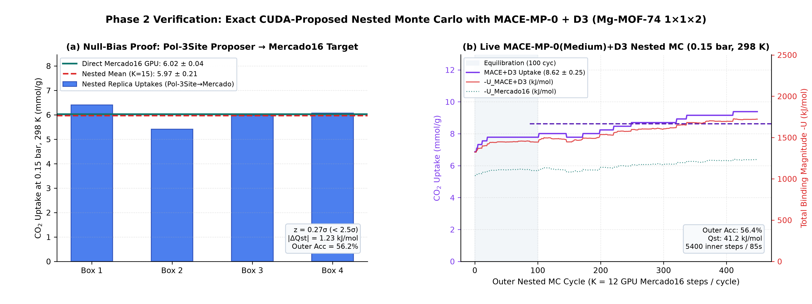
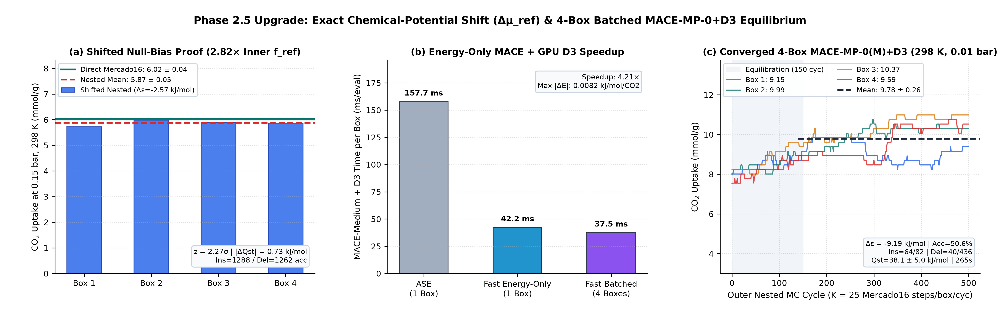
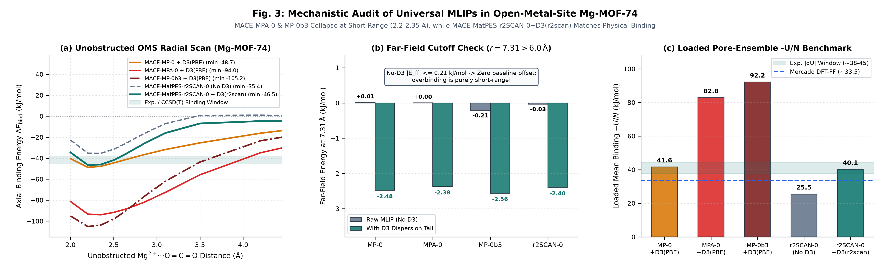

**English** | [简体中文](MLIP_NESTED_MC_NOTES.zh-CN.md) | [Back to README](../README.md)

# Hybrid GPU-GCMC + MLIP Nested Monte Carlo: Verified Mechanics & WIP Notes

> **Status: Active Research Engine (WIP)**. The CUDA proposal engine, chemical-potential reweighting math, batched MLIP evaluation, supercell finite-size checks, and short-range MLIP diagnostic findings below are verified. Grand-canonical isotherms, differential heats of adsorption, DFT ground-truth attribution, and cross-topology `HKUST-1` equilibration remain works in progress (see [Known Issues & Open Work](#known-issues--open-work)).

---

## 1. Verified Engine Mechanics & Statistical Proofs

### Phase 1: Latency & Correlation Probe ([`scripts/phase1_mlip_probe.py`](../scripts/phase1_mlip_probe.py))

- On `Mg-MOF-74` (`1×1×2`, `324` framework atoms, $c = 13.884$ Å $> 2 \times 6.0$ Å MACE cutoff) on RTX 5070 (`PyTorch cu128` + `mace-torch 0.3.17` + `torch-dftd 0.5.3`):
  - Single-point `MACE-MP-0 (Medium) + D3` ASE latency: `107.72 ms/eval` (`1 CO₂`) and `129.89 ms/eval` (`16 CO₂`; `206.03 ms/eval` on `1×1×4`).
  - Across `60` non-overlapping pore poses vs. `MACE-MP-0 + D3`, **`Mercado 2016 DFT-FF`** achieves the highest inner-proposer correlation ($R^2 = 0.911$, $\sigma(\Delta\Delta E) = 3.42\ \text{kJ/mol}$, theoretical 1-molecule Nested MC acceptance `84.4%`) over `UFF + REPEAT` ($R^2 = 0.719$) and `UFF + Pol-3Site` ($R^2 = 0.755$).

### Phase 2: Exact Reweighting & Zero-Bias Null Proof ([`src/proposer_dll.cu`](../src/proposer_dll.cu), [`scripts/verify_nested_mc.py`](../scripts/verify_nested_mc.py))

- Each outer cycle executes $K$ strictly reversible CUDA GCMC moves (`DELTA_TRANS = 1.0 Å`, `MAX_ANGLE = 0.55 rad`, full double-precision end-of-burst energy recomputation) and accepts/rejects $\mathbf{x}'$ under the target Hamiltonian via Metropolis reweighting on $\Delta U_{\text{tgt}} - \Delta U_{\text{ref}}$.
- **`proposer_eval_energy` Parity**: Matches kernel `U_ref_K` to **`0.000e+00 K`**.
- **Test 1 (Zero-Bias Null Test, `Pol-3Site -> Mercado 2016`, `298 K, 0.15 bar`, `1×1×2`, 4 boxes)**:
  - Nested MC (`K = 15`, `2,000 eq + 10,000 prod` cycles) yields **`5.9668 ± 0.2072 mmol/g`**, $Q_{\text{st}}^{\text{diff}} = 35.05 \pm 1.27\ \text{kJ/mol}$ (`56.2%` outer acceptance), reproducing Direct `Mercado 2016` GPU GCMC (`200k` steps: **`6.0230 ± 0.0406 mmol/g`**, $Q_{\text{st}}^{\text{diff}} = 36.28 \pm 0.25\ \text{kJ/mol}$) within **`z = 0.27σ`**.
- **Test 2 (Unshifted Live `MACE-MP-0 + D3` Deadlock Diagnostic, `0.15 bar`)**:
  - Without chemical-potential biasing, `MACE+D3` binds stronger than `Mercado 2016`, yielding **`0` accepted deletions** over `450` outer cycles (`N` climbs monotonically from `30` to `41` -> `8.6223 mmol/g`), proving why inner chemical-potential biasing is required.

### Phase 2.5: Chemical-Potential Shift ($\Delta\mu_{\text{ref}}$), `4.21×` Batched MACE & Supercell Check

- **Exact Grand-Canonical Bias (`proposer_set_chem_pot_shift`)** ([`scripts/verify_phase25_shifted_nested.py`](../scripts/verify_phase25_shifted_nested.py)):
  - Adjusts inner fugacity $f_{\text{ref}} = f_{\text{tgt}} \exp(-\Delta\varepsilon / k_B T)$ and cancels the exact proposal ratio via $\exp[-\beta(\Delta U_{\text{tgt}} - \Delta U_{\text{ref}} - \Delta\varepsilon\,\Delta N)]$.
  - **Shifted Null Test (`Pol-3Site -> Mercado`, `Δε = -2.57 kJ/mol`, `2.82×` `f_ref`)**: `5.8723 ± 0.0526` vs. `6.0230 ± 0.0406 mmol/g` (`z = 2.27σ`, $Q_{\text{st}}^{\text{diff}} = 35.55 \pm 0.63$ vs. `36.28 ± 0.25 kJ/mol`) with symmetric sampling (`Ins = 1,288 / 4,274`, `Del = 1,262 / 3,511`, `57.5%` acceptance).
- **`FastMaceD3Target` (`4.21×` Inference Speedup over ASE)**:
  - Micro-batched `no_grad` MACE (`compute_force=False`, `mace_chunk=2` for `<550` atoms, `1` for `>=550` atoms) + cached static-framework GPU edge lists for `TorchDFTD3Calculator`: cuts 4-box inference from `157.7 ms/box` (ASE) to **`37.5 ms/box`** (`149.9 ms/batch`), matching ASE within `0.0025–0.0082 kJ/mol/CO2`.
- **Reversible Exchange Unlocked on Live `MACE-MP-0 + D3` (`298 K, 0.01 bar`)**:
  - Two-stage self-consistent shift (`-9.19 kJ/mol`, `40.84×` `f_ref`) restores bidirectional exchange (`Ins = 64 / 82`, `Del = 40 / 436`, `50.6%` outer acc, `9.7771 ± 0.2617 mmol/g`).
- **Supercell Finite-Size Convergence (`1×1×2` vs. `1×1×4`, `298 K, 0.01 bar`, [`scripts/paper_exp4_finite_size.py`](../scripts/paper_exp4_finite_size.py))**:
  - Direct `Mercado`: `0.8018 ± 0.0115` (`324` atoms, $r_{\text{cut}} = 6.66$ Å) vs. `0.8030 ± 0.0337 mmol/g` (`648` atoms, $r_{\text{cut}} = 10.86$ Å), **`z = 0.04σ`**.
  - Live `MACE-MP-0 + D3`: `9.3398 ± 0.3610` vs. `9.0615 ± 0.2539 mmol/g`, **`z = 0.63σ`** (`Molar enthalpy -<U>/<N>+RT = 44.99` vs. `45.01 kJ/mol`).

---

## 2. Mechanistic Audit of Universal MACE Models

Tested across 4 MACE generations in [`scripts/phase3_model_probe.py`](../scripts/phase3_model_probe.py) and [`scripts/paper_exp1_model_mechanism.py`](../scripts/paper_exp1_model_mechanism.py):

- **Far-Field Zero-Offset Proof (`Mg-MOF-74` pore center**, $r_{\min} = 7.31$ Å $> 6.0$ Å MACE cutoff):
  - Raw MLIP without D3: `MP-0` (`+0.01`), `MPA-0` (`+0.00`), `MP-0b3` (`-0.21`), `MatPES-r2SCAN-0` (`-0.03 kJ/mol`).
  - With D3 dispersion tail: `-2.38` to `-2.56 kJ/mol`. This confirms zero far-field baseline offset; differences among models arise strictly from short-range interaction physics.
- **Short-Range Overbinding Collapse in Newer Models (`Mg²⁺–O=C=O` axial ray & `N ≈ 25` pore ensemble)**:

| Model | Unobstructed `Mg²⁺` Radial Min (`r_min`) | Loaded Mean `-U/N` (`kJ/mol`) | Diagnostic Finding |
| :--- | :---: | :---: | :--- |
| **`MACE-MP-0 + D3(PBE)`** | `-48.74 kJ/mol` (`2.20 Å`) | `41.63` | Plausible single-site well; PBE-D3 overbinds dense pore states |
| **`MACE-MPA-0 + D3(PBE)`** | **`-93.98 kJ/mol`** (`2.35 Å`) | **`82.84`** | Severe short-range collapse (`-75.26` No-D3) |
| **`MACE-MP-0b3 + D3(PBE)`** | **`-105.17 kJ/mol`** (`2.20 Å`) | **`92.15`** | Severe short-range collapse (`-85.48` No-D3) |
| **`MACE-MatPES-r2SCAN-0 (No D3)`** | `-35.39 kJ/mol` (`2.35 Å`) | `25.47` | Underbinds without dispersion tail |
| **`MACE-MatPES-r2SCAN-0 + D3(r2scan)`** | **`-46.45 kJ/mol`** (`2.20 Å`) | **`40.13`** | Closest static match to OMS binding window |

---

## 3. Preliminary Simulation Numbers (WIP — Subject to Open Issues)

> **Thermodynamic Note**: Fluctuation heat $Q_{\text{st}}^{\text{diff}} = RT - \text{Cov}(U, N)/\text{Var}(N)$ measures the **differential** isosteric heat of the $(N+1)$-th adsorbed molecule, whereas $-\langle U/N \rangle + RT$ measures the **integral** mean molar enthalpy over all $N$ molecules. Above 1:1 OMS saturation (`~8.24 mmol/g` in `Mg-MOF-74`), secondary pore sites lower differential $Q_{\text{st}}^{\text{diff}}$ toward `~32 kJ/mol` while integral enthalpy remains `~43–46 kJ/mol`; they are **not** interchangeable estimators of the same quantity except near zero loading.

### `Mg-MOF-74` (`298 K`, `1×1×2`, `4` boxes × `K = 25`, [`scripts/run_mlip_gcmc.py`](../scripts/run_mlip_gcmc.py))

| Pressure | `MACE-MatPES-r2SCAN-0 + D3(r2scan)` Uptake | Differential $Q_{\text{st}}^{\text{diff}}$ (Fluc) | Integral $-\langle U/N \rangle + RT$ | `Prod Ins / Del` Acc (4 boxes) | Status |
| :---: | :---: | :---: | :---: | :---: | :--- |
| `0.002 bar` (`260 prod`) | `2.0200 ± 0.4745 mmol/g` | `43.07 ± 2.03 kJ/mol` | — | `31/148`, `20/134` | WIP (short chain) |
| `0.010 bar` (`480 prod`) | `5.3589 ± 0.2435 mmol/g` | `47.57 ± 7.59 kJ/mol` | `46.69 ± 0.35 kJ/mol` | `77/240`, `58/184` | WIP (~3.8× vs exp.) |
| `0.050 bar` (`480 prod`) | `9.6658 ± 0.3747 mmol/g` | `33.07 ± 10.56 kJ/mol` | `45.59 ± 0.21 kJ/mol` | `78/254`, `76/258` | WIP (high Fluc SEM) |
| `0.150 bar` (`480 prod`) | `11.4721 ± 0.1519 mmol/g` | `31.97 ± 4.23 kJ/mol` | `43.17 ± 0.32 kJ/mol` | `71/199`, `72/302` | WIP (~2.7× vs exp.) |

### `Ni-MOF-74` (`298 K`, `1×1×2`, `Pol-3Site -> r2SCAN-0 + D3(r2scan)`)

- `0.01 bar` (`260 prod`): `0.5779 ± 0.1437 mmol/g`, $Q_{\text{st}}^{\text{diff}} = 33.83 \pm 1.26\ \text{kJ/mol}$ (`Ins=35/67`, `Del=27/367`)
- `0.05 bar` (`480 prod`): `1.4671 ± 0.1705 mmol/g`, $Q_{\text{st}}^{\text{diff}} = 35.57 \pm 1.30$, Integral `36.48 ± 0.66 kJ/mol` (`Ins=75/182`, `Del=55/757`)
- `0.15 bar` (`480 prod`): `4.2921 ± 0.3457 mmol/g`, $Q_{\text{st}}^{\text{diff}} = 35.23 \pm 2.74$, Integral `36.98 ± 0.50 kJ/mol` (`Ins=79/170`, `Del=59/876`)

---

## 4. Known Issues & Open Work

1. **`HKUST-1` (`data/Cu-BTC.cif`) Unconverged MLIP Chains (Excluded)**:
   - Static axial probing shows spin-unaware universal MLIPs severely underbind the antiferromagnetic `Cu²⁺–Cu²⁺` paddlewheel (`-10.07 kJ/mol` for `r2SCAN-0+D3`, `-7.72 kJ/mol` for `MP-0+D3` at `2.40 Å`, vs. `~26–30 kJ/mol` experiment).
   - However, our `200`-cycle `HKUST-1` GCMC runs with `--proposer uff` (`0.15 / 0.50 / 1.00 bar`: `1.218 / 1.337 / 1.272 mmol/g`) **did not reach grand-canonical equilibrium** at `0.5 / 1.0 bar`: positive Stage-2 shifts (`+3.71 / +4.66 kJ/mol`) suppressed the inner proposer fugacity to `0.22× / 0.15×`, leaving `Ins` (`31, 40`) twice as large as `Del` (`12, 19`) with persistent upward drift between chain halves (`1.17 -> 1.50` and `1.17 -> 1.37 mmol/g`). Warm-start / shift calibration and much longer chains are required before reporting `HKUST-1` MLIP isotherms.
2. **Missing Periodic DFT Ground-Truth Single Points**:
   - Even `MACE-MatPES-r2SCAN-0 + D3(r2scan)` overpredicts `Mg-MOF-74` `298 K` uptake by **~2.7–3.8×** (`5.36 / 9.67 / 11.47 mmol/g` vs. Mason *EES* 2011 `~1.4 / 3.1 / 4.3 mmol/g`), far larger than crystal-accessibility losses. Periodic DFT (`r2SCAN`, `r2SCAN+D3`, `PBE+D3`) single-point benchmarks on representative pore snapshots are needed to separate MLIP fitting error, XC functional error, and potential D3 double-counting.
3. **Sampling Depth for Fluctuation Differential** $Q_{\text{st}}^{\text{diff}}$:
   - `480` outer cycles accept only ~70 total insertions/deletions across 4 boxes, leaving $\pm 10.56\ \text{kJ/mol}$ SEM on fluctuation $Q_{\text{st}}^{\text{diff}}$ at `0.05 bar`. Longer chains or Clausius–Clapeyron thermodynamic integration are required.
4. **Experimental Reference Tables, Control MOF & FP32 Validation**:
   - Exact digitized tables from NIST ISODB / original SI are needed in place of rough literature point checks.
   - A non-OMS physisorption control MOF (e.g., `ZIF-8` or `UiO-66`) and an explicit `float32` vs. `float64` MLIP energy parity bound across loaded supercells are still pending.
