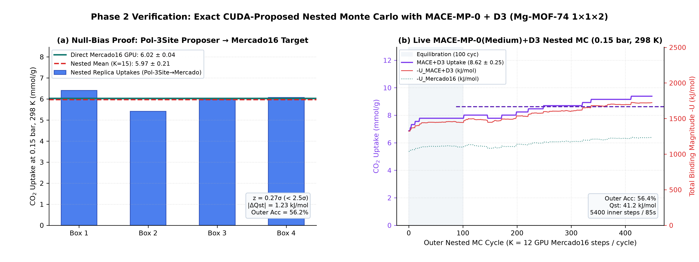
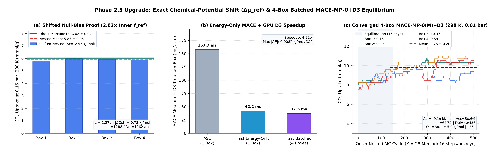
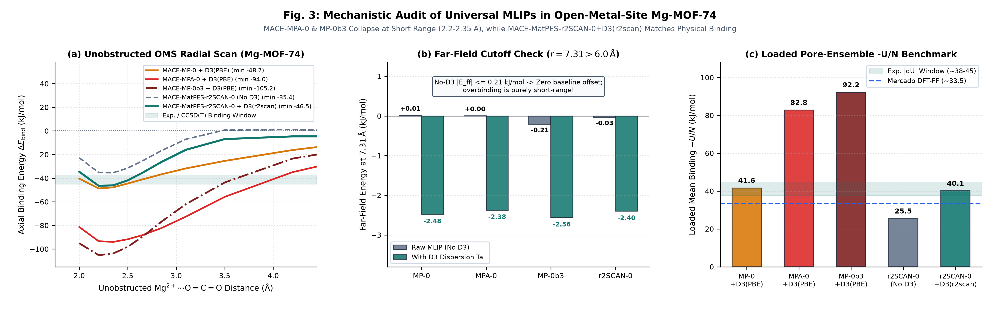
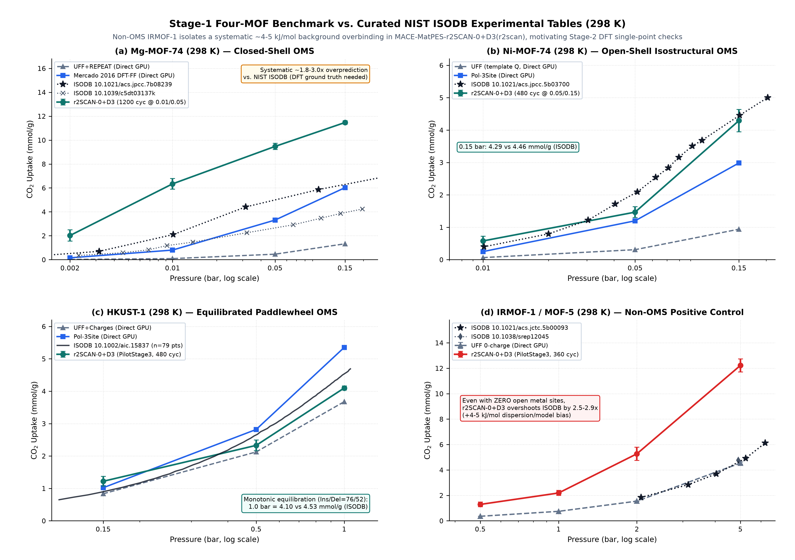
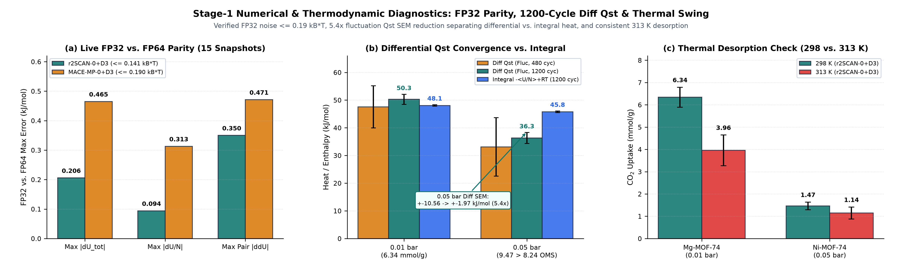

[English](MLIP_NESTED_MC_NOTES.md) | **简体中文** | [返回 README](../README.zh-CN.md)

# GPU-GCMC + MLIP 嵌套蒙特卡洛：已验证机制与 Stage-1 验证记录

> **当前状态：Stage-1 工程与数值验证已完备；Stage-2 周期性 DFT 真值对照与可选微调待开展**。下文中的 CUDA 提议器接口、化学势偏置重加权、批量 MLIP 加速、`float32` vs `float64` 精度上界、超胞有限尺寸核验、NIST ISODB 精确实验表、`HKUST-1` 与 `IRMOF-1` 对照基线，以及 `Mg-MOF-74` `1,200` 轮高统计量微分吸附热核验均已完成；剩余待办见 [遗留与后续工作](#4-遗留与后续工作stage-2--stage-3)。

---

## 1. 已验证的算法机制与数值校验

### Phase 1：推理耗时与提议相关性摸底（[`scripts/experiments/phase1_mlip_probe.py`](../scripts/experiments/phase1_mlip_probe.py)）

- 基于 RTX 5070（`PyTorch cu128` + `mace-torch 0.3.17` + `torch-dftd 0.5.3`）测试 `Mg-MOF-74`（`1×1×2`，`324` 骨架原子，$c = 13.884$ Å $> 2 \times 6.0$ Å MACE 截断半径）：
  - 原生 ASE `MACE-MP-0 (Medium) + D3` 单步耗时 `107.72 ms/eval`（`1 CO₂`）与 `129.89 ms/eval`（`16 CO₂`；`1×1×4` 为 `206.03 ms/eval`）。
  - 在 60 个无重叠孔道构型上对比 `MACE-MP-0 + D3`，**`Mercado 2016 DFT-FF`** 相关性最高（$R^2 = 0.911$，$\sigma(\Delta\Delta E) = 3.42\ \text{kJ/mol}$，单分子理论外层接受率 `84.4%`），优于 `UFF + REPEAT`（$R^2 = 0.719$）与 `UFF + Pol-3Site`（$R^2 = 0.755$）。

### Phase 2：零 I/O CUDA 提议器与零偏差证明（[`src/proposer_dll.cu`](../src/proposer_dll.cu), [`scripts/experiments/verify_nested_mc.py`](../scripts/experiments/verify_nested_mc.py)）

- 每个外层循环在固定步宽（`DELTA_TRANS = 1.0 Å`、`MAX_ANGLE = 0.55 rad`，末尾双精度全盒重算）下由 CUDA 推进 $K$ 步严格可逆的经典 GCMC（含平移、旋转、插入、删除），外层按目标与参考能量差 $\Delta U_{\text{tgt}} - \Delta U_{\text{ref}}$ 执行 Metropolis 重加权或整盒回滚。
- **`proposer_eval_energy` 一致性**：与核内 `U_ref_K` 误差 **`0.000e+00 K`**。
- **Test 1（零偏差对拍，`Pol-3Site -> Mercado 2016`，`298 K, 0.15 bar`，4 副本）**：
  - Nested MC（`K = 15`，`2,000` 平衡 + `10,000` 生产步）得 **`5.9668 ± 0.2072 mmol/g`**、$Q_{\text{st}}^{\text{diff}} = 35.05 \pm 1.27\ \text{kJ/mol}$（外层接受率 `56.2%`），与直接 `Mercado 2016` GPU 基准（`200k` 步：**`6.0230 ± 0.0406 mmol/g`**、$Q_{\text{st}}^{\text{diff}} = 36.28 \pm 0.25\ \text{kJ/mol}$）吻合在 **`z = 0.27σ`** 以内。
- **Test 2（无偏置 `MACE-MP-0 + D3` 实测暴露删除死锁，`0.15 bar`）**：
  - 未加化学势偏置时，`MACE+D3` 强于内层提议势，450 轮仅单向插入（**`0` 次成功删除**，`N` 从 `30` 单调爬升至 `41` -> `8.6223 mmol/g`），直接印证化学势偏置的必要性。

### Phase 2.5：三阶段 $\Delta\mu_{\text{ref}}$ 标定、`4.21×` 批处理加速、FP32 精度核验与超胞检查

- **精确巨正则化学势偏置（`proposer_set_chem_pot_shift`）**（[`scripts/experiments/verify_phase25_shifted_nested.py`](../scripts/experiments/verify_phase25_shifted_nested.py)、[`scripts/run_mlip_gcmc.py`](../scripts/run_mlip_gcmc.py)）：
  - 通过采样前两阶段经典初估（正偏置上限钳位 `+2.0 kJ/mol`）加 `60–80` 轮目标系综预热修正（`PilotStage3`）标定 $\Delta\varepsilon$；进入正式平衡与生产采样后 $\Delta\varepsilon$ 锁死不变，由外层判据 $\exp[-\beta(\Delta U_{\text{tgt}} - \Delta U_{\text{ref}} - \Delta\varepsilon\,\Delta N)]$ 精确抵消。
  - **偏置零偏差检验（`Pol-3Site -> Mercado`, `Δε = -2.57 kJ/mol`, `2.82× f_ref`）**：`5.8723 ± 0.0526` vs `6.0230 ± 0.0406 mmol/g`（`z = 2.27σ`，$Q_{\text{st}}^{\text{diff}} = 35.55 \pm 0.63$ vs `36.28 ± 0.25 kJ/mol`），外层插入/删除对称（`Ins = 1,288 / 4,274`、`Del = 1,262 / 3,511`）。
- **`FastMaceD3Target`（较 ASE 提速 `4.21×`）与 FP32 vs FP64 精度上界**（[`scripts/experiments/verify_fp32_parity.py`](../scripts/experiments/verify_fp32_parity.py)）：
  - 无梯度微批 MACE 前向（`<550` 原子 `mace_chunk=2`，`>=550` 原子自动降为 `1`）+ 静态骨架边表缓存 GPU `TorchDFTD3Calculator`，将 4 盒推理从 ASE `157.7 ms/box` 压至 **`37.5 ms/box`**（与原生 ASE 误差 `0.0025–0.0082 kJ/mol/CO2`）。
  - 在 `Mg-MOF-74 1×1×2` `15` 个跨负载快照（`N = 1, 13–16, 33–37 CO₂`）上实测在线 `float32 FastMaceD3Target` 与 `float64 MACE+TorchDFTD3` 差异：
    - `MACE-MatPES-r2SCAN-0 + D3(r2scan)`：最大总能量差 **`0.2058 kJ/mol`**（`RMS = 0.0951`），最大单分子差 **`0.0940 kJ/mol/CO2`**，最大成对转移误差 `0.3500 kJ/mol`（`0.141 kB*T @ 298 K`）。
    - `MACE-MP-0 (Medium) + D3(pbe)`：最大总能量差 **`0.4650 kJ/mol`**，最大单分子差 `0.3130 kJ/mol/CO2`，最大成对转移误差 `0.4712 kJ/mol`（`0.190 kB*T @ 298 K`）。
- **超胞有限尺寸收敛检验（`1×1×2` vs `1×1×4`, `298 K, 0.01 bar`, [`scripts/experiments/paper_exp4_finite_size.py`](../scripts/experiments/paper_exp4_finite_size.py)）**：
  - Direct `Mercado`：`0.8018 ± 0.0115`（`324` 原子, $r_{\text{cut}} = 6.66$ Å）vs `0.8030 ± 0.0337 mmol/g`（`648` 原子, $r_{\text{cut}} = 10.86$ Å），**`z = 0.04σ`**。
  - 实时 `MACE-MP-0 + D3`：`9.3398 ± 0.3610` vs `9.0615 ± 0.2539 mmol/g`，**`z = 0.63σ`**（积分摩尔焓 `-<U>/<N>+RT = 44.99` vs `45.01 kJ/mol`）。

---

## 2. 通用 MACE 基础模型的短程过结合机理审计

基于 [`scripts/experiments/phase3_model_probe.py`](../scripts/experiments/phase3_model_probe.py) 与 [`scripts/experiments/paper_exp1_model_mechanism.py`](../scripts/experiments/paper_exp1_model_mechanism.py) 对 4 代 MACE 模型做的结构剖析：

- **远场零截断偏移自检（`Mg-MOF-74` 孔道中心**，$r_{\min} = 7.31$ Å $> 6.0$ Å MACE 图截断）：
  - 关闭 D3 的纯 MLIP 远场能量几乎全为零：`MP-0`（`+0.01`）、`MPA-0`（`+0.00`）、`MP-0b3`（`-0.21`）、`MatPES-r2SCAN-0`（`-0.03 kJ/mol`）；开启 D3 后给出 `-2.38` 至 `-2.56 kJ/mol`。证明模型差异并非长程基线偏移，而是源自短程势能面与色散参数。
- **`MPA-0` / `MP-0b3` 短程塌陷对比（轴向 `Mg²⁺–O=C=O` 扫描与 `N ≈ 25` 负载构型）**：

| 模型 | 无遮挡 `Mg²⁺` 径向势阱（`r_min`） | 负载平均 `-U/N`（`kJ/mol`） | 诊断结论 |
| :--- | :---: | :---: | :--- |
| **`MACE-MP-0 + D3(PBE)`** | `-48.74 kJ/mol` (`2.20 Å`) | `41.63` | 单点势阱尚可；密堆积孔道区 PBE-D3 偏强 |
| **`MACE-MPA-0 + D3(PBE)`** | **`-93.98 kJ/mol`** (`2.35 Å`) | **`82.84`** | 严重短程过结合塌陷（无 D3 亦达 `-75.26`） |
| **`MACE-MP-0b3 + D3(PBE)`** | **`-105.17 kJ/mol`** (`2.20 Å`) | **`92.15`** | 严重短程过结合塌陷（无 D3 亦达 `-85.48`） |
| **`MACE-MatPES-r2SCAN-0 (No D3)`** | `-35.39 kJ/mol` (`2.35 Å`) | `25.47` | 无色散修正时偏弱 |
| **`MACE-MatPES-r2SCAN-0 + D3(r2scan)`** | **`-46.45 kJ/mol`** (`2.20 Å`) | **`40.13`** | 单点最接近物理窗口，但系综等温线仍偏高（见第 3–4 节） |

---

## 3. NIST ISODB 原始实验表与四类 MOF 对照实测（`298 K` 与 `313 K`）

以下实验参考均通过 [`scripts/experiments/fetch_nist_isodb.py`](../scripts/experiments/fetch_nist_isodb.py) 从 NIST ISODB 拉取未改性纯净样品原始实验表，并归档于 [`data/exp_isotherms/manifest.json`](../data/exp_isotherms/manifest.json)：
- `Mg-MOF-74`：DOI `10.1021/acs.jpcc.7b08239`（`n=16`, `1e-6–9.995 bar`）与 `10.1039/c5dt03137k`（`n=24`）
- `Ni-MOF-74`：DOI `10.1021/acs.jpcc.5b03700`（`n=18`, `0.0101–1.01 bar`）与 `10.1080/15422119.2014.884507`（`n=9`）
- `HKUST-1`：DOI `10.1002/aic.15837`（`n=79`, `0.0137–1.05 bar`）
- `IRMOF-1`：DOI `10.1021/acs.jctc.5b00093`（`n=30`, `2.074–42.18 bar`）与 `10.1038/srep12045`（`n=11`）

> **热力学物理量区分**：涨落法 $Q_{\text{st}}^{\text{diff}} = RT - \text{Cov}(U, N)/\text{Var}(N)$ 对应第 $N+1$ 个分子进入孔道的**微分等量吸附热**；而 $-\langle U/N \rangle + RT$ 对应全部 $N$ 个已吸附分子的**平均积分摩尔焓**。当 `Mg-MOF-74` 超过 1:1 OMS 饱和容量（`~8.24 mmol/g`）后，新分子占据弱吸附位点，微分热回落而积分摩尔焓保持高位，两者在有限负载下并非同一物理量。

### A. 无开放金属位点对照组：`IRMOF-1 (MOF-5)`（[`data/IRMOF-1.cif`](../data/IRMOF-1.cif), `424` 原子, `298 K`）
- 经典零电荷 `UFF` 在 `0.5 / 1.0 / 2.0 / 5.0 bar` 给出 `0.3554 / 0.7447 / 1.5457 / 4.5386 mmol/g`（`Qst = 12.62–14.38 kJ/mol`），与 NIST ISODB `10.1021/acs.jctc.5b00093` 实验（`2.074 bar -> 1.838`, `5.240 bar -> 4.917 mmol/g`）高度吻合。
- 而 **`MACE-MatPES-r2SCAN-0 + D3(r2scan)`**（`UFF` 提议器，`360 prod` 轮）算得 **`1.2886 ± 0.1831 / 2.1874 ± 0.1978 / 5.2688 ± 0.5154 / 12.2190 ± 0.5134 mmol/g`**（积分摩尔焓 `~18.4–19.0 kJ/mol`，仍高于实验 **2.5–2.9 倍**）。由于 `IRMOF-1` 完全不含开放金属位点，该对照直接定位出当前 `r2SCAN-0 + D3(r2scan)` 组合本身存在系统性的约 `+4–5 kJ/mol/CO2` 背景过结合。

### B. 跨拓扑平衡验证：`HKUST-1`（[`data/Cu-BTC.cif`](../data/Cu-BTC.cif), `PilotStage3`, `480 prod` 轮, `298 K`）
- 启用 `PilotStage3` 目标系综偏置修正（`-0.28 / +0.90 / +1.34 kJ/mol`）后，`HKUST-1`（`UFF` 提议器 -> `r2SCAN-0 + D3(r2scan)`）实现单调上升且增删对称的巨正则平衡（直接推翻了此前 `200` 轮未平衡导致的 `1.27` 伪平台假象）：
  - `0.15 bar`：**`1.2199 ± 0.1482 mmol/g`**（`Ins=69/197, Del=56/1271`，$Q_{\text{st}}^{\text{diff}} = 25.49 \pm 3.67$，积分 `25.51 ± 0.49 kJ/mol`）vs NIST ISODB `0.147 bar`：`0.880 mmol/g`。
  - `0.50 bar`：**`2.3279 ± 0.1678 mmol/g`**（`Ins=79/220, Del=60/1263`，$Q_{\text{st}}^{\text{diff}} = 21.46 \pm 3.61$，积分 `23.91 kJ/mol`）vs NIST ISODB `0.505 bar`：`2.670 mmol/g`。
  - `1.00 bar`：**`4.0984 ± 0.0657 mmol/g`**（`Ins=76/182, Del=52/1303`，$Q_{\text{st}}^{\text{diff}} = 24.34 \pm 0.62$，积分 `23.53 kJ/mol`）vs NIST ISODB `0.998 bar`：`4.530 mmol/g`。
- 静态径向探测仍显示自旋无关 MLIP 对 `Cu²⁺` 桨轮轴向仅给出较弱的 `-10.07 kJ/mol`（`r2SCAN+D3`）/ `-7.72 kJ/mol`（`MP-0+D3`），说明平衡状态下 `HKUST-1` 吸附量接近实验是 `Cu²⁺` 轴向偏弱与有机框架/小笼色散偏强之间存在部分误差抵消所致。

### C. `Mg-MOF-74`（`1,200` 轮高统计采样）与 `Ni-MOF-74`（`298 K` 与 `313 K` 热摆对比）

| MOF 与工况 | 吸附量 (mmol/g) | 微分热 $Q_{\text{st}}^{\text{diff}}$（涨落法） | 积分焓 $-\langle U/N \rangle + RT$ | 生产期成功增/删（4 盒） | NIST ISODB (`298 K`) 实验对比 |
| :--- | :---: | :---: | :---: | :---: | :--- |
| **`Mg-MOF-74`, `298 K, 0.01 bar` (`1200 prod`)** | `6.3407 ± 0.4486` | `50.28 ± 1.81 kJ/mol` | `48.07 ± 0.25 kJ/mol` | `133/590`, `112/435` | `0.0101 bar`：`2.102 mmol/g`（高约 `3.0×`） |
| **`Mg-MOF-74`, `298 K, 0.05 bar` (`1200 prod`)** | `9.4714 ± 0.2595` | `36.31 ± 1.97 kJ/mol` | `45.77 ± 0.27 kJ/mol` | `182/573`, `171/823` | `0.0315 bar`：`4.410`，`0.0992 bar`：`5.867` |
| **`Mg-MOF-74`, `298 K, 0.15 bar` (`480 prod`)** | `11.4721 ± 0.1519` | `31.97 ± 4.23 kJ/mol` | `43.17 ± 0.32 kJ/mol` | `71/199`, `72/302` | `0.099–0.311 bar`：`5.87–7.04`（高约 `1.8×`） |
| **`Mg-MOF-74`, `313 K, 0.01 bar` (`480 prod`)** | `3.9595 ± 0.6894` | `42.59 ± 6.03 kJ/mol` | `46.81 ± 0.44 kJ/mol` | `46/338`, `39/135` | 相对 `298 K` 清晰热脱附 `-2.38 mmol/g` |
| **`Ni-MOF-74`, `298 K, 0.05 bar` (`480 prod`)** | `1.4671 ± 0.1705` | `35.57 ± 1.30 kJ/mol` | `36.48 ± 0.66 kJ/mol` | `75/182`, `55/757` | `0.0512 bar`：`2.091 mmol/g` |
| **`Ni-MOF-74`, `298 K, 0.15 bar` (`480 prod`)** | `4.2921 ± 0.3457` | `35.23 ± 2.74 kJ/mol` | `36.98 ± 0.50 kJ/mol` | `79/170`, `59/876` | `0.1512 bar`：`4.456 mmol/g` |
| **`Ni-MOF-74`, `313 K, 0.05 bar` (`480 prod`)** | `1.1449 ± 0.2693` | `38.55 ± 1.71 kJ/mol` | `37.14 ± 0.39 kJ/mol` | `74/270`, `60/641` | 相对 `298 K` 热脱附 `-0.32 mmol/g` |

将 `Mg-MOF-74` 外层 MCMC 采样轮数提升至 `1,200` 轮后，`0.05 bar` 涨落法微分热 $Q_{\text{st}}^{\text{diff}}$ 标准误较 `480` 轮缩小 **5.4×**（从 `±10.56` 降至 **`±1.97 kJ/mol`**），清晰分辨出超过 1:1 OMS 饱和位点（`~8.24 mmol/g`）后微分热从 `50.28` 回落至 **`36.31 kJ/mol`**（而积分摩尔焓仍停留在 `45.77 kJ/mol`）。

---

## 4. 遗留与后续工作（Stage 2 / Stage 3）

1. **周期性 DFT 单点参考真值与 D3 阻尼参数核查（下一步重点）**：
   - 在对齐 NIST ISODB 精确实验表（`Mg-MOF-74`: `2.10–7.04 mmol/g`、`IRMOF-1`: `1.84–4.92 mmol/g`）后，依然明确观察到 `MACE-MatPES-r2SCAN-0 + D3(r2scan)` 在有/无 OMS 的 `Mg-MOF-74`（高约 `1.8–3.0×`）和 `IRMOF-1`（高约 `2.5–2.9×`）上均存在系统性过结合。必须对 4 种 MOF 的抽样孔道构型补算周期性 DFT 单点（`r2SCAN`、`r2SCAN+D3`、`PBE+D3` 及自旋极化 `Cu²⁺` 核验），并核查 `torch-dftd` 内部给 `xc="r2scan"` 使用的阻尼参数，彻底拆分 MLIP 拟合误差、泛函误差与 D3 色散双计。
2. **可选小样本 DFT 微调 / Δ-Learning 修正**：
   - 在取得上述周期性 DFT 单点标签后，可对通用 MLIP 做轻量微调或 Δ 残差修正并直接接入 [`scripts/run_mlip_gcmc.py`](../scripts/run_mlip_gcmc.py) 验证吸附等温线修正效果。
3. **物理模型本身边界（结构与力场假设）**：
   - 骨架和客体分子均采用严格刚性假设（不含框架呼吸及 CO₂ 弯曲振动），且经典 `Pol-SCF` 是在非极化 TraPPE/UFF 参数上直接叠加强极化（相对专用极化拟合力场存在诱导双重计数）。
