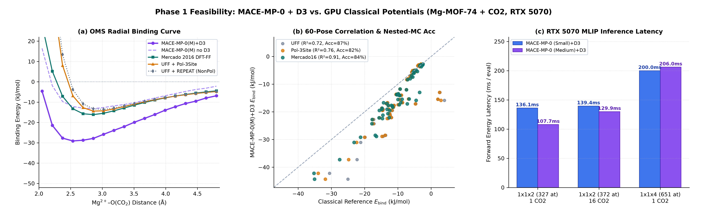

[English](MLIP_NESTED_MC_NOTES.md) | **简体中文** | [返回 README](../README.zh-CN.md)

# GPU-GCMC + MLIP 嵌套蒙特卡洛：已验证机制与研究进展记录（WIP）

> **当前状态：持续开发中的科研原型（WIP）**。下文中的 CUDA 提议器接口、化学势偏置重加权推导、批量 MLIP 加速、超胞有限尺寸核验及通用 MLIP 短程过结合机理定位均已完成实测验证；但完整等温线收敛、微分吸附热采样深度、DFT 真值归因以及 `HKUST-1` 收敛问题仍在完善中（详见 [已知问题与待办工作](#已知问题与待办工作)）。

---

## 1. 已验证的算法机制与统计检验

### Phase 1：推理耗时与提议相关性摸底（[`scripts/phase1_mlip_probe.py`](../scripts/phase1_mlip_probe.py)）

- 基于 RTX 5070（`PyTorch cu128` + `mace-torch 0.3.17` + `torch-dftd 0.5.3`）测试 `Mg-MOF-74`（`1×1×2`，`324` 骨架原子，$c = 13.884$ Å $> 2 \times 6.0$ Å MACE 截断半径）：
  - 原生 ASE `MACE-MP-0 (Medium) + D3` 单步耗时 `107.72 ms/eval`（`1 CO₂`）与 `129.89 ms/eval`（`16 CO₂`；`1×1×4` 为 `206.03 ms/eval`）。
  - 在 60 个无重叠孔道构型上对比 `MACE-MP-0 + D3`，**`Mercado 2016 DFT-FF`** 相关性最高（$R^2 = 0.911$，$\sigma(\Delta\Delta E) = 3.42\ \text{kJ/mol}$，单分子理论外层接受率 `84.4%`），显著优于 `UFF + REPEAT`（$R^2 = 0.719$）与 `UFF + Pol-3Site`（$R^2 = 0.755$）。

### Phase 2：零 I/O CUDA 提议器与零偏差证明（[`src/proposer_dll.cu`](../src/proposer_dll.cu), [`scripts/verify_nested_mc.py`](../scripts/verify_nested_mc.py)）

- 每个外层循环在固定步宽（`DELTA_TRANS = 1.0 Å`、`MAX_ANGLE = 0.55 rad`，末尾双精度全盒重算）下由 CUDA 推进 $K$ 步严格可逆的 GCMC 试探，外层按目标势能差 $\Delta U_{\text{tgt}} - \Delta U_{\text{ref}}$ 执行 Metropolis 重加权。
- **`proposer_eval_energy` 一致性**：与核内 `U_ref_K` 误差 **`0.000e+00 K`**。
- **Test 1（零偏差对拍，`Pol-3Site -> Mercado 2016`，`298 K, 0.15 bar`，4 副本）**：
  - Nested MC（`K = 15`，`2,000` 平衡 + `10,000` 生产循环）得 **`5.9668 ± 0.2072 mmol/g`**、$Q_{\text{st}}^{\text{diff}} = 35.05 \pm 1.27\ \text{kJ/mol}$（外层接受率 `56.2%`），与直接 `Mercado 2016` GPU 基准（`200k` 步：**`6.0230 ± 0.0406 mmol/g`**、$Q_{\text{st}}^{\text{diff}} = 36.28 \pm 0.25\ \text{kJ/mol}$）吻合在 **`z = 0.27σ`** 以内。
- **Test 2（无偏置 `MACE-MP-0 + D3` 实测暴露删除死锁，`0.15 bar`）**：
  - 未加化学势偏置时，由于 `MACE+D3` 强于内层提议势，450 轮仅单向插入（**`0` 次成功删除**，`N` 从 `30` 单调爬升至 `41` -> `8.6223 mmol/g`），直接印证了化学势偏置的必要性。

### Phase 2.5：化学势偏置（$\Delta\mu_{\text{ref}}$）、`4.21×` 批处理加速与超胞收敛验证

- **精确巨正则化学势偏置（`proposer_set_chem_pot_shift`）**（[`scripts/verify_phase25_shifted_nested.py`](../scripts/verify_phase25_shifted_nested.py)）：
  - 将内层提议逸度调整为 $f_{\text{ref}} = f_{\text{tgt}} \exp(-\Delta\varepsilon / k_B T)$，并在外层判据通过 $\exp[-\beta(\Delta U_{\text{tgt}} - \Delta U_{\text{ref}} - \Delta\varepsilon\,\Delta N)]$ 严格抵消偏置。
  - **偏置零偏差检验（`Pol-3Site -> Mercado`, `Δε = -2.57 kJ/mol`, `2.82× f_ref`）**：`5.8723 ± 0.0526` vs `6.0230 ± 0.0406 mmol/g`（`z = 2.27σ`，$Q_{\text{st}}^{\text{diff}} = 35.55 \pm 0.63$ vs `36.28 ± 0.25 kJ/mol`），实现对称增删（`Ins = 1,288 / 4,274`、`Del = 1,262 / 3,511`）。
- **`FastMaceD3Target`（较 ASE 提速 `4.21×`）**：
  - 通过无梯度微批 MACE 前向（`compute_force=False`, `mace_chunk=2`，`>=550` 原子自动降为 `1`）+ 静态骨架 GPU 边表缓存 `TorchDFTD3Calculator`，将 4 盒推理从 ASE 的 `157.7 ms/box` 降至 **`37.5 ms/box`**（与完整 ASE 误差仅 `0.0025–0.0082 kJ/mol/CO2`）。
- **打通真实 MLIP 可逆增删（`MACE-MP-0 + D3`, `298 K, 0.01 bar`）**：
  - 两阶段偏置标定（`-9.19 kJ/mol`, `40.84× f_ref`）恢复双向采样（`Ins = 64 / 82`、`Del = 40 / 436`，外层接受率 `50.6%`，`9.7771 ± 0.2617 mmol/g`）。
- **超胞有限尺寸收敛检验（`1×1×2` vs `1×1×4`, `298 K, 0.01 bar`, [`scripts/paper_exp4_finite_size.py`](../scripts/paper_exp4_finite_size.py)）**：
  - Direct `Mercado`：`0.8018 ± 0.0115`（`324` 原子, $r_{\text{cut}} = 6.66$ Å）vs `0.8030 ± 0.0337 mmol/g`（`648` 原子, $r_{\text{cut}} = 10.86$ Å），**`z = 0.04σ`**。
  - 实时 `MACE-MP-0 + D3`：`9.3398 ± 0.3610` vs `9.0615 ± 0.2539 mmol/g`，**`z = 0.63σ`**（平均摩尔焓 `-<U>/<N>+RT = 44.99` vs `45.01 kJ/mol`）。

---

## 2. 通用 MACE 基础模型的短程过结合机理审计

基于 [`scripts/phase3_model_probe.py`](../scripts/phase3_model_probe.py) 与 [`scripts/paper_exp1_model_mechanism.py`](../scripts/paper_exp1_model_mechanism.py) 对 4 代 MACE 模型做的结构剖析：

- **远场零截断偏移自检（`Mg-MOF-74` 孔道中心**，$r_{\min} = 7.31$ Å $> 6.0$ Å MACE 图截断）：
  - 关闭 D3 的纯 MLIP 远场能量几乎全为零：`MP-0`（`+0.01`）、`MPA-0`（`+0.00`）、`MP-0b3`（`-0.21`）、`MatPES-r2SCAN-0`（`-0.03 kJ/mol`）；开启 D3 后给出 `-2.38` 至 `-2.56 kJ/mol`。证明模型差异完全源自短程近邻势能面，而非长程基线偏移。
- **新版本模型在开放金属位点短程塌陷（轴向 `Mg²⁺–O=C=O` 径向扫描与 `N ≈ 25` 负载集合）**：

| 模型 | 无遮挡 `Mg²⁺` 径向势阱（`r_min`） | 负载平均 `-U/N`（`kJ/mol`） | 诊断结论 |
| :--- | :---: | :---: | :--- |
| **`MACE-MP-0 + D3(PBE)`** | `-48.74 kJ/mol` (`2.20 Å`) | `41.63` | 单点势阱尚可；密堆积孔道区 PBE-D3 偏强 |
| **`MACE-MPA-0 + D3(PBE)`** | **`-93.98 kJ/mol`** (`2.35 Å`) | **`82.84`** | 严重短程过结合塌陷（无 D3 亦达 `-75.26`） |
| **`MACE-MP-0b3 + D3(PBE)`** | **`-105.17 kJ/mol`** (`2.20 Å`) | **`92.15`** | 严重短程过结合塌陷（无 D3 亦达 `-85.48`） |
| **`MACE-MatPES-r2SCAN-0 (No D3)`** | `-35.39 kJ/mol` (`2.35 Å`) | `25.47` | 无色散修正时偏弱 |
| **`MACE-MatPES-r2SCAN-0 + D3(r2scan)`** | **`-46.45 kJ/mol`** (`2.20 Å`) | **`40.13`** | 目前静态结合能最接近物理区间的组合 |

---

## 3. 初步模拟数据记录（WIP — 存在待修正局限）

> **热力学物理量区分**：涨落法 $Q_{\text{st}}^{\text{diff}} = RT - \text{Cov}(U, N)/\text{Var}(N)$ 对应第 $N+1$ 个分子进入孔道的**微分等量吸附热**；而 $-\langle U/N \rangle + RT$ 对应全部 $N$ 个已吸附分子的**平均积分摩尔焓**。当 `Mg-MOF-74` 超过 1:1 开放金属位点饱和容量（`~8.24 mmol/g`）后，新分子进入次级弱吸附位点，微分 $Q_{\text{st}}^{\text{diff}}$ 理应回落至 `~32 kJ/mol`，而积分摩尔焓仍停留在 `~43–46 kJ/mol`——除零覆盖度极限外，两者并非同一物理量。

### `Mg-MOF-74`（`298 K`, `1×1×2`, `4` 盒 × `K = 25`, [`scripts/run_mlip_gcmc.py`](../scripts/run_mlip_gcmc.py)）

| 压力 | `MACE-MatPES-r2SCAN-0 + D3(r2scan)` 吸附量 | 微分热 $Q_{\text{st}}^{\text{diff}}$（涨落法） | 积分热 $-\langle U/N \rangle + RT$ | 生产阶段成功增/删（4 盒合计） | 状态说明 |
| :---: | :---: | :---: | :---: | :---: | :--- |
| `0.002 bar` (`260 prod`) | `2.0200 ± 0.4745 mmol/g` | `43.07 ± 2.03 kJ/mol` | — | `31/148`, `20/134` | WIP（短链） |
| `0.010 bar` (`480 prod`) | `5.3589 ± 0.2435 mmol/g` | `47.57 ± 7.59 kJ/mol` | `46.69 ± 0.35 kJ/mol` | `77/240`, `58/184` | WIP（高于实验约 3.8×） |
| `0.050 bar` (`480 prod`) | `9.6658 ± 0.3747 mmol/g` | `33.07 ± 10.56 kJ/mol` | `45.59 ± 0.21 kJ/mol` | `78/254`, `76/258` | WIP（涨落标准误大） |
| `0.150 bar` (`480 prod`) | `11.4721 ± 0.1519 mmol/g` | `31.97 ± 4.23 kJ/mol` | `43.17 ± 0.32 kJ/mol` | `71/199`, `72/302` | WIP（高于实验约 2.7×） |

### `Ni-MOF-74`（`298 K`, `1×1×2`, `Pol-3Site -> r2SCAN-0 + D3(r2scan)`）

- `0.01 bar` (`260 prod`): `0.5779 ± 0.1437 mmol/g`, $Q_{\text{st}}^{\text{diff}} = 33.83 \pm 1.26\ \text{kJ/mol}$（`Ins=35/67`, `Del=27/367`）
- `0.05 bar` (`480 prod`): `1.4671 ± 0.1705 mmol/g`, $Q_{\text{st}}^{\text{diff}} = 35.57 \pm 1.30$, 积分焓 `36.48 ± 0.66 kJ/mol`（`Ins=75/182`, `Del=55/757`）
- `0.15 bar` (`480 prod`): `4.2921 ± 0.3457 mmol/g`, $Q_{\text{st}}^{\text{diff}} = 35.23 \pm 2.74$, 积分焓 `36.98 ± 0.50 kJ/mol`（`Ins=79/170`, `Del=59/876`）

---

## 4. 已知问题与待办工作

1. **`HKUST-1`（[`data/Cu-BTC.cif`](../data/Cu-BTC.cif)）MLIP 采样尚未平衡（暂不采纳）**：
   - 轴向静态径向扫描已确认自旋无关通用 MLIP 严重低估反铁磁耦合 `Cu²⁺–Cu²⁺` 桨轮位点吸引（`2.40 Å` 处 `r2SCAN-0+D3` 仅 `-10.07 kJ/mol`，`MP-0+D3` 仅 `-7.72 kJ/mol`，而实验吸附热约 `26–30 kJ/mol`）。
   - 然而目前 `--proposer uff` 下 200 步 GCMC 跑出的 `0.15 / 0.50 / 1.00 bar` 吸附量（`1.218 / 1.337 / 1.272 mmol/g`）**在 `0.5 / 1.0 bar` 根本未达到巨正则平衡**：Stage 2 算出的正偏置（`+3.71 / +4.66 kJ/mol`）把内层有效逸度压至 `0.22× / 0.15×`，导致热启动起点过低、成功插入次数（`31, 40`）远大于删除次数（`12, 19`）、前后半程持续上漂（`1.17 -> 1.50` 与 `1.17 -> 1.37`），形成了非单调伪平台假象。必须修正热启动/偏置区间并大幅加长链长后重测。
2. **缺乏真实周期性 DFT 单点参考真值**：
   - `MACE-MatPES-r2SCAN-0 + D3(r2scan)` 在 `Mg-MOF-74` 上仍给出比实验高 `2.7–3.8×` 的吸附量（`5.36 / 9.67 / 11.47` vs 实验 `~1.4 / 3.1 / 4.3 mmol/g`），绝非“实验晶体缺陷”所能解释。后续必须对抽样构型补算真实的周期性 DFT（`r2SCAN`、`r2SCAN+D3`、`PBE+D3`）单点能量，把“MLIP 拟合误差”、“泛函本征误差”与“D3 色散双计”彻底拆解清楚。
3. **涨落法微分热采样深度不足**（$Q_{\text{st}}^{\text{diff}}$）：
   - `480` 个外层循环在 4 个盒子上累计仅成功增删约 `70` 次，导致 `0.05 bar` 下微分 $Q_{\text{st}}^{\text{diff}}$ 标准误高达 `±10.56 kJ/mol`。需要显著加长外层 MCMC 链或改用多温度 Clausius–Clapeyron 校验。
4. **实验基准规范化、阴性对照 MOF 与 FP32 误差边界**：
   - 需要用 NIST ISODB 或原文献 Supporting Information 原始数据表替换当前粗略手填实验点；
   - 需要补跑至少 1 个无开放金属位点对照骨架（如 `ZIF-8` 或 `UiO-66`），以及满载超胞下的 `float32` vs `float64` 推理精度误差上界核验。
