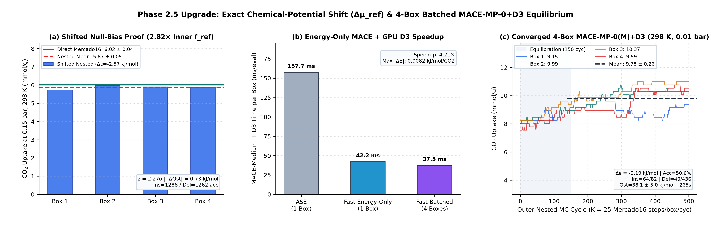
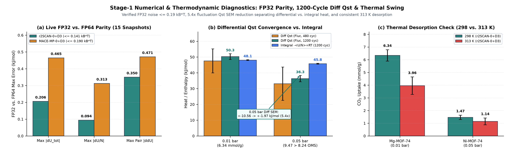
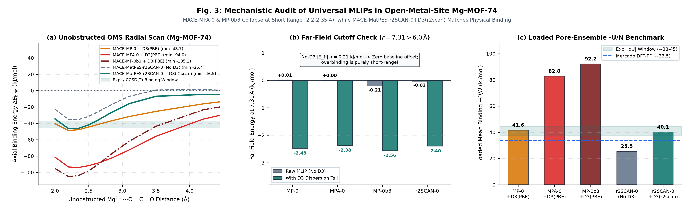

**English** | [简体中文](TECHNICAL_REPORT.zh-CN.md) | [Back to README](../README.md)

# A Hybrid Zero-I/O CUDA Proposal and Chemical-Potential-Shifted Nested Monte Carlo Framework for CO₂ Adsorption in Metal–Organic Frameworks and Assessment of Universal Machine-Learning Potentials

**Abstract**

Universal machine-learning interatomic potentials (MLIPs) offer a route to simulate gas adsorption in metal–organic frameworks (MOFs) without parameterizing custom force fields per metal center or topology, yet direct grand-canonical Monte Carlo (GCMC) evaluation remains bottlenecked by neural-network latency on steric overlaps, while standard nested Monte Carlo (Nested MC) suffers from insertion/deletion asymmetry whenever target MLIP and classical proposal binding energies diverge. Here we present `cuda-mof-gcmc`, a single-GPU hybrid simulation engine (NVIDIA GeForce RTX 5070) combining (i) a verified $O(h^4)$ 3D tricubic classical and many-body self-consistent Applequist–Thole polarizable (`Pol-SCF`) CUDA solver with (ii) a zero-disk-I/O GPU proposal library coupled directly in memory to batched `MACE + TorchDFTD3` evaluation via chemical-potential-shifted reweighting (`Stage 1 -> Stage 2 -> PilotStage3`). On `Mg-MOF-74` at 298 K (UFF+REPEAT), the tricubic classical kernel matches single-core `RASPA3 3.0.29` within $0.54\sigma$ across 0.15–5.0 bar at $598,669\ \text{MC-steps/s}$ ($153.2\times$ faster than single-core `RASPA3` Tricubic Grid), and `Pol-SCF` agrees with exact `36×36` matrix inversion to $1.83 \times 10^{-8}\ \text{K}$ ($1.13 \times 10^{-11}$ e·Å). Within the Nested MC framework, we verify exact reweighting zero bias ($z = 0.27\sigma$), `float32` vs. `float64` transition error bounds ($\le 0.190\ k_B T$), and `1×1×2` vs. `1×1×4` supercell finite-size convergence ($z = 0.04\sigma$ classical, $z = 0.63\sigma$ MLIP). Evaluating four MACE generations and four representative MOFs against unmodified NIST ISODB 298 K measurements reveals that while `MACE-MPA-0` and `MACE-MP-0b3` vanish at the far-field pore center ($7.31$ Å), both suffer severe short-range overbinding collapse ($-93.98$ and $-105.17\ \text{kJ/mol}$) near `Mg²⁺` ($2.20$–$2.35$ Å). Even `MACE-MatPES-r2SCAN-0 + D3(r2scan)` systematically overpredicts uptake on both `Mg-MOF-74` (1.8–3.0×) and non-OMS control `IRMOF-1` (2.5–2.9×), whereas apparent proximity on `HKUST-1` ($4.098\ \text{mmol/g}$ vs. $4.530\ \text{mmol/g}$ at 1.0 bar) involves partial cancellation between weak `Cu²⁺` paddlewheel axial binding ($-10.07\ \text{kJ/mol}$) and strong framework/cage dispersion.

**Keywords**: Metal–Organic Frameworks; Grand-Canonical Monte Carlo; Machine-Learning Interatomic Potentials; Nested Monte Carlo; Open Metal Sites; CUDA

---

## 1. Introduction

Nanoporous metal–organic frameworks (MOFs) bearing coordinatively unsaturated open metal sites (OMSs), such as M-MOF-74 ($\text{M}_2(\text{dobdc})$) and HKUST-1 ($\text{Cu}_3(\text{BTC})_2$), exhibit strong low-pressure $\text{CO}_2$ affinity driven by steep local electric-field gradients and metal–ligand orbital interactions[1, 2]. Generic fixed-charge force fields (UFF paired with REPEAT charges and TraPPE guests) frequently underestimate both uptake and differential isosteric heat in OMS pores, whereas DFT-derived force fields (such as Mercado et al. for `Mg-MOF-74`[3]) require manual parameterization for each metal species and coordination geometry.

Universal equivariant graph-neural-network interatomic potentials, such as the MACE foundation model family[4], span most of the periodic table and can in principle evaluate arbitrary MOF–adsorbate interactions. In practice, direct grand-canonical Monte Carlo (GCMC) sampling with MLIPs faces two coupled computational obstacles: (1) roughly 90%–95% of random trial insertions in microporous frameworks clash sterically with framework atoms, wasting neural-network evaluations on trivially rejected states; and (2) conventional Nested MC using a classical proposal potential fails to sample reversibly when the MLIP and classical per-molecule binding energies differ by several $k_B T$, because outer Metropolis acceptance drops exponentially for either deletions or insertions. Moreover, while mature GPU classical simulators such as `gRASPA`[5] provide broad classical force-field coverage and configurational-bias Monte Carlo (CBMC) for flexible chain molecules, they do not expose a zero-disk-I/O in-memory GPU proposer ABI for batched PyTorch MLIP reweighting or block-collective self-consistent many-body polarization (`Pol-SCF`).

To address these challenges on a single consumer GPU (NVIDIA GeForce RTX 5070), we implemented `cuda-mof-gcmc`:

1. A rigid-framework CUDA classical and polarizable GCMC solver featuring $O(h^4)$ 3D tricubic potential/field interpolation, periodic full-box double-precision recomputation, and shared-memory Applequist–Thole `Pol-SCF`, benchmarked back-to-back against native `RASPA3 3.0.29`;
2. A zero-I/O CUDA proposer dynamic library coupled in memory with batched `FastMaceD3Target` evaluation and a three-stage pre-production chemical-potential shift calibration (`Stage 1 -> Stage 2 -> PilotStage3`), validated for exact zero-bias reweighting, `float32` numerical error bounds, and supercell convergence;
3. A mechanistic audit of four MACE model generations and equilibrated grand-canonical comparisons against curated NIST ISODB experimental isotherms across `Mg-MOF-74`, `Ni-MOF-74`, `HKUST-1`, and non-OMS control `IRMOF-1` (`MOF-5`).

---

## 2. Theory and Implementation

### 2.1 $O(h^4)$ 3D Tricubic Grids and Zero-Drift Classical CUDA Kernel

Under the rigid-framework approximation, host–guest Lennard-Jones (or Buckingham) pair interactions, Ewald electrostatic potentials $\Phi_{\text{elec}}(\mathbf{r})$, and framework electric fields $\mathbf{E}_{\text{fw}}(\mathbf{r}) = -\nabla \Phi_{\text{elec}}(\mathbf{r})$ depend solely on fractional guest atom coordinates. During initialization, `cuda-mof-gcmc` precomputes species-specific potential and field grids on the GPU (typically $0.10$ Å spacing, e.g., $256 \times 256 \times 72$ for `Mg-MOF-74`) and evaluates them during MC moves using a 4-point Lagrange $O(h^4)$ tricubic stencil. Guest–guest truncated LJ/DSF Coulomb sums and all molecular coordinates are maintained in double precision (`double`) inside shared memory, with strict 5-candidate hexagonal/triclinic minimum-image convention (MIC) distance checks and a full from-scratch `u_fw + u_gg` recomputation every $50,000$ trial steps to eliminate floating-point accumulation drift. Gas-phase fugacities are computed via pure and multicomponent Peng–Robinson (PR) equations of state.

### 2.2 Explicit Polarization and Block-Collective Many-Body `Pol-SCF`

To capture electrostatic induction near OMS centers, the CUDA solver provides two polarization levels beyond non-polarizable (`NonPol`) sampling:

1. **First-Order Framework-Field Induction (`Pol-COM` and `Pol-3Site`)**: Anisotropic polarizability tensors are placed either at the $\text{CO}_2$ center of mass or distributed across its three atomic sites (resolving the steep $r^{-4}$ field gradient at the coordinating oxygen atom), retaining static cross-terms between induced and permanent guest moments;
2. **Level-2 Self-Consistent Many-Body Polarization (`polarization: "scf"`)**: At every trial move, coupled induced dipoles under both framework permanent fields, guest permanent DSF fields, and short-range Thole-damped dipole tensors $\mathbf{T}_{ij}^{\text{Thole}}$ are solved self-consistently in block shared memory to tolerance $|\Delta\boldsymbol{\mu}| < 10^{-10}$ e·Å:

$$
\boldsymbol{\mu}_i = K_E^{-1}\boldsymbol{\alpha}_i\left(\mathbf{E}_i^{\text{fw}} + \sum_{j \neq i}\mathbf{E}_{j \to i}^{\text{DSF,perm}} + \sum_{j \neq i}\mathbf{T}_{ij}^{\text{Thole}}\boldsymbol{\mu}_j\right),\qquad U_{\text{pol}}^{\text{SCF}} = -\frac{1}{2}\sum_i \boldsymbol{\mu}_i \cdot \mathbf{E}_i^0
$$

The solver employs $O(N)$ incremental permanent-field updates, warm-started dipoles, a pre-SCF hard-overlap filter, and a finite/convergence guard (`s_scf_conv`) to preserve detailed balance.

### 2.3 Chemical-Potential-Shifted Nested MC and Three-Stage Calibration

To sample the exact target MLIP grand-canonical distribution using a classical inner proposer $U_{\text{ref}}$, the inner GPU fugacity is shifted prior to equilibration and production by a constant per-molecule energy offset $\Delta\varepsilon$:

$$
f_{\text{ref}} = f_{\text{tgt}} \exp\left(-\frac{\Delta\varepsilon}{k_B T}\right)
$$

In each outer cycle, the CUDA proposer executes a $K$-step burst of strictly reversible classical GCMC moves (translation, rotation, insertion, and deletion with fixed step sizes $\Delta_{\text{trans}} = 1.0$ Å, $\Delta_{\text{rot}} = 0.55$ rad, and end-of-burst double-precision recomputation) and passes the resulting non-overlapping box configuration $\mathbf{x}'$ to the MLIP. The outer Metropolis acceptance criterion is:

$$
P_{\text{acc}}(\mathbf{x} \to \mathbf{x}') = \min\left\lbrace 1,\ \exp\left[-\beta\left((U_{\text{tgt}}(\mathbf{x}') - U_{\text{tgt}}(\mathbf{x})) - (U_{\text{ref}}(\mathbf{x}') - U_{\text{ref}}(\mathbf{x})) - \Delta\varepsilon\,\Delta N\right)\right]\right\rbrace
$$

Upon rejection, the CUDA library restores the full pre-burst box coordinates, molecule count, and energies. Because $\Delta\varepsilon$ is fixed prior to equilibration and production, the inner fugacity bias factor $\exp(-\beta\,\Delta\varepsilon\,\Delta N)$ cancels identically in $P_{\text{acc}}$, preserving exact detailed balance with respect to $\Pi(\mathbf{x}) \propto (z_{\text{tgt}}^N / N!) \exp[-\beta U_{\text{tgt}}(\mathbf{x})]$.

When classical and MLIP site preferences differ (for instance in `HKUST-1`, where classical partial charges overestimate $\text{Cu}^{2+}$ binding relative to spin-unaware MLIPs), purely classical Stage-1/2 estimates can produce overly positive shifts that starve inner insertion proposals. Accordingly, [`scripts/run_mlip_gcmc.py`](../scripts/run_mlip_gcmc.py) performs three pre-production calibration stages (`Stage 1 -> Stage 2 -> PilotStage3`):

1. **Stage 1 & Stage 2 (Classical Initializers)**: Two classical equilibration bursts (`20,000` and `30,000` steps, applying negative loading boosts only if $N < 4$) estimate $\Delta\varepsilon_1$ and $\Delta\varepsilon_2 = \langle (U_{\text{tgt}} - U_{\text{ref}})/N \rangle$, with positive classical shifts capped at $+2.0\ \text{kJ/mol}$;
2. **PilotStage3 (Target-Ensemble Burn-In Refinement)**: A short `60–80`-cycle live Nested MC run (excluded from production statistics) relaxes molecules to MLIP-preferred adsorption pockets, updating $\Delta\varepsilon_{\text{final}} = 0.5\,\Delta\varepsilon_2 + 0.5\,\Delta\varepsilon_{\text{live}}$. This constant shift is then locked before a $10,000$-step inner refresh and the fixed-shift `eq_cycles + prod_cycles` production run.

### 2.4 Zero-I/O CUDA Proposer DLL and Batched MLIP Inference

The software bridge separates persistent GPU proposal state ([`include/proposer_api.h`](../include/proposer_api.h), [`src/proposer_dll.cu`](../src/proposer_dll.cu)) from batched MLIP evaluation ([`scripts/nested_mc_engine.py`](../scripts/nested_mc_engine.py)):

- **`mof_gcmc_proposer.dll`**: Retains 3D grids, replica states, and rollback buffers in GPU memory across the entire run, exchanging double-precision arrays in memory with Python via `ctypes` (`proposer_set_chem_pot_shift`, `proposer_propose_k`, `proposer_commit`, `proposer_eval_energy`) without file I/O.
- **`FastMaceD3Target`**: Bypasses ASE calculator overhead by running `torch.no_grad()` batched MACE graph forward passes (`compute_force=False`, micro-batch size `2` for $<550$ framework atoms and `1` for $\ge 550$ atoms within 12 GB VRAM) paired with cached static framework–framework GPU periodic edge lists in `TorchDFTD3Calculator` (`damping="bj"`).

### 2.5 Differential Isosteric Heat vs. Integral Molar Enthalpy

Two distinct thermodynamic quantities are tracked separately throughout this report:

- **Differential Isosteric Heat** ($Q_{\text{st}}^{\text{diff}}$): Evaluated from grand-canonical particle–energy fluctuations, measuring the differential enthalpy change upon adsorbing the $(N+1)$-th molecule:

$$
Q_{\text{st}}^{\text{diff}} = RT - \frac{\langle U N \rangle - \langle U \rangle \langle N \rangle}{\langle N^2 \rangle - \langle N \rangle^2}
$$

- **Mean Integral Molar Enthalpy** ($Q_{\text{int}}^{\text{molar}}$): Defined as $RT - \langle U \rangle / \langle N \rangle$, measuring the average stabilization enthalpy over all $N$ adsorbed molecules. While both coincide near zero coverage or on energetically uniform sites, above 1:1 OMS saturation (e.g., $8.24\ \text{mmol/g}$ in `Mg-MOF-74`) newly inserted molecules occupy weaker secondary pore sites, causing $Q_{\text{st}}^{\text{diff}}$ to decrease below $Q_{\text{int}}^{\text{molar}}$; they are not interchangeable estimators of the same quantity at finite loading.

---

## 3. Numerical Verification and Performance Benchmarks

### 3.1 Classical Kernel Parity vs. `RASPA3 3.0.29` and `Pol-SCF` Matrix Check

Benchmarks on `Mg-MOF-74` (298 K, UFF+REPEAT and Mercado 2016 DFT-FF) on a single RTX 5070 establish the numerical baseline (Figures 1–2 and Table 1):

- **Grid Construction & Interpolation Accuracy**: Building six `0.10 Å` grids (`256×256×72`, 113 MB VRAM) takes `3.03 s`, achieving a **`38.9×`** speedup over single-core CPU `RASPA3` grid construction (`117.98 s` on `151×151×46`). Near-field `Mg–O` radial MAE (`2.3–3.8 Å`) drops **`290.3×`** relative to `0.20 Å` trilinear grids (`190.46 K` → **`0.656 K`** for UFF; **`0.092 K`** for Mercado 2016).
- **Zero Drift & Detailed Balance**: Across `128` boxes (`64M` steps per force field), periodic `50k` recomputation caps maximum energy drift at **`5.879e-09 K`** (UFF) and **`1.024e-08 K`** (Mercado 2016), with `max|acc_ins - acc_del| <= 0.000253`.
- **Throughput**: The `v2` tricubic kernel sustains **`598,669 MC-steps/s`** (`64M` steps in `106.90 s`)—**`153.2×`** faster than single-core `RASPA3 3.0.29` running the same tricubic grid algorithm (`3,908 MC-steps/s`) and **`492.6×`** faster than single-core `RASPA3` Exact Ewald (`1,215 MC-steps/s`).
- **Level-2 `Pol-SCF` Verification**: In `--test-scf`, the shared-memory Applequist–Thole solver matches exact Python `36×36` matrix inversion to **`1.83e-08 K`** in energy and **`1.13e-11 e·Å`** in induced dipoles. In `15:85` $\text{CO}_2/\text{N}_2$ flue gas (298 K), many-body mutual depolarization reduces selectivity from framework-only `Pol-3Site` values of `64.58` (`1.0 bar`) and `67.38` (`2.0 bar`) to **`37.28`** and **`43.24`**.

**Table 1.** Parity of the CUDA `v2` `0.10 Å` Tricubic Kernel vs. Native `RASPA3 3.0.29` (`Mg-MOF-74`, 298 K, UFF+REPEAT)

| Pressure | `v2` `0.10 Å` Tricubic (mmol/g) | `RASPA3` Exact Ewald (mmol/g) | `RASPA3` Tricubic Grid (mmol/g) | `v2` vs. Grid Deviation ($z$) | $\Delta Q_{\text{st}}$ (kJ/mol) |
| :---: | :---: | :---: | :---: | :---: | :---: |
| **`0.15 bar`** | **`1.4276 ± 0.0123`** | `1.4087 ± 0.0328` | `1.3952 ± 0.0719` | `+2.32%` (`0.44σ`) | `+0.14` |
| **`1.00 bar`** | **`7.6349 ± 0.1576`** | `7.3384 ± 0.1329` | `7.5303 ± 0.1156` | `+1.39%` (`0.54σ`) | `-0.38` |
| **`5.00 bar`** | **`13.1862 ± 0.0221`** | `13.3048 ± 0.2118` | `13.2402 ± 0.1871` | `-0.41%` (`0.29σ`) | `+0.54` |

*Figure 1. `0.10 Å` 3D tricubic CUDA kernel parity against native `RASPA3 3.0.29` (Exact Ewald and Tricubic Grid) and `Mercado 2016` DFT-FF on `Mg-MOF-74` at 298 K.*

*Figure 2. Level-2 many-body self-consistent polarization (`Pol-SCF`) pure-component uptake, $\text{CO}_2/\text{N}_2$ mutual depolarization screening, and `36×36` exact matrix parity check.*

### 3.2 Nested MC Zero-Bias Proof, Chemical-Potential Shifting & Speedup

Before running production MLIP isotherms, reweighting correctness and inference acceleration were verified (Figure 3):

1. **DLL Energy Parity & Null-Bias Proof**: `proposer_eval_energy` matches internal kernel energy `U_ref_K` to **`0.000e+00 K`**. Using `Pol-3Site` proposals to reweight into `Mercado 2016` (`Mg-MOF-74 1×1×2`, `298 K, 0.15 bar`, 4 boxes, $K = 15$, `2,000 eq + 10,000 prod` cycles), Nested MC yields **`5.9668 ± 0.2072 mmol/g`** ($Q_{\text{st}}^{\text{diff}} = 35.05 \pm 1.27\ \text{kJ/mol}$), matching direct `Mercado 2016` GPU GCMC (`6.0230 ± 0.0406 mmol/g`, $Q_{\text{st}}^{\text{diff}} = 36.28 \pm 0.25\ \text{kJ/mol}$) within **`z = 0.27σ`**.
2. **Shifted Reweighting & Deadlock Resolution**: Applying `Δε = -2.57 kJ/mol` ($2.82\times$ inner fugacity) in the same classical test yields **`5.8723 ± 0.0526 mmol/g`** ($Q_{\text{st}}^{\text{diff}} = 35.55 \pm 0.63\ \text{kJ/mol}$) with symmetric exchange (`Ins = 1,288 / 4,274`, `Del = 1,262 / 3,511`, `57.5%` outer acceptance). On live `MACE-MP-0 + D3`, unshifted Nested MC at `0.15 bar` suffered **`0` accepted deletions** over `450` cycles (`N` climbed monotonically from `30` to `41`), whereas two-stage shifting (`-9.19 kJ/mol`, `40.84×` fugacity) at `0.01 bar` restored bidirectional exchange (`Ins = 64 / 82`, `Del = 40 / 436`, `50.6%` outer acc, `9.7771 ± 0.2617 mmol/g`).
3. **Batched Inference Throughput**: Across 4 replicas of `Mg-MOF-74 1×1×2`, `FastMaceD3Target` lowers per-box inference latency from `157.7 ms/box` (ASE) to **`37.5 ms/box`** (`149.9 ms/batch`, **`4.21×`** speedup) while agreeing with full ASE evaluation within **`0.0025–0.0082 kJ/mol/CO2`**.

*Figure 3. Chemical-potential-shifted (`Δμ_ref`) zero-bias verification, `4.21×` batched `FastMaceD3Target` speedup, and reversible 4-replica equilibrium on `MACE-MP-0 + D3`.*

### 3.3 `float32` Precision Bounds and Supercell Finite-Size Convergence

To bound numerical errors from `float32` inference and finite periodic box sizes, two targeted checks were conducted (Figure 4 and Table 2):

- **`float32` vs. `float64` Parity**: Across 15 non-overlapping `Mg-MOF-74 1×1×2` snapshots spanning `N = 1`, `13–16`, and `33–37` $\text{CO}_2$ molecules (327–435 atoms), `MACE-MatPES-r2SCAN-0 + D3(r2scan)` in `FastMaceD3Target` differs from full `float64` `MACE + TorchDFTD3` by at most **`0.2058 kJ/mol`** total (`RMS = 0.0951 kJ/mol`), **`0.0940 kJ/mol/CO2`** per molecule, and **`0.3500 kJ/mol`** across pairwise transitions (`0.141 kB*T @ 298 K`). For `MACE-MP-0 (Medium) + D3(pbe)`, corresponding maxima are **`0.4650 kJ/mol`**, **`0.3130 kJ/mol/CO2`**, and **`0.4712 kJ/mol`** (`0.190 kB*T @ 298 K`).
- **Supercell Convergence (`1×1×2` vs. `1×1×4`)**: At `298 K, 0.01 bar` on `Mg-MOF-74`, doubling the supercell from `1×1×2` (324 framework atoms, effective MIC $r_{\text{cut}} = 6.66$ Å) to `1×1×4` (648 framework atoms, $r_{\text{cut}} = 10.86$ Å) changes direct `Mercado` uptake from `0.8018 ± 0.0115` to `0.8030 ± 0.0337 mmol/g` (**`z = 0.04σ`**) and live `MACE-MP-0 + D3` Nested MC uptake from **`9.3398 ± 0.3610`** to **`9.0615 ± 0.2539 mmol/g`** (**`z = 0.63σ`**, integral enthalpy `44.99 ± 0.54` vs. `45.01 ± 0.21 kJ/mol`), ruling out significant finite-size cutoff artifacts.

**Table 2.** Live `float32 FastMaceD3Target` vs. Full `float64` Energy Parity (`Mg-MOF-74 1×1×2`, 15 Snapshots)

| Model Configuration | Max Total `|ΔU|` (kJ/mol) | Total RMS Error (kJ/mol) | Max `|ΔU/N|` (kJ/mol/CO2) | Max Pairwise `|ΔΔU|` (kJ/mol) | Thermal Scale at 298 K |
| :--- | :---: | :---: | :---: | :---: | :---: |
| **`MACE-MatPES-r2SCAN-0 + D3(r2scan)`** | `0.2058` | `0.0951` | `0.0940` | `0.3500` | `0.141 kB*T` |
| **`MACE-MP-0 (Medium) + D3(pbe)`** | `0.4650` | `0.2528` | `0.3130` | `0.4712` | `0.190 kB*T` |

*Figure 4. Live `float32` vs. `float64` energy error bounds, `1,200`-cycle differential $Q_{\text{st}}^{\text{diff}}$ SEM reduction on `Mg-MOF-74`, and `298 K` vs. `313 K` thermal desorption checks.*

---

## 4. Universal MACE Foundation-Model Diagnostics and Four-MOF Benchmarks

### 4.1 Far-Field Zero-Offset Proof and Short-Range Overbinding Collapse

Four MACE foundation generations (`MACE-MP-0 (Medium)`, `MACE-MPA-0`, `MACE-MP-0b3`, and `MACE-MatPES-r2SCAN-0`) were audited in `Mg-MOF-74` across loaded ensembles ($N \approx 25$) and static probes (Figure 5 and Table 3). Placing a single $\text{CO}_2$ molecule at the unobstructed 1D pore center ($r_{\min} = 7.31$ Å $> 6.0$ Å MACE graph cutoff) yields near-zero raw MLIP energies without D3 across all four models (**`+0.01`**, **`+0.00`**, **`-0.21`**, and **`-0.03 kJ/mol`**), while D3 adds a consistent `-2.38` to `-2.56 kJ/mol` tail—confirming zero isolated reference or far-field offset.

Along the unobstructed axial $\text{Mg}^{2+}\cdots\text{O}=\text{C}=\text{O}$ coordinate ($2.20$–$2.35$ Å), however, newer `MACE-MPA-0` and `MACE-MP-0b3` suffer acute short-range collapse even with dispersion disabled (**`-75.26`** and **`-85.48 kJ/mol`** No-D3; **`-93.98`** and **`-105.17 kJ/mol`** with D3(PBE)), yielding `-82.84` and `-92.15 kJ/mol` ensemble averages that freeze pore occupancy. By contrast, `MACE-MP-0 + D3(PBE)` (`-48.74 kJ/mol`) and `MACE-MatPES-r2SCAN-0 + D3(r2scan)` (**`-46.45 kJ/mol`**, ensemble `-U/N = 40.13 kJ/mol`) produce physically bounded static wells.

**Table 3.** Far-Field (`7.31 Å`), Unobstructed Axial `Mg²⁺` Minimum, and Loaded Pore Diagnostics across Four MACE Generations

| Model Configuration | Far-Field `7.31 Å` (kJ/mol) | Axial `Mg²⁺` Min (kJ/mol) | `r_min` (`Å`) | Loaded Mean `-U/N` (kJ/mol) |
| :--- | :---: | :---: | :---: | :---: |
| **`MACE-MP-0` (No D3 / `+D3(PBE)`)** | `+0.01` / `-2.48` | `-29.31` / `-48.74` | `2.35` / `2.20` | `—` / `41.63` |
| **`MACE-MPA-0` (No D3 / `+D3(PBE)`)** | `+0.00` / `-2.38` | **`-75.26`** / **`-93.98`** | `2.35` / `2.35` | `—` / **`82.84`** |
| **`MACE-MP-0b3` (No D3 / `+D3(PBE)`)** | `-0.21` / `-2.56` | **`-85.48`** / **`-105.17`** | `2.20` / `2.20` | `—` / **`92.15`** |
| **`MACE-MatPES-r2SCAN-0` (No D3)** | `-0.03` | `-35.39` | `2.35` | `25.47` |
| **`MACE-MatPES-r2SCAN-0 + D3(r2scan)`** | `-2.40` | **`-46.45`** | `2.20` | **`40.13`** |

*Figure 5. Unobstructed `Mg²⁺` OMS axial radial scans, `7.31 Å` far-field zero-offset verification, and loaded pore-ensemble `-U/N` comparisons across four MACE generations.*

### 4.2 Four-MOF Grand-Canonical Benchmarks Against NIST ISODB Measurements

Using `MACE-MatPES-r2SCAN-0 + D3(r2scan)`, equilibrated grand-canonical simulations were conducted across four chemically and topologically distinct MOFs at `298 K` and `313 K`, benchmarked directly against pristine unmodified gravimetric isotherms retrieved from NIST ISODB (Figure 6 and Table 4).

*Figure 6. Simulated 298 K $\text{CO}_2$ isotherms across `Mg-MOF-74`, `Ni-MOF-74`, equilibrated `HKUST-1`, and non-OMS `IRMOF-1` (`MOF-5`) compared against curated NIST ISODB datasets.*

**Table 4.** Classical and `MACE-MatPES-r2SCAN-0 + D3(r2scan)` GCMC Benchmarks vs. NIST ISODB Experimental Tables

| System & Condition | Prod Cycles | Classical (mmol/g) | MLIP Uptake (mmol/g) | Diff. $Q_{\text{st}}^{\text{diff}}$ (kJ/mol) | Integral $Q_{\text{int}}^{\text{molar}}$ (kJ/mol) | Prod `Ins / Del` (4 boxes) | NIST ISODB `298 K` Ref. (DOI) |
| :--- | :---: | :---: | :---: | :---: | :---: | :---: | :--- |
| `Mg-MOF-74`, `298 K, 0.01 bar` | `1200` | `0.802` (`Mercado`) | `6.3407 ± 0.4486` | `50.28 ± 1.81` | `48.07 ± 0.25` | `133/590`, `112/435` | `2.102` @ `0.0101 bar` (`10.1021/acs.jpcc.7b08239`) |
| `Mg-MOF-74`, `298 K, 0.05 bar` | `1200` | `3.312` (`Mercado`) | `9.4714 ± 0.2595` | `36.31 ± 1.97` | `45.77 ± 0.27` | `182/573`, `171/823` | `4.410` @ `0.0315 bar` (`10.1021/acs.jpcc.7b08239`) |
| `Mg-MOF-74`, `298 K, 0.15 bar` | `480` | `6.023` (`Mercado`) | `11.4721 ± 0.1519` | `31.97 ± 4.23` | `43.17 ± 0.32` | `71/199`, `72/302` | `5.867–7.044` @ `0.099–0.311 bar` |
| `Mg-MOF-74`, `313 K, 0.01 bar` | `480` | `—` | `3.9595 ± 0.6894` | `42.59 ± 6.03` | `46.81 ± 0.44` | `46/338`, `39/135` | Thermal desorption `−2.38 mmol/g` vs. `298 K` |
| `Ni-MOF-74`, `298 K, 0.01 bar` | `260` | `0.249` (`Pol-3Site`) | `0.5779 ± 0.1437` | `33.83 ± 1.26` | `—` | `35/67`, `27/367` | `0.398` @ `0.0101 bar` (`10.1021/acs.jpcc.5b03700`) |
| `Ni-MOF-74`, `298 K, 0.05 bar` | `480` | `1.199` (`Pol-3Site`) | `1.4671 ± 0.1705` | `35.57 ± 1.30` | `36.48 ± 0.66` | `75/182`, `55/757` | `2.091` @ `0.0512 bar` (`10.1021/acs.jpcc.5b03700`) |
| `Ni-MOF-74`, `298 K, 0.15 bar` | `480` | `2.984` (`Pol-3Site`) | `4.2921 ± 0.3457` | `35.23 ± 2.74` | `36.98 ± 0.50` | `79/170`, `59/876` | `4.456` @ `0.1512 bar` (`10.1021/acs.jpcc.5b03700`) |
| `Ni-MOF-74`, `313 K, 0.05 bar` | `480` | `—` | `1.1449 ± 0.2693` | `38.55 ± 1.71` | `37.14 ± 0.39` | `74/270`, `60/641` | Thermal desorption `−0.32 mmol/g` vs. `298 K` |
| `HKUST-1`, `298 K, 0.15 bar` | `480` | `0.835` (`UFF`) | `1.2199 ± 0.1482` | `25.49 ± 3.67` | `25.51 ± 0.49` | `69/197`, `56/1271` | `0.880` @ `0.147 bar` (`10.1002/aic.15837`) |
| `HKUST-1`, `298 K, 0.50 bar` | `480` | `2.126` (`UFF`) | `2.3279 ± 0.1678` | `21.46 ± 3.61` | `23.91 ± 0.33` | `79/220`, `60/1263` | `2.670` @ `0.505 bar` (`10.1002/aic.15837`) |
| `HKUST-1`, `298 K, 1.00 bar` | `480` | `3.676` (`UFF`) | `4.0984 ± 0.0657` | `24.34 ± 0.62` | `23.53 ± 0.32` | `76/182`, `52/1303` | `4.530` @ `0.998 bar` (`10.1002/aic.15837`) |
| `IRMOF-1`, `298 K, 2.00 bar` | `360` | `1.546` (`UFF`) | `5.2688 ± 0.5154` | `18.67 ± 1.54` | `17.90 ± 0.51` | `50/229`, `35/960` | `1.838` @ `2.074 bar` (`10.1021/acs.jctc.5b00093`) |
| `IRMOF-1`, `298 K, 5.00 bar` | `360` | `4.539` (`UFF`) | `12.2190 ± 0.5134` | `26.51 ± 2.68` | `19.01 ± 0.31` | `103/295`, `72/653` | `4.917` @ `5.240 bar` (`10.1021/acs.jctc.5b00093`) |

Three physical conclusions follow from Table 4 and static site scans:

1. **Resolution of Post-Saturation Differential Heat (`Mg-MOF-74`, `1,200` Cycles)**: Extending sampling to `1,200` outer production cycles yields balanced grand-canonical exchange (`Ins/Del = 133/112` at `0.01 bar`; `182/171` at `0.05 bar`) and reduces fluctuation $Q_{\text{st}}^{\text{diff}}$ SEM by $5.4\times$ (from `±10.56` down to **`±1.97 kJ/mol`** at `0.05 bar`). Once loading exceeds 1:1 $\text{Mg}^{2+}$ saturation ($8.24\ \text{mmol/g}$) to reach $9.471\ \text{mmol/g}$, differential $Q_{\text{st}}^{\text{diff}}$ drops cleanly from `50.28` to **`36.31 kJ/mol`** as incoming molecules fill secondary sites, while integral enthalpy remains `45.77 kJ/mol`. Both `Mg-MOF-74` and `Ni-MOF-74` exhibit consistent `313 K` thermal desorption and reproduce the experimental $\text{Mg-MOF-74} > \text{Ni-MOF-74}$ metal ordering.
2. **Equilibration via `PilotStage3` and Error Cancellation in `HKUST-1`**: Uncalibrated positive classical shifts in earlier `200`-cycle `HKUST-1` runs (`+3.71 / +4.66 kJ/mol`) starved inner proposals (`0.22× / 0.15×` fugacity) and left a spurious plateau (`1.34 -> 1.27 mmol/g`). With the $+2.0\ \text{kJ/mol}$ classical shift cap and `PilotStage3` recalibration (`-0.28 / +0.90 / +1.34 kJ/mol`), `HKUST-1` equilibrates monotonically (`1.220 -> 2.328 -> 4.098 mmol/g`) within ~10%–13% of NIST ISODB at `0.5` and `1.0 bar`. However, independent axial scans at the antiferromagnetic $\text{Cu}^{2+}$–$\text{Cu}^{2+}$ paddlewheel show weak minima of only `-10.07 kJ/mol` (`r2SCAN-0+D3`) and `-7.72 kJ/mol` (`MP-0+D3`) at $2.40$ Å, indicating that the close isotherm agreement on `HKUST-1` involves partial cancellation between underestimated $\text{Cu}^{2+}$ chemisorption and overly attractive framework/cage dispersion.
3. **Isolation of Systematic Background Overbinding in `IRMOF-1`**: On `IRMOF-1` (zero open metal sites), zero-charge `UFF` (`1.546 / 4.539 mmol/g`) agrees closely with NIST ISODB (`1.838 / 4.917 mmol/g`), whereas `MACE-MatPES-r2SCAN-0 + D3(r2scan)` overshoots experiment by **`2.5–2.9×`** (`5.269 / 12.219 mmol/g`; integral enthalpy `~18.4–19.0` vs. `13.2–14.4 kJ/mol`), mirroring the `1.8–3.0×` overprediction observed on `Mg-MOF-74`. Direct inspection of `torch-dftd 0.5.3` confirms that `xc="r2scan"` loads the standard Grimme/Ehlert `r2SCAN-D3(BJ)` damping parameters ($s_6=1.0000,\ a_1=0.4948,\ s_8=0.7898,\ a_2=5.7308\ a_0$)[6], ruling out parameter fallback bugs and narrowing the excess `+4–5 kJ/mol/CO2` affinity to intrinsic `r2SCAN-D3(BJ)` functional error and/or residual MLIP–D3 dispersion double-counting.

---

## 5. Limitations and Future Work

1. **Periodic DFT Reference Decomposition (Stage 2)**: Representative pore snapshots across `Mg-MOF-74`, `Ni-MOF-74`, `HKUST-1`, and `IRMOF-1` remain to be evaluated with periodic DFT (`r2SCAN`, `r2SCAN+D3(BJ)`, `PBE+D3`, and spin-polarized `Cu²⁺` checks) to quantitatively partition MLIP fitting residuals, underlying functional bias, and dispersion double-counting.
2. **Rigid Geometry & Polarizable Parameter Assumptions**: Framework breathing and $\text{CO}_2$ bending are omitted under the rigid-body approximation, and classical `Pol-SCF` applies Thole many-body induction on top of unpolarized TraPPE/UFF parameters (introducing induction double-counting relative to dedicated polarizable fits).
3. **Residual Correction & `gRASPA` Comparison**: Following periodic DFT labeling, small-sample fine-tuning or a $\Delta$-learning residual head can be integrated into [`scripts/run_mlip_gcmc.py`](../scripts/run_mlip_gcmc.py) to assess corrected isotherms; additionally, direct same-GPU classical throughput benchmarking against `gRASPA` remains to be conducted.

---

## 6. References and Data Sources

[1] Boyd, P. G.; et al. Data-driven design of metal–organic frameworks for wet flue gas $\text{CO}_2$ capture. *Nature* **2019**, *576*, 253–256.  
[2] Queen, W. L.; Hudson, M. R.; Bloch, E. D.; et al. Comprehensive study of carbon dioxide adsorption in the metal–organic frameworks $\text{M}_2(\text{dobdc})$ ($\text{M} = \text{Mg, Mn, Fe, Co, Ni, Cu, Zn}$). *Chem. Sci.* **2014**, *5*, 4569–4581.  
[3] Mercado, R.; Vlaisavljevich, B.; Lin, L.-C.; et al. Force field development from periodic density functional theory calculations for gas separation applications using metal–organic frameworks. *J. Phys. Chem. C* **2016**, *120*, 12590–12604.  
[4] Batatia, I.; et al. A foundation model for atomistic materials chemistry. *arXiv:2401.00096* **2024**; MatPES / `MACE-MatPES-r2SCAN-0` foundational potentials.  
[5] Dubbeldam, D.; Torres-Knoop, A.; Walton, K. S. `RASPA3` (`3.0.29`); Zhou, J.; et al. `gRASPA`: GPU-accelerated Monte Carlo simulation of adsorption in porous materials. *J. Chem. Theory Comput.* **2024**.  
[6] Ehlert, S.; Huniar, U.; Orio, M.; Grimme, S. $\text{r}^2\text{SCAN-3c}$: A “Swiss army knife” composite electronic-structure method. *J. Chem. Phys.* **2021**, *154*, 061101.  
[7] NIST/ARPA-E Database of Novel and Emerging Adsorbent Materials (NIST ISODB) archived in [`data/exp_isotherms/manifest.json`](../data/exp_isotherms/manifest.json):  

- `Mg-MOF-74` (298 K $\text{CO}_2$): DOI `10.1021/acs.jpcc.7b08239`, `10.1039/c5dt03137k`  
- `Ni-MOF-74` (298 K $\text{CO}_2$): DOI `10.1021/acs.jpcc.5b03700`, `10.1080/15422119.2014.884507`  
- `HKUST-1` (298 K $\text{CO}_2$): DOI `10.1002/aic.15837`, `10.1007/s10450-013-9527-2`  
- `IRMOF-1` (298 K $\text{CO}_2$): DOI `10.1021/acs.jctc.5b00093`, `10.1038/srep12045`  
