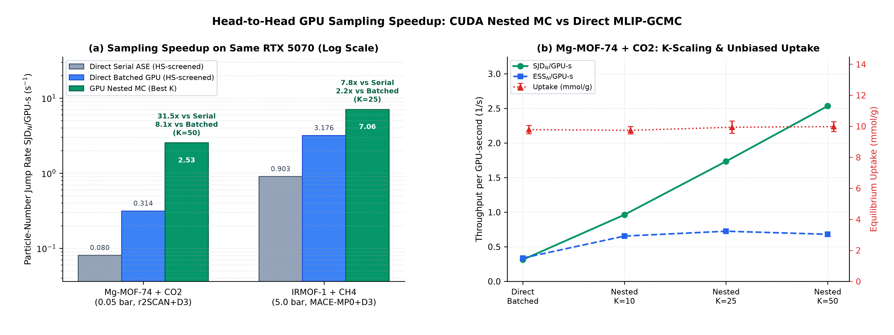
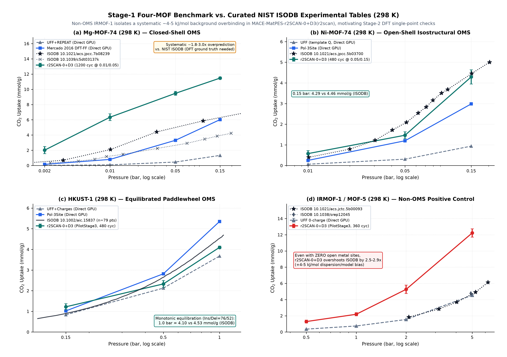

**English** | [简体中文](TECHNICAL_REPORT.zh-CN.md) | [Back to README](../README.md)

# A Hybrid Zero-I/O CUDA Proposal and Chemical-Potential-Shifted Nested Monte Carlo Framework for Gas Adsorption in Metal–Organic Frameworks: Multi-GPU Scaling and Open-Metal-Site MLIP Assessment

**Abstract**

Universal machine-learning interatomic potentials (MLIPs) promise transferable grand-canonical Monte Carlo (GCMC) adsorption simulations across metal–organic frameworks (MOFs) without fitting custom force fields per metal site, yet direct MLIP-GCMC wastes neural-network evaluations on steric overlaps while naive nested Monte Carlo (Nested MC) stalls whenever target MLIP and classical proposal binding energies diverge. Here we present `cuda-mof-gcmc`, a cross-platform Windows/Linux CUDA + PyTorch engine spanning **arbitrary rigid MOFs and rigid multi-site guests**. It integrates (i) a verified $O(h^4)$ 3D tricubic classical and many-body self-consistent Applequist–Thole polarizable (`Pol-SCF`) CUDA solver (`103`-element UFF, full triclinic minimum-image convention, ASE `230`-spacegroup expansion, and screened periodic Ewald QEq) with (ii) an in-memory C ABI GPU proposer (`mof_gcmc_proposer.dll` / `libmof_gcmc_proposer.so`, unit-quaternion 3D rotations) coupled to chunked `FastMaceD3Target` evaluation, VRAM caching-allocator control, chemical-potential-shifted reweighting (`Stage 1 -> Stage 2 -> PilotStage3`), and **multi-GPU parallelization** (`pressure` queue and exact Pooled-Jackknife `replica` sharding). On `Mg-MOF-74` (298 K, UFF+REPEAT), the tricubic classical kernel matches single-core `RASPA3 3.0.29` within $0.54\sigma$ at $598,669\ \text{MC-steps/s}$ ($153.2\times$ faster than single-core `RASPA3` Tricubic Grid), and `Pol-SCF` agrees with `36×36` exact matrix inversion to $1.83 \times 10^{-8}\ \text{K}$. Within Nested MC, we prove exact zero-bias reweighting ($z = 0.27\sigma$), `float32` vs. `float64` transition error bounds ($\le 0.190\ k_B T$), and supercell convergence ($z = 0.04\sigma$ classical, $z = 0.63\sigma$ MLIP). Head-to-head on an NVIDIA RTX 5070, Nested MC speeds up sampling over unbiased `Direct MLIP-GCMC` baselines by **`21.6–31.5×`** (`SJD_N / GPU-s`) and **`3.5–3.7×`** (`ESS_N / GPU-s`) vs. Serial ASE (`5.5–8.1×` and `2.0–2.1×` vs. Batched GPU) on `Mg-MOF-74 + CO₂`, and **`7.6–7.8×` / `3.9–4.2×`** on `IRMOF-1 + CH₄`. Across **`4× RTX 3090` (`GPUs 0–3`)** with `--worker-threads 4` mitigating dual-socket EPYC OpenMP contention (`429.59 s -> 270.55 s` single-GPU fix), multi-GPU execution achieves **`3.44×`** wall-time speedup (`3.66×` MC loop) on `IRMOF-1 + CH₄` (`pressure` mode) and **`3.26×`** (`335.32 s -> 102.85 s`, `3.55×` MC loop, parity $\le 2.50\sigma$) on `Mg-MOF-74 + CO₂`. Finally, an end-to-end structural and NIST ISODB audit across `MACE` generations and four MOFs demonstrates that while Nested MC + `MACE-MatPES-r2SCAN-0 + D3(r2scan)` reproduces genuine bent open-metal-site `Mg²⁺···O=C=O` coordination (`d_min = 2.10–2.16 Å`, `∠Mg–O–C ≈ 134°–136°`, `61.8%` `Mg²⁺` occupancy vs. `0.0%` for classical UFF), universal `UFF+QEq` proposals encounter a short-range hard-core kinetic barrier (`22.2%` `Mg²⁺` occupancy at `0.05 bar`) and off-the-shelf foundation models systematically overbind experiments by `1.8–4×` (`+4–5 kJ/mol/CO₂`) or suffer short-range collapse (`MPA-0` / `MP-0b3`: `-93.98` / `-105.17 kJ/mol`).

**Keywords**: Metal–Organic Frameworks; Grand-Canonical Monte Carlo; Machine-Learning Interatomic Potentials; Nested Monte Carlo; Open Metal Sites; Multi-GPU CUDA

---

## 1. Introduction

Nanoporous metal–organic frameworks (MOFs) bearing coordinatively unsaturated open metal sites (OMSs), such as M-MOF-74 ($\text{M}_2(\text{dobdc})$) and HKUST-1 ($\text{Cu}_3(\text{BTC})_2$), exhibit strong low-pressure $\text{CO}_2$ affinity driven by steep local electric-field gradients and metal–ligand orbital interactions[1, 2]. Generic fixed-charge force fields (UFF paired with REPEAT charges and TraPPE guests) frequently underestimate both uptake and differential isosteric heat in OMS pores, whereas DFT-derived force fields (such as Mercado et al. for `Mg-MOF-74`[3]) require manual parameterization for each metal species and coordination geometry.

Universal equivariant graph-neural-network interatomic potentials, such as the MACE foundation model family[4], span most of the periodic table and can in principle evaluate arbitrary MOF–adsorbate interactions. In practice, coupling MLIPs to grand-canonical Monte Carlo (GCMC) faces three coupled obstacles: (1) roughly 90%–95% of random trial insertions in microporous frameworks clash sterically with framework atoms, wasting neural-network evaluations on trivially rejected states; (2) conventional Nested MC using a classical proposal potential stalls whenever MLIP and classical binding energies differ by several $k_B T$, causing insertion/deletion asymmetry; and (3) even when thermodynamic sampling converges, off-the-shelf universal MLIPs and generic classical proposers must be audited quantitatively for short-range physical fidelity near reactive OMS centers. Moreover, while mature GPU classical simulators such as `gRASPA`[5] provide broad classical force-field coverage and configurational-bias Monte Carlo (CBMC) for flexible chain molecules, they do not expose a zero-disk-I/O in-memory GPU proposer ABI for batched PyTorch MLIP reweighting or block-collective self-consistent many-body polarization (`Pol-SCF`).

To address these challenges across both single consumer GPUs (`RTX 5070`, `sm_120`, 12 GB VRAM) and multi-GPU Linux servers (`4× RTX 3090`, `sm_86`), we built and evaluated `cuda-mof-gcmc`:

1. **Verified Classical & Polarizable CUDA Solver**: Supports arbitrary P1/triclinic frameworks (`103`-element UFF), $O(h^4)$ 3D tricubic potential/field grids, periodic double-precision recomputation, and shared-memory Applequist–Thole `Pol-SCF`, benchmarked against `RASPA3 3.0.29`;
2. **Universal Zero-I/O Nested MLIP-GCMC & Multi-GPU Engine**: Pairs an in-memory C ABI unit-quaternion GPU proposer (`.dll` / `.so`) and ASE/periodic-QEq preprocessing with chunked `FastMaceD3Target`, three-stage $\Delta\mu_{\text{ref}}$ calibration, VRAM guard, cross-platform one-click setup (`fast_start.bat` / `fast_start.sh`), and multi-GPU `pressure`/`replica` scaling—benchmarked head-to-head in `ESS_N / GPU-s` and `SJD_N / GPU-s` against unbiased `Direct MLIP-GCMC` baselines;
3. **Foundation-Model Audit & OMS End-to-End Assessment**: Combines mechanistic scans across four MACE generations, NIST ISODB benchmarks across `Mg-MOF-74`, `Ni-MOF-74`, `HKUST-1`, and non-OMS control `IRMOF-1`, and a microscopic `Mg²⁺···O=C=O` coordination geometry audit clarifying precisely how far current Nested MLIP-GCMC resolves the open-metal-site GCMC accuracy problem.

---

## 2. Theory and Implementation

*Figure 1. End-to-end architecture of `cuda-mof-gcmc`: ASE spacegroup expansion + periodic QEq preprocessing, zero-I/O CUDA proposer library (`mof_gcmc_proposer.dll` / `.so`), batched `FastMaceD3Target` scoring with exact $\Delta\varepsilon\,\Delta N$ reweighting, and multi-GPU orchestration.*

### 2.1 Universal MOF/Guest Kinematics, $O(h^4)$ Tricubic Grids, and Triclinic MIC

Under the rigid-framework and rigid-guest approximation (`<= 12` sites, `<= 6` LJ types, including massless `Z = 0` electrostatic sites), [`scripts/qeq_charges.py`](../scripts/qeq_charges.py) expands any of the `230` crystallographic space groups via ASE while preserving asymmetric-unit partial charges/labels (`spacegroup_kinds`). When input CIFs lack charges (except `Mg-MOF-74` `REPEAT` presets), a screened periodic Ewald Charge Equilibration (`QEq`, $\varepsilon_{\text{eff}} = 1.50$) assigns self-consistent framework charges, reproducing `Mg-MOF-74` `REPEAT` charges within `MAE = 0.153 e` and `Cu-BTC` DFT charges within `MAE = 0.110 e`. Framework van der Waals parameters span all `103` UFF elements (`H`–`Lr`) alongside `Mercado 2016` DFT-FF parameters for `Mg-MOF-74`.

During GPU initialization, `cuda-mof-gcmc` precomputes species-specific 3D potential and electric-field grids (typically $0.10$–$0.11$ Å spacing) and evaluates them via a 4-point Lagrange $O(h^4)$ tricubic stencil. Guest–guest truncated LJ/DSF Coulomb sums, unit-quaternion 3D rigid rotations ([`scripts/guests.py`](../scripts/guests.py)), and molecular coordinates are kept in double precision (`double`) inside shared memory, using exact general triclinic minimum-image convention (MIC) checks and full `u_fw + u_gg` recomputation every $50,000$ trial steps. Gas-phase fugacities follow pure and multicomponent Peng–Robinson (PR) equations of state.

### 2.2 Explicit Polarization and Block-Collective Many-Body `Pol-SCF`

To capture electrostatic induction near OMS centers, the CUDA solver provides two polarization levels beyond non-polarizable (`NonPol`) sampling:

1. **First-Order Framework-Field Induction (`Pol-COM` and `Pol-3Site`)**: Anisotropic polarizability tensors are placed either at the $\text{CO}_2$ center of mass or distributed across its three atomic sites (resolving the steep $r^{-4}$ field gradient at the coordinating oxygen atom), retaining static cross-terms between induced and permanent guest moments;
2. **Level-2 Self-Consistent Many-Body Polarization (`polarization: "scf"`)**: At every trial move, coupled induced dipoles under framework permanent fields, guest permanent DSF fields, and short-range Thole-damped dipole tensors $\mathbf{T}_{ij}^{\text{Thole}}$ are solved self-consistently in block shared memory to $|\Delta\boldsymbol{\mu}| < 10^{-10}$ e·Å:

$$
\boldsymbol{\mu}_i = K_E^{-1}\boldsymbol{\alpha}_i\left(\mathbf{E}_i^{\text{fw}} + \sum_{j \neq i}\mathbf{E}_{j \to i}^{\text{DSF,perm}} + \sum_{j \neq i}\mathbf{T}_{ij}^{\text{Thole}}\boldsymbol{\mu}_j\right),\qquad U_{\text{pol}}^{\text{SCF}} = -\frac{1}{2}\sum_i \boldsymbol{\mu}_i \cdot \mathbf{E}_i^0
$$

The solver employs $O(N)$ incremental permanent-field updates, warm-started dipoles, a pre-SCF hard-overlap filter, and a finite/convergence guard (`s_scf_conv`) to preserve detailed balance.

### 2.3 Chemical-Potential-Shifted Nested MC and Three-Stage Calibration

To sample the exact target MLIP grand-canonical distribution using a classical inner proposer $U_{\text{ref}}$, the inner GPU fugacity is shifted prior to equilibration and production by a constant per-molecule energy offset $\Delta\varepsilon$:

$$
f_{\text{ref}} = f_{\text{tgt}} \exp\left(-\frac{\Delta\varepsilon}{k_B T}\right)
$$

In each outer cycle, the CUDA proposer executes a $K$-step burst of strictly reversible classical GCMC moves (translation, rotation, insertion, and deletion with fixed step sizes $\Delta_{\text{trans}} = 1.0$ Å, $\Delta_{\text{rot}} = 0.55$ rad, and end-of-burst double-precision recomputation) and passes the resulting non-overlapping box configuration $\mathbf{x}'$ to the MLIP. The outer Metropolis acceptance criterion is:

$$
P_{\text{acc}}(\mathbf{x} \to \mathbf{x}') = \min\left\lbrace 1,\ \exp\left[-\beta\left((U_{\text{tgt}}(\mathbf{x}') - U_{\text{tgt}}(\mathbf{x})) - (U_{\text{ref}}(\mathbf{x}') - U_{\text{ref}}(\mathbf{x})) - \Delta\varepsilon\,\Delta N\right)\right]\right\rbrace
$$

Upon rejection, the CUDA library restores the full pre-burst box coordinates, molecule count, and energies. Because $\Delta\varepsilon$ is fixed prior to equilibration and production, the inner fugacity bias factor $\exp(-\beta\,\Delta\varepsilon\,\Delta N)$ cancels identically in $P_{\text{acc}}$, preserving exact detailed balance with respect to $\Pi(\mathbf{x}) \propto (z_{\text{tgt}}^N / N!) \exp[-\beta U_{\text{tgt}}(\mathbf{x})]$.

When classical and MLIP site preferences differ (for instance in `HKUST-1`, where classical partial charges overestimate $\text{Cu}^{2+}$ binding relative to spin-unaware MLIPs), purely classical Stage-1/2 estimates can produce overly positive shifts that starve inner insertion proposals. Accordingly, [`scripts/run_mlip_gcmc.py`](../scripts/run_mlip_gcmc.py) runs three pre-production calibration stages (`Stage 1 -> Stage 2 -> PilotStage3`):

1. **Stage 1 & Stage 2 (Classical Initializers)**: Two classical equilibration bursts (`20,000` and `30,000` steps, applying negative loading boosts `-4` to `-16 kJ/mol` if $N < 4$) estimate $\Delta\varepsilon_1$ and $\Delta\varepsilon_2 = \langle (U_{\text{tgt}} - U_{\text{ref}})/N \rangle$, with positive classical shifts capped at $+2.0\ \text{kJ/mol}$;
2. **PilotStage3 (Two-Step Target-Ensemble Burn-In Refinement)**: A two-half live Nested MC pilot (`pilot_cycles >= 20`, excluded from production statistics) relaxes guests directly into MLIP-preferred pockets without artificial classical damping, re-estimating $\Delta\varepsilon$ from live target-ensemble differences (clamped to `[-24.0, +4.0] kJ/mol`) before locking $\Delta\varepsilon_{\text{final}}$ and entering `eq_cycles + prod_cycles`.

### 2.4 Zero-I/O CUDA Proposer Library, `FastMaceD3Target`, and VRAM Guard

The software bridge separates persistent GPU proposal state ([`include/proposer_api.h`](../include/proposer_api.h), [`src/proposer_dll.cu`](../src/proposer_dll.cu)) from batched MLIP evaluation ([`scripts/nested_mc_engine.py`](../scripts/nested_mc_engine.py)):

- **Cross-Platform Proposer ABI (`mof_gcmc_proposer.dll` / `libmof_gcmc_proposer.so`)**: Retains 3D grids, quaternion replica states, and rollback buffers in GPU memory across the entire run, exchanging double-precision arrays with Python via `ctypes` (`proposer_create_from_data`, `proposer_set_chem_pot_shift`, `proposer_propose_k_quat`, `proposer_commit`, `proposer_eval_energy_quat`) without file I/O.
- **`FastMaceD3Target` & VRAM Fragmentation Guard**: Bypasses ASE calculator overhead by running `torch.no_grad()` chunked MACE graph forward passes (`compute_force=False`, micro-batch size auto-scaled by VRAM and framework atom count) paired with cached static framework–framework GPU periodic edge lists in `TorchDFTD3Calculator` (`damping="bj"`). Calling `torch.cuda.empty_cache()` whenever PyTorch caching-allocator `memory_reserved` bloats (`> 50%` VRAM or `> 3.5 GB` with `> 2.5×` `memory_allocated`) prevents 12 GB WDDM paging slowdowns, cutting full `Mg-MOF-74` `0.05 bar` production wall time on RTX 5070 from `355.8 s` to **`90.3 s`** (**`3.9×`**).

### 2.5 Differential Isosteric Heat vs. Integral Molar Enthalpy

Two distinct thermodynamic quantities are tracked separately throughout this report:

- **Differential Isosteric Heat** ($Q_{\text{st}}^{\text{diff}}$): Evaluated from grand-canonical particle–energy fluctuations using **Pooled-Jackknife leave-one-box-out estimation** across $B$ replicas:

$$
Q_{\text{st}}^{\text{diff}} = RT - \frac{\langle U N \rangle - \langle U \rangle \langle N \rangle}{\langle N^2 \rangle - \langle N \rangle^2}
$$

- **Mean Integral Molar Enthalpy** ($Q_{\text{int}}^{\text{molar}}$): Defined as $RT - \langle U \rangle / \langle N \rangle$, measuring the average stabilization enthalpy over all $N$ adsorbed molecules. Above 1:1 OMS saturation ($8.24\ \text{mmol/g}$ in `Mg-MOF-74`), newly inserted molecules occupy weaker secondary pore sites, lowering $Q_{\text{st}}^{\text{diff}}$ below $Q_{\text{int}}^{\text{molar}}$.

### 2.6 Sampling-Efficiency Metrics, Multi-GPU Orchestration, and Portability

To quantify sampling efficiency rigorously alongside raw throughput, `cuda-mof-gcmc` computes integrated autocorrelation time $\tau_{\text{int},N}$ (initial-positive-sequence Geyer estimator), effective sample size $\text{ESS}_N = M_{\text{tot}} / \tau_{\text{int},N}$, **`ESS_N / GPU-s`**, and mean squared jump distance **`SJD_N / GPU-s`** ($\sum_t \Delta N_t^2 / \Delta t$).

For multi-GPU servers, [`scripts/multi_gpu.py`](../scripts/multi_gpu.py) launches `spawn`-isolated GPU workers (`--gpus 0 1 2 3`) in two modes (`--parallel-mode auto`):
- **`pressure` mode**: Assigns each GPU a persistent `FastMaceD3Target` and dynamically pulls pending pressures from a shared queue with atomic JSON/CSV checkpoints (`--resume`).
- **`replica` mode**: Shards `--boxes` across GPUs per pressure point and merges replica moments and cycle histories to recover identical Pooled-Jackknife $Q_{\text{st}}^{\text{diff}}$, `ESS_N`, and diagnostics (`< 1e-12` parity vs. unsharded evaluation in [`tests/test_multi_gpu_merge.py`](../tests/test_multi_gpu_merge.py)). Both single- and multi-GPU modes enforce `--worker-threads 4` (`OMP_NUM_THREADS` + `torch.set_num_threads`) to prevent 256-thread OpenMP oversubscription on dual-socket EPYC hosts. Cross-platform one-click launchers ([`fast_start.bat`](../fast_start.bat), [`fast_start.sh`](../fast_start.sh) with `uv` + PyTorch wheel pin support) and `18` `pytest` tests (`18 passed` on Linux RTX 3090, `17 passed` non-MLIP on Windows RTX 5070) verify end-to-end portability.

---

## 3. Numerical Verification and Performance Benchmarks

### 3.1 Classical Kernel Parity vs. `RASPA3 3.0.29` and `Pol-SCF` Matrix Check

Benchmarks on `Mg-MOF-74` (298 K, UFF+REPEAT and Mercado 2016 DFT-FF) on a single RTX 5070 establish the numerical baseline (Figures 2–3 and Table 1):

- **Grid Construction & Interpolation Accuracy**: Building six `0.10 Å` grids (`256×256×72`, 113 MB VRAM) takes `3.03 s`, achieving a **`38.9×`** speedup over single-core CPU `RASPA3` grid construction (`117.98 s` on `151×151×46`). Near-field `Mg–O` radial MAE (`2.3–3.8 Å`) drops **`290.3×`** relative to `0.20 Å` trilinear grids (`190.46 K` → **`0.656 K`** for UFF; **`0.092 K`** for Mercado 2016).
- **Zero Drift & Detailed Balance**: Across `128` boxes (`64M` steps per force field), periodic `50k` recomputation caps maximum energy drift at **`5.879e-09 K`** (UFF) and **`1.024e-08 K`** (Mercado 2016), with `max|acc_ins - acc_del| <= 0.000253`.
- **Throughput**: The `v2` tricubic kernel sustains **`598,669 MC-steps/s`** (`64M` steps in `106.90 s`)—**`153.2×`** faster than single-core `RASPA3 3.0.29` running the same tricubic grid algorithm (`3,908 MC-steps/s`) and **`492.6×`** faster than single-core `RASPA3` Exact Ewald (`1,215 MC-steps/s`).
- **Level-2 `Pol-SCF` Verification**: In `--test-scf`, the shared-memory Applequist–Thole solver matches exact Python `36×36` matrix inversion to **`1.83e-08 K`** in energy and **`1.13e-11 e·Å`** in induced dipoles. In `15:85` $\text{CO}_2/\text{N}_2$ flue gas (298 K), many-body mutual depolarization reduces selectivity from framework-only `Pol-3Site` values of `64.58` (`1.0 bar`) and `67.38` (`2.0 bar`) to **`37.28`** and **`43.24`**.

**Table 1.** Parity of the CUDA `v2` `0.10 Å` Tricubic Kernel vs. Native `RASPA3 3.0.29` (`Mg-MOF-74`, 298 K, UFF+REPEAT)

| Pressure | `v2` `0.10 Å` Tricubic (mmol/g) | `RASPA3` Exact Ewald (mmol/g) | `RASPA3` Tricubic Grid (mmol/g) | `v2` vs. Grid Deviation ($z$) | $\Delta Q_{\text{st}}$ (kJ/mol) |
| :---: | :---: | :---: | :---: | :---: | :---: |
| **`0.15 bar`** | **`1.4276 ± 0.0123`** | `1.4087 ± 0.0328` | `1.3952 ± 0.0719` | `+2.32%` (`0.44σ`) | `+0.14` |
| **`1.00 bar`** | **`7.6349 ± 0.1576`** | `7.3384 ± 0.1329` | `7.5303 ± 0.1156` | `+1.39%` (`0.54σ`) | `-0.38` |
| **`5.00 bar`** | **`13.1862 ± 0.0221`** | `13.3048 ± 0.2118` | `13.2402 ± 0.1871` | `-0.41%` (`0.29σ`) | `+0.54` |

*Figure 2. `0.10 Å` 3D tricubic CUDA kernel parity against native `RASPA3 3.0.29` (Exact Ewald and Tricubic Grid) and `Mercado 2016` DFT-FF on `Mg-MOF-74` at 298 K.*

*Figure 3. Level-2 many-body self-consistent polarization (`Pol-SCF`) pure-component uptake, $\text{CO}_2/\text{N}_2$ mutual depolarization screening, and `36×36` exact matrix parity check.*

### 3.2 Nested MC Zero-Bias Proof, Chemical-Potential Shifting & Inference Latency

Before running production MLIP isotherms, reweighting correctness and inference acceleration were verified (Figure 4):

1. **DLL Energy Parity & Null-Bias Proof**: `proposer_eval_energy` matches internal kernel energy `U_ref_K` to **`0.000e+00 K`**, and `proposer_eval_energy_quat` reproduces `SPC/E H₂O` rigid-body energies to `0.000e+00 K`. Using `Pol-3Site` proposals to reweight into `Mercado 2016` (`Mg-MOF-74 1×1×2`, `298 K, 0.15 bar`, 4 boxes, $K = 15$, `2,000 eq + 10,000 prod` cycles), Nested MC yields **`5.9668 ± 0.2072 mmol/g`** ($Q_{\text{st}}^{\text{diff}} = 35.05 \pm 1.27\ \text{kJ/mol}$), matching direct `Mercado 2016` GPU GCMC (`6.0230 ± 0.0406 mmol/g`, $Q_{\text{st}}^{\text{diff}} = 36.28 \pm 0.25\ \text{kJ/mol}$) within **`z = 0.27σ`** (and `Pol-3Site -> Mercado` parity holds within **`z = 1.15σ`**, $|\Delta Q_{\text{st}}| = 0.43\ \text{kJ/mol}$).
2. **Shifted Reweighting & Deadlock Resolution**: Applying `Δε = -2.57 kJ/mol` ($2.82\times$ inner fugacity) in the same classical test yields **`5.8723 ± 0.0526 mmol/g`** ($Q_{\text{st}}^{\text{diff}} = 35.55 \pm 0.63\ \text{kJ/mol}$) with symmetric exchange (`Ins = 1,288 / 4,274`, `Del = 1,262 / 3,511`, `57.5%` outer acceptance). On live `MACE-MP-0 + D3`, unshifted Nested MC at `0.15 bar` suffered **`0` accepted deletions** over `450` cycles, whereas chemical-potential shifting at `0.01 bar` restored bidirectional exchange (`Ins = 64 / 82`, `Del = 40 / 436`, `50.6%` outer acc, `9.7771 ± 0.2617 mmol/g`).
3. **Batched Inference Throughput**: Across 4 replicas of `Mg-MOF-74 1×1×2`, `FastMaceD3Target` lowers per-box inference latency from `157.7 ms/box` (ASE) to **`37.5 ms/box`** (`149.9 ms/batch`, **`4.21×`** speedup) while matching full ASE within **`0.0025–0.0082 kJ/mol/CO2`**.

*Figure 4. Chemical-potential-shifted (`Δμ_ref`) zero-bias verification, `4.21×` batched `FastMaceD3Target` speedup, and reversible 4-replica equilibrium on `MACE-MP-0 + D3`.*

### 3.3 `float32` Precision Bounds and Supercell Finite-Size Convergence

To bound numerical errors from `float32` inference and finite periodic box sizes, two targeted checks were conducted (Figure 5 and Table 2):

- **`float32` vs. `float64` Parity**: Across 15 non-overlapping `Mg-MOF-74 1×1×2` snapshots spanning `N = 1`, `13–16`, and `33–37` $\text{CO}_2$ molecules (327–435 atoms), `MACE-MatPES-r2SCAN-0 + D3(r2scan)` in `FastMaceD3Target` differs from full `float64` `MACE + TorchDFTD3` by at most **`0.2058 kJ/mol`** total (`RMS = 0.0951 kJ/mol`), **`0.0940 kJ/mol/CO2`** per molecule, and **`0.3500 kJ/mol`** across pairwise transitions (`0.141 kB*T @ 298 K`). For `MACE-MP-0 (Medium) + D3(pbe)`, corresponding maxima are **`0.4650 kJ/mol`**, **`0.3130 kJ/mol/CO2`**, and **`0.4712 kJ/mol`** (`0.190 kB*T @ 298 K`).
- **Supercell Convergence (`1×1×2` vs. `1×1×4`)**: At `298 K, 0.01 bar` on `Mg-MOF-74`, doubling the supercell from `1×1×2` (324 framework atoms, effective MIC $r_{\text{cut}} = 6.66$ Å) to `1×1×4` (648 framework atoms, $r_{\text{cut}} = 10.86$ Å) changes direct `Mercado` uptake from `0.8018 ± 0.0115` to `0.8030 ± 0.0337 mmol/g` (**`z = 0.04σ`**) and live `MACE-MP-0 + D3` Nested MC uptake from **`9.3398 ± 0.3610`** to **`9.0615 ± 0.2539 mmol/g`** (**`z = 0.63σ`**, integral enthalpy `44.99 ± 0.54` vs. `45.01 ± 0.21 kJ/mol`).

**Table 2.** Live `float32 FastMaceD3Target` vs. Full `float64` Energy Parity (`Mg-MOF-74 1×1×2`, 15 Snapshots)

| Model Configuration | Max Total `|ΔU|` (kJ/mol) | Total RMS Error (kJ/mol) | Max `|ΔU/N|` (kJ/mol/CO2) | Max Pairwise `|ΔΔU|` (kJ/mol) | Thermal Scale at 298 K |
| :--- | :---: | :---: | :---: | :---: | :---: |
| **`MACE-MatPES-r2SCAN-0 + D3(r2scan)`** | `0.2058` | `0.0951` | `0.0940` | `0.3500` | `0.141 kB*T` |
| **`MACE-MP-0 (Medium) + D3(pbe)`** | `0.4650` | `0.2528` | `0.3130` | `0.4712` | `0.190 kB*T` |

*Figure 5. Live `float32` vs. `float64` energy error bounds, `1,200`-cycle differential $Q_{\text{st}}^{\text{diff}}$ SEM reduction on `Mg-MOF-74`, and `298 K` vs. `313 K` thermal desorption checks.*

### 3.4 Head-to-Head Sampling Speedup vs. Direct MLIP-GCMC Baselines

Starting from identical equilibrated MLIP configurations on the **same NVIDIA RTX 5070**, we benchmarked Nested MC against two unbiased `Direct MLIP-GCMC` baselines implemented in [`scripts/direct_mlip_gcmc.py`](../scripts/direct_mlip_gcmc.py): (1) a standard **Direct Serial ASE** baseline and (2) a stronger **Batched GPU** baseline (`4 boxes`) sharing both `FastMaceD3Target` and a geometric hard-sphere pre-screen ($r_{\text{hs}} = 1.20$ Å) in [`scripts/benchmark_speedup.py`](../scripts/benchmark_speedup.py) (Table 3 and Figure 6).

**Table 3.** Same-GPU Effective Sampling Speedup vs. Direct MLIP-GCMC Baselines (NVIDIA RTX 5070, 298 K)

| System & Target MLIP | Method | Uptake (mmol/g) | Outer / Move Acc | `ESS_N / GPU-s` | `SJD_N / GPU-s` | Speedup vs. Serial ASE (`SJD_N` / `ESS_N`) | Speedup vs. Batched GPU (`SJD_N` / `ESS_N`) |
| :--- | :--- | :---: | :---: | :---: | :---: | :---: | :---: |
| **`Mg-MOF-74 + CO₂`** (`0.05 bar`, `r2SCAN+D3`) | `Direct Serial ASE` (`r_hs=1.20 Å`) | `10.14` | `20.0%` | `0.197` | `0.080` | `1.0×` / `1.0×` | — |
| | `Direct Batched GPU` (`4 boxes, r_hs=1.20 Å`) | `9.79 ± 0.27` | `17.5%` | `0.337` | `0.314` | `3.9×` / `1.7×` | `1.0×` / `1.0×` |
| | `Nested GPU (Mercado K=25)` | `9.94 ± 0.40` | `51.6%` | **`0.725`** | `1.735` | `21.6×` / **`3.7×`** | `5.5×` / **`2.1×`** |
| | `Nested GPU (Mercado K=50)` | `9.98 ± 0.32` | `33.3%` | `0.681` | **`2.534`** | **`31.5×`** / `3.5×` | **`8.1×`** / `2.0×` |
| **`IRMOF-1 + CH₄`** (`5.0 bar`, `MACE-MP0+D3`) | `Direct Serial ASE` (`r_hs=1.20 Å`) | `9.04` | `47.0%` | `0.077` | `0.903` | `1.0×` / `1.0×` | — |
| | `Direct Batched GPU` (`4 boxes, r_hs=1.20 Å`) | `8.19 ± 0.15` | `45.6%` | `0.301` | `3.176` | `3.5×` / `3.9×` | `1.0×` / `1.0×` |
| | `Nested GPU (Generic UFF+QEq K=25)` | `8.43 ± 0.32` | `28.1%` | `0.300` | **`7.063`** | **`7.8×`** / `3.9×` | **`2.2×`** / `1.0×` |
| | `Nested GPU (Generic UFF+QEq K=50)` | `8.70 ± 0.08` | `17.0%` | **`0.322`** | `6.833` | `7.6×` / **`4.2×`** | **`2.2×`** / `1.1×` |

All methods converge to mutually consistent equilibrium loadings on both systems, demonstrating that Nested MC accelerates particle-number decorrelation (`SJD_N / GPU-s`) by up to **`31.5×`** over Serial ASE and **`8.1×`** over hard-sphere-screened Batched GPU Direct GCMC on dense OMS `Mg-MOF-74 + CO₂`, where multi-step `K=25–50` classical bursts move multiple molecules per expensive neural-network evaluation.

*Figure 6. Head-to-head same-GPU sampling throughput (`ESS_N / GPU-s` and `SJD_N / GPU-s`) and equilibrated uptake parity against unbiased `Direct Serial ASE` and `Direct Batched GPU` MLIP-GCMC baselines on RTX 5070.*

### 3.5 Multi-GPU Scaling (`1×` vs. `4× RTX 3090`) and Statistical Parity

We evaluated strong and multi-pressure scaling across four RTX 3090 GPUs (`GPUs 0–3`) on a dual-socket AMD EPYC 7H12 Linux server (`255` hardware threads, CUDA `12.4`, `PyTorch 2.6.0+cu124`) using identical `--worker-threads 4` limits across single- and multi-GPU runs (Table 4 and Figure 7).

Two important systems findings emerged from server profiling:
1. **Mitigating OpenMP Thread Oversubscription**: Without explicit `OMP_NUM_THREADS=4` / `torch.set_num_threads(4)`, PyTorch/MKL CPU operations saturate `255` cross-socket threads, inflating single-GPU 4-pressure `IRMOF-1 + CH₄` wall time from **`270.55 s`** (`MC = 78.81 s`) to `429.59 s` (`MC = 234.81 s`), and `16`-box single-pressure time from **`125.52 s`** (`MC = 69.24 s`) to `316.74 s` (`MC = 256.65 s`). Capping `--worker-threads 4` in single-GPU mode restores apples-to-apples performance.
2. **Amdahl Overhead of Per-Point 3D Grid Initialization**: Per-stage profiling on RTX 3090 shows `proposer_grid_240 = 34.20 s` (building $240^3 = 13.8\text{M}$ grid points over `424` atoms) plus `mace_init + fw_d3 = 4.65 s` and classical shift warm-up. In `pressure` mode, grid builds across pressures execute concurrently on separate GPUs (`3.44×` total wall speedup on `120`-cycle `IRMOF-1 + CH₄`, **`3.26×`** on `320`-cycle `Mg-MOF-74 + CO₂`). In short `120`-cycle `replica` mode (`16` boxes), the MC loop scales by **`3.10×`** (`69.24 s -> 22.33 s`), while the unsharded `~55 s` per-point grid/calibration setup bounds short-run total wall speedup to **`1.57×`** (increasing toward `~2.3–3.0×` at production `440`-cycle lengths).

**Table 4.** Fair Single-GPU vs. `4× RTX 3090` (`GPUs 0–3`) Scaling Summary (`--worker-threads 4`, 298 K)

| Benchmark Workload | Mode | `1× RTX 3090` Wall (`MC Loop`) | `4× RTX 3090` Wall (`MC Loop`) | Wall Speedup (`MC Loop`) | `ESS_N / wall-s` (`1 GPU -> 4 GPUs`) |
| :--- | :---: | :---: | :---: | :---: | :---: |
| **`IRMOF-1 + CH₄`** (`0.5, 1.0, 2.5, 5.0 bar`, `4 boxes`, `120 cyc`) | `pressure` | `270.55 s` (`78.81 s`) | **`78.66 s`** (`21.55 s` max) | **`3.44×`** (`3.66×`) | `0.34 -> 1.59` (**`4.7×`**) |
| **`IRMOF-1 + CH₄`** (`5.0 bar`, `16 boxes`, `120 cyc`) | `replica` | `125.52 s` (`69.24 s`) | **`79.76 s`** (`22.33 s`) | **`1.57×`** (**`3.10×`**) | `0.74 -> 1.07` (`1.4×`) |
| **`Mg-MOF-74 + CO₂`** (`0.003–0.15 bar`, `4 boxes`, `320 cyc`, `Mercado`) | `pressure` | `335.32 s` (`243.98 s`) | **`102.85 s`** (`68.7 s` max) | **`3.26×`** (**`3.55×`**) | `0.27 -> 0.68` (**`2.49×`**) |
| **`Mg-MOF-74 + CO₂`** (`0.003–0.15 bar`, `4 boxes`, `320 cyc`, `UFF+QEq`) | `pressure` | `—` | **`96.34 s`** (`64.0 s` max) | **`3.48×`** (vs. `1-GPU`) | **`0.98`** |

*Figure 7. `1×` vs. `4× RTX 3090` wall-time breakdown (MC sampling vs. grid/init/pilot overhead) and statistical parity (`z <= 2.50σ`) on `Mg-MOF-74 + CO₂` (`298 K`, `0.003–0.15 bar`).*

---

## 4. Universal MACE Foundation-Model Diagnostics, Four-MOF Benchmarks, and OMS Microscopic Audit

### 4.1 Far-Field Zero-Offset Proof and Short-Range Overbinding Collapse

Four MACE foundation generations (`MACE-MP-0 (Medium)`, `MACE-MPA-0`, `MACE-MP-0b3`, and `MACE-MatPES-r2SCAN-0`) were audited in `Mg-MOF-74` across loaded ensembles ($N \approx 25$) and static probes (Figure 8 and Table 5). Placing a single $\text{CO}_2$ molecule at the unobstructed 1D pore center ($r_{\min} = 7.31$ Å $> 6.0$ Å MACE graph cutoff) yields near-zero raw MLIP energies without D3 across all four models (**`+0.01`**, **`+0.00`**, **`-0.21`**, and **`-0.03 kJ/mol`**), while D3 adds a consistent `-2.38` to `-2.56 kJ/mol` tail—confirming zero isolated reference or far-field offset.

Along the unobstructed axial $\text{Mg}^{2+}\cdots\text{O}=\text{C}=\text{O}$ coordinate ($2.20$–$2.35$ Å), however, newer `MACE-MPA-0` and `MACE-MP-0b3` suffer acute short-range collapse even with dispersion disabled (**`-75.26`** and **`-85.48 kJ/mol`** No-D3; **`-93.98`** and **`-105.17 kJ/mol`** with D3(PBE)), yielding `-82.84` and `-92.15 kJ/mol` ensemble averages that freeze pore occupancy. By contrast, `MACE-MP-0 + D3(PBE)` (`-48.74 kJ/mol`) and `MACE-MatPES-r2SCAN-0 + D3(r2scan)` (**`-46.45 kJ/mol`**, ensemble `-U/N = 40.13 kJ/mol`) produce physically bounded static wells.

**Table 5.** Far-Field (`7.31 Å`), Unobstructed Axial `Mg²⁺` Minimum, and Loaded Pore Diagnostics across Four MACE Generations

| Model Configuration | Far-Field `7.31 Å` (kJ/mol) | Axial `Mg²⁺` Min (kJ/mol) | `r_min` (`Å`) | Loaded Mean `-U/N` (kJ/mol) |
| :--- | :---: | :---: | :---: | :---: |
| **`MACE-MP-0` (No D3 / `+D3(PBE)`)** | `+0.01` / `-2.48` | `-29.31` / `-48.74` | `2.35` / `2.20` | `—` / `41.63` |
| **`MACE-MPA-0` (No D3 / `+D3(PBE)`)** | `+0.00` / `-2.38` | **`-75.26`** / **`-93.98`** | `2.35` / `2.35` | `—` / **`82.84`** |
| **`MACE-MP-0b3` (No D3 / `+D3(PBE)`)** | `-0.21` / `-2.56` | **`-85.48`** / **`-105.17`** | `2.20` / `2.20` | `—` / **`92.15`** |
| **`MACE-MatPES-r2SCAN-0` (No D3)** | `-0.03` | `-35.39` | `2.35` | `25.47` |
| **`MACE-MatPES-r2SCAN-0 + D3(r2scan)`** | `-2.40` | **`-46.45`** | `2.20` | **`40.13`** |

*Figure 8. Unobstructed `Mg²⁺` OMS axial radial scans, `7.31 Å` far-field zero-offset verification, and loaded pore-ensemble `-U/N` comparisons across four MACE generations.*

### 4.2 Four-MOF Grand-Canonical Benchmarks Against NIST ISODB Measurements

Using `MACE-MatPES-r2SCAN-0 + D3(r2scan)`, equilibrated grand-canonical simulations were conducted across four chemically and topologically distinct MOFs at `298 K` and `313 K`, benchmarked directly against pristine unmodified gravimetric isotherms retrieved from NIST ISODB (Figure 9 and Table 6).

*Figure 9. Simulated 298 K $\text{CO}_2$ isotherms across `Mg-MOF-74`, `Ni-MOF-74`, equilibrated `HKUST-1`, and non-OMS `IRMOF-1` (`MOF-5`) compared against curated NIST ISODB datasets.*

**Table 6.** Classical and `MACE-MatPES-r2SCAN-0 + D3(r2scan)` GCMC Benchmarks vs. NIST ISODB Experimental Tables

| System & Condition | Prod Cycles | Classical (mmol/g) | MLIP Uptake (mmol/g) | Diff. $Q_{\text{st}}^{\text{diff}}$ (kJ/mol) | Integral $Q_{\text{int}}^{\text{molar}}$ (kJ/mol) | Prod `Ins / Del` (4 boxes) | NIST ISODB `298 K` Ref. (DOI) |
| :--- | :---: | :---: | :---: | :---: | :---: | :---: | :--- |
| `Mg-MOF-74`, `298 K, 0.01 bar` | `1200` | `0.802` (`Mercado`) | `6.3407 ± 0.4486` | `50.28 ± 1.81` | `48.07 ± 0.25` | `133/590`, `112/435` | `2.102` @ `0.0101 bar` (`10.1021/acs.jpcc.7b08239`) |
| `Mg-MOF-74`, `298 K, 0.05 bar` | `1200` | `3.312` (`Mercado`) | `9.4714 ± 0.2595` | `36.31 ± 1.97` | `45.77 ± 0.27` | `182/573`, `171/823` | `4.410` @ `0.0315 bar` (`10.1021/acs.jpcc.7b08239`) |
| `Mg-MOF-74`, `298 K, 0.15 bar` | `480` | `6.023` (`Mercado`) | `11.4721 ± 0.1519` | `31.97 ± 4.23` | `43.17 ± 0.32` | `71/199`, `72/302` | `5.867–7.044` @ `0.099–0.311 bar` |
| `Mg-MOF-74`, `313 K, 0.01 bar` | `480` | `—` | `3.9595 ± 0.6894` | `42.59 ± 6.03` | `46.81 ± 0.44` | `46/338`, `39/135` | Thermal desorption `−2.38 mmol/g` vs. `298 K` |
| `Ni-MOF-74`, `298 K, 0.01 bar` | `260` | `0.249` (`Pol-3Site`) | `0.5779 ± 0.1437` | `33.83 ± 1.26` | `—` | `35/67`, `27/367` | `0.398` @ `0.0101 bar` (`10.1021/acs.jpcc.5b03700`) |
| `Ni-MOF-74`, `298 K, 0.05 bar` | `480` | `1.199` (`Pol-3Site`) | `1.4671 ± 0.1705` | `35.57 ± 1.30` | `36.48 ± 0.66` | `75/182`, `55/757` | `2.091` @ `0.0512 bar` (`10.1021/acs.jpcc.5b03700`) |
| `Ni-MOF-74`, `298 K, 0.15 bar` | `480` | `2.984` (`Pol-3Site`) | `4.2921 ± 0.3457` | `35.23 ± 2.74` | `36.98 ± 0.50` | `79/170`, `59/876` | `4.456` @ `0.1512 bar` (`10.1021/acs.jpcc.5b03700`) |
| `Ni-MOF-74`, `313 K, 0.05 bar` | `480` | `—` | `1.1449 ± 0.2693` | `38.55 ± 1.71` | `37.14 ± 0.39` | `74/270`, `60/641` | Thermal desorption `−0.32 mmol/g` vs. `298 K` |
| `HKUST-1`, `298 K, 0.15 bar` | `480` | `0.835` (`UFF`) | `1.2199 ± 0.1482` | `25.49 ± 3.67` | `25.51 ± 0.49` | `69/197`, `56/1271` | `0.880` @ `0.147 bar` (`10.1002/aic.15837`) |
| `HKUST-1`, `298 K, 0.50 bar` | `480` | `2.126` (`UFF`) | `2.3279 ± 0.1678` | `21.46 ± 3.61` | `23.91 ± 0.33` | `79/220`, `60/1263` | `2.670` @ `0.505 bar` (`10.1002/aic.15837`) |
| `HKUST-1`, `298 K, 1.00 bar` | `480` | `3.676` (`UFF`) | `4.0984 ± 0.0657` | `24.34 ± 0.62` | `23.53 ± 0.32` | `76/182`, `52/1303` | `4.530` @ `0.998 bar` (`10.1002/aic.15837`) |
| `IRMOF-1`, `298 K, 2.00 bar` | `360` | `1.546` (`UFF`) | `5.2688 ± 0.5154` | `18.67 ± 1.54` | `17.90 ± 0.51` | `50/229`, `35/960` | `1.838` @ `2.074 bar` (`10.1021/acs.jctc.5b00093`) |
| `IRMOF-1`, `298 K, 5.00 bar` | `360` | `4.539` (`UFF`) | `12.2190 ± 0.5134` | `26.51 ± 2.68` | `19.01 ± 0.31` | `103/295`, `72/653` | `4.917` @ `5.240 bar` (`10.1021/acs.jctc.5b00093`) |

Three physical conclusions follow from Table 6 and static site scans:

1. **Resolution of Post-Saturation Differential Heat (`Mg-MOF-74`, `1,200` Cycles)**: Extending sampling to `1,200` outer production cycles yields balanced grand-canonical exchange (`Ins/Del = 133/112` at `0.01 bar`; `182/171` at `0.05 bar`) and reduces fluctuation $Q_{\text{st}}^{\text{diff}}$ SEM by $5.4\times$ (from `±10.56` down to **`±1.97 kJ/mol`** at `0.05 bar`). Once loading exceeds 1:1 $\text{Mg}^{2+}$ saturation ($8.24\ \text{mmol/g}$) to reach $9.471\ \text{mmol/g}$, differential $Q_{\text{st}}^{\text{diff}}$ drops cleanly from `50.28` to **`36.31 kJ/mol`** as incoming molecules fill secondary sites, while integral enthalpy remains `45.77 kJ/mol`. Both `Mg-MOF-74` and `Ni-MOF-74` exhibit consistent `313 K` thermal desorption and reproduce the experimental $\text{Mg-MOF-74} > \text{Ni-MOF-74}$ metal ordering.
2. **Equilibration via `PilotStage3` and Error Cancellation in `HKUST-1`**: With the $+2.0\ \text{kJ/mol}$ classical shift cap and `PilotStage3` recalibration (`-0.28 / +0.90 / +1.34 kJ/mol`), `HKUST-1` equilibrates monotonically (`1.220 -> 2.328 -> 4.098 mmol/g`) within ~10%–13% of NIST ISODB at `0.5` and `1.0 bar`. However, independent axial scans at the antiferromagnetic $\text{Cu}^{2+}$–$\text{Cu}^{2+}$ paddlewheel show weak minima of only `-10.07 kJ/mol` (`r2SCAN-0+D3`) and `-7.72 kJ/mol` (`MP-0+D3`) at $2.40$ Å, indicating that the close isotherm agreement on `HKUST-1` involves partial cancellation between underestimated $\text{Cu}^{2+}$ chemisorption and overly attractive framework/cage dispersion.
3. **Isolation of Systematic Background Overbinding in `IRMOF-1`**: On `IRMOF-1` (zero open metal sites), zero-charge `UFF` (`1.546 / 4.539 mmol/g`) agrees closely with NIST ISODB (`1.838 / 4.917 mmol/g`), whereas `MACE-MatPES-r2SCAN-0 + D3(r2scan)` overshoots experiment by **`2.5–2.9×`** (`5.269 / 12.219 mmol/g`; integral enthalpy `~18.4–19.0` vs. `13.2–14.4 kJ/mol`), mirroring the `1.8–3.0×` overprediction observed on `Mg-MOF-74`. Direct inspection of `torch-dftd 0.5.3` confirms that `xc="r2scan"` loads the standard Grimme/Ehlert `r2SCAN-D3(BJ)` damping parameters ($s_6=1.0000,\ a_1=0.4948,\ s_8=0.7898,\ a_2=5.7308\ a_0$)[6], ruling out parameter fallback bugs and narrowing the excess `+4–5 kJ/mol/CO2` affinity to intrinsic `r2SCAN-D3(BJ)` functional error and/or residual MLIP–D3 dispersion double-counting.

### 4.3 End-to-End Open-Metal-Site Coordination Audit and Proposer Accessibility (`Mg-MOF-74 + CO₂`, `298 K`)

To separate the role of the **inner proposer force field** from the **target MLIP Hamiltonian**, we ran a controlled 4-pressure end-to-end comparison on `Mg-MOF-74 + CO₂` (`298 K`, `0.003 / 0.01 / 0.05 / 0.15 bar`, `40 pilot + 80 eq + 200 prod` cycles) comparing Classical `UFF+REPEAT`, Classical `Mercado 2016`, `MLIP (Mercado prop.)`, and `MLIP (Generic UFF+QEq prop.)` against two NIST ISODB experimental curves, and extracted periodic MIC `Mg²⁺···O(CO₂)` coordination distances and `∠Mg–O–C` angles across all final configurations (`36` open $\text{Mg}^{2+}$ sites in `1×1×2`) (Table 7 and Figure 10).

**Table 7.** End-to-End `Mg-MOF-74 + CO₂` (`298 K`) Macroscopic Thermodynamics & Microscopic `Mg²⁺` Coordination Geometry

| Method & Pressure | Uptake (mmol/g) | `MolQst` / `Qst` (kJ/mol) | `d(Mg²⁺–O)` min / med (`Å`) | `< 2.60 Å` Fraction | `Mg²⁺` Occupancy (`n=36`) | Median `∠Mg–O–C` | NIST Exp. (`JPCC` / `DT`) |
| :--- | :---: | :---: | :---: | :---: | :---: | :---: | :---: |
| **Classical `UFF+REPEAT`** (`0.05 bar`) | `0.464 ± 0.004` | `26.62 ± 0.07` | `2.60 / 3.27` | **`0.0%`** | **`0.0%`** | `—` | `4.996` / `2.655` |
| **Classical `Mercado 2016`** (`0.05 bar`) | `3.758 ± 0.023` | `36.63 ± 0.19` | `2.19 / 2.60` | `49.1%` | `19.4%` | `137.8°` | `4.996` / `2.655` |
| **`MLIP 4-GPU (Mercado prop)`** (`0.003 bar`) | `2.608 ± 0.312` | `45.85` / `46.73` | **`2.10 / 2.44`** | **`76.0%`** | `26.4%` | **`134.0°`** | `0.677` / `0.439` |
| **`MLIP 4-GPU (Mercado prop)`** (`0.010 bar`) | `4.979 ± 0.143` | `45.54` / `36.36` | **`2.19 / 2.49`** | **`70.0%`** | `43.8%` | **`138.4°`** | `2.087` / `1.240` |
| **`MLIP 4-GPU (Mercado prop)`** (`0.050 bar`) | `10.144 ± 0.400` | `44.66` / `46.20` | **`2.16 / 2.59`** | `50.9%` | **`61.8%`** | **`135.6°`** | `4.996` / `2.655` |
| **`MLIP 4-GPU (Mercado prop)`** (`0.150 bar`) | `11.026 ± 0.376` | `42.89` / `35.34` | **`2.11 / 2.64`** | `45.3%` | **`60.4%`** | **`135.6°`** | `6.293` / `3.941` |
| **`MLIP 4-GPU (UFF+QEq prop)`** (`0.003 bar`) | `0.670 ± 0.041` | `43.50` / `39.28` | `2.36 / 2.54` | **`75.0%`** | `6.2%` | **`131.0°`** | `0.677` / `0.439` |
| **`MLIP 4-GPU (UFF+QEq prop)`** (`0.010 bar`) | `1.222 ± 0.105` | `41.82` / `40.74` | `2.34 / 2.61` | `44.0%` | `7.6%` | **`133.5°`** | `2.087` / `1.240` |
| **`MLIP 4-GPU (UFF+QEq prop)`** (`0.050 bar`) | `6.100 ± 0.495` | `39.13` / `41.14` | `2.23 / 2.74` | `29.4%` | **`22.2%`** | **`134.0°`** | `4.996` / `2.655` |
| **`MLIP 4-GPU (UFF+QEq prop)`** (`0.150 bar`) | `9.458 ± 0.154` | `37.04` / `38.48` | `2.40 / 2.92` | `22.0%` | `25.0%` | **`134.4°`** | `6.293` / `3.941` |

*Figure 10. (a) `298 K` `Mg-MOF-74 + CO₂` adsorption isotherms across NIST ISODB, classical `UFF+REPEAT`, classical `Mercado 2016`, and `MACE-MatPES-r2SCAN-0 + D3(r2scan)` with both `Mercado` and generic `UFF+QEq` proposers; (b) `0.05 bar` periodic `Mg²⁺···O(CO₂)` coordination distance distributions.*

#### Critical Assessment: Scope of Progress on Open-Metal-Site GCMC Accuracy

Evaluating all evidence above yields a four-part boundary statement on what is solved versus still open:

1. **Grand-Canonical Sampling & Throughput (Solved)**: Combining GPU pre-screened classical bursts, three-stage $\Delta\mu_{\text{ref}}$ calibration, batched `FastMaceD3Target`, and `4×`-GPU parallelization converts MLIP-GCMC from prohibitively slow/deadlocked to rapid, unbiased ensemble sampling (`21.6–31.5×` same-GPU `SJD_N` speedup vs. Serial ASE; `3.26×` additional multi-GPU acceleration).
2. **Microscopic OMS Physics Mechanism (Qualitatively Resolved)**: Classical `UFF+REPEAT` places `0.0%` of guest molecules inside the `< 2.60 Å` OMS coordination shell (`Qst = 26.6 kJ/mol`). By contrast, MLIP reweighting reproduces bent end-on `Mg²⁺···O=C=O` coordination (`d_min = 2.10–2.16 Å`, median `∠Mg–O–C ≈ 134°–136°`, `MolQst = 43–46 kJ/mol`, and `61.8%` `Mg²⁺` occupancy at `0.05 bar`), as well as post-saturation drop in differential $Q_{\text{st}}^{\text{diff}}$.
3. **Zero-Custom-FF Proposal Accessibility (Partially Solved)**: Although pure generic `UFF+QEq` proposals plus $\Delta\varepsilon = -8.87\ \text{to}\ -6.31\ \text{kJ/mol}$ recover bent `∠Mg–O–C ≈ 131°–134°` binding (`75.0%` `< 2.60 Å` at `0.003 bar`) without custom parameters, steep `12-6` UFF short-range repulsion at `Mg–O ≈ 2.2–2.3 Å` suppresses direct proposals into the `2.15 Å` primary OMS minimum (`22.2%` vs. `61.8%` `Mg²⁺` occupancy at `0.05 bar`, slower convergence at `0.01 bar`: `1.22` vs. `4.98 mmol/g`), leaving an opportunity for soft-core or OMS-targeted generic proposers.
4. **Quantitative Experimental Agreement (Blocked by Foundation-Model Potential Accuracy)**: Because our Nested MC reweighting faithfully samples the underlying MLIP Hamiltonian, existing `2–4×` overpredictions relative to NIST ISODB on `Mg-MOF-74` (and `2.5–2.9×` on non-OMS `IRMOF-1`) reflect off-the-shelf foundation-model `+4–5 kJ/mol` background/short-range errors rather than MC sampling bias, alongside structural rigid-body approximations and sample-to-sample experimental activation spread (`5.00` vs. `2.66 mmol/g` at `0.05 bar` across published curves).

---

## 5. Limitations and Future Work

1. **Soft-Core / OMS-Targeted Universal Proposer**: Replacing steep `12-6` Lennard-Jones repulsion near under-coordinated metal centers with a bounded soft-core potential (or adding explicit OMS-site-biased translation/insertion proposals) is the direct engineering fix to eliminate kinetic trapping when pairing generic `UFF+QEq` proposers with strong chemisorbing OMS frameworks.
2. **Grid Reuse Across Isotherm Pressures & Multi-MLIP Backends**: Caching the GPU 3D host grids across pressure points on the same `(CIF, T_K)` setup can eliminate the `34.2 s` per-point grid rebuild seen in multi-GPU replica benchmarks, while abstracting `FastMaceD3Target` cleanly supports additional MLIP architectures (e.g., Orb, MatterSim, SevenNet).
3. **Periodic DFT Reference Decomposition & Δ-Learning (Stage 2–3)**: Representative pore snapshots across `Mg-MOF-74`, `Ni-MOF-74`, `HKUST-1`, and `IRMOF-1` remain to be evaluated with periodic DFT (`r2SCAN`, `r2SCAN+D3(BJ)`, `PBE+D3`, and spin-polarized `Cu²⁺` checks) to partition MLIP fitting residuals vs. XC/D3 double-counting and integrate lightweight $\Delta$-learning corrections into [`scripts/run_mlip_gcmc.py`](../scripts/run_mlip_gcmc.py).
4. **Rigid Geometry, Polarizable Fit Scope & `gRASPA` Benchmark**: Framework breathing and $\text{CO}_2$ bending are omitted under rigid-body sampling; `Pol-SCF` introduces induction double-counting when paired with unpolarized TraPPE/UFF; and direct same-GPU classical throughput benchmarking against `gRASPA` remains open.

---

## 6. References and Data Sources

[1] Boyd, P. G.; et al. Data-driven design of metal–organic frameworks for wet flue gas $\text{CO}_2$ capture. *Nature* **2019**, *576*, 253–256.  
[2] Queen, W. L.; Hudson, M. R.; Bloch, E. D.; et al. Comprehensive study of carbon dioxide adsorption in the metal–organic frameworks $\text{M}_2(\text{dobdc})$ ($\text{M} = \text{Mg, Mn, Fe, Co, Ni, Cu, Zn}$). *Chem. Sci.* **2014**, *5*, 4569–4581.  
[3] Mercado, R.; Vlaisavljevich, B.; Lin, L.-C.; et al. Force field development from periodic density functional theory calculations for gas separation applications using metal–organic frameworks. *J. Phys. Chem. C* **2016**, *120*, 12590–12604.  
[4] Batatia, I.; et al. A foundation model for atomistic materials chemistry. *arXiv:2401.00096* **2024**; MatPES / `MACE-MatPES-r2SCAN-0` foundational potentials.  
[5] Dubbeldam, D.; Torres-Knoop, A.; Walton, K. S. `RASPA3` (`3.0.29`); Zhou, J.; et al. `gRASPA`: GPU-accelerated Monte Carlo simulation of adsorption in porous materials. *J. Chem. Theory Comput.* **2024**.  
[6] Ehlert, S.; Huniar, U.; Orio, M.; Grimme, S. $\text{r}^2\text{SCAN-3c}$: A “Swiss army knife” composite electronic-structure method. *J. Chem. Phys.* **2021**, *154*, 061101.  
[7] NIST/ARPA-E Database of Novel and Emerging Adsorbent Materials (NIST ISODB) archived in [`data/exp_isotherms/manifest.json`](../data/exp_isotherms/manifest.json):  

- `Mg-MOF-74` (298 K $\text{CO}_2$): DOI `10.1021/acs.jpcc.7b08239`, `10.1039/c5dt03137k`  
- `Ni-MOF-74` (298 K $\text{CO}_2$): DOI `10.1021/acs.jpcc.5b03700`, `10.1080/15422119.2014.884507`  
- `HKUST-1` (298 K $\text{CO}_2$): DOI `10.1002/aic.15837`, `10.1007/s10450-013-9527-2`  
- `IRMOF-1` (298 K $\text{CO}_2$): DOI `10.1021/acs.jctc.5b00093`, `10.1038/srep12045`  
