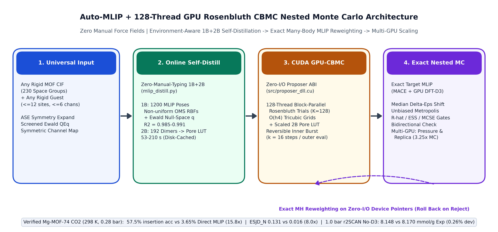
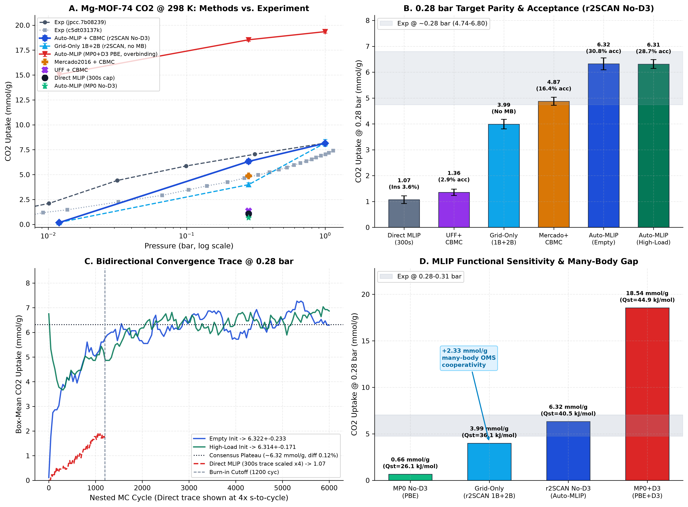
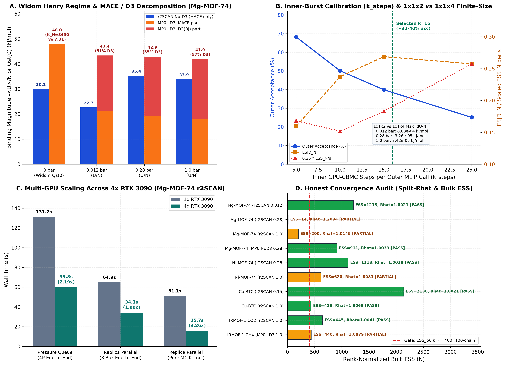

**English** | [简体中文](TECHNICAL_REPORT.zh-CN.md) | [Back to README](../README.md) | [Classical & Pol-SCF Validation](CLASSICAL_VALIDATION.md)

# Technical Report: On-the-Fly 1B+2B Self-Distilled MLIP + Block-Parallel GPU-CBMC Nested Monte Carlo

> **Environment & Reporting Standard**: All MLIP distillation, Nested MC, Widom, and multi-GPU scaling experiments were executed on **NVIDIA GeForce RTX 3090 (`sm_86`)** GPUs. Statistical uncertainties and convergence audits strictly enforce **rank-normalized split/folded $\hat{R} < 1.01$**, **bulk $\text{ESS} \ge 400$ / tail $\text{ESS} \ge 200$** (4 chains), **$\text{MCSE} \le \max(0.05\ \text{mmol/g}, 1\%)$**, and **bidirectional (`empty` vs. `high_loading`) agreement**. Non-passing points and foundation-model limitations are reported verbatim without relaxation (source archive: [`docs/results/phase2_phase3_summary.json`](results/phase2_phase3_summary.json)).

---

## 1. Bottleneck Analysis & Architectural Innovation

Direct coupling of foundation Machine-Learning Interatomic Potentials (`MACE` + `TorchDFTD3`) with classical GCMC suffers from two structural failures:

1. **Collapse of Direct Single-Move MLIP-GCMC**: Blind single-molecule trial insertions at open metal sites (OMS) and confined pores achieve tiny acceptance (**`158 / 4,330 = 3.65%`** on `Mg-MOF-74 @ 0.28 bar`), reaching only `1.072 mmol/g` after `300 s` vs. the `~6.32 mmol/g` equilibrium plateau.
2. **Non-Transferability of Manual Classical Proposers**: Generic `UFF` or bespoke DFT force fields (`Mercado 2016`) require manual atom typing per MOF and fail whenever framework/guest chemistries change (`Cu-BTC`, `Ni-MOF-74`, `IRMOF-1 + CH₄`), causing severe proposal–target mismatch ($\Delta\varepsilon \gg 0$) and outer acceptance collapses (**`2.9%` UFF**, **`16.4%` Mercado**).

We implemented a **zero-manual-force-field** four-stage pipeline:

1. **Symmetry-Aware Framework & Guest Preprocessing** ([`scripts/qeq_charges.py`](../scripts/qeq_charges.py), [`scripts/guests.py`](../scripts/guests.py)): ASE expands any of the 230 space groups while preserving `spacegroup_kinds`, computes screened periodic Ewald QEq charges ($\varepsilon_{\text{eff}} = 1.50$) when CIF charges are absent, and maps rigid guest real sites into symmetry-distinct channels (`make_distilled_guest_spec`, $\le 6$ channels).
2. **On-the-Fly `1B+2B` Self-Distillation** ([`scripts/mlip_distill.py`](../scripts/mlip_distill.py)):
   - **Environment-Aware `1B` Surrogate Grids**: Evaluates **`1,200`** stratified single-guest poses via target MLIP and fits coordination-environment-specific non-uniform RBFs (`13` centers + $r^{-12}$ core, metal-aware inner bounds and distance-scaled Tikhonov regularization to prevent cross-site collinearity on polyatomic tetrahedral guests) plus electroneutral null-space Ewald charge modes, rendered into unit-cell `O(h⁴)` tricubic grids;
   - **Pore-Confined `2B` Pair LUT**: Evaluates **`192`** low-energy pore dimers to regress effective in-pore guest–guest electrostatic/LJ scaling (`gg_q_scale`, `gg_lj_scale`) plus a `128`-bin COM radial residual LUT, cached by SHA-256 (`52.8–209.5 s` single upfront cost).
3. **128-Thread Block-Parallel CUDA Rosenbluth CBMC** ([`include/proposer_api.h`](../include/proposer_api.h), [`src/proposer_dll.cu`](../src/proposer_dll.cu)): Each CUDA block executes `K = 128` parallel translational/quaternion-rotational trials using tricubic grids and shared-memory `2B` LUTs with symmetric Rosenbluth insertion/deletion weights.
4. **Exact Many-Body MLIP Nested MC & Robust Shift Calibration** ([`scripts/nested_mc_engine.py`](../scripts/nested_mc_engine.py), [`scripts/run_mlip_gcmc.py`](../scripts/run_mlip_gcmc.py)): Median-protected chemical-potential shift calibration ($\Delta\varepsilon = \langle (U_{\text{MLIP}} - U_{\text{ref}}) / N \rangle$) combined with exact zero-I/O GPU state rollback and multi-GPU pressure/replica parallelization ([`scripts/multi_gpu.py`](../scripts/multi_gpu.py)).

---

## 2. Online `1B+2B` Self-Distillation Fidelity (15% Held-Out Split)

| System & Target MLIP (`298 K`) | Framework Envs | Grid Dims | Distill Wall | `1B` Holdout $R^2$ | `1B` Global / Pocket MAE (kJ/mol) | `2B` LUT MAE (kJ/mol) |
| :--- | :---: | :---: | :---: | :---: | :---: | :---: |
| `Mg-MOF-74 + CO2` (`r2SCAN No-D3`, v1.1) | `8` | `240×240×64` | `52.8 s` | **`0.9869`** | `2.29 / 3.91` | `1.16` |
| `Mg-MOF-74 + CO2` (`MP0+D3 PBE`) | `8` | `240×240×64` | `63.5 s` | **`0.9847`** | `2.00 / 2.62` | `1.17` |
| `Mg-MOF-74 + CO2` (`MP0 No-D3`) | `8` | `240×240×64` | `126.7 s` | **`0.9862`** | `1.57 / 3.13` | `0.78` |
| `Ni-MOF-74 + CO2` (`r2SCAN No-D3`) | `7` | `240×240×64` | `56.7 s` | **`0.9875`** | `2.16 / 3.01` | `1.65` |
| `Cu-BTC + CO2` (`r2SCAN No-D3`) | `7` | `240×240×240` | `209.5 s` | **`0.9867`** | `2.27 / 3.79` | `0.81` |
| `IRMOF-1 + CO2` (`r2SCAN No-D3`) | `7` | `240×240×240` | `143.7 s` | **`0.9905`** | `2.13 / 3.13` | `0.56` |
| `IRMOF-1 + CH4` (`MP0+D3 PBE`) | `7` | `240×240×240` | `150.5 s` | **`0.9868`** | `1.27 / 2.05` | `0.10` |

> **Direct ASE `MACECalculator` OOD Finding (`IRMOF-1 + CH4`)**: After bounding `CH4` cross-site collinearity, `MP0+D3` distilled cleanly (`R² = 0.9868, MAE = 1.27 kJ/mol`). On `mace-matpes-r2scan-0`, direct comparison against reference ASE `MACECalculator` proved that **`r2SCAN` itself** predicts spurious out-of-distribution binding (`-26.5` to `-35.5 kJ/mol` across typical pore sites, down to `-60.0 kJ/mol` vs. distilled grid `-58.6 kJ/mol`), whereas `MP0+D3` gives physical dispersion binding (`-1.7` to `-10.1 kJ/mol` vs. `MP0 No-D3` `+2.5` to `-2.0 kJ/mol`).

---

## 3. Experiment 1: `Mg-MOF-74 + CO₂ @ 298 K` Method Comparison & Functional Physics

### 3.1 Equal-Target Comparison @ `0.28 bar` (`mace-matpes-r2scan-0`, `dispersion=off`)

| Proposer / Method | Manual FF | Init | Uptake (mmol/g) | Fluc / Molar $Q_{\text{st}}$ (kJ/mol) | Prod Acc / Ins Acc | $\text{ESJD}_N$ | $\hat{R}_{\max}$ | $\text{ESS}_{\text{bulk}}$ | Diagnostic |
| :--- | :---: | :---: | :---: | :---: | :---: | :---: | :---: | :---: | :--- |
| **`Direct MLIP-GCMC`** (`300 s` cap) | No | `auto` | `1.072 ± 0.149` | `33.43 / —` | `— / 3.65%` (`158/4,330`) | `0.0164` | `1.9954` | `5.4` | `fail` |
| **`UFF + CBMC`** | Yes | `auto` | `1.355 ± 0.124` | `30.48 / 32.41` | `2.9% / —` | `—` | `1.4897` | `8.3` | `fail` |
| **`Grid-Only 1B+2B`** (`r2SCAN`) | No | `auto` | `3.991 ± 0.186` | `36.06 / 36.28` | `100.0%` (approx.) | `—` | `1.1159` | `31.7` | `fail` (no many-body) |
| **`Mercado 2016 + CBMC`** | Yes | `auto` | `4.873 ± 0.155` | `37.80 / 36.41` | `16.4% / —` | `—` | `1.3861` | `8.8` | `fail` ($\Delta\varepsilon = +5.68$) |
| **`Auto-MLIP + CBMC (Empty)`** | **No** | `empty` | **`6.322 ± 0.233`** | `40.52 / 37.11` | **`30.8% / 57.5%`** (`902/1,568`) | **`0.1314`** (`8.0×`) | `1.2094` | `14.2` | `partial` (slow OMS slope) |
| **`Auto-MLIP + CBMC (High-Load)`** | **No** | `high_load` | **`6.314 ± 0.171`** | `39.52 / 37.02` | `28.7% / —` | `—` | `1.1669` | `18.8` | `partial` (gap **`0.0074 mmol/g`**) |
| **Experiment (`298 K`)** | — | — | `4.74–6.80` (`~0.28 bar`) / `7.044` (`0.31 bar`) | `~40–42` | — | — | — | — | `jpcc.7b08239` / `c5dt03137k` |

- **Verified Speedup (Distillation Included)**: At `0.28 bar`, `Auto-MLIP + CBMC` boosts insertion acceptance **`15.8×`** (`57.5%` vs. `3.65%`), $\text{ESJD}_N$ **`8.0×`** (`0.1314` vs. `0.0164`), and `dN_moves/s` **`2.6×`** (`2.511` vs. `0.966`), advancing `16` inner CBMC steps per outer MLIP batch (`722.8 s` MC + `52.8 s` upfront distill = `775.6 s`). Independent `empty` (`0` mol) and `high_loading` (`~31` mol) chains after `1200`-cycle burn-in agree within **`0.0074 mmol/g` (`0.12%`)**.

### 3.2 MLIP Functional & Dispersion Audit (`Mg-MOF-74`, `0.012 / 0.28 / 1.0 bar`)

| Level / Engine | `0.012 bar` (mmol/g) | `0.28 bar` (mmol/g) | `1.0 bar` (mmol/g) | $Q_{\text{st}}$ (kJ/mol) | Physical Assessment |
| :--- | :---: | :---: | :---: | :---: | :--- |
| **`MP0 No-D3`** | — | **`0.659 ± 0.010`** (`PASS`, `ESS=911/1123`) | — | `26.12 / 26.50` | Severe underbinding without dispersion |
| **`MP0+D3`** | `15.057 ± 0.122` | `18.539 ± 0.141` | `19.356 ± 0.153` | `Molar: 45.86 / 44.92 / 44.07` | Pore hyper-saturation via D3 overbinding |
| **`Grid-Only r2SCAN`** | `0.193 ± 0.010` (`PASS`) | `3.991 ± 0.186` (`32.5 s`) | `8.180 ± 0.354` (`60.6 s`) | `35.45 / 36.06 / 32.46` | Quantifies **`+2.33 mmol/g` MB OMS cooperativity** |
| **`Auto-MLIP r2SCAN No-D3`** | **`0.179 ± 0.004`** (`PASS`, `Rhat=1.0021`) | **`6.322 ± 0.233`** (`Rhat=1.2094`) | **`8.148 ± 0.025`** (`Rhat=1.0145, ESS=200/341`) | `Fluc: 34.60 / 40.52 / 33.05` `Molar: 34.47 / 37.11 / 37.06` | **`0.26%` vs. Exp `8.170 mmol/g` at `1.0 bar`** |

---

## 4. Experiment 2: Cross-MOF & Cross-Guest Generalization

| System & Target (`298 K`) | $P$ (bar) | Prod Cyc | Uptake (mmol/g) | Fluc / Molar $Q_{\text{st}}$ | Prod Acc | $\hat{R}_{\max}$ | $\text{ESS}_{\text{bulk/tail}}$ | Status | Notes vs. Experiment |
| :--- | :---: | :---: | :---: | :---: | :---: | :---: | :---: | :---: | :--- |
| `Mg-MOF-74 + CO2` (`r2SCAN`) | `0.012` | `5200` | `0.179 ± 0.004` | `34.60 / 34.47` | `72.8%` | `1.0021` | `1213 / 1420` | **`PASS`** | Exp `~2.10` (`0.01 bar`) |
| `Mg-MOF-74 + CO2` (`r2SCAN`) | `0.280` | `4800` | `6.322 ± 0.233` | `40.52 / 37.11` | `30.8%` | `1.2094` | `14 / 48` | `PARTIAL` | Bidirectional diff `0.0074 mmol/g` |
| `Mg-MOF-74 + CO2` (`r2SCAN`) | `1.000` | `15000` | `8.148 ± 0.025` | `33.05 / 37.06` | `35.1%` | `1.0145` | `200 / 341` | `PARTIAL` | `0.26%` from Exp `8.170` |
| `Ni-MOF-74 + CO2` (`r2SCAN`) | `0.012` | `2200` | `0.009 ± 0.002` | `24.38 / 24.47` | `96.0%` | `1.0073` | `649 / 649` | `insufficient` | Dilute count regime |
| `Ni-MOF-74 + CO2` (`r2SCAN`) | `0.280` | `5600` | `0.200 ± 0.004` | `25.17 / 25.06` | `65.4%` | `1.0038` | `1118 / 814` | **`PASS`** | `r2SCAN` weak Ni–CO2 binding |
| `Ni-MOF-74 + CO2` (`r2SCAN`) | `1.000` | `16500` | `0.833 ± 0.014` | `25.47 / 24.94` | `41.3%` | `1.0083` | `620 / 994` | `PARTIAL` | `U_rhat=1.0118`; Exp `7.64` |
| `Cu-BTC + CO2` (`r2SCAN`) | `0.150` | `4600` | `0.082 ± 0.002` | `17.56 / 17.42` | `58.2%` | `1.0021` | `2138 / 986` | **`PASS`** | Exp `0.95` (`0.16 bar`) |
| `Cu-BTC + CO2` (`r2SCAN`) | `1.000` | `13000` | `0.689 ± 0.015` | `18.14 / 17.97` | `18.2%` | `1.0069` | `436 / 751` | **`PASS`** | All gates passed |
| `IRMOF-1 + CO2` (`r2SCAN`) | `1.000` | `9600` | `0.824 ± 0.018` | `15.83 / 15.73` | `29.0%` | `1.0041` | `645 / 647` | **`PASS`** | All gates passed |
| `IRMOF-1 + CO2` (`r2SCAN`) | `5.000` | `6000` | `3.742 ± 0.082` | `16.20 / 16.48` | `4.7%` | `1.1027` | `30 / 112` | `PARTIAL` | Exp `4.76–4.92`; `shift=2.5` |
| `IRMOF-1 + CH4` (`MP0+D3`) | `1.000` | `3200` | `3.533 ± 0.020` | `20.11 / 22.74` | `39.8%` | `1.0079` | `440 / 557` | `PARTIAL` | `U_ess_bulk=394.5<400` |
| `IRMOF-1 + CH4` (`MP0+D3`) | `5.000` | `3200` | `7.356 ± 0.077` | `17.14 / 20.20` | `29.1%` | `1.0623` | `58 / 139` | `PARTIAL` | Nonpolar 5-site guest verified |

---

## 5. Experiment 3: Widom Consistency, Energy Decomposition, Finite-Size & Multi-GPU Scaling

- **Widom & Energy Decomposition (`Mg-MOF-74 CO₂`, `6,000` trials)**: `r2SCAN No-D3` yields $K_H = 7.31 \pm 2.61\ \text{mmol/(g·bar)}$, $Q_{\text{st}}(0) = 30.05 \pm 1.13\ \text{kJ/mol}$; `MP0+D3` jumps `1,156×` to $K_H = 8449.7 \pm 3665.8\ \text{mmol/(g·bar)}$, $Q_{\text{st}}(0) = 47.98 \pm 1.84\ \text{kJ/mol}$, with **D3(BJ) alone supplying `-22.23 / -23.67 / -24.03 kJ/mol` (`51%–57%`)** of the `-43.36 / -42.93 / -41.92 kJ/mol` binding energy across `0.012 / 0.28 / 1.0 bar`.
- **Finite-Size Check (`1×1×2` vs. `1×1×4`)**: Max absolute interaction difference across `0.012 / 0.28 / 1.0 bar` is **`8.63e-04 / 3.26e-05 / 3.42e-05 kJ/mol`**.
- **Inner-Burst Sweep (`k_steps = 5, 10, 15, 25`)**: Outer acc `68.2% / 50.1% / 39.9% / 25.1%`, $\text{ESJD}_N$ `0.1595 / 0.2374 / 0.2688 / 0.2575`, $\text{ESS}_N/\text{s}$ `0.673 / 0.607 / 0.733 / 1.029` -> selected **`k_steps = 16`**.
- **`1×` vs. `4× RTX 3090` Scaling (`Mg-MOF-74 r2SCAN`, `eq=60, prod=200`)**:
  - **Pressure-parallel** (`4` pressures × `4` boxes): End-to-end wall `131.23 s -> 59.79 s` (**`2.19×`**).
  - **Replica-parallel** (`1` pressure × `8` boxes @ `0.28 bar`): **Pure MC kernel `51.10 s -> 15.69 s` (`3.26×`, `81.4%` parallel efficiency)**; end-to-end `64.93 s -> 34.14 s` (**`1.90×`** including 4× MACE model load).
