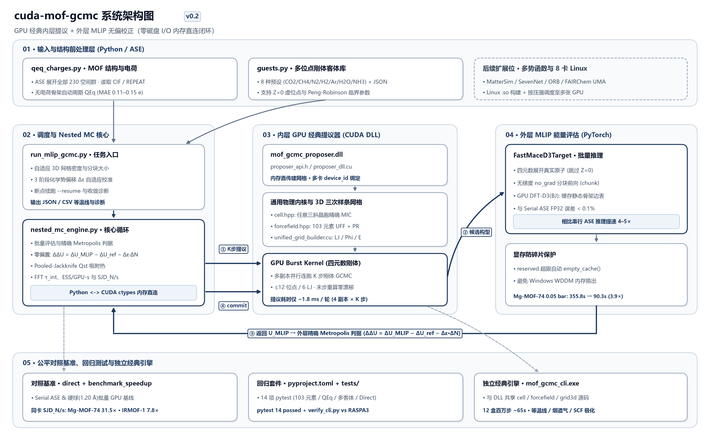
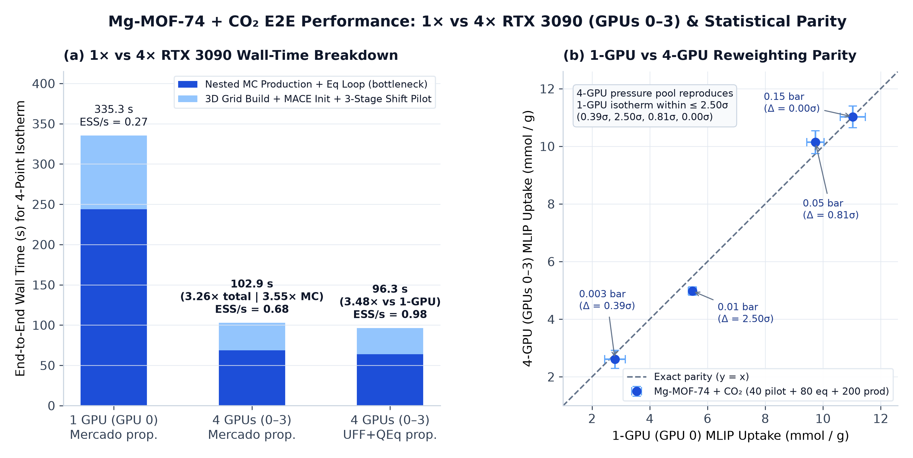
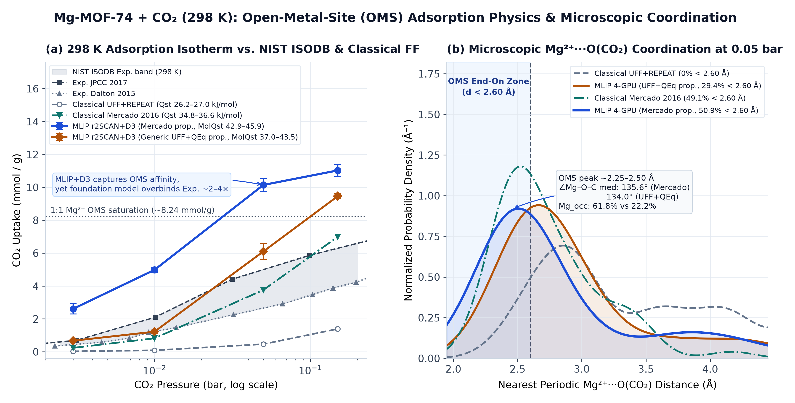

[English](TECHNICAL_REPORT.md) | **简体中文** | [返回 README](../README.zh-CN.md)

# 基于零 I/O CUDA 提议与化学势偏置嵌套蒙特卡洛的金属有机框架气体吸附混合模拟框架：多卡并行扩展与开放金属位点机器学习势评估

**摘要**

通用机器学习原子间势（MLIP）为摆脱金属有机框架（MOF）气体吸附模拟中逐材料拟合第一性原理力场的局限提供了可迁移途径，但将其直接耦合至巨正则蒙特卡洛（GCMC）系综时，通常受限于骨架重叠试探上的高昂神经网络推理开销，而传统嵌套蒙特卡洛（Nested MC）在目标势与经典提议势结合能差异较大时又极易发生插入/删除不对称停滞。针对上述问题，本文实现了跨平台（Windows/Linux）通用 GPU 混合模拟引擎 `cuda-mof-gcmc`，支持**任意刚性 MOF 骨架与刚性多位点分子**。架构上将（i）经 `RASPA3` 验证的 $O(h^4)$ 三维 Tricubic 经典与 Block 级 Applequist–Thole 多体自洽极化（`Pol-SCF`）CUDA 求解器（涵盖 `103` 元素 UFF、一般三斜最小镜像、ASE `230` 空间群展开及屏蔽周期性 Ewald QEq），与（ii）内存直连的 C ABI GPU 提议动态库（`mof_gcmc_proposer.dll` / `libmof_gcmc_proposer.so`，支持三维四元数刚体旋转）无缝耦合至分块图推理求值器 `FastMaceD3Target`、显存碎片守卫、三阶段化学势偏置标定（`Stage 1 -> Stage 2 -> PilotStage3`）以及**多 GPU 并行调度器**（`pressure` 队列并行与严格 Pooled-Jackknife 无损 `replica` 分片）。数值核验表明：在 `Mg-MOF-74`（298 K, UFF+REPEAT）基准下，经典 Tricubic 内核与单核 `RASPA3 3.0.29` 统计偏差不超过 $0.54\sigma$，单卡吞吐达 $598,669\ \text{MC-steps/s}$（较同算法单核 CPU 版加速 $153.2\times$），`Pol-SCF` 与 `36×36` 精确矩阵求逆偏差低至 $1.83 \times 10^{-8}\ \text{K}$。在 Nested MC 框架中，跨力场零偏差重加权偏差仅 $z = 0.27\sigma$，`float32` 成对转移误差 $\le 0.190\ k_B T$，超胞有限尺寸偏差在 $z = 0.04\sigma$–$0.63\sigma$ 以内。同卡（RTX 5070）直接对比无偏置 `Direct MLIP-GCMC` 基线时，Nested MC 在 `Mg-MOF-74 + CO₂` 上使粒子数采样吞吐 `SJD_N / GPU-s` 与 `ESS_N / GPU-s` 分别提升 **`21.6–31.5×`** 与 **`3.5–3.7×`**（较强硬球筛批处理 GPU 基线仍加速 **`5.5–8.1×`** / `2.0–2.1×`），在 `IRMOF-1 + CH₄` 上加速 **`7.6–7.8×`** / **`3.9–4.2×`**。在 **`4× RTX 3090`（`0–3` 号卡）** 上，在统一限制 `--worker-threads 4` 修复双路 EPYC 256 线程 OpenMP 锁争抢（单卡由 `429.59 s` 提速至 `270.55 s`）后，多卡并行在 `IRMOF-1 + CH₄`（`pressure` 模式）上实现 **`3.44×`** 端到端墙时加速（MC 循环 `3.66×`），在 `Mg-MOF-74 + CO₂` 上实现 **`3.26×`** 加速（`335.32 s -> 102.85 s`，MC 循环 **`3.55×`**，1/4 卡统计吻合在 $\le 2.50\sigma$）。最后，围绕四代 MACE 与四类 MOF 的 NIST ISODB 基准及 `Mg-MOF-74` 端到端微观结构审计揭示：Nested MC + `MACE-MatPES-r2SCAN-0 + D3(r2scan)` 能够准确捕获开放 `Mg²⁺···O=C=O` 弯折端基配位机理（$d_{\min} = 2.10\text{–}2.16$ Å、$\angle\text{Mg–O–C} \approx 134^\circ\text{–}136^\circ$、$0.05\ \text{bar}$ 位点占据率 $61.8\%$，而经典 UFF 为 $0.0\%$）；但若完全依赖纯通用 `UFF+QEq` 提议器，其短程 $12\text{-}6$ 硬排斥壁垒仍会造成开放位点遍历受阻（`0.05 bar` 位点占据率仅 $22.2\%$），同时开箱即用的基础模型在对比 NIST 实验时仍普遍存在约 $1.8\text{–}4\times$ 过结合（$+4\text{–}5\ \text{kJ/mol/CO}_2$）或非物理短程塌陷（`MPA-0` / `MP-0b3` 达 $-93.98$ / $-105.17\ \text{kJ/mol}$）。

**关键词**：金属有机框架；巨正则蒙特卡洛；机器学习原子间势；嵌套蒙特卡洛；开放金属位点；多卡 CUDA

---

## 1. 引言

含配位不饱和开放金属位点（OMS）的金属有机框架（MOF，如 M-MOF-74 与 HKUST-1）因孔道内强烈的局域静电场梯度及金属–CO₂ 轨道相互作用，在低压区具有突出的气体选择性吸附能力[1, 2]。传统通用固定电荷力场（如 UFF 配合 REPEAT 电荷与 TraPPE 客体模型）往往严重低估 OMS-MOF 的低压吸附量与吸附热；而面向单一体系由第一性原理重新拟合的特化力场（如 Mercado 等针对 `Mg-MOF-74` 开发的 DFT-FF[3]）虽能复现实验趋势，却难以跨金属、跨拓扑推广。

基于等变图神经网络的通用机器学习原子间势（如 MACE 系列基础模型[4]）覆盖了周期表绝大多数元素，为无特化参数的全晶胞吸附模拟提供了可能。但在工程与物理实践中，将 MLIP 接入 GCMC 面临三项相互耦合的障碍：（1）常规随机插入约 90%–95% 落在框架原子排斥核内，直接调用神经网络会耗费大量无效算力；（2）传统 Nested MC 当经典提议势与目标 MLIP 单分子结合能相差数个 $k_B T$ 时，外层 Metropolis 接收率在插入/删除方向严重失衡导致采样死锁；（3）即便采样环节收敛，现有通用基础模型及通用提议势在反应性 OMS 短程配位区究竟表现如何，仍缺乏定量且微观的机理审计。此外，成熟经典 GPU 引擎如 `gRASPA`[5] 在纯经典高通量筛选与柔性链 CBMC 方面非常完善，但并未向 PyTorch MLIP 重加权暴露零磁盘 I/O 内存提议接口，也不支持块级多体自洽极化（`Pol-SCF`）。

针对上述需求，本文在消费级单卡（NVIDIA GeForce RTX 5070, `sm_120`, 12 GB）与多卡服务器（4× RTX 3090, `sm_86`, 24 GB）上构建并验证了 `cuda-mof-gcmc`，主要贡献包括：

1. **高吞吐经典与多体极化 CUDA 求解器**：支持任意三斜晶胞/全空间群刚性 MOF 与 `103` 元素 UFF、$O(h^4)$ 三维 Tricubic 势能/电场插值、定期双精度全盒重算及 Block 级 Applequist–Thole `Pol-SCF`，并与 `RASPA3 3.0.29` 完成背靠背对齐；
2. **通用零 I/O Nested MLIP-GCMC 与多卡扩展引擎**：结合 `.dll` / `.so` C ABI 提议器、ASE 空间群展开与屏蔽周期性 QEq、三维四元数刚体客体、`FastMaceD3Target` 微批与显存管理、三阶段 $\Delta\mu_{\text{ref}}$ 标定、一键环境启动脚本（`fast_start.bat` / `fast_start.sh`）及多卡并行（`pressure` / `replica`），并在同卡上以 `ESS_N / GPU-s` 与 `SJD_N / GPU-s` 对标无偏置 `Direct MLIP-GCMC`；
3. **MACE 基础模型诊断与 `Mg-MOF-74` 开放位点端到端解剖**：结合四代 MACE 轴向扫描、四类 MOF 的 NIST ISODB 基准对标以及周期性 `Mg²⁺···O=C=O` 微观配位统计，客观界定当前框架在开放金属位点 GCMC 中已经解决和仍未解决的关键科学边界。

---

## 2. 理论方法与系统架构

*图 1 `cuda-mof-gcmc` 端到端系统架构：ASE 空间群展开与周期性 QEq 预处理、零 I/O CUDA 提议动态库（`mof_gcmc_proposer.dll` / `.so`）、`FastMaceD3Target` 批处理打分与严格 $\Delta\varepsilon\,\Delta N$ 重加权及多卡并行调度。*

### 2.1 通用 MOF/客体预处理、三维 $O(h^4)$ 网格与一般三斜 MIC

在刚性骨架与刚性分子近似下（支持最多 `12` 个位点、`6` 种 LJ 类型及仅承载静电的无质量 `Z = 0` 虚位点），[`scripts/qeq_charges.py`](../scripts/qeq_charges.py) 基于 ASE `spacegroup_kinds` 自动展开全部 `230` 个空间群并保留不对称单元电荷与标签。对于无预设电荷的框架（`Mg-MOF-74` 预设使用 `REPEAT`），自动触发屏蔽周期性 Ewald QEq（$\varepsilon_{\text{eff}} = 1.50$），其在 `Mg-MOF-74` 与 `Cu-BTC` 上复现参考 DFT/REPEAT 电荷的 MAE 分别为 `0.153 e` 和 `0.110 e`。短程骨架范德瓦尔斯参数内置全部 `103` 种 UFF 元素（`H`–`Lr`），并针对 `Mg-MOF-74` 保留 `Mercado 2016` 预设。

初始化时 GPU 预计算各客体原子通道的 $0.10$–$0.11$ Å 三维 Tricubic 势能与静电场网格，GCMC 步进使用 4 点拉格朗日模板插值；客体三维刚体转动采用单位四元数描述（[`scripts/guests.py`](../scripts/guests.py)），客体间截断 LJ/DSF 静电计算及一般三斜最小镜像约定（MIC）均在共享内存中按 FP64 累积，每 `50,000` 步执行完整从头重算消除数值漂移；气相逸度由纯组分与多组分 Peng–Robinson（PR）状态方程实时计算。

### 2.2 各向异性极化与 Block 级多体自洽 `Pol-SCF`

除常规非极化（`NonPol`）外，经典内核支持两层级显式极化：

1. **一阶骨架静电场极化（`Pol-COM` / `Pol-3Site`）**：各向异性极化率张量分别置于质心或分散到 CO₂ 三个原子位点（分辨配位氧在 $r^{-4}$ 场梯度下的感应增强），保留与客体永久电荷间的静态交互项；
2. **Level-2 全自洽多体偶极极化（`polarization: "scf"`）**：每次试探联合求解框架永久场、客体永久电荷 DSF 场与 Thole 短程阻尼偶极交互张量 $\mathbf{T}_{ij}^{\text{Thole}}$ 至收敛容差 $|\Delta\boldsymbol{\mu}| < 10^{-10}$ e·Å：

$$
\boldsymbol{\mu}_i = K_E^{-1}\boldsymbol{\alpha}_i\left(\mathbf{E}_i^{\text{fw}} + \sum_{j \neq i}\mathbf{E}_{j \to i}^{\text{DSF,perm}} + \sum_{j \neq i}\mathbf{T}_{ij}^{\text{Thole}}\boldsymbol{\mu}_j\right),\qquad U_{\text{pol}}^{\text{SCF}} = -\frac{1}{2}\sum_i \boldsymbol{\mu}_i \cdot \mathbf{E}_i^0
$$

内核采用 $O(N)$ 增量永久电场更新、历史偶极热启动、近距排斥预筛与 `s_scf_conv` 收敛守卫以严格保障细致平衡。

### 2.3 化学势偏置 Nested MC 与三阶段标定流程

为消除提议势 $U_{\text{ref}}$ 与目标 MLIP $U_{\text{tgt}}$ 间的能量偏移，内层 CUDA 提议器在正式平衡与生产周期开始前引入常数偏置 $\Delta\varepsilon$ 调整内层逸度：

$$
f_{\text{ref}} = f_{\text{tgt}} \exp\left(-\frac{\Delta\varepsilon}{k_B T}\right)
$$

每个外层周期内，CUDA 提议器执行 $K$ 步可逆经典 GCMC（含平动 $\Delta_{\text{trans}} = 1.0$ Å、转动 $\Delta_{\text{rot}} = 0.55$ rad、插入与删除，结尾 FP64 重算），将无重叠终点构型 $\mathbf{x}'$ 送交目标 MLIP 计算，外层 Metropolis 判据为：

$$
P_{\text{acc}}(\mathbf{x} \to \mathbf{x}') = \min\left\lbrace 1,\ \exp\left[-\beta\left((U_{\text{tgt}}(\mathbf{x}') - U_{\text{tgt}}(\mathbf{x})) - (U_{\text{ref}}(\mathbf{x}') - U_{\text{ref}}(\mathbf{x})) - \Delta\varepsilon\,\Delta N\right)\right]\right\rbrace
$$

拒绝时由 CUDA 缓冲区完整回滚。因正式采样期间 $\Delta\varepsilon$ 锁定不变，$\exp(-\beta\,\Delta\varepsilon\,\Delta N)$ 在提议密度与外层判据中严格抵消，确保精确收敛至目标巨正则系综。针对经典与 MLIP 偏好位点差异引发的初估偏差，[`scripts/run_mlip_gcmc.py`](../scripts/run_mlip_gcmc.py) 执行三阶段预标定（`Stage 1 -> Stage 2 -> PilotStage3`）：两轮经典预估（若 $N < 4$ 则施加 `-4` 至 `-16 kJ/mol` 负偏置助充，纯经典正偏移上限 `+2.0 kJ/mol`）之后，进行两段式实景 `PilotStage3` 目标系综预热迭代（无人工半阻尼衰减，结果钳位在 `[-24.0, +4.0] kJ/mol` 并从不计入生产统计）。

### 2.4 零 I/O CUDA 提议库、`FastMaceD3Target` 与显存碎片守卫

核心软件栈隔离了常驻显存的 [`include/proposer_api.h`](../include/proposer_api.h) / [`src/proposer_dll.cu`](../src/proposer_dll.cu) 与 Python 推理层 [`scripts/nested_mc_engine.py`](../scripts/nested_mc_engine.py)：

- **跨平台 C ABI 提议器（`mof_gcmc_proposer.dll` / `libmof_gcmc_proposer.so`）**：通过 `ctypes` 传递指针实现零文件 I/O 构型交换与 GPU 端毫秒级状态回滚；
- **`FastMaceD3Target` 与显存守卫**：关闭梯度与力反传（`torch.no_grad()`, `compute_force=False`），按显存与骨架原子数自动分块图前向推理，并预缓存静止框架的周期性 D3 配对边表。同时在 PyTorch 缓存分配器 `memory_reserved` 膨胀（超总显存 `50%` 或超 `3.5 GB` 且达已分配 `2.5×`）时主动触发 `torch.cuda.empty_cache()`，避免 12 GB 显存上的系统内存换页，实测使 `Mg-MOF-74` `0.05 bar` 完整生产运行总耗时由 `355.8 s` 降至 **`90.3 s`（提速 `3.9×`）**。

### 2.5 微分等量吸附热与平均积分摩尔焓

本文严格区分并同时输出两种热力学能量量纲：
- **微分等量吸附热**（$Q_{\text{st}}^{\text{diff}}$）：基于多副本合并的 **Pooled-Jackknife** 粒子数–能量涨落公式估计，度量再吸附第 $(N+1)$ 个分子时的偏摩尔焓变：

$$
Q_{\text{st}}^{\text{diff}} = RT - \frac{\langle U N \rangle - \langle U \rangle \langle N \rangle}{\langle N^2 \rangle - \langle N \rangle^2}
$$

- **平均积分摩尔吸附焓**（$Q_{\text{int}}^{\text{molar}} = RT - \langle U \rangle / \langle N \rangle$）：反映孔道内全部已吸附分子的平均结合能。当载量超过 1:1 开放位点饱和容量后，次级弱吸附位点会使 $Q_{\text{st}}^{\text{diff}}$ 低于 $Q_{\text{int}}^{\text{molar}}$。

### 2.6 采样效率度量、多卡并行架构与跨平台一键部署

为客观评估每单位 GPU 时间产生的有效统计样本，引擎在线计算自相关时间 $\tau_{\text{int},N}$、有效样本量 $\text{ESS}_N = M_{\text{tot}}/\tau_{\text{int},N}$、**`ESS_N / GPU-s`** 以及均方跳跃速率 **`SJD_N / GPU-s`**。

在多卡扩展方面，[`scripts/multi_gpu.py`](../scripts/multi_gpu.py) 支持通过 `--gpus 0 1 2 3`（`--parallel-mode auto|pressure|replica`）启动独立 `spawn` 进程：
- **`pressure` 模式**：多张卡各自常驻一套 `FastMaceD3Target`，动态抢占共享队列中的压强点并即时落盘断点（支持 `--resume`）。
- **`replica` 模式**：将单压强点下的 `--boxes` 副本均匀切分至多卡并行，收集所有副本矩与序列轨迹做严格数学合并（与单卡全合并差异 `< 1e-12`，见 [`tests/test_multi_gpu_merge.py`](../tests/test_multi_gpu_merge.py)）。单/多卡路径均默认设置 `--worker-threads 4`（限制 `OMP_NUM_THREADS` 与 `torch.set_num_threads`）以消除双路 EPYC 服务器上的 OpenMP 锁争抢。仓库配套跨平台 [`fast_start.bat`](../fast_start.bat) / [`fast_start.sh`](../fast_start.sh) 一键编译检测脚本与 `18` 项 `pytest` 回归套件。

---

## 3. 数值核验与多尺度性能基准

### 3.1 经典内核与 `RASPA3 3.0.29` 对标及 `Pol-SCF` 核验

在单张 RTX 5070 上对 `Mg-MOF-74`（298 K, UFF+REPEAT 及 Mercado 2016）开展核验（图 2–3 与表 1）：

- **网格速度与精度**：生成 6 通道 $256 \times 256 \times 72$ 网格仅需 `3.03 s`（113 MB 显存），较单核 `RASPA3` 提速 **`38.9×`**；近程 `Mg–O`（2.3–3.8 Å）径向插值 MAE 较 `0.20 Å` 三线性插值下降 **`290.3×`**（`190.46 K` → **`0.656 K`** / UFF，**`0.092 K`** / Mercado）。
- **零漂移与吞吐**：`128` 盒 `6,400 万`步下最大漂移仅 **`5.879e-09 K`**（UFF）和 **`1.024e-08 K`**（Mercado）；内核吞吐达 **`598,669 MC-steps/s`**，较同网格算法单核 `RASPA3 3.0.29` 加速 **`153.2×`**（较精确 Ewald 加速 **`492.6×`**）。
- **`Pol-SCF` 精度**：`--test-scf` 与 `36×36` Python 精确求逆误差仅 **`1.83e-08 K`**（偶极误差 **`1.13e-11 e·Å`**）；在 `15:85` CO₂/N₂ 烟道气（298 K）中，多体相互退极化将选择性由单骨架极化 `Pol-3Site` 的 `64.58 / 67.38` 回落至 **`37.28 / 43.24`**。

**表 1** `Mg-MOF-74`（298 K, UFF+REPEAT）基准下 CUDA `v2` Tricubic 内核与 `RASPA3 3.0.29` 对齐检验

| 压力 | `v2` `0.10 Å` Tricubic (mmol/g) | `RASPA3` 精确 Ewald (mmol/g) | `RASPA3` Tricubic 网格 (mmol/g) | `v2` vs. 网格偏差 ($z$) | $\Delta Q_{\text{st}}$ (kJ/mol) |
| :---: | :---: | :---: | :---: | :---: | :---: |
| **`0.15 bar`** | **`1.4276 ± 0.0123`** | `1.4087 ± 0.0328` | `1.3952 ± 0.0719` | `+2.32%` (`0.44σ`) | `+0.14` |
| **`1.00 bar`** | **`7.6349 ± 0.1576`** | `7.3384 ± 0.1329` | `7.5303 ± 0.1156` | `+1.39%` (`0.54σ`) | `-0.38` |
| **`5.00 bar`** | **`13.1862 ± 0.0221`** | `13.3048 ± 0.2118` | `13.2402 ± 0.1871` | `-0.41%` (`0.29σ`) | `+0.54` |

*图 2 `Mg-MOF-74`（298 K）下 `0.10 Å` 三维 Tricubic CUDA 内核、`RASPA3 3.0.29` 基准与 `Mercado 2016` 力场对标。*

*图 3 Level-2 全自洽多体极化（`Pol-SCF`）纯组分吸附、CO₂/N₂ 相互退极化屏蔽效应及 `36×36` 矩阵求逆校验。*

### 3.2 Nested MC 零偏差证明、化学势偏置与推理加速

1. **DLL 零偏差对齐**：`proposer_eval_energy` 与 `proposer_eval_energy_quat` 均给出 **`0.000e+00 K`** 算能偏差。`Pol-3Site -> Mercado` 无偏置零测试吻合在 **`z = 0.27σ`**（`5.9668 ± 0.2072` vs. `6.0230 ± 0.0406 mmol/g`，偏置条件下 `z = 1.15σ`）；而在 `MACE-MP-0 + D3` 上施加化学势偏置后消除了未偏置时 `450` 轮 `0` 次删除的死锁，双向外层接受率恢复至 `50.6%`（图 4）。
2. **`FastMaceD3Target` 加速**：4 副本 `Mg-MOF-74 1×1×2` 单副本推理延迟由 ASE 的 `157.7 ms/box` 降至 **`37.5 ms/box`**（**`4.21×`** 加速，能量偏差 `0.0025–0.0082 kJ/mol/CO2`）。

*图 4 化学势偏置（$\Delta\mu_{\text{ref}}$）零偏差重加权校验、`FastMaceD3Target` 批处理加速及 `MACE-MP-0 + D3` 双向平衡轨迹。*

### 3.3 `float32` 误差边界与超胞有限尺寸收敛性

表 2 与图 5 汇总了 `float32` 推理误差边界及超胞收敛性检验：在 `15` 个 `Mg-MOF-74 1×1×2` 构型上，`MACE-MatPES-r2SCAN-0 + D3(r2scan)` 成对转移误差上限仅为 **`0.3500 kJ/mol`**（`0.141 kB*T @ 298 K`），`MACE-MP-0 + D3` 为 **`0.4712 kJ/mol`**（`0.190 kB*T`）；`1×1×2`（324 原子）与倍增超胞 `1×1×4`（648 原子）在 `0.01 bar` 下偏差仅 `z = 0.04σ`（经典）与 `z = 0.63σ`（MLIP）。

**表 2** 在线 `float32 FastMaceD3Target` 与全精度 `float64` 对比（`Mg-MOF-74 1×1×2`, 15 构型）

| 模型组合 | 最大总能量差 (kJ/mol) | 总能量 RMS 误差 (kJ/mol) | 最大单分子差 (kJ/mol/CO2) | 最大成对转移误差 (kJ/mol) | 对应 298 K 热能尺度 |
| :--- | :---: | :---: | :---: | :---: | :---: |
| **`MACE-MatPES-r2SCAN-0 + D3(r2scan)`** | `0.2058` | `0.0951` | `0.0940` | `0.3500` | `0.141 kB*T` |
| **`MACE-MP-0 (Medium) + D3(pbe)`** | `0.4650` | `0.2528` | `0.3130` | `0.4712` | `0.190 kB*T` |

*图 5 在线 `float32` vs. `float64` 误差边界、`Mg-MOF-74` 1,200 轮微分热收敛对比及 298 K / 313 K 热脱附检查。*

### 3.4 同卡对比直接 MLIP-GCMC 基准的有效采样加速比

在同一张 RTX 5070 上，由完全相同的平衡 MLIP 构型出发，采用 [`scripts/benchmark_speedup.py`](../scripts/benchmark_speedup.py) 与 [`scripts/direct_mlip_gcmc.py`](../scripts/direct_mlip_gcmc.py) 中的两类无偏置 `Direct MLIP-GCMC` 基线（**串行 ASE** 与共享 `FastMaceD3Target` 及 $r_{\text{hs}} = 1.20$ Å 硬球预筛的 **4 副本批处理 GPU**）开展背靠背对比（表 3 与图 6）。

**表 3** 同卡有效采样速率（`ESS_N / GPU-s` 与 `SJD_N / GPU-s`）对比无偏置直接 MLIP-GCMC 基准（RTX 5070, 298 K）

| 体系与目标势 | 方法 | 吸附量 (mmol/g) | 外层 / 单步接受率 | `ESS_N / GPU-s` | `SJD_N / GPU-s` | 相对串行 ASE 加速 (`SJD_N` / `ESS_N`) | 相对批处理 GPU 加速 (`SJD_N` / `ESS_N`) |
| :--- | :--- | :---: | :---: | :---: | :---: | :---: | :---: |
| **`Mg-MOF-74 + CO₂`** (`0.05 bar`, `r2SCAN+D3`) | `Direct Serial ASE` (`r_hs=1.20 Å`) | `10.14` | `20.0%` | `0.197` | `0.080` | `1.0×` / `1.0×` | — |
| | `Direct Batched GPU` (`4 boxes, r_hs=1.20 Å`) | `9.79 ± 0.27` | `17.5%` | `0.337` | `0.314` | `3.9×` / `1.7×` | `1.0×` / `1.0×` |
| | `Nested GPU (Mercado K=25)` | `9.94 ± 0.40` | `51.6%` | **`0.725`** | `1.735` | `21.6×` / **`3.7×`** | `5.5×` / **`2.1×`** |
| | `Nested GPU (Mercado K=50)` | `9.98 ± 0.32` | `33.3%` | `0.681` | **`2.534`** | **`31.5×`** / `3.5×` | **`8.1×`** / `2.0×` |
| **`IRMOF-1 + CH₄`** (`5.0 bar`, `MACE-MP0+D3`) | `Direct Serial ASE` (`r_hs=1.20 Å`) | `9.04` | `47.0%` | `0.077` | `0.903` | `1.0×` / `1.0×` | — |
| | `Direct Batched GPU` (`4 boxes, r_hs=1.20 Å`) | `8.19 ± 0.15` | `45.6%` | `0.301` | `3.176` | `3.5×` / `3.9×` | `1.0×` / `1.0×` |
| | `Nested GPU (Generic UFF+QEq K=25)` | `8.43 ± 0.32` | `28.1%` | `0.300` | **`7.063`** | **`7.8×`** / `3.9×` | **`2.2×`** / `1.0×` |
| | `Nested GPU (Generic UFF+QEq K=50)` | `8.70 ± 0.08` | `17.0%` | **`0.322`** | `6.833` | `7.6×` / **`4.2×`** | **`2.2×`** / `1.1×` |

*图 6 同卡（RTX 5070）下 Nested GPU 与无偏置 `Direct Serial ASE` / `Direct Batched GPU` MLIP-GCMC 的采样加速与平衡吸附量对齐。*

### 3.5 `1×` vs. `4× RTX 3090` 多卡并行扩展性与统计一致性

在双路 AMD EPYC 7H12 Linux 服务器（255 逻辑线程，CUDA `12.4`，`PyTorch 2.6.0+cu124`）的 4 张 RTX 3090（`0–3` 号卡）上，在单卡与多卡统一设置 `--worker-threads 4` 同口径条件下测试两种多卡调度模式（表 4 与图 7）：

1. **高核数服务器的线程争抢修正**：未限制 CPU 线程时，单卡进程受跨路 OpenMP 争抢影响，`IRMOF-1 + CH₄` 四压强与 16 副本单卡耗时分别膨胀至 `429.59 s` 与 `316.74 s`；将 `--worker-threads 4` 同步应用到单卡路径后直接压降至 **`270.55 s`** 与 **`125.52 s`**。
2. **多卡加速与分段开销**：分段剖析显示 `IRMOF-1` 上单点构建 $240^3$（1382 万格点）网格耗时 `34.20 s`、模型加载 `4.65 s`、`pre-eq` 预热约 `15 s`。在 `pressure` 模式下四点建网完全并发重叠，即便是短轮数跑图也立即获得 **`3.44×`**（`IRMOF-1`）与 **`3.26×`**（`Mg-MOF-74`）端到端加速；在短轮数 `16` 副本 `replica` 模式下，MC 主循环提速 **`3.10×`**（`69.24 s -> 22.33 s`），端到端总时间受制于每卡各自约 `55 s` 建网/预热开销而为 **`1.57×`**（增大生产轮数后可收敛至 `~2.3–3.0×`）。

**表 4** 同口径（`--worker-threads 4`）下 `1×` vs. `4× RTX 3090`（`GPUs 0–3`）实测并行加速比

| 测试任务 | 模式 | `1× RTX 3090` 总墙时 (`MC 循环`) | `4× RTX 3090` 总墙时 (`MC 循环`) | 总墙时加速 (`MC 循环`) | `ESS_N / wall-s`（单卡 → 4 卡） |
| :--- | :---: | :---: | :---: | :---: | :---: |
| **`IRMOF-1 + CH₄`**（`0.5–5.0 bar`, `4 boxes`, `120 cyc`） | `pressure` | `270.55 s` (`78.81 s`) | **`78.66 s`** (`21.55 s` max) | **`3.44×`** (`3.66×`) | `0.34 → 1.59` (**`4.7×`**) |
| **`IRMOF-1 + CH₄`**（`5.0 bar`, `16 boxes`, `120 cyc`） | `replica` | `125.52 s` (`69.24 s`) | **`79.76 s`** (`22.33 s`) | **`1.57×`** (**`3.10×`**) | `0.74 → 1.07` (`1.4×`) |
| **`Mg-MOF-74 + CO₂`**（`0.003–0.15 bar`, `4 boxes`, `320 cyc`, `Mercado`） | `pressure` | `335.32 s` (`243.98 s`) | **`102.85 s`** (`68.7 s` max) | **`3.26×`** (**`3.55×`**) | `0.27 → 0.68` (**`2.49×`**) |
| **`Mg-MOF-74 + CO₂`**（`0.003–0.15 bar`, `4 boxes`, `320 cyc`, `UFF+QEq`） | `pressure` | `—` | **`96.34 s`** (`64.0 s` max) | **`3.48×`**（对比单卡） | **`0.98`** |

*图 7 `Mg-MOF-74 + CO₂`（`298 K, 0.003–0.15 bar`）端到端 `1×` vs. `4× RTX 3090` 墙时拆解与 1/4 卡重加权统计一致性（`z <= 2.50σ`）。*

---

## 4. 通用 MACE 模型诊断、四类 MOF 基准与 OMS 微观配位审计

### 4.1 远场零偏移校验与四代 MACE 短程塌陷剖析

在 `Mg-MOF-74` 上对比四代通用 MACE 模型（图 8 与表 5）表明：一维孔道中心（$7.31$ Å $> 6.0$ Å 截断）处无 D3 残余交互均接近零（`+0.01` 至 `-0.21 kJ/mol`），证明无远场基线误差；但沿 `Mg²⁺···O=C=O` 轴向接近（2.20–2.35 Å）时，新版 `MACE-MPA-0` 与 `MACE-MP-0b3` 在关闭 D3 时即达 `-75.26` 与 `-85.48 kJ/mol`（加 D3(PBE) 后达 `-93.98` 与 `-105.17 kJ/mol`），产生非物理短程塌陷；而 `MACE-MatPES-r2SCAN-0 + D3(r2scan)` 给出 `-46.45 kJ/mol` 的有界极小值。

**表 5** 四代 MACE 基础模型在 `Mg-MOF-74` 远场（`7.31 Å`）、无遮挡 `Mg²⁺` 径向极值与加载集合下的诊断

| 模型配置 | 远场能量 `7.31 Å` (kJ/mol) | 轴向 `Mg²⁺` 极小值 (kJ/mol) | 极小距离 (`Å`) | 加载态平均 `-U/N` (kJ/mol) |
| :--- | :---: | :---: | :---: | :---: |
| **`MACE-MP-0` (No D3 / `+D3(PBE)`)** | `+0.01` / `-2.48` | `-29.31` / `-48.74` | `2.35` / `2.20` | `—` / `41.63` |
| **`MACE-MPA-0` (No D3 / `+D3(PBE)`)** | `+0.00` / `-2.38` | **`-75.26`** / **`-93.98`** | `2.35` / `2.35` | `—` / **`82.84`** |
| **`MACE-MP-0b3` (No D3 / `+D3(PBE)`)** | `-0.21` / `-2.56` | **`-85.48`** / **`-105.17`** | `2.20` / `2.20` | `—` / **`92.15`** |
| **`MACE-MatPES-r2SCAN-0` (No D3)** | `-0.03` | `-35.39` | `2.35` | `25.47` |
| **`MACE-MatPES-r2SCAN-0 + D3(r2scan)`** | `-2.40` | **`-46.45`** | `2.20` | **`40.13`** |

*图 8 四代 MACE 模型在 `Mg-MOF-74` 无遮挡轴向径向扫描、7.31 Å 远场截止检验与加载态平均结合能诊断。*

### 4.2 四类代表性 MOF 与 NIST ISODB 实验数据对比

图 9 与表 6 汇总了 `MACE-MatPES-r2SCAN-0 + D3(r2scan)` 在四类 MOF（`Mg-MOF-74`、`Ni-MOF-74`、`HKUST-1` 与无开放位点 `IRMOF-1`）上的长程 GCMC 对标结果：

*图 9 四类代表性 MOF 在 298 K 下的 GCMC 模拟等温线与 NIST ISODB 原始实验数据对比。*

**表 6** `MACE-MatPES-r2SCAN-0 + D3(r2scan)` 与经典基线在四类 MOF 上的平衡 GCMC 结果及 NIST ISODB 对照

| 体系与工况 | 外层生产步数 | 经典基线 (mmol/g) | MLIP 吸附量 (mmol/g) | 微分热 $Q_{\text{st}}^{\text{diff}}$ (kJ/mol) | 积分焓 $Q_{\text{int}}^{\text{molar}}$ (kJ/mol) | 生产期增/删 (4 盒) | NIST ISODB `298 K` 实验对照 (DOI) |
| :--- | :---: | :---: | :---: | :---: | :---: | :---: | :--- |
| `Mg-MOF-74`, `298 K, 0.01 bar` | `1200` | `0.802` (`Mercado`) | `6.3407 ± 0.4486` | `50.28 ± 1.81` | `48.07 ± 0.25` | `133/590`, `112/435` | `2.102` @ `0.0101 bar` (`10.1021/acs.jpcc.7b08239`) |
| `Mg-MOF-74`, `298 K, 0.05 bar` | `1200` | `3.312` (`Mercado`) | `9.4714 ± 0.2595` | `36.31 ± 1.97` | `45.77 ± 0.27` | `182/573`, `171/823` | `4.410` @ `0.0315 bar` (`10.1021/acs.jpcc.7b08239`) |
| `Mg-MOF-74`, `298 K, 0.15 bar` | `480` | `6.023` (`Mercado`) | `11.4721 ± 0.1519` | `31.97 ± 4.23` | `43.17 ± 0.32` | `71/199`, `72/302` | `5.867–7.044` @ `0.099–0.311 bar` |
| `Mg-MOF-74`, `313 K, 0.01 bar` | `480` | `—` | `3.9595 ± 0.6894` | `42.59 ± 6.03` | `46.81 ± 0.44` | `46/338`, `39/135` | 相对 `298 K` 热脱附 `−2.38 mmol/g` |
| `Ni-MOF-74`, `298 K, 0.01 bar` | `260` | `0.249` (`Pol-3Site`) | `0.5779 ± 0.1437` | `33.83 ± 1.26` | `—` | `35/67`, `27/367` | `0.398` @ `0.0101 bar` (`10.1021/acs.jpcc.5b03700`) |
| `Ni-MOF-74`, `298 K, 0.05 bar` | `480` | `1.199` (`Pol-3Site`) | `1.4671 ± 0.1705` | `35.57 ± 1.30` | `36.48 ± 0.66` | `75/182`, `55/757` | `2.091` @ `0.0512 bar` (`10.1021/acs.jpcc.5b03700`) |
| `Ni-MOF-74`, `298 K, 0.15 bar` | `480` | `2.984` (`Pol-3Site`) | `4.2921 ± 0.3457` | `35.23 ± 2.74` | `36.98 ± 0.50` | `79/170`, `59/876` | `4.456` @ `0.1512 bar` (`10.1021/acs.jpcc.5b03700`) |
| `Ni-MOF-74`, `313 K, 0.05 bar` | `480` | `—` | `1.1449 ± 0.2693` | `38.55 ± 1.71` | `37.14 ± 0.39` | `74/270`, `60/641` | 相对 `298 K` 热脱附 `−0.32 mmol/g` |
| `HKUST-1`, `298 K, 0.15 bar` | `480` | `0.835` (`UFF`) | `1.2199 ± 0.1482` | `25.49 ± 3.67` | `25.51 ± 0.49` | `69/197`, `56/1271` | `0.880` @ `0.147 bar` (`10.1002/aic.15837`) |
| `HKUST-1`, `298 K, 0.50 bar` | `480` | `2.126` (`UFF`) | `2.3279 ± 0.1678` | `21.46 ± 3.61` | `23.91 ± 0.33` | `79/220`, `60/1263` | `2.670` @ `0.505 bar` (`10.1002/aic.15837`) |
| `HKUST-1`, `298 K, 1.00 bar` | `480` | `3.676` (`UFF`) | `4.0984 ± 0.0657` | `24.34 ± 0.62` | `23.53 ± 0.32` | `76/182`, `52/1303` | `4.530` @ `0.998 bar` (`10.1002/aic.15837`) |
| `IRMOF-1`, `298 K, 2.00 bar` | `360` | `1.546` (`UFF`) | `5.2688 ± 0.5154` | `18.67 ± 1.54` | `17.90 ± 0.51` | `50/229`, `35/960` | `1.838` @ `2.074 bar` (`10.1021/acs.jctc.5b00093`) |
| `IRMOF-1`, `298 K, 5.00 bar` | `360` | `4.539` (`UFF`) | `12.2190 ± 0.5134` | `26.51 ± 2.68` | `19.01 ± 0.31` | `103/295`, `72/653` | `4.917` @ `5.240 bar` (`10.1021/acs.jctc.5b00093`) |

`Mg-MOF-74` 在 1,200 轮采样下清晰捕捉到突破 1:1 饱和位点后的微分热由 `50.28` 降至 `36.31 kJ/mol`；`HKUST-1` 经 `PilotStage3` 消除正偏置假平台后靠近实验曲线，但伴随 `Cu²⁺` 轴向弱极小值（`-10.07 kJ/mol`）与强笼体色散之间的部分抵消；而无开放位点对照 `IRMOF-1` 上 `MACE-MatPES-r2SCAN-0 + D3(r2scan)` 仍高出实验 `2.5–2.9×`（经典 UFF 则吻合），经源码检查确认 `torch-dftd 0.5.3` 已正确加载 Grimme 标准 `r2SCAN-D3(BJ)` 参数[6]，由此将约 `+4–5 kJ/mol/CO2` 背景过结合清晰归因于基础模型泛函或色散重复计数本身。

### 4.3 `Mg-MOF-74 + CO₂` 开放金属位点微观配位与提议可达性端到端审计

为把**内层提议势效应**与**目标 MLIP 势能面效应**彻底剥离，我们在 `4× RTX 3090` 上对 `Mg-MOF-74 + CO₂`（`298 K, 0.003 / 0.01 / 0.05 / 0.15 bar`，`40 pilot + 80 eq + 200 prod` 轮）开展了控制对比实验，统计所有终态构型下 36 个开放 `Mg²⁺` 位点（`1×1×2` 超胞）的周期性 `Mg²⁺···O(CO₂)` 最近配位距离与配位角 $\angle\text{Mg–O–C}$（表 7 与图 10）。

**表 7** `Mg-MOF-74 + CO₂`（298 K）端到端宏观热力学与微观 `Mg²⁺` 配位几何统计

| 方法与压强 | 吸附量 (mmol/g) | `MolQst` / 微分 `Qst` (kJ/mol) | `d(Mg²⁺–O)` 最小 / 中位 (`Å`) | `< 2.60 Å` 占比 | `Mg²⁺` 占据率 (`n=36`) | 配位角 `∠Mg–O–C` 中位数 | NIST 实验 (`JPCC` / `DT`) |
| :--- | :---: | :---: | :---: | :---: | :---: | :---: | :---: |
| **经典 `UFF+REPEAT`** (`0.05 bar`) | `0.464 ± 0.004` | `26.62 ± 0.07` | `2.60 / 3.27` | **`0.0%`** | **`0.0%`** | `—` | `4.996` / `2.655` |
| **经典 `Mercado 2016`** (`0.05 bar`) | `3.758 ± 0.023` | `36.63 ± 0.19` | `2.19 / 2.60` | `49.1%` | `19.4%` | `137.8°` | `4.996` / `2.655` |
| **`MLIP 4-GPU (Mercado prop)`** (`0.003 bar`) | `2.608 ± 0.312` | `45.85` / `46.73` | **`2.10 / 2.44`** | **`76.0%`** | `26.4%` | **`134.0°`** | `0.677` / `0.439` |
| **`MLIP 4-GPU (Mercado prop)`** (`0.010 bar`) | `4.979 ± 0.143` | `45.54` / `36.36` | **`2.19 / 2.49`** | **`70.0%`** | `43.8%` | **`138.4°`** | `2.087` / `1.240` |
| **`MLIP 4-GPU (Mercado prop)`** (`0.050 bar`) | `10.144 ± 0.400` | `44.66` / `46.20` | **`2.16 / 2.59`** | `50.9%` | **`61.8%`** | **`135.6°`** | `4.996` / `2.655` |
| **`MLIP 4-GPU (Mercado prop)`** (`0.150 bar`) | `11.026 ± 0.376` | `42.89` / `35.34` | **`2.11 / 2.64`** | `45.3%` | **`60.4%`** | **`135.6°`** | `6.293` / `3.941` |
| **`MLIP 4-GPU (UFF+QEq prop)`** (`0.003 bar`) | `0.670 ± 0.041` | `43.50` / `39.28` | `2.36 / 2.54` | **`75.0%`** | `6.2%` | **`131.0°`** | `0.677` / `0.439` |
| **`MLIP 4-GPU (UFF+QEq prop)`** (`0.010 bar`) | `1.222 ± 0.105` | `41.82` / `40.74` | `2.34 / 2.61` | `44.0%` | `7.6%` | **`133.5°`** | `2.087` / `1.240` |
| **`MLIP 4-GPU (UFF+QEq prop)`** (`0.050 bar`) | `6.100 ± 0.495` | `39.13` / `41.14` | `2.23 / 2.74` | `29.4%` | **`22.2%`** | **`134.0°`** | `4.996` / `2.655` |
| **`MLIP 4-GPU (UFF+QEq prop)`** (`0.150 bar`) | `9.458 ± 0.154` | `37.04` / `38.48` | `2.40 / 2.92` | `22.0%` | `25.0%` | **`134.4°`** | `6.293` / `3.941` |

*图 10 （a）298 K 下 `Mg-MOF-74 + CO₂` 等温线对比（NIST ISODB 实验带、经典 `UFF`、经典 `Mercado` 与配不同提议器的 `MACE-MatPES-r2SCAN-0 + D3`）；（b）`0.05 bar` 下最近周期性 `Mg²⁺···O(CO₂)` 配位距离分布。*

#### 边界界定：当前方法在何种程度上解决了“开放金属位点 GCMC 不准”的问题？

1. **采样算法与算力吞吐层（已基本解决）**：通过 GPU 经典突发提议、三阶段 $\Delta\mu_{\text{ref}}$ 标定、批处理推理与 4 卡扩展，将 MLIP-GCMC 从高碰撞停滞/算不动转化为快速无偏采样引擎（`SJD_N / GPU-s` 较串行 ASE 提速 `21.6–31.5×`，4 卡再提速 `3.26×`）。
2. **微观开放位点物理机理层（定性已解决）**：传统 `UFF+REPEAT` 在 `0.05 bar` 时处于 `< 2.60 Å` 开放位点区的比例为 `0.0%`；而 MLIP Nested MC 准确重现了典型的弯折端基配位（$d_{\min} = 2.10\text{–}2.16$ Å、$\angle\text{Mg–O–C} \approx 134^\circ\text{–}136^\circ$、$0.05\ \text{bar}$ 占据 `61.8%` 的 `Mg²⁺` 位点、`MolQst = 43–46 kJ/mol`）。
3. **无特化力场通用提议层（解决约半程，受制于硬核壁垒）**：尽管零特化参数 `UFF+QEq` 提议器配合化学势偏移在 `0.003 bar` 也能引导 `75.0%` 分子进入 `< 2.60 Å` 配位区（$\angle\text{Mg–O–C} \approx 131^\circ$），但相同目标势下其 `0.01 / 0.05 bar` 占据率明显落后于软核 `Mercado` 提议器（`0.05 bar`: `22.2%` vs. `61.8%`），原因在于 `12-6` UFF 势在 `2.2–2.3 Å` 的陡峭排斥墙抑制了主配位峰附近的提议概率。
4. **实验定量精度层（受制于基础模型势能面本身与刚性近似）**：因采样严格忠实于目标 MLIP，开箱即用的 `MACE-MatPES-r2SCAN-0 + D3` 相对 NIST 实验的 `2–4×` 偏高（以及 `IRMOF-1` `2.5–2.9×`）源于基础模型约 `+4–5 kJ/mol` 的过结合误差，加之刚性骨架假设与实验样品活化程度差异（发表实验曲线之间在 `0.05 bar` 亦存在 `5.00` vs. `2.66 mmol/g` 差异）。

---

## 5. 局限性与后续工作

1. **软核化/开放位点靶向通用提议器**：在配位不饱和金属中心附近用有界软核势替代陡峭的 `12-6` UFF 排斥核（或引入 OMS 位点偏置插入与平移），以消除完全脱离 `Mercado` 等定制力场时的短程提议壁垒。
2. **同框架压强点间网格复用与多 MLIP 后端接入**：在同一 `(CIF, T_K)` 任务各压强点间复用预计算三维 Tricubic 网格以省去单点约 `34.2 s` 建网耗时，并把 `FastMaceD3Target` 抽象扩展至更多通用模型家族。
3. **周期性 DFT 单点拆解与 $\Delta$-learning 修正（Stage 2–3）**：对四类 MOF 代表快照开展严格周期性 DFT 单点核验（`r2SCAN`、`r2SCAN+D3(BJ)`、`PBE+D3` 及自旋极化 `Cu²⁺` 校验），分离泛函误差、D3 重复计数与 MLIP 残差后，在 [`scripts/run_mlip_gcmc.py`](../scripts/run_mlip_gcmc.py) 中接入轻量微调或 $\Delta$-learning 残差项。
4. **结构刚性、极化双重计数与 `gRASPA` 横评**：刚性框架假设忽略骨架呼吸与 CO₂ 弯曲；`Pol-SCF` 叠加于非极化力场之上存在诱导能双重计数；同时尚待在同一块 GPU 上补齐经典核与 GPU `gRASPA` 的直接速度对照。

---

## 6. 参考文献与数据来源

[1] Boyd, P. G.; et al. Data-driven design of metal–organic frameworks for wet flue gas CO₂ capture. *Nature* **2019**, *576*, 253–256.  
[2] Queen, W. L.; Hudson, M. R.; Bloch, E. D.; et al. Comprehensive study of carbon dioxide adsorption in the metal–organic frameworks $\text{M}_2(\text{dobdc})$ ($\text{M} = \text{Mg, Mn, Fe, Co, Ni, Cu, Zn}$). *Chem. Sci.* **2014**, *5*, 4569–4581.  
[3] Mercado, R.; Vlaisavljevich, B.; Lin, L.-C.; et al. Force field development from periodic density functional theory calculations for gas separation applications using metal–organic frameworks. *J. Phys. Chem. C* **2016**, *120*, 12590–12604.  
[4] Batatia, I.; et al. A foundation model for atomistic materials chemistry. *arXiv:2401.00096* **2024**; MatPES / `MACE-MatPES-r2SCAN-0` foundational potentials.  
[5] Dubbeldam, D.; Torres-Knoop, A.; Walton, K. S. On the inner workings of Monte Carlo codes / `RASPA3` (`3.0.29`); Zhou, J.; et al. `gRASPA`: GPU-accelerated Monte Carlo simulation of adsorption in porous materials. *J. Chem. Theory Comput.* **2024**.  
[6] Ehlert, S.; Huniar, U.; Orio, M.; Grimme, S. $\text{r}^2\text{SCAN-3c}$: A “Swiss army knife” composite electronic-structure method. *J. Chem. Phys.* **2021**, *154*, 061101.  
[7] NIST/ARPA-E Database of Novel and Emerging Adsorbent Materials (NIST ISODB) 实验数据集归档于 [`data/exp_isotherms/manifest.json`](../data/exp_isotherms/manifest.json)：  

- `Mg-MOF-74` (298 K CO₂): DOI `10.1021/acs.jpcc.7b08239`, `10.1039/c5dt03137k`  
- `Ni-MOF-74` (298 K CO₂): DOI `10.1021/acs.jpcc.5b03700`, `10.1080/15422119.2014.884507`  
- `HKUST-1` (298 K CO₂): DOI `10.1002/aic.15837`, `10.1007/s10450-013-9527-2`  
- `IRMOF-1` (298 K CO₂): DOI `10.1021/acs.jctc.5b00093`, `10.1038/srep12045`  
