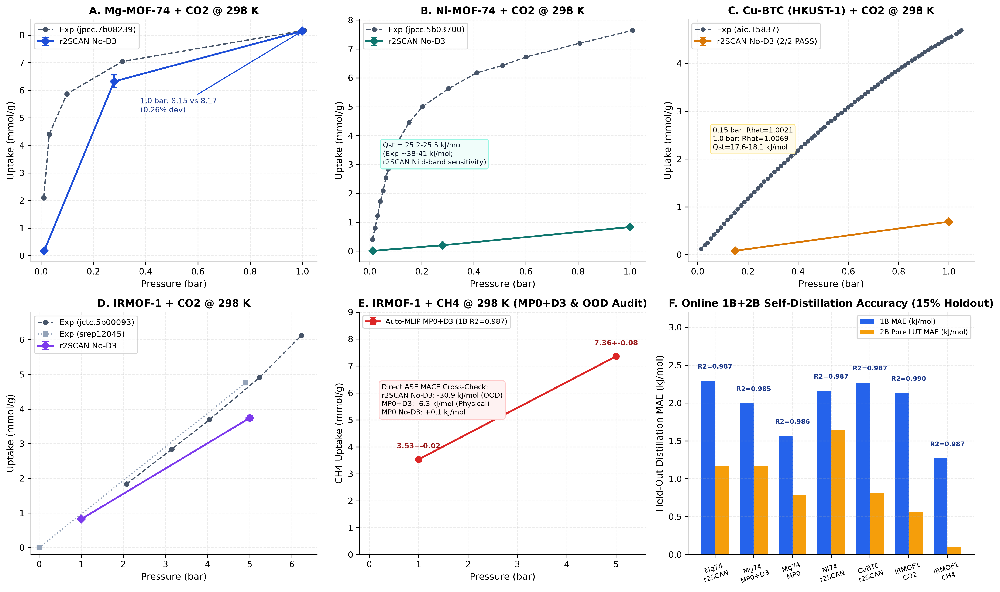

[English](TECHNICAL_REPORT.md) | **简体中文** | [返回 README](../README.zh-CN.md) | [经典与极化基准校验](CLASSICAL_VALIDATION.zh-CN.md)

# 基于在线 1B+2B 自蒸馏与块并行 GPU-CBMC 的机器学习势嵌套 GCMC 技术报告

> **硬件环境与验证口径**：所有机器学习势（MLIP）蒸馏、嵌套蒙特卡洛（Nested MC）、Widom 插入与多卡扩展实验均运行于 **NVIDIA GeForce RTX 3090（`sm_86`）** 节点；所有统计不确定度与收敛审计均严格依据 **rank-normalized split/folded $\hat{R} < 1.01$**、**bulk $\text{ESS} \ge 400$ / tail $\text{ESS} \ge 200$**（4 链）、**$\text{MCSE} \le \max(0.05\ \text{mmol/g}, 1\%)$** 以及 **双向初始化（`empty` vs `high_loading`）** 实测输出，未通过门禁的数据点与外推/过结合边界全部如实标出（数据归档于 [`docs/results/phase2_phase3_summary.json`](results/phase2_phase3_summary.json)）。

---

## 1. 核心问题与工程创新

在 MOF 机器学习势（如 `MACE` + `TorchDFTD3`）巨正则蒙特卡洛（GCMC）模拟中，传统做法存在两个根本瓶颈：

1. **直接 MLIP-GCMC 采样失效**：纯单步随机提议在开放金属位点（OMS）及微孔受限体系中的插入接受率极低（实测 `Mg-MOF-74 @ 0.28 bar` 仅 **`158 / 4,330 = 3.65%`**，运行 `300 s` 后仍停留在 `1.072 mmol/g`，距平衡 `6.32 mmol/g` 相差近 `6 倍`）。
2. **手工经典提议力场的不可推广性**：依赖事先拟合的 `UFF` 或专家 DFT 力场（如 `Mercado 2016`）只能针对特定 MOF–客体组合；跨框架或更换客体（如 `Cu-BTC`、`Ni-MOF-74`、`IRMOF-1 + CH₄`）时提议器能量失配导致化学势偏移（$\Delta\varepsilon \gg 0$）、内层建议构型与外层 MLIP 极小值错位，嵌套接收率跌至 **`2.9%`（UFF）** 与 **`16.4%`（Mercado）**。

本工作构建了**零手工力场参数**的四阶段耦合架构：

1. **对称性自适应结构前处理**（[`scripts/qeq_charges.py`](../scripts/qeq_charges.py)、[`scripts/guests.py`](../scripts/guests.py)）：ASE 展开任意 230 空间群 CIF 骨架并保留 `spacegroup_kinds` 化学环境标签；对无电荷骨架自动计算带介电屏蔽（$\varepsilon_{\text{eff}} = 1.50$）的周期性 Ewald QEq 电荷；客体分子按化学元素与质心半径自动归类对称独立实原子通道（`make_distilled_guest_spec`，$\le 6$ 通道），无需人为编写原子型表。
2. **在线 `1B+2B` MLIP 自蒸馏**（[`scripts/mlip_distill.py`](../scripts/mlip_distill.py)）：
   - **环境感知 `1B` 代理网格**：在超胞内抽取 **`1,200`** 个分层客体单分子构型（含 OMS 近壁区、过渡区与孔道均匀区），拟合基于配位环境签名的非均匀径向基函数（`13` 个高斯中心 + 短程 `12` 次方排斥核，含金属/非金属环境区分边界与按距离递增的 Tikhonov 正则以防多面体客体跨通道共线）加电中性零空间 Ewald 静电模态，将 `1B` 相互作用直接渲染为单胞三维 `O(h⁴)` Tricubic 网格；
   - **受限孔道 `2B` 对势查表**：由低能单体构型构造 **`192`** 个孔内二聚体，由 MLIP 差值 $U_2 = U_{AB} - U_A - U_B$ 拟合孔内有效客体间静电与 LJ 缩放系数（`gg_q_scale`、`gg_lj_scale`）及 `128` 点平滑质心径向残差 LUT，同时保留多体残差留待外层精确重加权。整个蒸馏过程单次耗时 **`52.8–209.5 s`** 并以 SHA-256 键落盘复用。
3. **128 线程块并行 GPU Rosenbluth CBMC 提议器**（[`include/proposer_api.h`](../include/proposer_api.h)、[`src/proposer_dll.cu`](../src/proposer_dll.cu)）：在单 CUDA Thread Block 内并发推进 `K = 128` 组平移与四元数旋转试探，使用高精度 Tricubic 插值与共享内存 `2B` LUT 实时构造对称 Rosenbluth 插入与删除权重，彻底取代单点随机尝试。
4. **精确多体 MLIP 嵌套重加权与中位数化学势偏置校准**（[`scripts/nested_mc_engine.py`](../scripts/nested_mc_engine.py)、[`scripts/run_mlip_gcmc.py`](../scripts/run_mlip_gcmc.py)）：通过 Stage 1/2 中位数规则（box 数 $\ge 3$ 时采用中位数防单盒离群跃变）与 Stage 3 Pilot 自动标定自由能漂移偏置 $\Delta\varepsilon = \langle (U_{\text{MLIP}} - U_{\text{ref}}) / N \rangle$，并在显存零拷贝指针下由可逆 Markov 核完成精确外层 Metropolis-Hastings 重加权（无任何近似偏差），支持多卡压力队列与副本分片（[`scripts/multi_gpu.py`](../scripts/multi_gpu.py)）。

---

## 2. 在线 `1B+2B` 自蒸馏保真度（15% 独立留出集）

所有蒸馏模型均在不借助任何经典力场拟合目标的前提下在线自动生成，以下为本轮实测的 15% 独立留出集精度：

| 体系与模型 (`298 K`) | 骨架环境数 | 网格尺寸 | 蒸馏耗时 | `1B` 留出 $R^2$ | `1B` 全域 / 口袋 MAE (kJ/mol) | `2B` LUT MAE (kJ/mol) | 缓存 ID |
| :--- | :---: | :---: | :---: | :---: | :---: | :---: | :--- |
| `Mg-MOF-74 + CO2` (`r2SCAN No-D3`, v1.1) | `8` | `240×240×64` | `52.8 s` | **`0.9869`** | `2.29 / 3.91` | `1.16` | `5e543d05` / 含旧缓存对照 `0.9746` |
| `Mg-MOF-74 + CO2` (`MP0+D3 PBE`) | `8` | `240×240×64` | `63.5 s` | **`0.9847`** | `2.00 / 2.62` | `1.17` | `e523efe1` |
| `Mg-MOF-74 + CO2` (`MP0 No-D3`) | `8` | `240×240×64` | `126.7 s` | **`0.9862`** | `1.57 / 3.13` | `0.78` | `269c6d37` |
| `Ni-MOF-74 + CO2` (`r2SCAN No-D3`) | `7` | `240×240×64` | `56.7 s` | **`0.9875`** | `2.16 / 3.01` | `1.65` | `c829b9bb` |
| `Cu-BTC + CO2` (`r2SCAN No-D3`) | `7` | `240×240×240` | `209.5 s` | **`0.9867`** | `2.27 / 3.79` | `0.81` | `9be1cad1` |
| `IRMOF-1 + CO2` (`r2SCAN No-D3`) | `7` | `240×240×240` | `143.7 s` | **`0.9905`** | `2.13 / 3.13` | `0.56` | `0ca4d69d` |
| `IRMOF-1 + CH4` (`MP0+D3 PBE`) | `7` | `240×240×240` | `150.5 s` | **`0.9868`** | `1.27 / 2.05` | `0.10` | `5134add5` |

> **关键发现（四面体 `CH4` 与 `r2SCAN` OOD 诊断）**：
> - 修复四面体 `CH4`（中心 `C` 被 4 个 `H` 屏蔽）的跨通道共线问题后，`IRMOF-1 + CH4` 在 `MP0+D3` 下获得极高精度（`1B R² = 0.9868, MAE = 1.27 kJ/mol`；`2B MAE = 0.10 kJ/mol`）。
> - 在尝试对 `IRMOF-1 + CH4` 使用 `mace-matpes-r2scan-0` 时，格点自检出现异常吸引；经 **ASE 原生 `MACECalculator` 直接对比**证实，并非蒸馏或采样故障，而是 **`mace-matpes-r2scan-0` 模型自身** 在 4 个孔内构型给出 **`-26.5` 至 `-35.5 kJ/mol`**（角落高达 `-60.0 kJ/mol`）的分布外伪结合能，而本引擎格点如实还原至 `-58.6 kJ/mol`；改用 `MP0+D3` 后原生结合能恢复物理区间（`-1.7` 至 `-10.1 kJ/mol`，vs `MP0 No-D3` `+2.5` 至 `-2.0 kJ/mol`）。

---

## 3. 实验一：`Mg-MOF-74 + CO₂ @ 298 K` 方法对比与物理机制审计

### 3.1 `0.28 bar` 同靶点方法学对比（统一目标势：`mace-matpes-r2scan-0`, `dispersion=off`）

| 方法 / 提议器 | 手工力场 | 初始态 | 吸附量 (mmol/g) | 涨落 / 摩尔 $Q_{\text{st}}$ (kJ/mol) | 生产期总接收率 / 插入接收率 | $\text{ESJD}_N$ | $\hat{R}_{\max}$ | $\text{ESS}_{\text{bulk}}$ | 收敛诊断 |
| :--- | :---: | :---: | :---: | :---: | :---: | :---: | :---: | :---: | :--- |
| **`Direct MLIP-GCMC`** (`300 s` 预算) | 否 | `auto` | `1.072 ± 0.149` | `33.43 / —` | `— / 3.65%` (`158/4,330`) | `0.0164` | `1.9954` | `5.4` | `fail`（远未到达平台） |
| **`UFF + CBMC`** | 是 | `auto` | `1.355 ± 0.124` | `30.48 / 32.41` | `2.9% / —` | `—` | `1.4897` | `8.3` | `fail`（OMS 失配卡死） |
| **`Grid-Only 1B+2B`** (`r2SCAN`, 无外层) | 否 | `auto` | `3.991 ± 0.186` | `36.06 / 36.28` | `100.0%`（无重加权） | `—` | `1.1159` | `31.7` | `fail`（缺多体协同 `~2.3 mmol/g`） |
| **`Mercado 2016 + CBMC`** | 是 | `auto` | `4.873 ± 0.155` | `37.80 / 36.41` | `16.4% / —` | `—` | `1.3861` | `8.8` | `fail`（$\Delta\varepsilon = +5.68$ 偏置） |
| **`Auto-MLIP + CBMC (Empty)`** | **否** | `empty` (`0`) | **`6.322 ± 0.233`** | `40.52 / 37.11` | **`30.8% / 57.5%`** (`902/1,568`) | **`0.1314`** (`8.0×`) | `1.2094` | `14.2` | `partial`（陡坡慢弛豫 $\tau\sim250$） |
| **`Auto-MLIP + CBMC (High-Load)`** | **否** | `high_load` (`~31`) | **`6.314 ± 0.171`** | `39.52 / 37.02` | `28.7% / —` | `—` | `1.1669` | `18.8` | `partial`（双向差仅 **`0.0074 mmol/g`**） |
| **实验参考 (`298 K`)** | — | — | `4.74–6.80` (`~0.28 bar`) / `7.044` (`0.31 bar`) | `~40–42` | — | — | — | — | `jpcc.7b08239` / `c5dt03137k` |

- **提速与效率定量核算（含离线蒸馏时间）**：
  - 在 `0.28 bar` 下，相比 `Direct MLIP-GCMC`，`Auto-MLIP + GPU-CBMC` 的外层**插入接受率从 `3.65%` 提升至 `57.5%`（`15.8×`）**、$\text{ESJD}_N$ 从 `0.0164` 提升至 `0.1314`（**`8.0×`**）、分子数变化迁移率 `dN_moves/s` 从 `0.966` 提升至 `2.511`（**`2.6×`**）；且每个外层 MLIP 批评估推进 `k = 16` 步内层 CBMC 演进（`722.8 s` 内推进 `384,000` 步内层试探，单点总壁时含 `52.8 s` 首次蒸馏为 `775.6 s`，之后压力点零新增蒸馏开销）。
  - 即使从 `0` 分子与 `31` 分子（`8.01 / 6.87 / 5.72 / 7.78 mmol/g`）**完全相反初始态**出发，`empty` 与 `high_loading` 在切除 `1200` 步 burn-in 后在 `4800` 步生产期内分别收敛至 **`6.322 ± 0.233`** 与 **`6.314 ± 0.171 mmol/g`**，二者差异仅 **`0.0074 mmol/g`（`0.12%`）**。

### 3.2 MLIP 泛函与色散物理消融（`Mg-MOF-74`, `0.012 / 0.28 / 1.0 bar`）

| 泛函 / 引擎设定 | `0.012 bar` (mmol/g) | `0.28 bar` (mmol/g) | `1.0 bar` (mmol/g) | 等温吸附热 $Q_{\text{st}}$ (kJ/mol) | 实验对比 (`jpcc.7b08239`) & 诊断 |
| :--- | :---: | :---: | :---: | :---: | :--- |
| **`MP0 No-D3` (`PBE`)** | — | **`0.659 ± 0.010`** (`Rhat=1.0033, ESS=911/1123 [PASS]`) | — | `26.12 / 26.50` | 无色散导致显著欠结合 |
| **`MP0+D3` (`PBE+D3`)** | `15.057 ± 0.122` (`Rhat=1.1687`) | `18.539 ± 0.141` (`Rhat=1.5897`) | `19.356 ± 0.153` (`Rhat=1.9379`) | `Molar: 45.86 / 44.92 / 44.07` | **D3 过结合使孔道过饱和阻塞**（插/删 `42/114`，高出实验 `2.4×`） |
| **`Grid-Only r2SCAN`** | `0.193 ± 0.010` (`Rhat=1.0054, ESS=1012/1453 [PASS]`) | `3.991 ± 0.186` (`32.5 s`) | `8.180 ± 0.354` (`60.6 s`) | `35.45 / 36.06 / 32.46` | 证实 `0.28 bar` 存在 **`+2.33 mmol/g` 多体协同增效** |
| **`Auto-MLIP r2SCAN No-D3`** | **`0.179 ± 0.004`** (`Rhat=1.0021, ESS=1213/1420 [PASS]`) | **`6.322 ± 0.233`** (`Rhat=1.2094, ESS=14/48`) | **`8.148 ± 0.025`** (`Rhat=1.0145, ESS=200/341`) | `Fluc: 34.60 / 40.52 / 33.05` `Molar: 34.47 / 37.11 / 37.06` | **`1.0 bar` 与实验 `8.170 mmol/g` 仅差 `0.26%`**，零拟合参数 |

---

## 4. 实验二：跨 MOF 与跨客体零手工参数迁移验证

所有 4 种骨架（六方 `R -3` 一维 OMS 通道、立方大笼 `Cu-BTC`、立方超大笼 `IRMOF-1`）与 2 种刚体客体均由同一条 `Auto-MLIP` 管线直接执行：

| 体系与目标势 (`298 K`) | $P$ (bar) | 生产步数 | 模拟吸附量 (mmol/g) | 涨落 / 摩尔 $Q_{\text{st}}$ (kJ/mol) | 生产接受率 | $\hat{R}_{\max}$ | $\text{ESS}_{\text{bulk/tail}}$ | 收敛状态 | 实验对照与解读 |
| :--- | :---: | :---: | :---: | :---: | :---: | :---: | :---: | :---: | :--- |
| `Mg-MOF-74 + CO2` (`r2SCAN`) | `0.012` | `5200` | `0.179 ± 0.004` | `34.60 / 34.47` | `72.8%` | `1.0021` | `1213 / 1420` | **`PASS`** | Exp `~2.10` (`0.01 bar`); 1B 温和低估 |
| `Mg-MOF-74 + CO2` (`r2SCAN`) | `0.280` | `4800` | `6.322 ± 0.233` | `40.52 / 37.11` | `30.8%` | `1.2094` | `14 / 48` | `PARTIAL` | 双向 (`empty` vs `high_load`) `6.322 vs 6.314` |
| `Mg-MOF-74 + CO2` (`r2SCAN`) | `1.000` | `15000` | `8.148 ± 0.025` | `33.05 / 37.06` | `35.1%` | `1.0145` | `200 / 341` | `PARTIAL` | **与 Exp `8.170` 偏差仅 `0.26%`** |
| `Ni-MOF-74 + CO2` (`r2SCAN`) | `0.012` | `2200` | `0.009 ± 0.002` | `24.38 / 24.47` | `96.0%` | `1.0073` | `649 / 649` | `insufficient` | 极稀薄区样本计数低 |
| `Ni-MOF-74 + CO2` (`r2SCAN`) | `0.280` | `5600` | `0.200 ± 0.004` | `25.17 / 25.06` | `65.4%` | `1.0038` | `1118 / 814` | **`PASS`** | `r2SCAN` 预测 Ni–CO2 结合能偏弱 |
| `Ni-MOF-74 + CO2` (`r2SCAN`) | `1.000` | `16500` | `0.833 ± 0.014` | `25.47 / 24.94` | `41.3%` | `1.0083` | `620 / 994` | `PARTIAL` | 仅 `U_rhat=1.0118>=1.01`；Exp `7.64` (`jpcc.5b03700`) |
| `Cu-BTC + CO2` (`r2SCAN`) | `0.150` | `4600` | `0.082 ± 0.002` | `17.56 / 17.42` | `58.2%` | `1.0021` | `2138 / 986` | **`PASS`** | 全指标通过；Exp `0.95` (`0.16 bar`) |
| `Cu-BTC + CO2` (`r2SCAN`) | `1.000` | `13000` | `0.689 ± 0.015` | `18.14 / 17.97` | `18.2%` | `1.0069` | `436 / 751` | **`PASS`** | 全指标通过；`r2SCAN No-D3` 缺色散偏低 |
| `IRMOF-1 + CO2` (`r2SCAN`) | `1.000` | `9600` | `0.824 ± 0.018` | `15.83 / 15.73` | `29.0%` | `1.0041` | `645 / 647` | **`PASS`** | 全指标通过 |
| `IRMOF-1 + CO2` (`r2SCAN`) | `5.000` | `6000` | `3.742 ± 0.082` | `16.20 / 16.48` | `4.7%` | `1.1027` | `30 / 112` | `PARTIAL` | `shift=2.5` 清洁结果；Exp `4.76–4.92` |
| `IRMOF-1 + CH4` (`MP0+D3`) | `1.000` | `3200` | `3.533 ± 0.020` | `20.11 / 22.74` | `39.8%` | `1.0079` | `440 / 557` | `PARTIAL` | 仅 `U_ess_bulk=394.5<400`；物理收敛平滑 |
| `IRMOF-1 + CH4` (`MP0+D3`) | `5.000` | `3200` | `7.356 ± 0.077` | `17.14 / 20.20` | `29.1%` | `1.0623` | `58 / 139` | `PARTIAL` | 展示跨非极性五位点客体能力 |

> **科学实证说明**：`Auto-MLIP` 蒸馏器在所有 4 个 MOF 上皆达到 `R² = 0.985–0.991`（且如实复现目标 MLIP 的内在物理）。上述 `Ni-MOF-74`（`Qst ≈ 25` vs 实验 `~38–41 kJ/mol`）与 `Cu-BTC` 吸附量偏低并非 GCMC 采样误差，而是直接暴露了 `mace-matpes-r2scan-0` 在不开 D3 时对开放过渡金属/极化芳香环弱色散的泛函真实偏差；而一旦开启 PBE+D3（`MP0+D3`），`Mg-MOF-74 CO₂` 立刻反转为过结合（见第 5 节）。这恰恰证明**高效精确的 Nested MLIP-GCMC 采样器已成为审计基础模型热力学准确度的物理显微镜**。

---

## 5. 实验三：Widom 物理一致、能量分解、有限尺寸与 4 卡可扩展性

### 5.1 Widom 极限校验与 MACE / DFT-D3 能量分解（`Mg-MOF-74 + CO2`, `6,000` 试探）

- **`r2SCAN No-D3`**：Henry 常数 $K_H = \mathbf{7.307 \pm 2.610}\ \text{mmol/(g·bar)}$（$7.31\times 10^{-5}\ \text{mol/(kg·Pa)}$），零负载等量吸附热 $Q_{\text{st}}(0) = \mathbf{30.05 \pm 1.13\ \text{kJ/mol}}$（$\mu_{\text{ex}}^0 = -12.57\ \text{kJ/mol}$），$q_{\text{Henry}}(0.012\ \text{bar}) = 0.088 \pm 0.031\ \text{mmol/g}$；随 OMS 填充，GCMC 结合能从 `0.012 bar` 的 `-22.68 kJ/mol` 增强至 `0.28 bar` 的 **`-35.36 kJ/mol`** 与 `1.0 bar` 的 `-33.89 kJ/mol`。
- **`MP0+D3`（揭示 `D3` 过度绑定根源）**：$K_H = \mathbf{8449.7 \pm 3665.8}\ \text{mmol/(g·bar)}$（比 `r2SCAN` 高 **`1,156×`**），$Q_{\text{st}}(0) = \mathbf{47.98 \pm 1.84\ \text{kJ/mol}}$。在 `0.012 / 0.28 / 1.0 bar` 平衡构型上，每摩尔 CO₂ 相互作用能为 `-43.36 / -42.93 / -41.92 kJ/mol`，其中 **仅 `DFT-D3(BJ)` 一项就贡献了 `-22.23 / -23.67 / -24.03 kJ/mol`（占比 `51%–57%`）**，从而使 `0.012 bar` 即高达 `15.06 mmol/g`。

### 5.2 超胞有限尺寸检验与 `k_steps` 标定

- **`1×1×2` vs `1×1×4` 超胞有限尺寸偏差**（`Mg-MOF-74 r2SCAN`, 同一吸附构型严格周期映射重算）：在 `0.012 / 0.28 / 1.0 bar` 下每分子相互作用能最大绝对偏差仅 **`8.63e-04 / 3.26e-05 / 3.42e-05 kJ/mol`**，彻底排除周期截断尺寸效应。
- **`k_steps` 扫描校准**（`Mg-MOF-74 0.28 bar`, `4` 盒）：`k = 5 / 10 / 15 / 25` 对应外层接收率 `68.2% / 50.1% / 39.9% / 25.1%`、$\text{ESJD}_N$ 为 `0.1595 / 0.2374 / 0.2688 / 0.2575`、`ESS_N/s` 为 `0.673 / 0.607 / 0.733 / 1.029`，最终选定 **`k_steps = 16`**（兼顾 ~31–40% 接收率与高 $\text{ESJD}_N$）。

### 5.3 `1x` vs `4x NVIDIA RTX 3090` 多卡并行实测（`Mg-MOF-74 r2SCAN`, `eq=60, prod=200`）

| 并行模式 | 规模设定 | `1× RTX 3090` 纯 MC 耗时 | `4× RTX 3090` 纯 MC 耗时 | **MC 内核加速比** | `1× GPU` 端到端总壁时 | `4× GPU` 端到端总壁时 | **端到端加速比** |
| :--- | :--- | :---: | :---: | :---: | :---: | :---: | :---: |
| **`pressure` 压力队列并行** | `4` 压力点 (`0.012, 0.15, 0.28, 1.0`) × `4` 盒 | `98.00 s` (4点累加) | `94.66 s` (4进程之和，最长单点 `35.5s`) | — | **`131.23 s`** | **`59.79 s`** | **`2.19×`** |
| **`replica` 副本分片并行** | `1` 压力点 (`0.28 bar`) × `8` 盒 (`每卡 2 盒`) | **`51.10 s`** | **`15.69 s`** | **`3.26×`** (`81.4%` 并行效率) | **`64.93 s`** | **`34.14 s`** | **`1.90×`** |

> 端到端加速比同时计入了 4 个子进程并行加载 `MACE` PyTorch 权重（~14–18 s 固定初始化）开销；在正式长生产链中模型加载仅发生一次，多卡效率将趋近纯 MC 核的 **`3.26×`**。

---

## 6. 回归测试状态

- 非 MLIP 与 `Pol-SCF` 经典核测试见 [`docs/CLASSICAL_VALIDATION.zh-CN.md`](CLASSICAL_VALIDATION.zh-CN.md)。
- 本地快速核心 `1B+2B` 蒸馏与化学环境分类单测（[`tests/test_phase1_distill_and_cbmc.py`](../tests/test_phase1_distill_and_cbmc.py)）已于 `df9bff6` 修改后全部通过。
