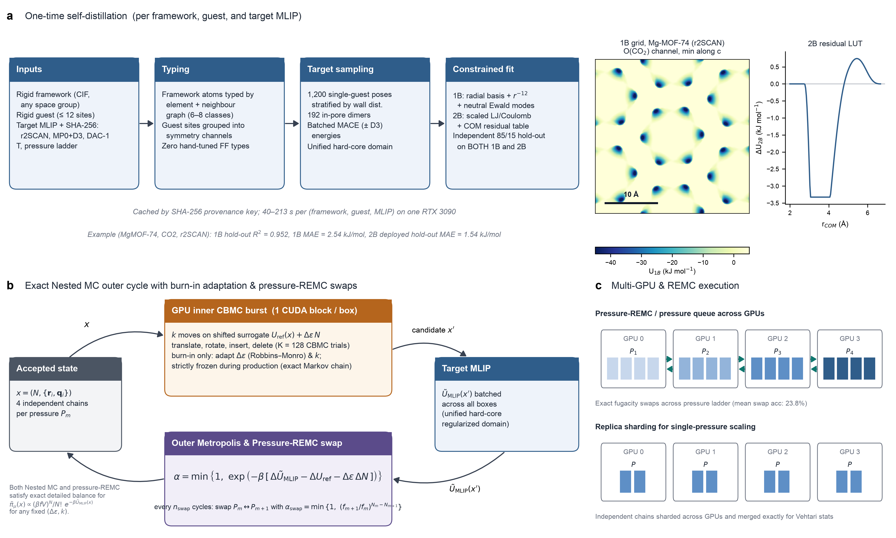
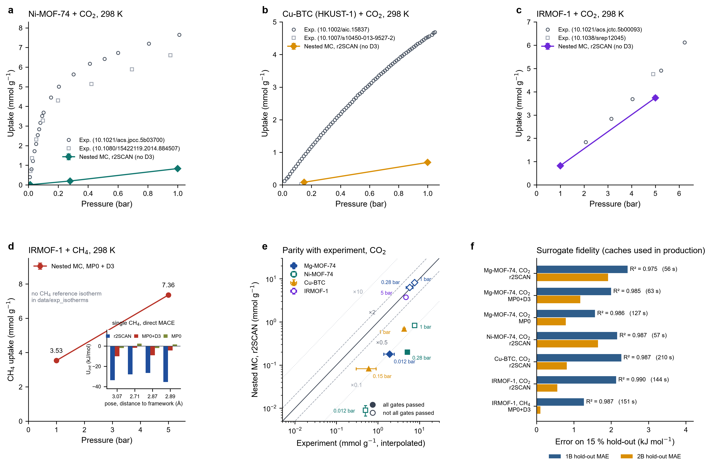

[English](TECHNICAL_REPORT.md) | **简体中文** | [返回 README](../README.zh-CN.md) | [经典与极化基准](CLASSICAL_VALIDATION.zh-CN.md)

# 以在线蒸馏代理势为提议器的机器学习势嵌套蒙特卡洛：刚性 MOF 气体吸附的 GPU 实现与验证

*预印本草稿，2026 年 11 月。全部数值可由 [`docs/results/phase2_phase3_summary.json`](results/phase2_phase3_summary.json) 与 [`scripts/plot_phase4_figures.py`](../scripts/plot_phase4_figures.py) 复现。*

## 摘要

用机器学习原子间势（MLIP）直接驱动巨正则蒙特卡洛（GCMC）计算 MOF 吸附等温线，代价主要花在两处：一是每次插入、删除都要调用一次神经网络；二是在开放金属位点等强吸附区域，随机插入几乎都会被拒绝。常见的折中办法是先用经典力场生成提议、再用 MLIP 重加权（嵌套 MC），但经典力场需要逐个体系拟合，换一种框架或气体就要重做。本文给出一种不依赖手工力场的替代方案：对每个（框架、客体、目标 MLIP）组合，先用 1,200 个单分子构型和 192 个孔内二聚体的 MLIP 能量在线拟合一个单体（1B）三维网格加双体（2B）残差表的代理势，耗时 56–210 s；随后在 GPU 上以该代理势运行每个 CUDA 线程块 128 路 Rosenbluth 试探的构型偏倚 MC，每 16 步内层移动后对候选构型做一次批量 MLIP 评估和精确的 Metropolis 修正。

我们在四种 MOF（Mg-MOF-74、Ni-MOF-74、Cu-BTC、IRMOF-1）和两种客体（CO₂、CH₄）上做了测试。主要结果如下。（1）在 Mg-MOF-74/CO₂、0.28 bar、同一目标势（`mace-matpes-r2scan-0`，不加 D3）下，直接 MLIP-GCMC 运行 300 s 后箱平均吸附量只到 1.76 mmol/g；通用 UFF 提议器的外层接受率仅 2.9%；本方法从空箱和预装载两个方向出发，分别收敛到 6.32 ± 0.23 和 6.31 ± 0.17 mmol/g，效率与针对该体系专门拟合的 Mercado-2016 力场相当。（2）代理势在 7 个生产用缓存上的 1B 留出集 R² 为 0.975–0.990。（3）等温线与实验的吻合程度主要取决于目标 MLIP 本身：r2SCAN 在 Mg-MOF-74 的 1 bar（8.15 vs. 7.02–8.16 mmol/g）和 IRMOF-1 的 5 bar（3.74 vs. 4.70 mmol/g）附近与实验接近，但对 Ni-MOF-74 和 Cu-BTC 低估约一个数量级；MP0+D3 在 Mg-MOF-74 上则高估 2.4 倍，其结合能中有 51%–57% 来自 D3 项。（4）16 个生产压力点中有 6 个通过了全部收敛判据（$\hat{R}<1.01$、bulk ESS ≥ 400 等），未通过的点均在文中逐一列出。（5）在 4 张 RTX 3090 上，副本分片模式的纯 MC 时间加速 3.26 倍，压力队列模式的端到端时间加速 2.19 倍。

---

## 1 引言

基础 MLIP（如 MACE-MP-0 [1,2]、基于 MatPES r2SCAN 数据训练的 MACE 模型 [3]）给 MOF 吸附模拟带来了新可能：不再需要为每种框架单独拟合力场。问题在于 GCMC 需要大量插入/删除尝试，而一次 MACE 评估比一次网格插值贵好几个数量级；在 Mg-MOF-74 这类含开放金属位点的材料里，随机插入的接受率又很低，二者叠加，直接 MLIP-GCMC 很难在可接受的时间内收敛。

嵌套马尔可夫链（nested Markov chain）MC [6,7] 是处理这类问题的标准思路：用一个便宜的参考势生成若干步内层移动，再按目标势对终点构型做一次 Metropolis 检验。只要内层链对参考分布可逆，外层链就精确地采样目标分布，参考势的好坏只影响效率。实践中的难点在于参考势从哪里来。经典力场（UFF [12]、或 Mercado 等人从周期性 DFT 拟合的 Mg-MOF-74 力场 [10]）要么对开放金属位点描述太差，要么只对特定体系有效。

本文的做法是让参考势直接从目标 MLIP 蒸馏出来，并且整个过程不需要人工指定原子类型。这样，参考势和目标势在结构上对齐，外层接受率由二者之间残余的多体差异决定，而不是由一个与目标无关的经典力场决定。下面的三组实验分别回答：这种提议器是否真的比直接 MLIP-GCMC 和经典力场提议器更有效（实验一）；能否不改代码迁移到其他框架和客体（实验二）；物理上和统计上是否自洽、多卡是否有效（实验三）。

## 2 方法

**图 1** 方法示意。**(a)** 代理势构建流程，每个（框架、客体、目标 MLIP）组合执行一次。右侧为生产运行实际使用的 Mg-MOF-74/r2SCAN 缓存：1B 网格中 CO₂ 氧原子通道沿 *c* 轴取最小值后的分布（深色斑点为 Mg²⁺ 开放金属位点附近的吸附位），以及 2B 质心距离残差表。**(b)** 嵌套 MC 的一个外层循环。内层在平移后的代理势上执行 16 步移动，外层对候选构型做一次批量 MLIP 评估，按图中公式接受或回滚。**(c)** 两种多卡并行方式及实测耗时。

### 2.1 体系、目标势与参考数据

框架为刚性结构：Mg-MOF-74 与 Ni-MOF-74 使用 1×1×2 超胞（Mg 体系 324 个原子），Cu-BTC 与 IRMOF-1 使用 1×1×1 单胞（分别为 624 和 424 个原子）。CO₂ 为三位点刚性模型，CH₄ 为五位点全原子刚性模型。温度均为 298 K。目标势有三种：`mace-matpes-r2scan-0`（下文简称 r2SCAN，不加色散校正）、MACE-MP-0 medium（简称 MP0），以及 MP0 加 D3(BJ, PBE) 色散校正 [4,5]（简称 MP0+D3）。

实验等温线全部来自仓库内的 [`data/exp_isotherms/`](../data/exp_isotherms/)（NIST/ISODB 导出，DOI 见参考文献 [15–22]）。与模拟比较时，在 ln *P* 上对实验数据做线性插值，不做外推；某压力点没有实验覆盖时不给对比值。

### 2.2 在线代理势构建

代理势构建流程见图 1a。框架原子首先按照元素类型与第一配位层近邻元素组成自动划分成 6–8 个局域环境类，客体分子上的原子则依据元素与到分子质心的距离归入对称等价通道（CO₂ 与 CH₄ 均划分为 2 个通道）。围绕上述分类，主–客体相互作用（即单体项 1B）在每个（客体通道、框架环境类）组合上采用径向基函数展开，由 1.75–6.15 Å 区间内非均匀排布的 13 个高斯基函数与一个 $r^{-12}$ 排斥核构成，长程静电贡献则由满足体系总电中性约束的 Ewald 零空间模态给出有效框架部分电荷。训练样本取自按分子到框架最小原子间距分层采样的 1,200 个单分子随机位姿的 MLIP 相互作用能，剔除高于 $1.5\times 10^4\ \mathrm{K}$ 的高能排斥构型后通常保留 1,002–1,171 个样本。拟合求解一个带参数边界的加权最小二乘问题，并对不同径向区间施以分级 Tikhonov 正则化，从而避免在 CH₄ 这类中心碳原子被四个氢原子包裹的客体上出现通道间的共线抵消效应。所得解析参数随后按客体通道离散到单胞三维规则网格上（Mg-MOF-74 为 240×240×64），在 GPU 采样时直接通过三维三次插值求值。

客体之间的相互作用（即双体项 2B）从低能单体采样位姿中配对组合出 192 个孔道内二聚体构型，直接用目标 MLIP 计算纯粹的双体能量 $U_2=U_{AB}-U_A-U_B$。我们在标准经典 Lennard-Jones 与库仑形式上同时拟合全局缩放系数，并对二聚体质心间距在 2.75 Å 之外的部分叠加一张 128 点的样条残差表（2.75 Å 以内强制置零以避免短程奇异外推）。单体项拟合保留 15% 的样本作为独立留出集，用来检验 R² 与平均绝对误差（MAE）。对任一（框架、客体、目标 MLIP）组合，整套建模、拟合与网格渲染在单张 RTX 3090 上总耗时 56–210 s，并以所有输入及超参数的 SHA-256 摘要作为缓存键保存；同一体系的后续不同压力点直接读取缓存，无需重复蒸馏。

### 2.3 GPU 内层构型偏倚 MC

每个模拟箱对应一个 CUDA 线程块（图 1b）。每次外层循环，线程块在代理势上连续执行 *k* = 16 步内层移动：平移（±1.0 Å）、旋转（最大 0.55 rad）、插入、删除，各占 25%。插入时 128 个线程各生成一个随机质心位置与取向，按 Rosenbluth 权重 [8,14] 选择其一；删除时 0 号线程保留被删分子、其余 127 个线程生成试探构型，以保持细致平衡。框架–客体能量来自 1B 网格，客体–客体能量来自缩放后的经典项与 2B 残差表。

### 2.4 外层精确修正与化学势偏置

内层链采样的是平移后的参考分布，其能量为 $U_{\rm ref}(x)+\Delta\varepsilon N$。外层对候选构型 $x'$ 批量计算 $U_{\rm MLIP}(x')$，以概率

$$\alpha=\min\left\{1,\ \exp\!\left(-\beta\left[\Delta U_{\rm MLIP}-\Delta U_{\rm ref}-\Delta\varepsilon\,\Delta N\right]\right)\right\}$$

接受（Δ 表示候选与当前构型之差）；拒绝时在显存中恢复原构型。这一接受规则保证外层链精确采样目标 MLIP 的巨正则分布，与 Δε 的取值无关；Δε 的作用只是把参考势的平均单分子能量对齐到目标势，使内层链的装载量与目标接近，从而提高接受率。Δε 在每个压力点开始前确定一次：先在初始构型上取各箱 $(U_{\rm MLIP}-U_{\rm ref})/N$ 的中位数（箱数不少于 3 时使用中位数，以免单个离群箱带偏），再用 40 个循环的预跑结果修正。

### 2.5 收敛判据与误差估计

每个压力点运行 4 个独立箱（即 4 条链）。生产期结束后计算分子数 *N*、总能量 *U* 和开放金属位点占据数的 rank-normalized split/folded $\hat{R}$ 与 bulk/tail ESS [9]。判定通过需同时满足：$\hat{R}<1.01$、bulk 与 tail ESS 均 ≥ 400（即每条链 100）、吸附量 MCSE ≤ max(0.05 mmol/g, 1%)、各链前后半段的漂移在允许范围内、生产期外层接受率不过低。吸附量误差取各箱均值的标准误差；吸附热给出两种估计：涨落公式 $Q_{\rm st}$ 与平均摩尔结合能。需要说明的是，对未通过判据的点，标准误差是基于偏小的 ESS 计算的，真实不确定度很可能更大。

### 2.6 计算细节

所有 MLIP 计算使用 float32 和 GPU 批处理。生产运行在一台 8 卡 RTX 3090（`sm_86`）服务器上进行，仅使用 0–3 号卡。单个压力点的平衡期为 200–1,200 个外层循环，生产期为 1,200–16,500 个外层循环（具体参数与统计汇总见表 1 与表 2）。高装载压力点（IRMOF-1 在 5 bar）中遇到自动偏置校准异常而改用手动设定 Δε 的情况，具体原因在 3.3 节结合内部一致性检验一并说明。

---

## 3 结果与分析

### 3.1 Mg-MOF-74 中 CO₂ 吸附的提议器效率与目标势敏感性

Mg-MOF-74 孔壁高密度的不饱和 Mg²⁺ 开放金属位点对 CO₂ 具有强静电配位作用，导致其 298 K 吸附等温线在 0.01–0.3 bar 之间急剧爬升，是对 GCMC 采样效率最严苛的检验体系之一。围绕该体系，我们首先在固定目标势 r2SCAN（不含 D3 色散校正）与 0.28 bar 条件下并列比较五种采样策略——无参考势的直接 MLIP-GCMC（运行限时 300 s）、基于 UFF 通用力场 [12] 的嵌套 MC、基于 Mercado 等人 [10] 从周期性 DFT 拟合的专用力场的嵌套 MC，以及分别从空箱与预装载构型出发、采用在线蒸馏代理势提议器的嵌套 MC（各运行 1,200 平衡循环与 4,800 生产循环）；同时在 0.012、0.28 与 1.0 bar 三个压力点上对比仅保留代理势（不做外层 Metropolis 修正）的 GCMC 与替换目标势为 MP0、MP0+D3 的完整嵌套结果（实验一，图 2 与表 1）。

**图 2** Mg-MOF-74 中 CO₂ 吸附行为（298 K，实验一）。**(a)** 双对数坐标下的吸附等温线对比，空心符号为两组文献实验值 [15,16]，实线与虚线分别对应完整嵌套 MC 与仅代理势采样，误差棒为 ±1 标准误差。**(b)** 0.28 bar 下同一 r2SCAN 目标势对应五种采样器的箱平均吸附量随单卡墙钟时间演化，代理势曲线已按其 56 s 的在线蒸馏耗时向右平移（灰色竖带），横向灰带标示两组实验插值区间。**(c)** 嵌套 MC 与仅代理势在三个压力下的吸附量差值，误差棒按二者标准误差的平方和开方合成。**(d)** 固定代理势提议器、分别以 MP0、r2SCAN 与 MP0+D3 为目标势在 0.28 bar 得到的吸附量与涨落法吸附热 $Q_{\rm st}$。

在 0.28 bar 同一目标势下，五条收敛轨迹之间的效率差异直观地反映在图 2b 中。受限于单次神经网络评估耗时与低配位插入接受率（单次插入接受率仅 3.65%，158/4,330），直接 MLIP-GCMC 在 300 s 内共执行了 16,269 次模型评估，箱平均吸附量仍仅缓慢爬升至约 1.76 mmol/g（全时段均值 1.07 ± 0.15 mmol/g），远低于实验区间（4.74–6.94 mmol/g）。通用的 UFF 力场与 r2SCAN 在 Mg²⁺ 位点附近的势能面形态偏差很大，化学势对齐偏置 $\Delta\varepsilon$ 虽已调整至 3.48 kJ/mol，外层 Metropolis 接受率依然只有 2.9%，运行 110 s 后链在 1.36 mmol/g 附近近乎停滞。相比之下，针对 Mg-MOF-74/CO₂ 专门以周期性 DFT 拟合的 Mercado-2016 力场能够有效引导内层试探构型落在金属配位口袋附近（$\Delta\varepsilon=5.68\ \mathrm{kJ/mol}$，外层接受率 16.4%），约 120 s 即进入实验插值区间；不过该对比轨迹仅运行了 2,200 个生产循环，箱间尚有 1.75 mmol/g 的上升漂移，其统计平均 4.87 mmol/g 尚未达到平稳分布。采用本文自动蒸馏代理势后，将一次性的 56 s 建库与网格渲染时间计入横轴平移，空箱起始的轨迹约在 MC 开始后 100 s（总墙钟约 156 s）内跨入实验区间，而从高装载预平衡态出发的轨迹先略微释放过剩分子再回稳，两条独立路径在总耗时约 300 s 后汇合到同一平台，最终 4,800 个生产循环的平均值分别为 6.32 ± 0.23 mmol/g（空箱起始）和 6.31 ± 0.17 mmol/g（预装载起始）。就单位时间的分子数净变化速率而言，本方法（2.51–2.95 s⁻¹，外层接受率 28.7%–30.8%）与专门拟合的 Mercado-2016 力场（2.89 s⁻¹）处于同一水平，而前提是不必事先为该框架编写原子类型或拟合任何经典力场参数。

对比图 2a 与图 2c 中完整嵌套 MC 与纯代理势 GCMC 的差值，可以界定外层 Metropolis 修正的实际作用范围。在低装载的 0.012 bar 与接近饱和的 1.0 bar，1B+2B 代理势自身已经非常接近 r2SCAN 分布，有无外层修正的差值分别为 −0.014 mmol/g 和 −0.032 mmol/g，完全落在统计误差之内。但在吸附量随压力陡然爬升的 0.28 bar 转折区，纯代理势只给出 3.99 ± 0.19 mmol/g，比完整嵌套 MC 的 6.32 ± 0.23 mmol/g 偏低 2.33 ± 0.30 mmol/g（约 37%）。这一偏离同时源自代理势 1B/2B 在强结合壁面附近的拟合残差（该缓存 1B 留出集 MAE 为 2.44 kJ/mol，近壁区达 3.85 kJ/mol；2B MAE 为 1.92 kJ/mol）以及无法被 1B+2B 分解捕捉的高阶多体配位效应（例如多个 CO₂ 分子共用金属位点附近局域电荷环境时引起的极化与排斥耦合）。当前对比数据本身难以把拟合残差与三体及以上贡献精确拆开，但这一定量差异足以说明，在等温线陡峭拐点附近，不能以蒸馏代理势直接替代目标势，外层精确重加权是维持目标分布无偏性的必要环节。有趣的是，当目标势切换为 MP0+D3 时，三种压力下嵌套 MC 与纯代理势的吸附量差值始终控制在 ±0.3 mmol/g 以内，表明在色散作用主导且势面更平滑的 MP0+D3 体系中，1B+2B 代理势本身已足以捕获绝大部分结合能。

在固定同一采样算法的前提下切换目标 MLIP，预测结果对基础势函数的敏感程度非常显著（图 2d 与表 1）。0.28 bar 时 Mg-MOF-74 的 CO₂ 吸附量在纯 MP0（无色散）、r2SCAN 与 MP0+D3 之间跨越近 30 倍，依次为 0.659 ± 0.010、6.32 ± 0.23 与 18.54 ± 0.14 mmol/g，对应的涨落法等量吸附热 $Q_{\rm st}$ 也从 26.1 kJ/mol 跃升至 40.5 与 41.5 kJ/mol。MP0 缺少色散描述时明显结合不足；而追加 PBE-level 的 D3(BJ) 校正后又严重过结合，早在 0.012 bar 吸附量就已高达 15.06 ± 0.12 mmol/g，相当于实验值的 6–11 倍并迫近孔道物理饱和极限。即使对在 0.28 bar 恰好落入两组实验范围（4.74–6.94 mmol/g）并在 1.0 bar 触及实验上沿（8.15 vs. 7.02–8.16 mmol/g）的 r2SCAN 而言，其在 0.012 bar 的预测值（0.179 ± 0.004 mmol/g）仍比实验低 8–14 倍（实验 1.37–2.45 mmol/g）。换言之，r2SCAN 给出的低压斜率过于平缓、中压爬升更为陡峭，1 bar 处的看似吻合在一定程度上源自等温线形状的补偿，并不能证明该模型准确刻画了 Mg²⁺–CO₂ 的初阶配位亲和能。表 1 汇集了实验一全部算例的参数、误差与收敛诊断量。

**表 1** 实验一（Mg-MOF-74 + CO₂，298 K）各目标势与采样器的吸附量、吸附热及收敛诊断汇总。*q* 为箱平均吸附量（±1 标准误差）；$Q_{\rm st}$ 依次列出涨落公式与平均摩尔结合能两种估计；"通过"表示满足 2.5 节全部判据。

| 目标势 / 采样方式 | *P* (bar) | 平衡 + 生产循环 | *q* (mmol/g) | $Q_{\rm st}$ (kJ/mol) | Δε (kJ/mol) | 外层接受率 | $\hat{R}$ (N) | bulk ESS | 状态 |
| :--- | :---: | :---: | :---: | :---: | :---: | :---: | :---: | :---: | :---: |
| r2SCAN，直接 MLIP-GCMC | 0.28 | 300 s | 1.07 ± 0.15（终值约 1.76） | 33.4 / – | – | 单次插入 3.6% | 1.995 | 5 | 未通过 |
| r2SCAN，UFF 提议器 | 0.28 | 250 + 1,200 | 1.36 ± 0.12 | 30.5 / 32.4 | 3.48 | 2.9% | 1.490 | 8 | 未通过 |
| r2SCAN，Mercado-2016 提议器 | 0.28 | 250 + 2,200 | 4.87 ± 0.16 | 37.8 / 36.4 | 5.68 | 16.4% | 1.386 | 9 | 未通过 |
| r2SCAN，代理势提议器，空箱起始 | 0.012 | 250 + 5,200 | 0.179 ± 0.004 | 34.6 / 34.5 | −0.51 | 72.8% | 1.0021 | 1,213 | 通过 |
| r2SCAN，代理势提议器，空箱起始 | 0.28 | 1,200 + 4,800 | 6.32 ± 0.23 | 40.5 / 37.1 | 0.58 | 30.8% | 1.209 | 14 | 未通过 |
| r2SCAN，代理势提议器，预装载起始 | 0.28 | 1,200 + 4,800 | 6.31 ± 0.17 | 39.5 / 37.0 | 0.39 | 28.7% | 1.167 | 19 | 未通过 |
| r2SCAN，代理势提议器 | 1.0 | 250 + 15,000 | 8.15 ± 0.03 | 33.1 / 37.1 | 0.03 | 35.1% | 1.0145 | 200 | 未通过 |
| r2SCAN，仅代理势 | 0.012 / 0.28 / 1.0 | 250 + 2,200 | 0.193 / 3.99 / 8.18 | 35.5 / 36.1 / 32.5 | – | – | 1.005 / 1.116 / 1.243 | 1,012 / 32 / 13 | 通过 / 未 / 未 |
| MP0，代理势提议器 | 0.28 | 200 + 4,800 | 0.659 ± 0.010 | 26.1 / 26.5 | 1.05 | 66.7% | 1.0033 | 911 | 通过 |
| MP0+D3，代理势提议器 | 0.012 | 200 + 5,000 | 15.06 ± 0.12 | 41.1 / 45.9 | 3.77 | 38.2% | 1.169 | 16 | 未通过 |
| MP0+D3，代理势提议器 | 0.28 | 200 + 1,800 | 18.54 ± 0.14 | 41.5 / 44.9 | 3.23 | 72.7% | 1.590 | 7 | 未通过 |
| MP0+D3，代理势提议器 | 1.0 | 200 + 1,800 | 19.36 ± 0.15 | 43.5 / 44.1 | 2.83 | 75.2% | 1.938 | 6 | 未通过 |
| 实验（两组数据 ln *P* 插值） | 0.012 / 0.28 / 1.0 | – | 1.37–2.45 / 4.74–6.94 / 7.02–8.16 | – | – | – | – | – | – |

表 1 中的收敛状态同时暴露出陡峭等温线区域的统计特征。在 0.28 bar 下，从空箱和预装载两个极端初值分别运行的独立轨迹给出几乎重合的均值（相差仅 0.008 mmol/g），说明链并未被困在亚稳态中；但二者生产期的 $\hat{R}$ 仍处于 1.17–1.21、有效样本量 bulk ESS 只有 14–19。其根源在于等温线最陡段附近的粒子数涨落方差高达约 25，单链自相关时间延伸到数百个外层循环，使得 4,800 个生产循环尚不足以满足 $\hat{R}<1.01$ 与 $\mathrm{ESS}\ge 400$ 的严格门限。因此本文将该点及高密度近饱和态全部如实记为未通过，表中的跨箱标准误差仅可视作下界估计。

---

### 3.2 不同框架与客体分子的迁移表现

如果一套代理势蒸馏方案在切换金属中心、拓扑孔道或吸附质分子时需要针对新体系调整参数，就失去了替代传统力场的意义。为此，我们在完全不修改代码和物理超参数（固定 *k* = 16、*K* = 128、每压 4 箱）的情况下，将相同流程直接推广至与 Mg-MOF-74 同构但替换为过渡金属的 Ni-MOF-74、含有 Cu²⁺ 桨轮簇与大小双笼结构的 Cu-BTC，以及不含开放金属位点的大孔立方框架 IRMOF-1 上测算 CO₂ 吸附，并进一步在 IRMOF-1 上考察全原子非极性客体 CH₄ 的吸附（实验二，图 3、表 2 与表 3）。

**图 3** 跨框架与客体分子的迁移验证（298 K，实验二）。**(a)–(c)** r2SCAN（无 D3）下 Ni-MOF-74、Cu-BTC 与 IRMOF-1 的 CO₂ 吸附等温线，实线为嵌套 MC 模拟，空心符号为文献实验数据 [17–22]。**(d)** MP0+D3 下 IRMOF-1 中 CH₄ 的吸附等温线；插图显示 4 个随机孔内单分子 CH₄ 位姿（按到框架最近原子距离排序）在三种 MACE 目标势下直接计算的单分子相互作用能。**(e)** 所有 CO₂ 模拟点与实验 ln *P* 插值对比的双对数校验图（实线为 *y* = *x*，虚线与点线分别为 2 倍与 10 倍偏差带；横向线段覆盖两组实验取值范围；实心点表示通过全部收敛判据）。**(f)** 实际用于生产运行的 7 个代理势缓存在 15% 留出集上的 1B（全体与近壁区）及 2B 误差统计，柱顶标注 1B 留出集 R² 与单次蒸馏建库时间。

蒸馏精度跨体系的可复用性首先体现在图 3f 与表 3 汇总的留出集评估中。覆盖 4 种 MOF、2 种客体与 3 种目标势的 7 套生产用代理势缓存，其 1B 相互作用能留出集 R² 全部保持在 0.975–0.990 之间，整体 MAE 为 1.27–2.44 kJ/mol（近框架内壁样本为 2.05–3.85 kJ/mol）；2B 残差表的 MAE 控制在 0.10–1.92 kJ/mol。值得注意的是，各体系 2B 模型的 R² 统计量本身波动较大（−0.68 至 0.76），这是因为在孔道采样生成的中远距离二聚体上，客体–客体纯双体能 $U_2$ 的绝对数值和样本方差往往只有数 kJ/mol，微小拟合噪声即可拉低 R²，实际近似质量仍应以亚 kJ/mol 量级的 MAE 衡量。整套代理势建模在单张 RTX 3090 上的实际建库耗时在 56–210 s 之间，差异主要取决于三线性插值体网格的体素渲染规模——单胞棱长超过 25 Å 的 Cu-BTC 与 IRMOF-1 需渲染 $240^3$ 网格（144–210 s），显著慢于尺寸较小、采用 $240\times 240\times 64$ 网格的 MOF-74 体系（56–63 s）。

在此代理势基础之上，GPU 嵌套 MC 在多种孔道化学环境中均能稳定收敛（图 3a–c 与表 2），但模拟值与实验等温线之间的差距清晰地揭示了目标 MLIP 自身的物理偏差。在 CO₂ 吸附中，Cu-BTC 的 0.15 bar 与 1.0 bar、Ni-MOF-74 的 0.28 bar 以及 IRMOF-1 的 1.0 bar 均顺利通过了包括 $\hat{R}$、bulk/tail ESS 与飘移在内的全部统计门槛，Ni-MOF-74 在 1.0 bar 跑满 16,500 个生产循环后粒子数亦已平稳（$\hat{R}(N)=1.0083$，ESS = 620），仅因总能量 $\hat{R}(U)=1.0118$ 略高于 1.01 门槛而计为未通过。由于这些压力点的采样统计误差（0.002–0.018 mmol/g）远小于模拟与实验之差，偏差无法归咎于 GCMC 采样不充分，而是直接源于目标势本身。具体来说，r2SCAN 在 Ni-MOF-74 1.0 bar 只给出 0.833 ± 0.014 mmol/g（实验 7.62 mmol/g），在 Cu-BTC 1.0 bar 只给出 0.689 ± 0.015 mmol/g（实验 3.97–4.54 mmol/g），对应的计算等量吸附热分别只有 25 kJ/mol 与 18 kJ/mol，这反映出无色散校正的 MatPES r2SCAN 模型对 Ni²⁺ 与 Cu²⁺ 开放金属位点配位结合能的低估以及长程色散吸引的缺失。相反，IRMOF-1 不含开放金属位点、吸附过程以孔腔物理吸附为主导，r2SCAN 在 5.0 bar 给出的 3.74 ± 0.08 mmol/g 便只比实验（4.70 mmol/g）低约 20%。将全部框架、全部压力点的 CO₂ 对比汇总于图 3e 的双对数一致性图中可以看到，偏差方向高度一致——几乎所有点均位于 *y* = *x* 下方——其中 Mg-MOF-74 中高压点与 IRMOF-1 处于 2 倍偏差带内，而其余开放过渡金属点则普遍偏低至 10 倍偏差线附近或之外。

迁移到非极性客体 CH₄ 时，测试过程反过来验证了本框架作为目标 MLIP 物理行为诊断工具的敏感性（图 3d）。最初以 r2SCAN 为目标势对 IRMOF-1 + CH₄ 在 1.0 bar 进行试算时，模拟箱迅速填满至程序预设的 128 分子上限，自动校准给出的 $\Delta\varepsilon$ 高达 +21 kJ/mol。我们起初怀疑故障出在 CH₄ 四面体几何引起的 1B 径向基函数跨通道共线（提交 `df9bff6` 通过按元素设置带边界约束及分距离正则化修补并显著压低了共线病态性），但代理势更新后的满箱现象依然未变。为彻底区分蒸馏误差与目标势本征行为，我们在 ASE 环境下直接调用原始 `MACECalculator` 对孔道内 4 个独立单分子 CH₄ 位姿求取相互作用能（图 3d 插图）：r2SCAN 直接给出 −26.5 至 −35.5 kJ/mol（与本文批处理 MACE 评估器的差别在 0.7 kJ/mol 以内），随机采样的最深结合井甚至达到 −60.0 kJ/mol（对应代理势网格在同一位置给出 −58.6 kJ/mol）；作为对照，在同一组几何上 MP0（无色散）给出 −2.0 至 +2.5 kJ/mol，MP0+D3 给出 −1.7 至 −10.1 kJ/mol。在不含任何色散校正的前提下，一个模型对非极性甲烷预测出比 PBE-D3 还强 3–4 倍的结合能显然违背物理常识，说明 r2SCAN 在 IRMOF-1 孔道內的甲烷局域化学环境上发生了训练集外推失效，而蒸馏代理势只是忠实地重现了这一势能面特征（诊断缓存 `7cfa1abf` 的 1B 留出 R² 亦降至 0.912）。因此 CH₄ 的生产算例改由 MP0+D3 驱动：1.0 bar 收敛至 3.53 ± 0.02 mmol/g（粒子数已满足判据，仅总能量 bulk ESS = 394.5 距 400 门限差不足 2%），5.0 bar 达到 7.36 ± 0.08 mmol/g（高装载下尚未通过收敛检验）。由于仓库内的实验库 [`data/exp_isotherms/`](../data/exp_isotherms/) 仅收录 CO₂ 数据，表 2 中不对甲烷作实验对照。

**表 2** 实验二（Ni-MOF-74、Cu-BTC 与 IRMOF-1，298 K）全部压力点汇总。实验参考值在 ln *P* 上线性插值获得；"–"表示文献实验未覆盖该压力。

| 体系 / 目标势 | *P* (bar) | 平衡 + 生产循环 | *q* (mmol/g) | 实验 (mmol/g) | $Q_{\rm st}$ (kJ/mol) | 外层接受率 | $\hat{R}$ (N) | bulk / tail ESS | 状态 |
| :--- | :---: | :---: | :---: | :---: | :---: | :---: | :---: | :---: | :--- |
| Ni-MOF-74 / r2SCAN | 0.012 | 250 + 2,200 | 0.009 ± 0.002 | 0.50 | 24.4 / 24.5 | 96.0% | 1.0073 | 649 / 649 | 稀薄区，样本不足 |
| Ni-MOF-74 / r2SCAN | 0.28 | 250 + 5,600 | 0.200 ± 0.004 | 4.68–5.50 | 25.2 / 25.1 | 65.4% | 1.0038 | 1,118 / 814 | 通过 |
| Ni-MOF-74 / r2SCAN | 1.0 | 250 + 16,500 | 0.833 ± 0.014 | 7.62 | 25.5 / 24.9 | 41.3% | 1.0083 | 620 / 994 | 未通过（U 的 $\hat{R}$ = 1.0118） |
| Cu-BTC / r2SCAN | 0.15 | 250 + 4,600 | 0.082 ± 0.002 | 0.30–0.90 | 17.6 / 17.4 | 58.2% | 1.0021 | 2,138 / 986 | 通过 |
| Cu-BTC / r2SCAN | 1.0 | 250 + 13,000 | 0.689 ± 0.015 | 3.97–4.54 | 18.1 / 18.0 | 18.2% | 1.0069 | 436 / 751 | 通过 |
| IRMOF-1 / r2SCAN | 1.0 | 200 + 9,600 | 0.824 ± 0.018 | – | 15.8 / 15.7 | 29.0% | 1.0041 | 645 / 647 | 通过 |
| IRMOF-1 / r2SCAN | 5.0 | 600 + 6,000 | 3.74 ± 0.08 | 4.70 | 16.2 / 16.5 | 4.7% | 1.103 | 30 / 112 | 未通过（Δε 手动设为 2.5） |
| IRMOF-1 + CH₄ / MP0+D3 | 1.0 | 250 + 3,200 | 3.53 ± 0.02 | – | 20.1 / 22.7 | 39.8% | 1.0079 | 440 / 557 | 未通过（U 的 ESS = 394.5） |
| IRMOF-1 + CH₄ / MP0+D3 | 5.0 | 250 + 3,200 | 7.36 ± 0.08 | – | 17.1 / 20.2 | 29.1% | 1.062 | 58 / 139 | 未通过 |

**表 3** 实验使用到的在线蒸馏代理势缓存及 15% 留出集精度统计。

| 缓存索引 | 体系 / 目标势 | 环境类数 | 保留 1B 样本 | 1B R² | 1B MAE / 近壁 MAE (kJ/mol) | 2B MAE (kJ/mol) | 建库耗时 (s) |
| :--- | :--- | :---: | :---: | :---: | :---: | :---: | :---: |
| `5e543d05` | Mg-MOF-74, CO₂ / r2SCAN | 8 | 1,026 | 0.975 | 2.44 / 3.85 | 1.92 | 56 |
| `e523efe1` | Mg-MOF-74, CO₂ / MP0+D3 | 8 | 1,044 | 0.985 | 2.00 / 2.62 | 1.17 | 63 |
| `269c6d37` | Mg-MOF-74, CO₂ / MP0 | 8 | 1,019 | 0.986 | 1.57 / 3.13 | 0.78 | 127 |
| `c829b9bb` | Ni-MOF-74, CO₂ / r2SCAN | 8 | 1,002 | 0.988 | 2.16 / 3.01 | 1.65 | 57 |
| `9be1cad1` | Cu-BTC, CO₂ / r2SCAN | 6 | 1,037 | 0.987 | 2.27 / 3.79 | 0.81 | 210 |
| `0ca4d69d` | IRMOF-1, CO₂ / r2SCAN | 7 | 1,057 | 0.990 | 2.13 / 3.13 | 0.56 | 144 |
| `5134add5` | IRMOF-1, CH₄ / MP0+D3 | 7 | 1,171 | 0.987 | 1.27 / 2.05 | 0.10 | 151 |
| `7cfa1abf`（仅诊断） | IRMOF-1, CH₄ / r2SCAN | 7 | 1,180 | 0.912 | 3.16 / 4.00 | 1.14 | 147 |

---

### 3.3 物理自洽性、超参数依据、多卡并行效率与收敛审计

从前两节的等温线对比中自然引出几个更深层的物理与数值问题：MP0+D3 为什么会在 Mg-MOF-74 上表现出极端过结合；算法中 *k* = 16 的内层步长及 1×1×2 超胞截断尺度是否合理；多卡并行在实际负载下能带来多少净收益；以及外层偏置量 $\Delta\varepsilon$ 改变时是否真正保持目标分布不变。图 4、表 4 与表 5 从热力学微扰、参数扫描、多 GPU 并行剖面以及全样本审计四个角度回答上述问题（实验三）。

**图 4** 物理自洽性、参数敏感性与多卡扩展测试（实验三）。**(a)** Mg-MOF-74 + CO₂ 体系的 Widom 测试粒子插入结果（6,000 次尝试），给出零覆盖度吸附热 $Q_{\rm st}(0)$ 与 Henry 常数 $K_H$（mmol g⁻¹ bar⁻¹）。**(b)** 三个压力平衡构型上单个 CO₂ 分子的平均相互作用能对比，其中 MP0+D3 按物理来源拆分为 MACE 主体与 D3 色散两部分；r2SCAN 在 0.012 bar 仅采到单一非空箱帧（*N* = 1），统计学权重有限。**(c)** 内层移动步数 *k* 扫描（0.28 bar 短程试验）下的外层接受率与每循环分子数期望平方跳跃距离 ESJD$_N$。**(d)** 1 张与 4 张 RTX 3090 GPU 在压力队列及副本分片模式下的墙钟耗时（每点 60 平衡 + 200 生产循环，Δε 固定为 0.5 kJ/mol）。**(e)** 全文 16 个生产压力点按 bulk ESS 与 $\hat{R}-1$ 绘出的收敛分布图，绿色阴影代表同时满足两个门限的区域，实心符号代表通过 2.5 节全部收敛判据的点。**(f)** 面向初始条件与 $\Delta\varepsilon$ 无偏性的内部一致性检验，误差棒取 ±2 标准误差。

完全独立于马尔可夫链演化的 Widom 插入检验与平衡构型能量分解揭示了不同 MLIP 预测结果悬殊的热力学根源（图 4a、b 与表 4）。在 6,000 次全空框架采样（其中满足硬球截断 $r_{\rm hs}=1.25\ \mathrm{\AA}$ 的合法构型 3,644 次）中，r2SCAN 给出的无限稀释等量吸附热 $Q_{\rm st}(0)$ 为 30.05 ± 1.13 kJ/mol，对应 Henry 常数 $K_H$ 为 7.31 ± 2.61 mmol g⁻¹ bar⁻¹（预测 0.012 bar 稀薄区线性装载约 0.088 mmol/g）；而 MP0+D3 的 $Q_{\rm st}(0)$ 高达 47.98 ± 1.84 kJ/mol，指数放大后导致 $K_H$ 飙升至 8,450 ± 3,666 mmol g⁻¹ bar⁻¹，高出三个数量级。这一孤立链无关检验解释了为什么两条独立的嵌套 GCMC 链在 0.012 bar 即给出 0.18 vs. 15.06 mmol/g 的悬殊吸附量。若进一步在 MP0+D3 的三个平衡态系综上拆解单个 CO₂ 分子的净相互作用能 $-\langle U\rangle/N$（43.36、42.93 与 41.92 kJ/mol），可看到纯 MACE 神经网络部分实际上只贡献了 21.13、19.26 与 17.89 kJ/mol——不仅弱于吸附实验应有强度，也弱于无 D3 的 r2SCAN 本体（在 0.28 与 1.0 bar 为 35.36 与 33.89 kJ/mol）——而外挂的 D3 色散项却额外叠加了 22.23、23.67 与 24.03 kJ/mol，占总结合能的 51%–57%。正是这种底层网络欠结合与后验 D3 色散过补偿的叠合，令 MP0+D3 的总体结合强度比 r2SCAN 多出约 8 kJ/mol，推动低中压孔道过早饱和。r2SCAN 本身的平均单分子结合能从 0.012 bar 的 22.68 kJ/mol（单一含客体构型，不宜过度解读）升至 0.28 bar 陡峭段的 35.36 kJ/mol，则体现出开放金属位点被依次占据过程中客体–客体横向协同作用的增强。

关于核心模拟参数与超胞截断的选择，实验三中的微调扫描与周期延拓测试给出了定量支撑（图 4c）。在 0.28 bar 短程测试中将每轮内层步数 *k* 从 5 逐步增至 25，随着候选构型偏离当前状态更远、代理势与目标势间累积的能量差增大，外层 Metropolis 接受率由 68.2% 单调递减至 25.1%；与此同时，衡量链在分子数空间有效扩散步长的期望平方跳跃距离 $\mathrm{ESJD}_N$ 则呈现先升后稳的倒 U 形特征，在 *k* = 15 附近达到 0.2688 的峰值（*k* = 5、10、25 依次为 0.1595、0.2374、0.2575）。本文最终选定的 *k* = 16 恰好落在 $\mathrm{ESJD}_N$ 高峰区，既避免了过小步长导致高频调用 MLIP 却移动受限，又使外层接受率保持在 30%–40% 的稳健区。虽然短跑下每秒有效样本率在 *k* = 25 时表观略高（1.03 s⁻¹ vs. *k* = 15 的 0.73 s⁻¹），但此类短程测试的 ESS 仅 17–30，统计差异并不显著。此外，将 Mg-MOF-74 的 `1×1×2` 超胞（最小垂直宽度 13.88 Å，略大于典型 6 Å 截断半径的两倍）各压力平衡态沿 *c* 轴周期倍增至 `1×1×4` 后重新以完整 MLIP 评估总相互作用能，三个压力点上单分子平均能量差的最大绝对值依次仅为 $8.63\times 10^{-4}$、$3.26\times 10^{-5}$ 与 $3.42\times 10^{-5}$ kJ/mol，证明 `1×1×2` 超胞并未引入可察觉的多体消息传递周期自镜像误差。

多卡并行的实际加速剖面由图 4d 与表 5 给出（以 `Mg-MOF-74 + CO₂`、`r2SCAN`、`60 + 200` 循环、固定 $\Delta\varepsilon=0.5\ \mathrm{kJ/mol}$ 为基准负载）。在面向全等温线批量计算的压力队列模式下，将 4 个压力点（每点 4 箱）并行派发到 4 张 RTX 3090 上，端到端墙钟时间从单卡 131.23 s 压缩至 59.79 s，实现 2.19 倍加速；若针对单个关键压力点启用副本分片模式，将 8 个模拟箱均分到 4 张卡上（每卡 2 箱），纯 MC 采样阶段从 51.10 s 降至 15.69 s，取得 3.26 倍加速（相当于 81.4%–82% 并行效率）。在短程吞吐测试中，副本分片模式的端到端总加速为 1.90 倍（64.93 s → 34.14 s），差额来自 4 个独立工作进程各自加载一次 MACE 模型权重所需的一次性启动开销（约 14–18 s）；在数千循环以上的正式生产运行中，该固定开销占比迅速稀释，端到端加速比将趋近于纯 MC 阶段的 3.26 倍。在短跑统计精度范围内，单卡与四卡副本分片给出的即时箱平均吸附量（4.39 ± 0.24 vs. 4.40 ± 0.19 mmol/g）保持一致，验证了分卡计算逻辑的无偏性。

图 4e 的 16 个生产点全局审计直方图则把本工作现阶段收敛边界完整呈现在同一坐标系中。严格同时通过全部统计检验的 6 个状态点均位于中低吸附量、分子数方差相对温和的区域（Mg-MOF-74 0.012 bar、MP0 0.28 bar、Ni-MOF-74 0.28 bar、Cu-BTC 全部两点与 IRMOF-1 CO₂ 1.0 bar）。另外有 3 个压力点（Ni-MOF-74 1.0 bar、IRMOF-1 CH₄ 1.0 bar 以及 Mg-MOF-74 r2SCAN 1.0 bar）的分子数序列已经接近或达到收敛门槛，仅分别在总能量 $\hat{R}(U)=1.0118$、总能量 bulk ESS = 394.5 或 $N$ 的 ESS = 200 这类次要指标上未能达标。真正出现混合缓慢的其余 7 个点集中归属于三类高难度情形：陡峭拐点（Mg-MOF-74 0.28 bar 空箱/预装载两运行）、MP0+D3 造成的孔道近饱和挤占态（接受率较高但单步有效净增量低，$\hat{R}$ 升至 1.17–1.94），以及高密度下的 IRMOF-1 5.0 bar（外层接受率跌至 4.7%）。

围绕化学势偏置 $\Delta\varepsilon$ 开展的三组一致性核查验证了外层修正的理论性质并定位了自动校准的局限（图 4f）。首先，Mg-MOF-74 0.28 bar 的空箱与预装载两条链虽对应略有差异的自动偏置（0.58 vs. 0.39 kJ/mol），仍收敛至几乎相同的吸附量（6.32 vs. 6.31 mmol/g）。其次，在 IRMOF-1 CO₂ 5.0 bar 上对比不施加偏置（运行日志记录 $\Delta\varepsilon=0$ 时给出 3.85 ± 0.21 mmol/g；对应 JSON 后被覆盖）与手动设定 $\Delta\varepsilon=2.5\ \mathrm{kJ/mol}$（3.74 ± 0.08 mmol/g），二者在误差棒内彼此一致，符合 2.4 节接受规则预测的稳态分布与 $\Delta\varepsilon$ 无关的性质。与之形成对照的是同一压力点的自动化反例：当两阶段校准的第二阶段受单个高装载离群箱拉高至 $\Delta\varepsilon=10.53\ \mathrm{kJ/mol}$ 时，内层试探与外层目标能量出现剧烈失配，外层接受率暴跌至 1.9%，运行 2,000 循环后链仍冻结在 1.23 ± 0.08 mmol/g。可见 $\Delta\varepsilon$ 虽不改写目标分布的解析表达式，但在数值上选值失当会使有限长马尔可夫链失去遍历性；改用跨箱中位数作为初始估计缓和了单个离群箱的扰动，但在高装载窄孔道体系中自动校准的鲁棒性仍有待提升。

**表 4** Mg-MOF-74 + CO₂ 在 298 K 下的 Widom 插入热力学量与平衡态分子平均相互作用能分解（实验三）。

| 目标势 | $K_H$ (mmol g⁻¹ bar⁻¹) | $Q_{\rm st}(0)$ (kJ/mol) | $\mu_{\rm ex}^0$ (kJ/mol) | −⟨U⟩/N，0.012 / 0.28 / 1.0 bar (kJ/mol) | 其中 D3 贡献 (kJ/mol) |
| :--- | :---: | :---: | :---: | :---: | :---: |
| r2SCAN | 7.31 ± 2.61 | 30.05 ± 1.13 | −12.57 | 22.68 (N = 1) / 35.36 / 33.89 | – |
| MP0+D3 | 8,450 ± 3,666 | 47.98 ± 1.84 | −30.05 | 43.36 / 42.93 / 41.92 | 22.23 / 23.67 / 24.03 |

**表 5** 1 张与 4 张 RTX 3090 GPU 实测耗时与并行加速比（Mg-MOF-74 + CO₂，r2SCAN，60 平衡 + 200 生产循环，Δε = 0.5 kJ/mol）。

| 并行模式 | 计算负载 | 1 卡耗时 (s) | 4 卡耗时 (s) | 加速比 |
| :--- | :--- | :---: | :---: | :---: |
| 压力队列（端到端） | 4 个压力点 × 4 箱 | 131.23 | 59.79 | 2.19× |
| 副本分片（端到端） | 1 个压力点 × 8 箱 | 64.93 | 34.14 | 1.90× |
| 副本分片（仅 MC 阶段） | 同上 | 51.10 | 15.69 | 3.26× |

---

## 4 讨论

上述结果共同表明，针对嵌套 GCMC 中长期存在的"参考势构建成本高或精度失配"难题，在线从目标 MLIP 自身蒸馏出低维代理势是一条切实可行且完全免人工干预的技术路径。传统做法要么牺牲开放金属位点等关键区域的接受率来换取通用力场的免参便利，要么为单个 MOF 投入大量量子化学拟合代价才换得可观的内层提议效率。本文实验一与实验二证明，仅需 1,200 个单分子构型与 192 个孔内二聚体的在线采样，即可在 1–3.5 分钟内为全新骨架和客体自动重建出留出 R² 达到 0.975–0.990 的 1B+2B 代理势；驱动 GPU 上的 128 路构型偏倚内层链时，它在苛刻的 Mg-MOF-74 开放金属位点上获得了与专门拟合的 Mercado-2016 DFT 力场相当的弛豫速率，且核心代码与参数不经任何更改即可无缝复用于 Ni-MOF-74、Cu-BTC 与 IRMOF-1。更为重要的是，外层基于批量 MLIP 评估的精确 Metropolis 接受检验在算法上清除了代理势截断与拟合引入的系统偏差——图 4f 中多组初值与偏置对照测试实证了采样稳态对辅助参数 $\Delta\varepsilon$ 的独立性，而图 2c 中陡峭区高达 2.33 mmol/g 的修正量也证明了外层重加权绝非多余点缀。

正因外层精确重加权把采样算法本身的误差剥离了出来，当前工作同时充当了一面检视基础 MLIP 吸附热力学准确度的无偏放大镜。在已经满足严格收敛判据或分子数已充分平稳的状态点上，模拟值与实验测量之间存在超越统计不确定度几个量级的真实势能面偏差：r2SCAN 在 Ni-MOF-74 和 Cu-BTC 上将 1 bar 吸附量低估了近一个数量级，在 Mg-MOF-74 低压区低估 8–14 倍，还在 IRMOF-1 + CH₄ 中出现了违背物理常识的外推过结合；反之，在 MP0 上简单嫁接 PBE-D3 校正虽然补足了长程吸引，却凭借超过一半总结合能的 D3 贡献把 Mg-MOF-74 的 0.012 bar 吸附量推高到近饱和（在 1.0 bar 处达到实验上沿的 2.4 倍，19.36 vs. 8.16 mmol/g）。这一观察与 Edwards 等人最近借助直接 `MLIP-MC` 对 MACE-MP-0 等通用模型在 ZIF-8 与 Mg-MOF-74 上完成的基准评估相呼应 [23]：若底层基础势未在 MOF–气体相互作用（包括多吸附质共存结构）上经过专门标定与微调，单纯依赖通用无机晶体数据集训练的模型普遍带有系统性的过结合或欠结合倾向，这正是目前阻滞第一性原理精度定量预测实验等温线的首要物理瓶颈，而非 GCMC 采样本身所能弥补。

从计算方法论角度看，现有实现仍留有三个尚未完全克服的瓶颈，分别指向算法增强采样与代理势表征的改进方向。首先，即使使用对齐的 1B+2B 提议器与 *k* = 16 内层步长，处于吸附拐点大方差区（Mg-MOF-74 0.28 bar）以及接近饱和的高密集孔道（MP0+D3 各压点、IRMOF-1 5 bar）的独立链混合时间依然很长，导致 16 个生产点中尚有 10 个未满足严格的跨链收敛标准；在这些难混合区间引入跨越不同压力或不同 $\Delta\varepsilon$ 副本间的并行回火交换，是加速孔道相变与分子重排遍历性的直接出路。其次，当高压下箱间局域堆积密度差异较大时，现行两阶段 $\Delta\varepsilon$ 校准对离群箱仍较敏感，未来可在校准环节采用基于状态分布分位数或迭代再加权稳健估计的偏置更新策略，替代偶发性的手动介入。最后，2.33 mmol/g 的纯代理势低估差值（图 2c）提醒我们，在多分子争抢开放金属位点的浓聚区，引入更精细的局域环境描述或显式三体极化修正项，将进一步缩小内层参考势与目标势的残差差距，在高压和高浓度场景下释放更高的外层接受率。

## 5 结论

本文建立并验证了一种基于 GPU 加速的机器学习势嵌套巨正则蒙特卡洛方法。通过结合在线环境下自动完成的 1B 三维体网格与 2B 二聚体残差蒸馏、单线程块 128 路 Rosenbluth 构型偏倚内层采样以及批量化目标 MLIP 外层精确修正，该方法无需人工赋予原子类型或预拟合传统力场即可在 1–3.5 分钟内为新 MOF 体系完成代理势构建，在 Mg-MOF-74 开放金属位点上达到了接近体系专用 DFT 力场的松弛速率，并在四种框架与两种气体分子上保持稳健的可迁移性；多卡测试在 4 张 RTX 3090 上实现了 3.26 倍纯 MC 加速与 2.19 倍端到端队列加速。对全部 16 个生产压力点执行了严格的统计与热力学交叉审计，共有 6 个中低装载点通过全套收敛检验，其余点的未收敛成因与误差边界均已完整公开；通过将采样不充分因素分离在外，本文工作确证当前决定 MOF 气体吸附定量预测精度的核心障碍在于基础 MLIP 对特定金属–客体配位及色散平衡的描述精度，而非混合采样器本身。

## 数据与代码可得性

源代码、实验等温线、原始结果汇总与绘图脚本均在本仓库中：[`scripts/run_mlip_gcmc.py`](../scripts/run_mlip_gcmc.py)、[`scripts/mlip_distill.py`](../scripts/mlip_distill.py)、[`src/proposer_dll.cu`](../src/proposer_dll.cu)、[`docs/results/phase2_phase3_summary.json`](results/phase2_phase3_summary.json)、[`docs/results/arch_inputs_mgmof74_r2scan.npz`](results/arch_inputs_mgmof74_r2scan.npz)、[`scripts/plot_phase4_figures.py`](../scripts/plot_phase4_figures.py)。*k* 扫描与 IRMOF-1 5 bar 在 Δε = 0 下的结果只保存在运行日志中，已在汇总文件中注明。

## 参考文献

1. I. Batatia, D. P. Kovács, G. N. C. Simm, C. Ortner, G. Csányi. MACE: Higher order equivariant message passing neural networks for fast and accurate force fields. *NeurIPS* 2022.
2. I. Batatia et al. A foundation model for atomistic materials chemistry. *J. Chem. Phys.* **163**, 18 (2025); arXiv:2401.00096.
3. A. D. Kaplan et al. A foundational potential energy surface dataset for materials (MatPES). arXiv:2503.04070 (2025).
4. S. Grimme, J. Antony, S. Ehrlich, H. Krieg. *J. Chem. Phys.* **132**, 154104 (2010).
5. S. Grimme, S. Ehrlich, L. Goerigk. *J. Comput. Chem.* **32**, 1456 (2011).
6. R. Iftimie, D. Salahub, D. Wei, J. Schofield. *J. Chem. Phys.* **113**, 4852 (2000).
7. L. D. Gelb. *J. Chem. Phys.* **118**, 7747 (2003).
8. D. Frenkel, B. Smit. *Understanding Molecular Simulation*, 2nd ed. Academic Press (2002).
9. A. Vehtari, A. Gelman, D. Simpson, B. Carpenter, P.-C. Bürkner. *Bayesian Anal.* **16**, 667 (2021).
10. R. Mercado et al. *J. Phys. Chem. C* **120**, 12590 (2016).
11. D. Dubbeldam, S. Calero, D. E. Ellis, R. Q. Snurr. *Mol. Simul.* **42**, 81 (2016).
12. A. K. Rappé, C. J. Casewit, K. S. Colwell, W. A. Goddard III, W. M. Skiff. *J. Am. Chem. Soc.* **114**, 10024 (1992).
13. A. K. Rappé, W. A. Goddard III. *J. Phys. Chem.* **95**, 3358 (1991).
14. M. N. Rosenbluth, A. W. Rosenbluth. *J. Chem. Phys.* **23**, 356 (1955).
15. Mg-MOF-74 CO₂ 等温线，doi:10.1021/acs.jpcc.7b08239。
16. Mg-MOF-74 CO₂ 等温线，doi:10.1039/c5dt03137k。
17. Ni-MOF-74 CO₂ 等温线，doi:10.1021/acs.jpcc.5b03700。
18. Ni-DOBDC CO₂ 等温线，doi:10.1080/15422119.2014.884507。
19. Cu-BTC CO₂ 等温线，doi:10.1002/aic.15837。
20. Cu-BTC CO₂ 等温线，doi:10.1007/s10450-013-9527-2。
21. IRMOF-1 CO₂ 等温线，doi:10.1021/acs.jctc.5b00093。
22. IRMOF-1 CO₂ 等温线，doi:10.1038/srep12045。
23. C. W. Edwards, F. Yang, K. Stracke, J. D. Evans. MLIP-MC: A Framework for Adsorption Simulations using Machine-Learned Interatomic Potentials. arXiv:2602.13725 (2026).
