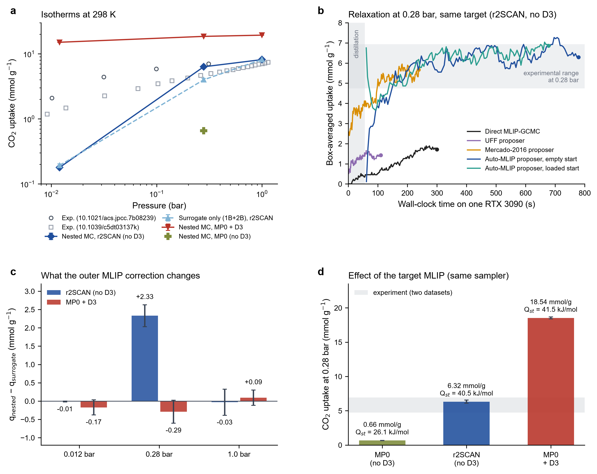
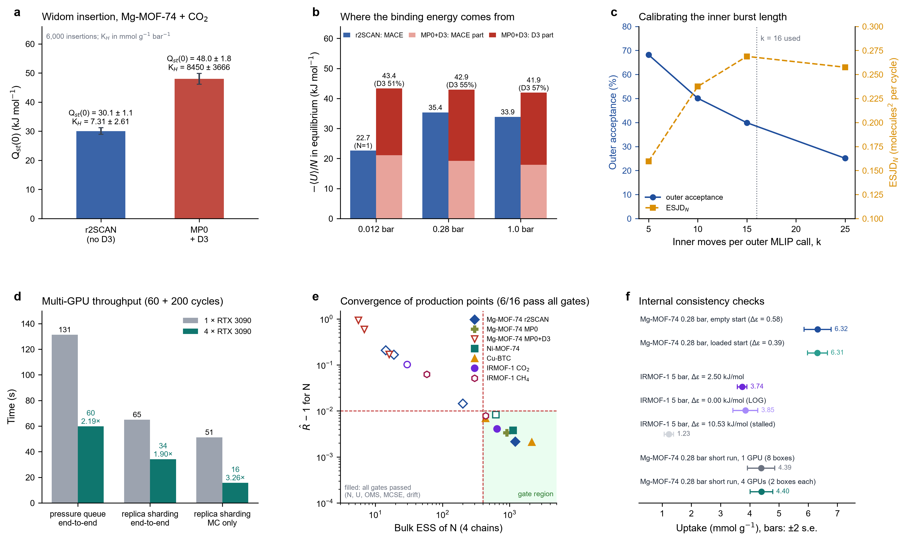

[English](TECHNICAL_REPORT.md) | **简体中文** | [返回 README](../README.zh-CN.md) | [经典与极化基准](CLASSICAL_VALIDATION.zh-CN.md)

# 以在线蒸馏代理势为提议器的机器学习势嵌套蒙特卡洛：刚性 MOF 气体吸附的 GPU 实现与验证

*预印本草稿，2026 年 11 月。全部数值可由 [`docs/results/phase2_phase3_summary.json`](results/phase2_phase3_summary.json) 与 [`scripts/plot_phase4_figures.py`](../scripts/plot_phase4_figures.py) 复现。*

## 摘要

用机器学习原子间势（MLIP）直接驱动巨正则蒙特卡洛（GCMC）计算 MOF 吸附等温线，代价主要花在两处：一是每次插入、删除都要调用一次神经网络；二是在开放金属位点等强吸附区域，随机插入几乎都会被拒绝。常见的折中办法是先用经典力场生成提议、再用 MLIP 重加权（嵌套 MC），但经典力场需要逐个体系拟合，换一种框架或气体就要重做。本文给出一种不依赖手工力场的替代方案：对每个（框架、客体、目标 MLIP）组合，先用 1,200 个单分子构型和 192 个孔内二聚体的 MLIP 能量在线拟合一个单体（1B）三维网格加双体（2B）残差表的代理势，耗时 56–210 s；随后在 GPU 上以该代理势运行每个 CUDA 线程块 128 路 Rosenbluth 试探的构型偏倚 MC，每 16 步内层移动后对候选构型做一次批量 MLIP 评估和精确的 Metropolis 修正。

我们在四种 MOF（Mg-MOF-74、Ni-MOF-74、Cu-BTC、IRMOF-1）和两种客体（CO₂、CH₄）上做了测试。主要结果如下。（1）在 Mg-MOF-74/CO₂、0.28 bar、同一目标势（`mace-matpes-r2scan-0`，不加 D3）下，直接 MLIP-GCMC 运行 300 s 后箱平均吸附量只到 1.76 mmol/g；通用 UFF 提议器的外层接受率仅 2.9%；本方法从空箱和预装载两个方向出发，分别收敛到 6.32 ± 0.23 和 6.31 ± 0.17 mmol/g，效率与针对该体系专门拟合的 Mercado-2016 力场相当。（2）代理势在 7 个生产用缓存上的 1B 留出集 R² 为 0.975–0.990。（3）等温线与实验的吻合程度主要取决于目标 MLIP 本身：r2SCAN 在 Mg-MOF-74 的 1 bar（8.15 vs. 7.02–8.16 mmol/g）和 IRMOF-1 的 5 bar（3.74 vs. 4.70 mmol/g）附近与实验接近，但对 Ni-MOF-74 和 Cu-BTC 低估约一个数量级；MP0+D3 在 Mg-MOF-74 上则高估 2.4 倍，其结合能中有 51%–57% 来自 D3 项。（4）16 个生产压力点中有 6 个通过了全部收敛判据（$\hat{R}<1.01$、bulk ESS ≥ 400 等），未通过的点均在文中逐一列出。（5）在 4 张 RTX 3090 上，副本分片模式的纯 MC 时间加速 3.26 倍，压力队列模式的端到端时间加速 2.19 倍。

---

## 1 引言

基础 MLIP（如 MACE-MP-0 [1,2]、基于 MatPES r2SCAN 数据训练的 MACE 模型 [3]）给 MOF 吸附模拟带来了新可能：不再需要为每种框架单独拟合力场。问题在于 GCMC 需要大量插入/删除尝试，而一次 MACE 评估比一次网格插值贵好几个数量级；在 Mg-MOF-74 这类含开放金属位点的材料里，随机插入的接受率又很低，二者叠加，直接 MLIP-GCMC 很难在可接受的时间内收敛。

嵌套马尔可夫链（nested Markov chain）MC [6,7] 是处理这类问题的标准思路：用一个便宜的参考势生成若干步内层移动，再按目标势对终点构型做一次 Metropolis 检验。只要内层链对参考分布可逆，外层链就精确地采样目标分布，参考势的好坏只影响效率。实践中的难点在于参考势从哪里来。经典力场（UFF [12]、或 Mercado 等人从周期性 DFT 拟合的 Mg-MOF-74 力场 [10]）要么对开放金属位点描述太差，要么只对特定体系有效。

本文的做法是让参考势直接从目标 MLIP 蒸馏出来，并且整个过程不需要人工指定原子类型。这样，参考势和目标势在结构上对齐，外层接受率由二者之间残余的多体差异决定，而不是由一个与目标无关的经典力场决定。下面的三组实验分别回答：这种提议器是否真的比直接 MLIP-GCMC 和经典力场提议器更有效（实验一）；能否不改代码迁移到其他框架和客体（实验二）；物理上和统计上是否自洽、多卡是否有效（实验三）。

## 2 方法

**图 1** 方法示意。**(a)** 代理势构建流程，每个（框架、客体、目标 MLIP）组合执行一次。右侧为生产运行实际使用的 Mg-MOF-74/r2SCAN 缓存：1B 网格中 CO₂ 氧原子通道沿 *c* 轴取最小值后的分布（深色斑点为 Mg²⁺ 开放金属位点附近的吸附位），以及 2B 质心距离残差表。**(b)** 嵌套 MC 的一个外层循环。内层在平移后的代理势上执行 16 步移动，外层对候选构型做一次批量 MLIP 评估，按图中公式接受或回滚。**(c)** 两种多卡并行方式及实测耗时。

### 2.1 体系、目标势与参考数据

框架为刚性结构：Mg-MOF-74 与 Ni-MOF-74 使用 1×1×2 超胞（Mg 体系 324 个原子），Cu-BTC 与 IRMOF-1 使用 1×1×1 单胞（分别为 624 和 424 个原子）。CO₂ 为三位点刚性模型，CH₄ 为五位点全原子刚性模型。温度均为 298 K。目标势有三种：`mace-matpes-r2scan-0`（下文简称 r2SCAN，不加色散校正）、MACE-MP-0 medium（简称 MP0），以及 MP0 加 D3(BJ, PBE) 色散校正 [4,5]（简称 MP0+D3）。

实验等温线全部来自仓库内的 [`data/exp_isotherms/`](../data/exp_isotherms/)（NIST/ISODB 导出，DOI 见参考文献 [15–22]）。与模拟比较时，在 ln *P* 上对实验数据做线性插值，不做外推；某压力点没有实验覆盖时不给对比值。

### 2.2 在线代理势构建

见图 1a。框架原子按"元素 + 近邻元素组成"分为 6–8 个环境类；客体原子按元素与到质心的距离归入对称通道（CO₂ 和 CH₄ 都是 2 个通道）。代理势分两部分：

- **单体项（1B）**：每个（客体通道、框架环境类）对使用一组径向基函数（13 个非均匀分布的高斯中心，1.75–6.15 Å，外加一个 $r^{-12}$ 排斥核），静电部分用满足电中性约束的 Ewald 零空间模态表示有效框架电荷。训练数据是 1,200 个按到框架最小距离分层采样的单分子构型的 MLIP 相互作用能（能量高于 1.5×10⁴ K 的构型剔除，最终保留 1,002–1,171 个）。拟合采用带边界约束的加权最小二乘，并对不同径向区间施加不同强度的 Tikhonov 正则，以避免 CH₄ 这类中心原子被氢原子包围的客体出现通道间共线抵消。拟合结果按通道渲染成单胞三维网格（Mg-MOF-74 为 240×240×64），在 GPU 上做三次插值。
- **双体项（2B）**：从低能单体构型中组合出 192 个孔内二聚体，用 MLIP 计算 $U_2=U_{AB}-U_A-U_B$，拟合经典 LJ 和库仑项的缩放系数，再加一张 128 点的质心距离残差表（2.75 Å 以内置零）。

单体项保留 15% 的构型作为留出集报告 R² 和 MAE。整个构建过程在单张 RTX 3090 上耗时 56–210 s，结果以输入内容的 SHA-256 为键缓存，同一组合的后续压力点直接复用。

### 2.3 GPU 内层构型偏倚 MC

每个模拟箱对应一个 CUDA 线程块（图 1b）。每次外层循环，线程块在代理势上连续执行 *k* = 16 步内层移动：平移（±1.0 Å）、旋转（最大 0.55 rad）、插入、删除，各占 25%。插入时 128 个线程各生成一个随机质心位置与取向，按 Rosenbluth 权重 [8,14] 选择其一；删除时 0 号线程保留被删分子、其余 127 个线程生成试探构型，以保持细致平衡。框架–客体能量来自 1B 网格，客体–客体能量来自缩放后的经典项与 2B 残差表。

### 2.4 外层精确修正与化学势偏置

内层链采样的是平移后的参考分布，其能量为 $U_{\rm ref}(x)+\Delta\varepsilon N$。外层对候选构型 $x'$ 批量计算 $U_{\rm MLIP}(x')$，以概率

$$\alpha=\min\left\{1,\ \exp\!\left(-\beta\left[\Delta U_{\rm MLIP}-\Delta U_{\rm ref}-\Delta\varepsilon\,\Delta N\right]\right)\right\}$$

接受（Δ 表示候选与当前构型之差）；拒绝时在显存中恢复原构型。这一接受规则保证外层链精确采样目标 MLIP 的巨正则分布，与 Δε 的取值无关；Δε 的作用只是把参考势的平均单分子能量对齐到目标势，使内层链的装载量与目标接近，从而提高接受率。Δε 在每个压力点开始前确定一次：先在初始构型上取各箱 $(U_{\rm MLIP}-U_{\rm ref})/N$ 的中位数（箱数不少于 3 时使用中位数，以免单个离群箱带偏），再用 40 个循环的预跑结果修正。

### 2.5 收敛判据与误差估计

每个压力点运行 4 个独立箱（即 4 条链）。生产期结束后计算分子数 *N*、总能量 *U* 和开放金属位点占据数的 rank-normalized split/folded $\hat{R}$ 与 bulk/tail ESS [9]。判定通过需同时满足：$\hat{R}<1.01$、bulk 与 tail ESS 均 ≥ 400（即每条链 100）、吸附量 MCSE ≤ max(0.05 mmol/g, 1%)、各链前后半段的漂移在允许范围内、生产期外层接受率不过低。吸附量误差取各箱均值的标准误差；吸附热给出两种估计：涨落公式 $Q_{\rm st}$ 与平均摩尔结合能。需要说明的是，对未通过判据的点，标准误差是基于偏小的 ESS 计算的，真实不确定度很可能更大。

### 2.6 计算细节

所有 MLIP 计算使用 float32 和 GPU 批处理。生产运行在一台 8 卡 RTX 3090（`sm_86`）服务器上进行，仅使用 0–3 号卡。单个压力点的平衡期为 200–1,200 个外层循环，生产期为 1,200–16,500 个外层循环（具体值见表 1–3）。部分高压点（IRMOF-1 5 bar）手动设定 Δε，原因见 3.3 节。

---

## 3 结果

### 3.1 实验一：Mg-MOF-74 + CO₂，提议器效率与目标势的影响

**目的。** Mg-MOF-74 的 Mg²⁺ 开放金属位点对 CO₂ 结合很强，等温线在 0.01–0.3 bar 间陡峭上升，是检验 GCMC 采样效率最苛刻的场景之一。本实验在同一个目标势下比较五种采样方式，判断代理势提议器的实际收益；再在同一采样器下更换目标势，看结果对 MLIP 的敏感程度。

**设置。** 目标势固定为 r2SCAN（不加 D3），压力 0.012、0.28、1.0 bar。0.28 bar 处比较：直接 MLIP-GCMC（不使用任何参考势，运行 300 s）、以 UFF 为提议器的嵌套 MC、以 Mercado-2016 力场为提议器的嵌套 MC、以本文代理势为提议器的嵌套 MC（空箱起始与预装载起始各一组，平衡 1,200 循环、生产 4,800 循环）。另外运行"仅代理势"的 GCMC（不做外层修正）以及以 MP0、MP0+D3 为目标势的嵌套 MC。

**图 2** Mg-MOF-74 + CO₂，298 K。**(a)** 吸附等温线（双对数坐标）。空心符号为两组实验数据；实线为嵌套 MC 结果，虚线为仅代理势结果；误差棒为 ±1 标准误差。**(b)** 0.28 bar 下箱平均吸附量随单卡墙钟时间的变化，五种采样方式使用同一目标势。代理势提议器的曲线向右平移了 56 s 的蒸馏时间（灰色竖带）。横向灰带为两组实验数据在 0.28 bar 的插值范围。时间轴按每循环耗时恒定换算。**(c)** 嵌套 MC 与仅代理势结果之差，误差棒为二者标准误差的平方和开方。**(d)** 同一采样器、三种目标势在 0.28 bar 的吸附量，标注值为涨落法 $Q_{\rm st}$。

**图片分析。**

图 2b 最直接地回答了效率问题。直接 MLIP-GCMC（黑线）在 300 s 内调用了 16,269 次 MLIP，箱平均吸附量从 0 缓慢爬升到约 1.8 mmol/g，离实验区间还很远。UFF 提议器（紫线）对 Mg²⁺ 位点的描述与 r2SCAN 差别很大，Δε 校准到 3.48 kJ/mol，外层接受率只有 2.9%，110 s 后停在 1.4 mmol/g 左右。Mercado-2016 力场是专门针对 Mg-MOF-74/CO₂ 从 DFT 拟合的，作为提议器表现明显更好：约 120 s 就进入实验区间，外层接受率 16.4%，Δε 为 5.68 kJ/mol；不过该运行只做了 2,200 个生产循环，期间吸附量仍在上升（链间漂移 1.75 mmol/g），时间平均值 4.87 mmol/g 不能视为平衡值。代理势提议器在扣除 56 s 蒸馏时间后，空箱起始的链（蓝线）约 100 s 内进入实验区间，预装载起始的链（青线）从约 7 mmol/g 先下降再回升，两条链在约 300 s 后进入同一平台，生产期平均值分别为 6.32 ± 0.23 和 6.31 ± 0.17 mmol/g。

就松弛速度而言，本方法与 Mercado 力场大致相当（单位时间内分子数改变次数分别为 2.51 s⁻¹ 和 2.89 s⁻¹，外层接受率分别为 30.8% 和 16.4%）。差别在于：Mercado 力场需要事先为这个特定体系做 DFT 拟合，换框架就不能用；本方法的参考势是从目标 MLIP 自动得到的，同样的流程在实验二中直接用于其他三种框架。

图 2a 与图 2c 说明外层 MLIP 修正在什么条件下起作用。在 0.012 bar 和 1.0 bar，嵌套 MC 与仅代理势的结果几乎一致（差值 −0.01 和 −0.03 mmol/g，均在误差内）；只有在等温线最陡的 0.28 bar，嵌套 MC 比仅代理势高出 2.33 ± 0.30 mmol/g。这个差值包含两部分：代理势的拟合误差（该缓存 1B 留出集 MAE 为 2.44 kJ/mol，2B 为 1.92 kJ/mol），以及代理势未能表达的三体及以上相互作用。现有数据无法把二者分开，但可以确定的是，单靠 1B+2B 代理势在陡峭区会低估约 37%，外层修正是必要的。对 MP0+D3，三个压力点的差值都在 ±0.3 mmol/g 以内，说明在该目标势下代理势本身已经相当接近。

图 2d 显示，采样器不变、只换目标势，0.28 bar 的吸附量从 0.66 mmol/g（MP0，不加色散）变到 6.32 mmol/g（r2SCAN）再到 18.54 mmol/g（MP0+D3），跨度近 30 倍。MP0 不加色散时明显结合不足；加上 D3 后又严重过结合，0.012 bar 时吸附量已达 15.06 mmol/g，接近孔道饱和。实验三会对这一点做能量分解。

**结果。** 表 1 汇总了实验一的全部数值。

**表 1** Mg-MOF-74 + CO₂，298 K。*q* 为吸附量（±1 标准误差），$Q_{\rm st}$ 为涨落法/平均摩尔结合能两种估计；"通过"指 2.5 节全部判据。

| 目标势 / 采样方式 | *P* (bar) | 平衡+生产循环 | *q* (mmol/g) | $Q_{\rm st}$ (kJ/mol) | Δε (kJ/mol) | 外层接受率 | $\hat{R}$ (N) | bulk ESS | 状态 |
| :--- | :---: | :---: | :---: | :---: | :---: | :---: | :---: | :---: | :---: |
| r2SCAN，直接 MLIP-GCMC | 0.28 | 300 s | 1.07 ± 0.15（终值约 1.76） | 33.4 / – | – | 单次插入 3.6% | 1.995 | 5 | 未通过 |
| r2SCAN，UFF 提议器 | 0.28 | 250 + 1,200 | 1.36 ± 0.12 | 30.5 / 32.4 | 3.48 | 2.9% | 1.490 | 8 | 未通过 |
| r2SCAN，Mercado-2016 提议器 | 0.28 | 250 + 2,200 | 4.87 ± 0.16 | 37.8 / 36.4 | 5.68 | 16.4% | 1.386 | 9 | 未通过 |
| r2SCAN，代理势提议器，空箱起始 | 0.012 | 250 + 5,200 | 0.179 ± 0.004 | 34.6 / 34.5 | −0.51 | 72.8% | 1.0021 | 1,213 | 通过 |
| r2SCAN，代理势提议器，空箱起始 | 0.28 | 1,200 + 4,800 | 6.32 ± 0.23 | 40.5 / 37.1 | 0.58 | 30.8% | 1.209 | 14 | 未通过 |
| r2SCAN，代理势提议器，预装载起始 | 0.28 | 1,200 + 4,800 | 6.31 ± 0.17 | 39.5 / 37.0 | 0.39 | 28.7% | 1.167 | 19 | 未通过 |
| r2SCAN，代理势提议器 | 1.0 | 250 + 15,000 | 8.15 ± 0.03 | 33.1 / 37.1 | 0.03 | 35.1% | 1.0145 | 200 | 未通过 |
| r2SCAN，仅代理势 | 0.012 / 0.28 / 1.0 | 250 + 2,200 | 0.193 / 3.99 / 8.18 | 35.5 / 36.1 / 32.5 | – | – | 1.005 / 1.116 / 1.243 | 1,012 / 32 / 13 | 通过 / 未 / 未 |
| MP0，代理势提议器 | 0.28 | 200 + 4,800 | 0.659 ± 0.010 | 26.1 / 26.5 | 1.05 | 66.7% | 1.0033 | 911 | 通过 |
| MP0+D3，代理势提议器 | 0.012 | 200 + 5,000 | 15.06 ± 0.12 | 41.1 / 45.9 | 3.77 | 38.2% | 1.169 | 16 | 未通过 |
| MP0+D3，代理势提议器 | 0.28 | 200 + 1,800 | 18.54 ± 0.14 | 41.5 / 44.9 | 3.23 | 72.7% | 1.590 | 7 | 未通过 |
| MP0+D3，代理势提议器 | 1.0 | 200 + 1,800 | 19.36 ± 0.15 | 43.5 / 44.1 | 2.83 | 75.2% | 1.938 | 6 | 未通过 |
| 实验（两组数据插值） | 0.012 / 0.28 / 1.0 | – | 1.37–2.45 / 4.74–6.94 / 7.02–8.16 | – | – | – | – | – | – |

与实验相比，r2SCAN 在 0.28 bar 落在两组实验之间，1.0 bar 处于实验范围上沿；但在 0.012 bar 低估 8–14 倍。也就是说，r2SCAN 预测的等温线在低压段比实验平缓得多、在中压段又上升得更陡。1 bar 处的吻合部分来自这种形状上的补偿，不应被解读为该模型准确描述了 Mg²⁺–CO₂ 结合。

关于收敛性：0.28 bar 的两条链均值几乎相同（差 0.008 mmol/g），说明没有出现明显的初值依赖或亚稳陷阱；但两者的 $\hat{R}$ 都在 1.17–1.21，bulk ESS 只有 14–19。该压力点处于等温线最陡的位置，*N* 的涨落大（方差约 25），自相关时间达数百个循环，4,800 个生产循环不足以满足判据。本文如实将其标为未通过，并认为其真实不确定度大于表中给出的标准误差。

---

### 3.2 实验二：不同框架与客体上的迁移

**目的。** 检验同一套流程能否不修改代码、不提供任何力场参数，直接用于拓扑、金属和孔径都不同的框架以及不同客体；同时把模拟与实验放在一起比较，区分采样问题和目标势问题。

**设置。** Ni-MOF-74（与 Mg-MOF-74 同构，金属换为 Ni²⁺）、Cu-BTC（立方笼状、铜桨轮位点）、IRMOF-1（无开放金属位点的大孔框架）均以 r2SCAN 为目标势吸附 CO₂。IRMOF-1 + CH₄ 以 MP0+D3 为目标势，原因见下文。所有运行使用与实验一相同的参数（*k* = 16，*K* = 128，4 箱）。

**图 3** 不同框架与客体，298 K。**(a)–(c)** Ni-MOF-74、Cu-BTC、IRMOF-1 的 CO₂ 等温线，目标势为 r2SCAN（不加 D3）；空心符号为实验。**(d)** IRMOF-1 的 CH₄ 等温线，目标势为 MP0+D3；插图为 4 个孔内单分子 CH₄ 构型上三种 MACE 模型直接给出的相互作用能（横轴为构型到框架原子的最小距离）。**(e)** CO₂ 模拟值与实验插值的对比（双对数坐标），实线为 *y* = *x*，虚线和点线分别为 2 倍和 10 倍偏差；横向误差棒为两组实验数据的范围；实心符号表示该点通过全部收敛判据。**(f)** 生产运行实际使用的 7 个代理势缓存在 15% 留出集上的误差，标注为 1B 的 R² 与蒸馏耗时。

**图片分析。**

图 3f 是迁移性的基础。7 个缓存覆盖 4 种框架、2 种客体、3 种目标势，1B 留出集 R² 在 0.975–0.990 之间，MAE 1.27–2.44 kJ/mol；2B 残差表的 MAE 为 0.10–1.92 kJ/mol。需要指出，2B 的 R² 普遍很低（−0.68 至 0.76），这是因为孔内二聚体相互作用本身只有几 kJ/mol，方差小，R² 对此不敏感；MAE 更能反映 2B 项的实际误差。各缓存的构建耗时 56–210 s，主要花在网格渲染上（Cu-BTC 和 IRMOF-1 的 240³ 网格最慢）。

图 3a–c 中，采样本身在三种框架上都正常工作：Cu-BTC 的 0.15 bar 和 1.0 bar、Ni-MOF-74 的 0.28 bar、IRMOF-1 的 1.0 bar 都通过了全部判据，Ni-MOF-74 1.0 bar 仅因能量 $\hat{R}$ = 1.0118 略超阈值而未通过。但与实验相比差距很大：Ni-MOF-74 在 1 bar 模拟值为 0.83 mmol/g，实验为 7.62 mmol/g；Cu-BTC 在 1 bar 为 0.69 mmol/g，实验为 3.97–4.54 mmol/g。对应的吸附热只有 25 kJ/mol（Ni）和 18 kJ/mol（Cu）。由于这些点已经收敛，偏差不能归于采样不足，而应归于 r2SCAN 对 Ni²⁺、Cu²⁺ 位点与 CO₂ 结合的描述，以及该目标势不含色散校正。IRMOF-1 没有开放金属位点，吸附以较弱的物理作用为主，r2SCAN 在 5 bar 给出 3.74 mmol/g，比实验（4.70 mmol/g）低约 20%，偏差小得多。

图 3e 把上述比较汇总在一张图上。Mg-MOF-74 的 0.28 和 1 bar、IRMOF-1 的 5 bar 落在 2 倍带内；Cu-BTC、Ni-MOF-74 的大部分点以及 Mg-MOF-74 的 0.012 bar 落在 10 倍带附近或之外。偏差的方向一致——全部低估——且在开放过渡金属位点上最严重。

图 3d 记录了 CH₄ 的一段排查过程。最初对 IRMOF-1 + CH₄ 使用 r2SCAN 时，模拟在 1 bar 迅速填满到每箱 128 个分子的上限，Δε 校准到 +21 kJ/mol。我们一度怀疑是代理势拟合出了问题，于是修正了 CH₄ 的通道共线问题（提交 `df9bff6`），但结果不变。随后在 ASE 中直接用 `MACECalculator` 计算 4 个孔内单分子构型，r2SCAN 给出 −26.5 至 −35.5 kJ/mol 的相互作用能（本文的批处理实现给出的值与之相差不超过 0.7 kJ/mol），在随机构型中最深达 −60.0 kJ/mol，而代理势网格在同一位置给出 −58.6 kJ/mol。作为对照，MP0 不加色散时这些构型的相互作用能在 −2.0 至 +2.5 kJ/mol 之间，MP0+D3 为 −1.7 至 −10.1 kJ/mol。一个不含色散校正的模型对非极性 CH₄ 给出比 MP0+D3 强 3–4 倍的结合，在物理上很难成立，我们认为这是 r2SCAN 模型在该类构型上的外推失效。代理势如实复现了这一行为，问题出在目标势而非蒸馏。因此 CH₄ 的生产运行改用 MP0+D3：1 bar 为 3.53 ± 0.02 mmol/g（仅能量 bulk ESS = 394.5，略低于 400），5 bar 为 7.36 ± 0.08 mmol/g（未收敛）。仓库中没有 IRMOF-1 + CH₄ 的实验等温线，本文不对其做实验对比。

**结果。** 表 2 列出实验二的全部压力点。

**表 2** 不同框架与客体，298 K。实验值为 ln *P* 插值；"–"表示该压力点没有实验覆盖。

| 体系 / 目标势 | *P* (bar) | 平衡+生产循环 | *q* (mmol/g) | 实验 (mmol/g) | $Q_{\rm st}$ (kJ/mol) | 外层接受率 | $\hat{R}$ (N) | bulk / tail ESS | 状态 |
| :--- | :---: | :---: | :---: | :---: | :---: | :---: | :---: | :---: | :--- |
| Ni-MOF-74 / r2SCAN | 0.012 | 250 + 2,200 | 0.009 ± 0.002 | 0.50 | 24.4 / 24.5 | 96.0% | 1.0073 | 649 / 649 | 稀薄区，样本不足 |
| Ni-MOF-74 / r2SCAN | 0.28 | 250 + 5,600 | 0.200 ± 0.004 | 4.68–5.50 | 25.2 / 25.1 | 65.4% | 1.0038 | 1,118 / 814 | 通过 |
| Ni-MOF-74 / r2SCAN | 1.0 | 250 + 16,500 | 0.833 ± 0.014 | 7.62 | 25.5 / 24.9 | 41.3% | 1.0083 | 620 / 994 | 未通过（U 的 $\hat{R}$ = 1.0118） |
| Cu-BTC / r2SCAN | 0.15 | 250 + 4,600 | 0.082 ± 0.002 | 0.30–0.90 | 17.6 / 17.4 | 58.2% | 1.0021 | 2,138 / 986 | 通过 |
| Cu-BTC / r2SCAN | 1.0 | 250 + 13,000 | 0.689 ± 0.015 | 3.97–4.54 | 18.1 / 18.0 | 18.2% | 1.0069 | 436 / 751 | 通过 |
| IRMOF-1 / r2SCAN | 1.0 | 200 + 9,600 | 0.824 ± 0.018 | – | 15.8 / 15.7 | 29.0% | 1.0041 | 645 / 647 | 通过 |
| IRMOF-1 / r2SCAN | 5.0 | 600 + 6,000 | 3.74 ± 0.08 | 4.70 | 16.2 / 16.5 | 4.7% | 1.103 | 30 / 112 | 未通过（Δε 手动设为 2.5） |
| IRMOF-1 + CH₄ / MP0+D3 | 1.0 | 250 + 3,200 | 3.53 ± 0.02 | – | 20.1 / 22.7 | 39.8% | 1.0079 | 440 / 557 | 未通过（U 的 ESS = 394.5） |
| IRMOF-1 + CH₄ / MP0+D3 | 5.0 | 250 + 3,200 | 7.36 ± 0.08 | – | 17.1 / 20.2 | 29.1% | 1.062 | 58 / 139 | 未通过 |

**表 3** 生产运行使用的代理势缓存（15% 留出集）。

| 缓存 | 体系 / 目标势 | 环境类 | 保留的 1B 构型 | 1B R² | 1B MAE / 近壁 MAE (kJ/mol) | 2B MAE (kJ/mol) | 耗时 (s) |
| :--- | :--- | :---: | :---: | :---: | :---: | :---: | :---: |
| `5e543d05` | Mg-MOF-74, CO₂ / r2SCAN | 8 | 1,026 | 0.975 | 2.44 / 3.85 | 1.92 | 56 |
| `e523efe1` | Mg-MOF-74, CO₂ / MP0+D3 | 8 | 1,044 | 0.985 | 2.00 / 2.62 | 1.17 | 63 |
| `269c6d37` | Mg-MOF-74, CO₂ / MP0 | 8 | 1,019 | 0.986 | 1.57 / 3.13 | 0.78 | 127 |
| `c829b9bb` | Ni-MOF-74, CO₂ / r2SCAN | 8 | 1,002 | 0.987 | 2.16 / 3.01 | 1.65 | 57 |
| `9be1cad1` | Cu-BTC, CO₂ / r2SCAN | 6 | 1,037 | 0.987 | 2.27 / 3.79 | 0.81 | 210 |
| `0ca4d69d` | IRMOF-1, CO₂ / r2SCAN | 7 | 1,057 | 0.990 | 2.13 / 3.13 | 0.56 | 144 |
| `5134add5` | IRMOF-1, CH₄ / MP0+D3 | 7 | 1,171 | 0.987 | 1.27 / 2.05 | 0.10 | 151 |
| `7cfa1abf`（仅诊断） | IRMOF-1, CH₄ / r2SCAN | 7 | 1,180 | 0.912 | 3.16 / 4.00 | 1.14 | 147 |

---

### 3.3 实验三：物理一致性、参数选择、多卡效率与收敛审计

**目的。** 实验一、二给出的是吸附量。这一组实验回答四个更细的问题：MP0+D3 为什么会严重过结合；*k* = 16 和 1×1×2 超胞的选择有没有依据；多卡并行实际快了多少；以及在所有生产点上，统计判据的通过情况和方法本身的内部一致性如何。

**图 4** **(a)** Mg-MOF-74 + CO₂ 的 Widom 插入结果（6,000 次插入）：零覆盖度吸附热 $Q_{\rm st}(0)$ 与 Henry 常数 $K_H$（mmol g⁻¹ bar⁻¹）。**(b)** 各压力点平衡构型上每个 CO₂ 分子的平均相互作用能，MP0+D3 拆分为 MACE 与 D3 两部分；r2SCAN 在 0.012 bar 只有一个非空构型（*N* = 1），统计意义有限。**(c)** 内层步数 *k* 的扫描（0.28 bar，短程测试）：外层接受率与每循环 *N* 的期望平方跳跃距离 ESJD$_N$。**(d)** 1 张与 4 张 RTX 3090 的耗时对比（每个压力点 60 + 200 循环，Δε 固定为 0.5 kJ/mol）。**(e)** 16 个生产压力点的 bulk ESS 与 $\hat{R}-1$；绿色区域为判据区，实心符号为通过全部判据的点。**(f)** 内部一致性检查，误差棒为 ±2 标准误差。

**图片分析。**

*能量来源（图 4a、b）。* Widom 插入不依赖 GCMC 链，是一个独立的检查。r2SCAN 的 $Q_{\rm st}(0)$ 为 30.1 ± 1.1 kJ/mol，$K_H$ 为 7.3 ± 2.6；MP0+D3 分别为 48.0 ± 1.8 kJ/mol 和 8,450 ± 3,670，$K_H$ 高出三个数量级。这与 0.012 bar 下两种目标势给出 0.18 和 15.1 mmol/g 的巨大差异一致。把 MP0+D3 平衡构型上的相互作用能拆开，三个压力点的总结合能为 43.4、42.9、41.9 kJ/mol，其中 D3 贡献 22.2、23.7、24.0 kJ/mol，占 51%–57%；MACE 部分只有 17.9–21.1 kJ/mol，比 r2SCAN 的 33.9–35.4 kJ/mol 还弱。也就是说，MP0 本体对 Mg²⁺–CO₂ 结合偏弱，D3 又给出了过大的补偿，两者叠加后结合能比 r2SCAN 高约 8 kJ/mol。r2SCAN 的平均结合能从 0.012 bar 的 22.7 kJ/mol 增至 0.28 bar 的 35.4 kJ/mol，反映了金属位点被占据后 CO₂–CO₂ 之间的协同作用，但 0.012 bar 的值只来自单个分子，不宜过度解读。

*参数依据（图 4c，有限尺寸）。* *k* 从 5 增加到 25，外层接受率从 68.2% 单调降到 25.1%，ESJD$_N$ 在 *k* = 15 附近最高（0.269）。*k* = 16 在两者间取得平衡，此时外层接受率在 30%–40%。单位时间的 *N* 有效样本数在 *k* = 25 时略高（1.03 s⁻¹ vs. 0.73 s⁻¹），但这些扫描运行很短（ESS 只有 17–30），差别不显著，我们没有据此调整。有限尺寸方面，把 1×1×2 超胞的平衡构型周期性复制到 1×1×4 后重新计算 MLIP 相互作用能，三个压力点每分子能量差的最大绝对值分别为 8.6×10⁻⁴、3.3×10⁻⁵、3.4×10⁻⁵ kJ/mol，说明 1×1×2 超胞（垂直宽度最小 13.88 Å）不引入可察觉的周期镜像误差。

*多卡效率（图 4d）。* 压力队列模式把 4 个压力点分到 4 张卡上，端到端时间从 131 s 降到 60 s（2.19 倍）。副本分片模式把同一压力点的 8 个箱分成每卡 2 个，纯 MC 时间从 51.1 s 降到 15.7 s（3.26 倍，并行效率 82%），但端到端只有 1.90 倍，因为每个子进程都要单独加载一次 MACE 模型（约 14–18 s）。这组测试每点只有 260 个循环，加载开销占比很大；生产运行越长，端到端加速比越接近纯 MC 的数值。两种模式下 1 卡与 4 卡的吸附量一致（副本模式 4.39 ± 0.24 vs. 4.40 ± 0.19 mmol/g），但这些短程运行本身没有收敛，只用于衡量吞吐。

*收敛审计（图 4e）。* 16 个生产点中 6 个通过全部判据。通过的点集中在中低装载、*N* 涨落较小的情形（Mg-MOF-74 0.012 bar、MP0 0.28 bar、Ni-MOF-74 0.28 bar、Cu-BTC 两个压力点、IRMOF-1 CO₂ 1 bar）。另外 3 个点（Ni-MOF-74 1 bar、IRMOF-1 CH₄ 1 bar、Mg-MOF-74 r2SCAN 1 bar）的 *N* 已基本满足要求，分别因能量 $\hat{R}$、能量 ESS 或 *N* 的 ESS（200）不足而未通过。其余未通过的点有三类：Mg-MOF-74 0.28 bar 的陡峭区；MP0+D3 下孔道接近饱和、插入删除很少被接受的状态（$\hat{R}$ 达 1.6–1.9）；以及 IRMOF-1 5 bar 外层接受率只有 4.7% 的高装载状态。

*内部一致性（图 4f）。* 有三组对照可以检验"结果与 Δε 无关"这一理论性质。第一，Mg-MOF-74 0.28 bar 的空箱起始与预装载起始两条链 Δε 分别为 0.58 和 0.39 kJ/mol，结果为 6.32 和 6.31 mmol/g。第二，IRMOF-1 5 bar 在 Δε = 0（运行日志记录，3.85 ± 0.21 mmol/g；该 JSON 后被覆盖）与 Δε = 2.5 kJ/mol（3.74 ± 0.08 mmol/g）下的结果在误差内一致。第三，同一点若使用自动校准得到的 Δε = 10.53 kJ/mol（第二阶段校准被单个高装载箱带偏），外层接受率降到 1.9%，2,000 个循环后链仍停在 1.23 mmol/g。这说明 Δε 不改变采样的目标分布，但取值不当会让链实际上无法移动；改用中位数后单箱离群的问题有所缓解，但高装载下的 Δε 校准仍不够稳健，这也是我们对该点手动设定 Δε 的原因。

**结果。**

**表 4** Widom 插入与能量分解（Mg-MOF-74 + CO₂）。

| 目标势 | $K_H$ (mmol g⁻¹ bar⁻¹) | $Q_{\rm st}(0)$ (kJ/mol) | $\mu_{\rm ex}^0$ (kJ/mol) | −⟨U⟩/N，0.012 / 0.28 / 1.0 bar (kJ/mol) | 其中 D3 (kJ/mol) |
| :--- | :---: | :---: | :---: | :---: | :---: |
| r2SCAN | 7.31 ± 2.61 | 30.05 ± 1.13 | −12.57 | 22.7（N = 1）/ 35.4 / 33.9 | – |
| MP0+D3 | 8,450 ± 3,666 | 47.98 ± 1.84 | −30.05 | 43.4 / 42.9 / 41.9 | 22.2 / 23.7 / 24.0 |

**表 5** 1 张与 4 张 RTX 3090（Mg-MOF-74 + CO₂，r2SCAN，60 + 200 循环）。

| 模式 | 负载 | 1 卡 (s) | 4 卡 (s) | 加速比 |
| :--- | :--- | :---: | :---: | :---: |
| 压力队列，端到端 | 4 个压力点 × 4 箱 | 131.2 | 59.8 | 2.19 |
| 副本分片，端到端 | 1 个压力点 × 8 箱 | 64.9 | 34.1 | 1.90 |
| 副本分片，仅 MC | 同上 | 51.1 | 15.7 | 3.26 |

---

## 4 讨论

**这套方法解决了什么。** 它把"为嵌套 MC 找一个好的参考势"这一步自动化了。实验一表明，从目标 MLIP 蒸馏出的参考势，在 Mg-MOF-74 上的提议效率与专门拟合的 DFT 力场相当，而远好于通用力场和直接 MLIP 采样；实验二表明，同一流程不改参数就能用于其他框架和客体，代理势精度保持在 R² ≈ 0.98–0.99。外层 Metropolis 修正保证了结果对应目标 MLIP 的分布，图 4f 的对照在可检验的范围内支持这一点。

**还没有解决什么。** 第一，等温线陡峭段和高装载段的统计收敛仍然很慢。Mg-MOF-74 0.28 bar 跑了 6,000 个循环，$\hat{R}$ 仍为 1.2；IRMOF-1 5 bar 外层接受率不到 5%。这类状态下，*k* = 16 的内层步长和 4 条链可能都不够，需要更长的运行、更多的链，或者引入并行回火等增强采样手段。第二，Δε 在高装载下的自动校准不稳定，目前对个别点采用了手动设定。第三，代理势与目标势在陡峭区仍有约 2 mmol/g 的差距（图 2c），提高 1B 拟合精度或引入三体项可能提升该区域的接受率。

**与实验的差距主要来自目标势。** 在已经收敛的点上，模拟与实验的偏差最大接近一个数量级，而且方向一致（低估），在 Ni²⁺、Cu²⁺ 开放金属位点上最严重；换用 MP0+D3 又在 Mg-MOF-74 上变成 2.4 倍高估。这些偏差都超出了采样误差的范围。由于本方法对目标势的物理没有任何近似，它可以作为评估基础 MLIP 吸附热力学性能的工具：同一采样器下的差异就是模型之间的差异。若要直接预测实验等温线，需要使用针对 MOF–气体相互作用做过验证或微调的 MLIP。

## 5 结论

我们实现了一种以在线蒸馏代理势为提议器、在 GPU 上运行的 MLIP 嵌套 GCMC 方法。代理势的构建无需人工力场参数，单次耗时约 1–3.5 分钟；内层 128 路 Rosenbluth 试探与外层批量 MLIP 修正相结合，在 Mg-MOF-74 上达到了专门拟合力场的提议效率，并能直接迁移到其他框架和客体。在本文测试的 16 个生产压力点中，6 个通过全部收敛判据，其余均已列明原因。与实验的比较表明，当前基础 MLIP 在开放金属位点上的结合能误差是决定吸附量预测精度的主要因素。

## 数据与代码可得性

源代码、实验等温线、原始结果汇总与绘图脚本均在本仓库中：[`scripts/run_mlip_gcmc.py`](../scripts/run_mlip_gcmc.py)、[`scripts/mlip_distill.py`](../scripts/mlip_distill.py)、[`src/proposer_dll.cu`](../src/proposer_dll.cu)、[`docs/results/phase2_phase3_summary.json`](results/phase2_phase3_summary.json)、[`docs/results/arch_inputs_mgmof74_r2scan.npz`](results/arch_inputs_mgmof74_r2scan.npz)、[`scripts/plot_phase4_figures.py`](../scripts/plot_phase4_figures.py)。*k* 扫描与 IRMOF-1 5 bar 在 Δε = 0 下的结果只保存在运行日志中，已在汇总文件中注明。

## 参考文献

1. I. Batatia, D. P. Kovács, G. N. C. Simm, C. Ortner, G. Csányi. MACE: Higher order equivariant message passing neural networks for fast and accurate force fields. *NeurIPS* 2022.
2. I. Batatia et al. A foundation model for atomistic materials chemistry. arXiv:2401.00096 (2023).
3. A. D. Kaplan et al. A foundational potential energy surface dataset for materials (MatPES). arXiv:2503.04070 (2025).
4. S. Grimme, J. Antony, S. Ehrlich, H. Krieg. *J. Chem. Phys.* **132**, 154104 (2010).
5. S. Grimme, S. Ehrlich, L. Goerigk. *J. Comput. Chem.* **32**, 1456 (2011).
6. R. Iftimie, D. Salahub, D. Wei, J. Schofield. *J. Chem. Phys.* **113**, 4852 (2000).
7. L. D. Gelb. *J. Chem. Phys.* **118**, 7747 (2003).
8. D. Frenkel, B. Smit. *Understanding Molecular Simulation*, 2nd ed. Academic Press (2002).
9. A. Vehtari, A. Gelman, D. Simpson, B. Carpenter, P.-C. Bürkner. *Bayesian Anal.* **16**, 667 (2021).
10. R. Mercado et al. *J. Phys. Chem. C* **120**, 12590 (2016).
11. D. Dubbeldam, S. Calero, D. E. Ellis, R. Q. Snurr. *Mol. Simul.* **42**, 81 (2016).
12. A. K. Rappé, C. J. Casewit, K. S. Colwell, W. A. Goddard III, W. M. Skiff. *J. Am. Chem. Soc.* **114**, 10024 (1992).
13. A. K. Rappé, W. A. Goddard III. *J. Phys. Chem.* **95**, 3358 (1991).
14. M. N. Rosenbluth, A. W. Rosenbluth. *J. Chem. Phys.* **23**, 356 (1955).
15. Mg-MOF-74 CO₂ 等温线，doi:10.1021/acs.jpcc.7b08239。
16. Mg-MOF-74 CO₂ 等温线，doi:10.1039/c5dt03137k。
17. Ni-MOF-74 CO₂ 等温线，doi:10.1021/acs.jpcc.5b03700。
18. Ni-DOBDC CO₂ 等温线，doi:10.1080/15422119.2014.884507。
19. Cu-BTC CO₂ 等温线，doi:10.1002/aic.15837。
20. Cu-BTC CO₂ 等温线，doi:10.1007/s10450-013-9527-2。
21. IRMOF-1 CO₂ 等温线，doi:10.1021/acs.jctc.5b00093。
22. IRMOF-1 CO₂ 等温线，doi:10.1038/srep12045。
